# agent-warehouse

[](https://github.com/kawadeomkar/agent-warehouse/actions/workflows/ci.yml)
[](https://kawadeomkar.github.io/agent-warehouse/)
[](pyproject.toml)
[](docs/getting-started/requirements.md)
[](LICENSE)

Ansible that turns a Proxmox VE host into [Claude Code](https://code.claude.com/docs) development VMs.
One command, `just deploy alpha`, where `alpha` is the name you give the VM - any name you like, as a host
name would be:

1. **Provision** – creates a VM named `alpha` on the Proxmox host from an Ubuntu 24.04 cloud image, with
   your SSH key; your DHCP server gives it an address, and the guest agent reports it back.
2. **Configure** – installs a baseline, developer tooling (Node.js, Docker, GitHub CLI, uv, and optionally Rust),
   Claude Code and Tailscale, and clones every repository of your GitHub account (or the ones you list)
   into `~/projects`. Then it signs the VM in: to Claude, which starts Remote Control so the session is on
   your phone too; `gh` to GitHub, ready to push; and Tailscale, to reach the VM from anywhere. Each
   sign-in is a page in your browser.
3. **Your editor** – opens the VM: VS Code by default, with a terminal running Claude, or
   [Zed](docs/guides/zed.md), where Claude is a task of the window.

Every step is idempotent and everything specific to
your environment (the Proxmox address, tokens, etc.), lives as git-ignored files, with secrets stored in Ansible vault.



Then `just status` shows the whole fleet on one screen: each VM's size and the last day of its CPU, the
storage, each VM's addresses on the LAN and the tailnet, its sign-ins and Remote Control, its system and
updates, and the work in its checkouts that is not pushed yet. What needs you comes last, ranked, each with
the command that fixes it. It only reads, and changes nothing.



And `just settings claude_code` lists every variable of a role, here `claude_code`, with its value and the
file that set it.
`just settings <name> --value <value>` sets one in `local.yml`, held to its type; a secret is only said to
be set or not, and changes with `just vault`.



`just mcp` lets a Claude Code session in any of your projects ask the same of the fleet, through an MCP server
([Agents in other projects](docs/guides/agents.md)).

**Documentation:** [`docs/`](docs/README.md) covers every feature, setting and design decision, and
reads as a site with search at <https://kawadeomkar.github.io/agent-warehouse/>. This page gets you to
a first deploy.

## What you need

- **A Proxmox VE 9.x host** that already runs VMs: `apt` working, a bridge with a DHCP server on
  it, and a storage for VM disks ([what the project assumes](docs/getting-started/requirements.md)).
- **On your machine** (macOS or Linux): [just](https://github.com/casey/just) 1.59+ and
  [uv](https://docs.astral.sh/uv/getting-started/installation/) 0.13.4+ (`brew install just uv`, or each one's
  installer), an SSH key at `~/.ssh/id_ed25519.pub`, and, optionally, VS Code with the `code` command or Zed with
  `zed` (`zeditor` on some Linux distributions). No Python of your own: uv downloads the one the project runs on.
- **Accounts:** a Claude Pro, Max, Team or Enterprise login, which Remote Control needs - on Team and
  Enterprise an Owner turns Remote Control on for the organisation first - or an Anthropic API key, with
  Remote Control off; GitHub; and Tailscale, which is optional: `just init` asks whether to use it, and
  `n` keeps it off every VM, reached on the LAN as ever.

## Quick start

**1. Give it root SSH to Proxmox.** Install your key on the Proxmox host:

```bash
ssh-copy-id root@<proxmox-host>
```

Your first `just deploy` uses it to build the Ubuntu image every VM is cloned from, and a later one to
rebuild it when its settings change.
`just init` uses it too, once: it offers to create the API user, role and token this project uses for
everything else, with only the rights it needs, shows the commands it would run on the host, and runs them
only if you answer `y`. To create them yourself instead, answer `n` and run
[`tools/proxmox-access.sh`](tools/proxmox-access.sh) on the host. [Proxmox access](docs/getting-started/proxmox-access.md)
says how, and explains a datacenter setting that can block the project's tag and validating the host's
certificate.

**2. Get the project, and answer `just init`.**

```bash
git clone https://github.com/kawadeomkar/agent-warehouse.git && cd agent-warehouse
just init            # installs the tools, asks for your GitHub username, a VPN and your Proxmox host, and offers to make the API token
```

`just init` first makes the project's Python environment with uv - a Python uv downloads, and the locked
tools - in a folder of this checkout's own outside it (`~/.local/share/agent-warehouse/`), with the
Galaxy collections beside it. To use a virtualenv of your own instead (Python 3.12 or later), activate it,
or name its Python with `PYTHON=`, before `just init`.

Enter at a question leaves it for the next `just init`. What you answer goes into three git-ignored files,
the vault encrypted, with its password in `.vault_pass`: keep that file.

| File | Contents |
|------|----------|
| `inventory/hosts.yml` | The address of your Proxmox host, which `just init` asks for. VMs are **not** listed here |
| `inventory/group_vars/all/vault.yml` | Encrypted: your GitHub username, which `just init` asks for, and the token's secret, which it writes when it makes the token and asks for otherwise; a Tailscale auth key, which it asks for once you choose `tailscale`. Optionally `vault_github_token`, `vault_anthropic_api_key`, and a Tailscale API token or OAuth client, with which `just destroy` takes the VM off your tailnet - with `just vault` |
| `inventory/group_vars/all/local.yml` | Only your preferences - VM size, which repositories to clone - and what `just init` writes there: `vpn` from your answer, a token not named `ansible@pve!ansible`, and the node, storage and bridge when the defaults (`pve`, `local-lvm`, `vmbr0`) do not fit your host |

Every setting the two files take, with its default, is in the [settings reference](docs/reference/settings.md);
`just settings --all` shows the value each has now, and `just vault` edits the vault.
[Your first deploy](docs/getting-started/first-deploy.md) has the same setup with no terminal, every answer
an option of `just init`'s.

**3. Deploy.**

```bash
# alpha is the VM's name: choose your own
just deploy alpha
```

The run stops for you at most three times, each at a page it opens in your browser:

1. **Claude** - authorise Claude Code; your browser comes back to the VM by itself. Skipped when the vault
   has an Anthropic API key.
2. **GitHub** - the one-time code is on your clipboard: paste it and authorise. Skipped when the vault
   has a GitHub token.
3. **Tailscale** - sign in and connect the VM. Skipped when the vault has a Tailscale auth key, which
   `just init` asks for once you choose `tailscale` as the VPN, or with `vpn: none`, the default.

Then your editor opens on the VM, in `~/projects`. In VS Code, the default, Claude runs in a terminal; the
first time, VS Code asks you to trust the folder and to allow automatic tasks, both yours to answer. In Zed
(`just settings editor --value zed`), Claude is a task of the window you start ([Zed](docs/guides/zed.md)).
[Your first deploy](docs/getting-started/first-deploy.md) walks through each stop, and what to do when
one is skipped or fails.

**If a run fails**, it stops and says why, and `just logs` lists the whole run. Fix the cause and run the
same `just deploy` again: every stage is idempotent, and a VM a failed run left half-built is finished
rather than skipped. `just vault` changes a secret. The usual first-run snags are in
[Your first deploy](docs/getting-started/first-deploy.md#if-a-run-fails).

## Everyday commands

In these commands `alpha` and `beta` are the names of your VMs, `tailscale` and `claude_code` are the names
of roles, `tailscale_ssh` is a setting's, and `repo` a repository's on the VM.

| Command | What it does |
|---|---|
| `just deploy alpha beta` | Create and configure VMs and sign them in, then open a lone one in your editor. Re-run it after changing a setting (VM size applies when a VM is created) |
| `just code alpha [--project repo] [--session <id>]` | Open a VM, or one repository on it, in your editor - VS Code with a Claude terminal by default, Zed with `--editor zed`; this machine's recent Claude sessions are copied there, and `--session` goes on with one of them |
| `just login alpha` | Sign the VM in to Claude, GitHub and Tailscale where a sign-in was skipped; `--only claude`, `github` or `tailscale` for one of them |
| `just status` | The read-only report above, of every VM this project created; `--json` for scripts |
| `just settings tailscale` | A role's settings, each value and where it was set, as above; `just settings tailscale_ssh --value true` sets one, `--reset` puts it back |
| `just destroy alpha` | Save the Claude sessions only the VM has, sign it out of Claude, GitHub and Tailscale, then delete it |
| `just logs` | The log of every run, newest first |
| `just host nuc` | With more than one Proxmox host, make one the current host, which every command runs against; `--host nuc` on a command reaches it once ([More than one host](docs/guides/hosts.md)) |
| `ssh alpha` | The alias `just deploy` and `just code` keep pointed at the VM's address, in `~/.ssh/agent-warehouse.conf` (one `Include` line added to `~/.ssh/config`) |

`just deploy` does each of its parts on its own too: `just deploy alpha --tags claude_code` re-applies one
role to one VM, and `just deploy --only configure` re-applies the whole configuration to every VM,
creating none. `just` lists every recipe and `just help deploy` one's options;
[the reference](docs/reference/commands.md) says what each does.

## Help and contributing

Questions and bugs go to [Issues](https://github.com/kawadeomkar/agent-warehouse/issues); security
issues through [SECURITY.md](SECURITY.md) instead. Pull requests are welcome - see
[CONTRIBUTING.md](CONTRIBUTING.md) for the setup and the conventions, and [Testing](docs/development/testing.md)
for the test suite.

## License

[MIT](LICENSE)
