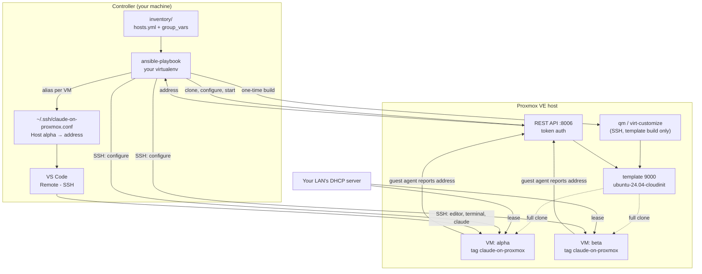

# Architecture

How `claude-on-proxmox` is built and why. The rest of this wiki is the user manual, `CONTRIBUTING.md`
the workflow, `SECURITY.md` the threat model; these pages are the technical reference behind all
three, and the source of truth when they disagree. They keep the numbering of the single
`ARCHITECTURE.md` they began as, which code comments cite ("`docs/architecture/roles.md`
[§5.5](roles.md#55-claude_code--install-claude-code)"):
sections 1 to 3 are on this page, and each later section is a page of its own.

**Contents**

1. [Purpose and scope](#1-purpose-and-scope)
2. [System overview](#2-system-overview)
3. [The identity model](#3-the-identity-model)
4. [Lifecycle and control flow](lifecycle.md)
5. [Roles](roles.md)
6. [Variable architecture](variables.md)
7. [Custom code](custom-code.md)
8. [Convergence and idempotence](convergence.md)
9. [Failure modes](failure-modes.md)
10. [Security model](security-model.md)
11. [Testing architecture](testing.md)
12. [CI](ci.md)
13. [Toolchain](toolchain.md)
14. [File map](file-map.md)
15. [Design decisions](decisions.md)

---

## 1. Purpose and scope

Create Ubuntu VMs on a Proxmox VE host and configure them as Claude Code development machines.
One command provisions a fleet; another configures it; a third tears it down.

**In scope:** cloning VMs from a cloud-init template, cloud-init user/key/network setup, discovering
VMs by tag, installing an OS baseline plus developer tooling, installing Claude Code, cloning a
GitHub account's repositories, and deleting VMs safely.

**Deliberately out of scope:** managing the Proxmox host itself beyond building one template,
networking (no bridges, no VLANs, no static IP management), storage provisioning, clustering,
backups, and anything that would require the project to remember state between runs.

**The governing constraint** is that the repository must be shareable. Nothing environment-specific
is ever committed. The Proxmox host's address is the single address anyone supplies, and it lives in
a git-ignored file. Every VM address is assigned by DHCP and read back at runtime.

---

## 2. System overview

Four actors:

| Actor | What runs there | How it is reached |
|---|---|---|
| **Controller** | Ansible, all Proxmox API calls | local |
| **Proxmox host** | `qm`, `virt-customize`, the template build | SSH (`playbooks/template.yml` only) |
| **VMs** | everything `configure.yml` installs | SSH, at a DHCP address discovered at runtime |
| **VS Code**, on the controller | the editor window; its server, terminal and extensions run on the VM | SSH, through an alias this project keeps in `~/.ssh/claude-on-proxmox.conf` |



The controller never learns a VM's address from configuration. It learns it from the QEMU guest
agent, which is the only portable way to read a DHCP-assigned address out of a VM that Proxmox
itself did not assign.

---

## 3. The identity model

Four separate identifiers, each owned by a different party. Understanding who owns what explains
most of the design.

| Identifier | Assigned by | Used for | Persisted? |
|---|---|---|---|
| **Name** (`alpha`) | the user, via `VM_NAME` | the key for every lookup | in Proxmox, as the VM name |
| **VMID** (`9001`) | Proxmox (`/cluster/nextid`; a fleet's are numbered from it once, in `provision.yml`) | API calls after the clone | in Proxmox |
| **Address** (`192.0.2.51`) | the LAN's DHCP server | SSH | nowhere — re-read every run |
| **Tag** (`claude-on-proxmox`) | this project | ownership and discovery | in Proxmox, on the VM |

**The name is the primary key.** The role looks a VM up by name and clones only when no VM of that
name exists, which is what makes re-running a no-op. `proxmox_vm_id` exists but is rarely needed.

**Proxmox is the register.** Nothing is tracked locally. A VM deleted in the Proxmox UI simply stops
appearing; there is no local state file to reconcile, and no drift to repair.

**The tag is the ownership interlock.** Proxmox permits any VM to carry any name, so a name alone
cannot prove this project created something. Every VM the `proxmox_vm` role creates is tagged
`claude-on-proxmox` (`claude_vm_tag`). Discovery selects on it, and both deletion and provisioning
*refuse* an existing VM without it — configuring someone else's VM would rewrite it and stamp the tag,
after which deletion would accept it too. Matching is anchored via `claude_vm_tag_pattern` so
`claude-on-proxmox-staging` and `not-claude-on-proxmox` are never claimed:

```
(?i)(^|[;,])claude\-on\-proxmox([;,]|$)
```

Both separators are handled because Proxmox stores tags `;`-joined, lowercased, deduplicated and
sorted, while `proxmox_kvm` *sends* them comma-joined and some versions echo that form back. The
lowercasing is why the match is case-insensitive and the role lowercases both what it sends and what
it compares: a `claude_vm_tag` of `Claude-On-Proxmox` is stamped on a VM as `claude-on-proxmox`, and
matched as typed it would never find the VMs it had created.
