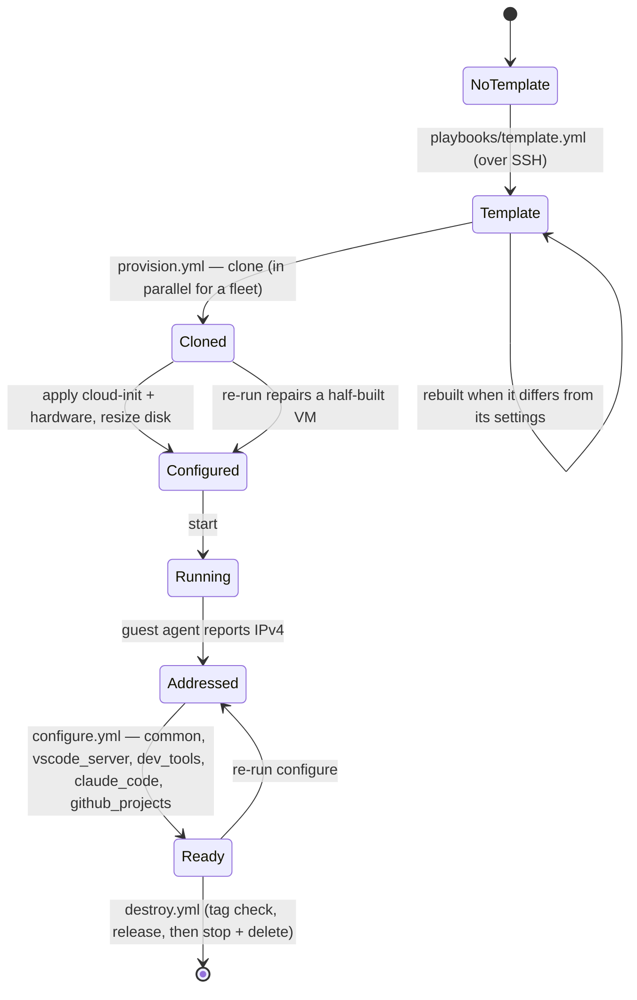
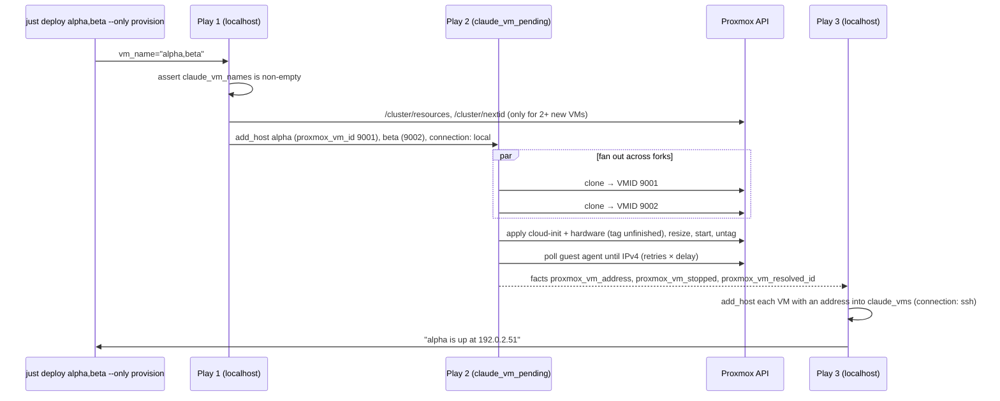

# 4. Lifecycle and control flow



## 4.1 `playbooks/template.yml` — built, and rebuilt when it differs

`hosts: proxmox`, over SSH, because importing a disk image needs `qm` on the node. Runs
`roles/proxmox_template`, unless `proxmox_template_custom` names a template you built, which is only read and cloned
([Your own base image](../guides/base-image.md)): `custom_check` holds it to what a clone needs, and no template is
built beside it. `deploy.yml` runs it only when the template is missing or differs from what
its settings would build, deciding that through the API, and the import-level `when:` is what keeps a
run that does not need to build it from opening an SSH connection to the hypervisor: it skips the
implicit fact gather along with every task ([§4.7](#47-deployyml)). The play's `gather_facts: false`
only saves a pointless gather on the run that does build.

A template is compared, not just found. Its config says what every clone inherits - CPU type, OS type,
bridge, storage, and the controller, agent, serial console and display the role always gives it - and is
read as it is, so a change made in Proxmox's UI is seen too. What went into its disk, Proxmox cannot
show, so the build records it in the template's notes, one line: the build steps' version
(`proxmox_template_build` in the role's `vars/main.yml`, raised whenever a change to them changes what a
template is), the image's URL, the packages put into it, and its SHA-256, kept but never compared. One
definition of what a build makes, the role's `proxmox_template_wanted`, feeds both the build and the
comparison (`proxmox_template_drift` in `lib/claude_vm/proxmox.py`): `deploy.yml` through the role's
`drift` entry point, on the config the API gives (`proxmox_vm_info` with `config: current`), and the role
itself on `qm config`'s, which
`qm_config` reads as the API's. A template that differs is rebuilt at the same VMID, each difference said first. One
that keeps no record of this project's build is refused and left, never rebuilt: it may be someone's own, and a
rebuild destroys it (`template_recorded`, in `deploy.yml` before anything is done and in the role).
A custom `proxmox_template_image_url` needs its checksum, and `virt-cat` reads the downloaded image's `os-release`
before anything is built of it, refusing one outside the Debian family, since configure installs with apt. The old one is removed only once the new
image is downloaded and customised, so a download that fails leaves it; the customised copy goes either
way. Proxmox refuses to remove a template a linked clone still uses; that refusal fails the run, naming
`proxmox_template_rebuild: false`, which keeps a template as it is, the differences said. The build reads
the new template back as the next run will, and fails if it still differs, rather than letting every run
rebuild it.

## 4.2 `playbooks/provision.yml` — three plays

Three plays rather than one loop, because the work parallelises. Most of the per-VM time is a
multi-minute wait for the guest agent to report a DHCP address, and the VMs are already booting on
the hypervisor, up to `forks` at a time. A loop over `include_role` would watch them one at a time.



**Play 1 — register.** Splits `vm_name` on commas into `claude_vm_names`, asserts the list is
non-empty (with no names the next play has no hosts and provisioning would report success having
done nothing), and turns each name into a placeholder host in `claude_vm_pending` with
`ansible_connection: local`. Nothing ever connects to those placeholders — every task in the role is
delegated to the controller.

When two or more of the names have no VM yet, play 1 also gives each of those a VMID, as the
placeholder's `proxmox_vm_id`, so play 2 can clone them concurrently (see [§9](failure-modes.md)).
The numbering starts at `/cluster/nextid`, so it begins where Proxmox would and honours the
datacenter's `next-id` range, and skips every VMID `/cluster/resources` lists, containers included.
Both are read with `uri` rather than `proxmox_vm_info`, which also queries every node holding a guest
and fails if one is offline. The header and CA path they send are `proxmox_api_headers` and
`proxmox_api_ca_path` from `group_vars/all`, shared with every other raw read; the token travels in
that header, so those tasks are `no_log`, and an assert after each reports a failed listing or
VMID read by status and reason, without it. A `proxmox_vm_id` set for the whole run is refused here
when more than one VM is new, before anything is created. A single new VM is left to Proxmox, as
before. With a size given (`vm_size`, from `just deploy alpha --cores 8 --memory 16G --disk 64G`), play 1 reads
`/cluster/resources?type=node` and refuses a size larger than `proxmox_node` - more cores than its CPU threads, more
memory than it has - before anything is created, where the token may read the node (`Sys.Audit`); play 2 hands the
size to the role as `proxmox_vm_size`. With a list of repositories given (`vm_repos`, from `just deploy alpha --repos a,b`),
play 1 holds each to a repository name's form, play 2 hands them to the role as `proxmox_vm_repos`, and play 3
publishes the VM with `claude_vm_repos`, from the notes the role's lookup found and this run's list.

**Play 2 — create.** Runs `roles/proxmox_vm` across the placeholders so Ansible fans out over
`forks` (20 in `ansible.cfg`; a larger fleet proceeds in waves of that size, or pass
`ANSIBLE_ARGS="-f N"`). `proxmox_vm_name` defaults to `inventory_hostname`, which is the VM name.
An existing, configured VM that is stopped is left stopped unless `proxmox_vm_start_existing` is
set, and the role does not wait for its agent: it sets `proxmox_vm_stopped` and an empty
`proxmox_vm_address` and prints why. A VM an earlier run left unfinished is finished and started
whatever its status (see [§8](convergence.md)).

**Play 3 — publish and report.** Loops `add_host` from localhost over the facts the role left
behind, putting each VM that has an address into `claude_vms`, and prints one line per requested
VM: its address, that it was left stopped, or that it failed. The loop is over the names asked for,
not the hosts that survived play 2, so the address is read with a default — a VM whose run failed
has no fact at all, and reading it bare crashed the play, skipping configuration for every VM that
did come up.

> **Why publishing lives here and not in the role.** `add_host` sets `BYPASS_HOST_LOOP`, so it runs
> **once per task** regardless of how many hosts the play has. A copy inside the role publishes only
> the first VM of a fleet. Looping it from a single-host play is the only form that scales. The
> `ansible_connection: ssh` is explicit because `add_host` *updates* a host of the same name rather
> than replacing it, and the placeholders from play 1 are `connection: local`.

## 4.3 `playbooks/discover.yml`

Finds VMs by tag so `configure.yml` works standalone, not only straight after provisioning. Steps 1 to 5
are `tasks/vms_requested.yml`, which the alias refresh opens with too (§4.8).

1. `playbooks/tasks/cluster_vms.yml` → `claude_vm_all`: every VM in the cluster, straight from
   `/cluster/resources` with `ansible.builtin.uri`. Not an unfiltered `proxmox_vm_info`, which goes on
   to ask every node that owns a VM for its VM list and fails outright if one node does not answer —
   so a single powered-off node in a cluster broke discovery for VMs on all the others. The listing
   already carries `name`, `vmid`, `node`, `status`, `template` and `tags`. The task is `no_log`
   because the request carries the token, so a second task asserts on the status and shows only it
   and the reason. `REQUESTS_CA_BUNDLE` is passed as `ca_path`, so the certificate recipe in
   [Proxmox access](../getting-started/proxmox-access.md#trusting-the-proxmox-certificate)
   covers this request too. It is `check_mode: false`: `uri` does not support check mode, so under
   `just deploy --check` it would skip itself and discovery would find nothing.
2. `claude_vm_tagged` (a lazily-evaluated group var) filters to the tagged QEMU VMs. Proxmox omits
   `tags` for an untagged guest, hence its `selectattr('tags', 'defined')`.
3. `claude_vm_discovered` is `claude_vm_requested`: narrowed to the names given (`vm_name`), else the whole
   fleet. `just status` narrows the same way. Never a VM named after a host of the inventory
   (`claude_vm_inventory_hosts`: `localhost`, and the Proxmox host's name, `pve` in `hosts.yml.example`):
   `add_host` merges a VM into the host of its name, so a VM named `pve` would give the Proxmox host the
   address its own agent reported, and the API token would go there; one named `localhost` would make the
   controller a VM to configure. On a Proxmox others use too, anyone can tag a VM so. Such a VM is left
   out and said; a name given that is one is refused before the cluster is listed
   (`tasks/vm_names.yml`, which deploy, provision, destroy, code and `--only ssh-config` import too;
   deploy, provision and code with `claude_vm_names_alias`, which also refuses a name that cannot be its
   SSH alias, §4.8), and `just status` shows such a VM from the listing alone.
4. Assert no duplicate names — Proxmox permits them, and the second `add_host` would silently
   overwrite the first, so `just deploy --only configure` would report success having touched one of two,
   unpredictably.
5. Per VM, its config and its agent's interfaces, two GETs to that VM's own node
   (`tasks/vm_addresses.yml`). A VM that is stopped, whose agent is not up or whose node is down is
   skipped; a refused token, a 401 or 403, is **fatal**, because it applies to every VM and swallowing
   it means configuring zero hosts and exiting 0, which looks like success. The role's agent wait reads
   the same refusal from its module's error with the `proxmox_access_denied` filter
   ([§7.1](custom-code.md#71-filter_pluginsproxmoxpy)).
6. `add_host` each VM, with the list of repositories its notes hold (`claude_vm_repos`, §4.2), to which
   `guest_addresses` gives an address, read on the NIC `proxmox_nic` names
   ([§7.1](custom-code.md#71-filter_pluginsproxmoxpy)), with
   `ansible_python_interpreter` set to `claude_vm_python` ([§5.3](roles.md#53-common--os-baseline)), as
   provisioning's play 3 does. Without the MAC of that NIC
   the VM is skipped rather than guessed at — an address picked without one could be a bridge the
   guest grew later (`docker0`).
7. If nothing was found, print a diagnostic that distinguishes "no tagged VMs exist", "tagged VMs
   exist but none match the names given", and "tagged VMs exist but none reported an address yet" (stopped,
   still booting, or a token without guest-agent access).

Without names, step 3 keeps every tagged VM, so `just deploy --only configure`, `--check` and
`--only ssh-config`, `just login` and `just status` are fleet-wide by default.

## 4.4 `playbooks/configure.yml`

```yaml
import_playbook: discover.yml   when: claude_vm_discovery | default(true) | bool
hosts: claude_vms, become: true
  pre_tasks: wait_for_connection (300s), cloud-init status --wait (rc 0 or 2)
  roles: common → vscode_server → dev_tools → claude_code → github_projects   (each tagged)
  tasks: block (tagged tailscale): import_role tailscale
         rescue: append the failure to claude_vm_configure_failures, say it
```

```yaml
  post_tasks (tagged always): getent vm_user → claude_vm_workspace fact
hosts: localhost  (tagged tailscale)
  import tasks/vpn_members.yml  Tailscale's plan → tasks/vpn_apply.yml → tasks/vm_marks.yml
                                 → tag each VM whose Tailscale has had a login <ownership tag>-tailscale
hosts: localhost  (tagged always)
  collect {name, address, user, vmid, workspace} for every claude_vms host that has the fact
  import tasks/ssh_config.yml  state: present   → the connect line per VM
hosts: claude_vms  (tagged always)
  fail each VM with a failure in claude_vm_configure_failures, unless claude_vm_configure_in_deploy
```

`claude_vm_discovery: false` skips the Proxmox API entirely, which is how the Vagrant and Molecule
paths configure a host that is already in a static inventory, and how `deploy.yml` configures only
the hosts provisioning published (§4.7). `cloud-init status --wait` accepts exit code 2 ("done with
recoverable errors").

The third play records in Proxmox, as a tag the VM cannot change, each VM whose Tailscale has had a login, so
that the vault's auth key is never sent to it again ([§5.8](roles.md#58-tailscale--join-the-vm-to-a-tailnet)):
Tailscale's plan of its members (`tasks/vpn_members.yml`, [§7.11](custom-code.md#711-the-choices-the-editor-the-vpn-and-later-the-hosts-os)),
applied by `tasks/vpn_apply.yml` through `tasks/vm_marks.yml`, which `tailscale_login.yml` runs too, after its
sign-ins. It reads each VM's tags and writes them back with the record, VM by VM, so one Proxmox cannot answer for is said, and kept for NEXT
STEPS, while the others are still recorded.

The fourth play keeps an SSH alias per VM on the controller (§4.8), so `ssh alpha` and the editor -
VS Code's host picker, Zed's `ssh://` URL - follow the address DHCP gave it. It reads a fact the second
play set *last*: `claude_vm_workspace`, `vm_projects_dir` or `~/projects` of `vm_user` as `getent`
resolves it on the VM, without a trailing `/`, as just code and just status name it (the `projects_dir`
filter, [§7.6](custom-code.md#76-filter_pluginssessionspy-and-playbookslibrary--the-session-handoff)).
A host that failed a role never reaches that `post_task`, so it never gets an alias; and the workspace is
the VM user's real home rather than a guess, because Ansible's own `user_dir` fact is the *connecting*
user's home, which is root's under Molecule. Both the lookup and the play are tagged `always`, like discovery, so a
`just deploy alpha --tags claude_code` after a lease moved still refreshes the alias. `claude_ssh_config: false`
keeps the whole project out of `~/.ssh`.

Tailscale runs last, from the play's `tasks:` - after `roles:`, before `post_tasks:` - in a block whose
rescue records a failure in `claude_vm_configure_failures`, with `just deploy <vm>
--tags tailscale`, and says it. The VM stays in the play, so it still records its workspace and gets its
alias, and under `just deploy` its sign-ins and the editor's window; a fifth play, tagged `always`, then fails each
VM with such a failure - skipped when `claude_vm_configure_in_deploy` is set, as `deploy.yml`'s configure
import sets it, since deploy's own last play raises the same list (§4.7). `import_role`, not
`include_role`: a static import takes the block's tag, so `just deploy <vm> --tags tailscale` runs the role's
tasks, where an include's tag reaches only the include. Off (`vpn` not `tailscale`, which it is not unless
chosen), a `stat` first looks for the marker the role's install writes, and the import, whose condition each
of the role's tasks carries, runs only where it is there - and only to say that the Tailscale it installed is
left as it is, unmanaged: choosing a VPN never removes one - so a VM it never installed Tailscale on gets that
one read and nothing of the role. Tailscale is optional, which is
why only it gets this treatment: a failure in it is the VM's last, not its first
([§5.8](roles.md#58-tailscale--join-the-vm-to-a-tailnet)).

> `when:` on an `import_playbook` propagates to the imported plays' tasks rather than skipping the
> import. Equivalent here because `discover.yml` is a single play.

## 4.5 `playbooks/destroy.yml` — confirm, release, delete

Destructive, so it is the most defensive playbook in the repository. It has `provision.yml`'s shape,
for the same reason: stopping a VM and removing its disks takes time, and none of it depends on
another VM. It used to loop `include_role` on localhost, which deleted the VMs one at a time: against
the fake, at 10 forks, 5 VMs took 40 s that way and take 14 s now, and 20 VMs 168 s
against 41 s.

**Play 1 — confirm and check (localhost).**

1. `vars_prompt` confirmation with `default: "no"` — a run with no terminal (CI, cron, a nested
   playbook) takes the default rather than hanging, so the default must be the safe answer. The
   question, under a `CONFIRM DELETION` block
   ([§7.5](custom-code.md#75-callback_pluginsagent_warehousepy--the-waits-and-next-steps)), names the
   VMs from `vm_name` alone, through the play var `claude_vm_confirm_names`: a `vars_prompt` is
   templated before any inventory variable is in scope, `-e` answer or not, so naming
   `claude_vm_names` failed every run.
2. List the cluster (§4.3, step 1) and assert every requested name exists among this project's VMs.
   Asking for a name that was never created is an error naming the VMs that *do* exist, not a
   confirmation prompt followed by silence. A name that exists but is untagged gets a hint: tag it,
   or set `proxmox_vm_allow_untagged_delete`, which widens the check to untagged VMs — the role's
   escape hatch for VMs created before this project tagged its own, which this check used to make
   unreachable. A template is never admitted, with the flag or without.
3. With `destroy_release` or `destroy_save_sessions` (both the default: `claude_vm_reaching`), refuse a
   `destroy_sessions_dir` that is not an absolute path after `~` - the module that writes the saved
   sessions would put a relative one wherever it ran - then start each stopped VM through the API (`status/start`), wait
   for its agent to report an IPv4 address on `proxmox_nic` - by the MAC its config gives, as
   `vm_addresses.yml` pairs them, so a bridge the guest grew (`docker0`, `tailscale0`) cannot end the wait
   before DHCP has answered; asked 36 times at most, `claude_vm_release_agent_delay` (5) seconds apart, a
   play variable only `-e` changes, which `tests/unit/test_release.py` sets to 0.2 against the fake agent
   that answers on its third ask - list the cluster again and read every requested VM's address
   (`tasks/vm_addresses.yml`). The listing gives the status Proxmox last polled, up to ten seconds old,
   so a VM started seconds before is still "stopped" there: the VMs started are passed as
   `claude_vm_just_started` and asked whatever it says. Read by the listing alone, a VM that booted
   within those seconds got no address and was deleted unreleased (seen live). A VM that does not start
   or report one gets no address. The VMs started are
   kept in `claude_vm_release_started`, and stopped again (`tasks/vm_stop.yml`) by whatever ends the run
   without deleting one, so a failed destroy leaves a VM as it found it: a rescue around the listing, the
   addresses and the `add_host` - which can still fail - stops them and fails again; the last play stops
   each one whose deletion failed. Before any of it, a name two VMs carry is refused for the whole run:
   the role refuses to delete either, and the release finds a VM by name, so it could otherwise start, and
   reach over SSH, a VM that is not this project's.
4. `add_host` each name into `claude_vm_doomed` with `ansible_connection: local`, as provisioning's
   placeholders are, and `claude_vm_release_address`.

**Release (`claude_vm_doomed`).** Over SSH to that address as `vm_user` - host vars from the `add_host`
above, never play vars, which would apply to the release's delegated calls to Tailscale's API too and run
them, credential included, on the VM - all VMs at once: a VM with no address, or one a `ping` with
`ignore_unreachable` and no sudo finds unreachable or failing (`failed_when: false`: a failed host leaves
the run, and a play in which every host fails ends it), is ended and deleted as it is. A second `ping`, as
root, in a block: a sudo that asks for a password or refuses is an error `failed_when` never sees, and
would take the host out of the run unsaved and unreported, so the rescue records it
(`claude_vm_release_blocked`), and that VM is saved, then ended before any release, and deleted, the report
saying "sudo on it failed". Then, with `destroy_save_sessions`
(the default) and before anything is released, `claude_code`'s `release_pause` entry point stops Remote
Control, which writes the transcript of the session it serves as it works, where sudo works, and
`tasks/session_save.yml` saves what of the VM's Claude Code
sessions exists only there: Claude Code keeps a session on the disk of the machine it runs on, the only
copy it can resume, and auto memory is machine-local too, so the deletion would end them.
`claude_sessions_info` reads the VM's `~/.claude` with every session whatever its age and just code's
manifest, from just code's own directory as code.yml names it (the `just_code_dir` filter, which follows
`editor_files_dir`), and `claude_sessions_saved` keeps each session that holds a message and is not
a copy still as just code wrote it - this machine has that one - with the folder beside it (subagents,
tool results, MCP tasks), and every auto memory folder. What the VM reports is the VM's to make up, so
nothing it names is trusted: a folder not named as Claude Code names one (ASCII letters, digits and `-`)
or an ID that is not a session's is left out and counted, never handed on. `claude_sessions_fetch`,
delegated here, then runs `tar -cf - -T -` on the VM over SSH as Ansible reaches it - its user, address,
`ansible_port`, `ansible_ssh_private_key_file` and SSH arguments, with `BatchMode` - and unpacks the stream
itself into `destroy_sessions_dir` (`.sessions/` in the checkout, git-ignored and refused by the
tracked-file guard), `<vm>-<YYYYMMDD-HHMMSS>/projects/` laid out as on the VM and edited in nothing:
plain files and folders only, 0600 and 0700, at the names asked for or inside one, never through a link,
never outside that folder. A link, hard link, device or pipe in the archive is left out and counted;
rsync made the VM's links here as links, and the `chmod -R` after it followed them out of the folder. A
`sessions.json` beside them names each, the Claude Code version that wrote it and the newest of them,
says that what they hold is the VM's and unchecked, and gives the `claude --resume <path>` that continues
each here: given a
transcript's path, Claude Code resumes it where it lies and writes to it there, whatever this machine
holds of the same ID (the `configure` scenario holds that against the real claude). Not best effort like
the releases: a failed save - SSH or tar failing, an archive cut short, a name asked for that did not
arrive, or the VM no longer answering, which its VM tasks take with `ignore_unreachable` and an assert,
never leaving the run unseen - sets `claude_vm_delete_failure`, and `claude_vm_save_error` with the
failed task and its message alone, starts Remote Control again (`release_resume`) and ends the host, so
the VM is neither released nor deleted and the last play fails the run with why. Its VM tasks run as the VM user, never through sudo, whose files they read. With
`destroy_release: false` the host ends there, saved and not released. Then the `release` entry
point of `claude_code` (stop Remote Control's path unit and service, `claude auth logout`), `github_projects`
(`gh auth logout`, and no token revoked: revoking the one this project's device flow made, through
GitHub's `POST /credentials/revoke`, ended every GitHub CLI sign-in of the account, the controller's own
included - seen live - so the report says where to revoke it and what that does; the digest that flow
writes, `~/.config/agent-warehouse/gh-device-login`, tells its token from the vault token, whatever the
marker says, and from one pasted by hand) and
`tailscale` (start a stopped `tailscaled`, read `Self.ID`, `tailscale logout`, then with the API
credential the vault holds look the device up and delete it from the controller, only when its name is
`tailscale_hostname` or `<it>-<n>`, since the VM reports the ID). Each runs in a block whose rescue
records the failure: a release never stops a deletion. Each leaves one clause in a `*_release_said` fact,
set on every run of its file.

**Delete (`claude_vm_doomed`).** With play vars `ansible_connection: local` and this machine's Python
(`ansible_playbook_python`), since its hosts now carry SSH settings for the release. A VM the release
kept, its sessions unsaved, ends first. The role with `proxmox_vm_state: absent` across the
placeholders, fanning out over `forks`; it looks each VM up again and applies the ownership check per
VM. It runs in a block: `claude_vm_deleted` after it marks a VM gone, and a deletion that fails is
rescued - a play in which every VM fails ends the run - into `claude_vm_delete_failure` and
`claude_vm_delete_error`, its reason alone, raised by the last play. Its `known_hosts` task is `throttle: 1`, because parallel deletes would otherwise each rewrite
the same file and restore a key another had just removed. It never forgets the Proxmox host's key, or another
inventory host's (`proxmox_vm_known_hosts_kept`), under any name, whatever address the VM reported last.

**Play 3 — forget the alias (localhost).** `tasks/ssh_config.yml` with `state: absent` for the VMs
that are actually gone: the delete play sets `claude_vm_deleted` only after the role, which a host that
failed in it never reaches, and play 3 removes only the aliases of hosts that have it. Which VMs are gone
and which are still there is written once, in the play's vars (`claude_vm_gone`, `claude_vm_kept_vars`),
which the stop, the alias removal, the reports and the last raise all read. A VM still there
keeps its alias, because it is there to connect to, and the line that says so names its reason: its
deletion failed - a stop that timed out, protection on, an API error (`claude_vm_delete_error`) - or a
save that failed kept it, its deletion never tried (`claude_vm_save_error`), or the run lost it before
its deletion, a task failing on it or the VM no longer answering. Said "its deletion failed" for every
VM kept, as it once was, it was wrong for a VM kept by its save. A run refused in play 1 never
reaches play 3; removing a block that is not there is a no-op. A localhost play rather than a task in the role, so the role stays free of the controller's
ssh config and the one writer per run needs no throttle. The same play says, in one line for every VM
of `claude_vm_doomed` and never two, what became of it. A VM deleted and released: what the release did -
joining the three clauses, and where its sessions were saved and how many entries of the VM's were left
out. A VM deleted unreleased: why - no address to reach it at, not answering, its sudo failing, or
`destroy_release: false` - and what is left of it to remove by hand and where: the Tailscale device
(which keeps its name, so a VM built again under it would join as `<name>-1`), a GitHub token its sign-in
made, and a Claude Code login, which Anthropic offers no way to revoke from outside - and where its
sessions were saved, or that they were not. A VM not deleted: "not deleted" and why, from the facts
above, never from a message's text, its SSH alias kept with it, then how far it was released first; and a
VM kept by its save, "kept, its SSH alias with it, neither released nor deleted" with the save's error.
Each line is recorded for NEXT STEPS straight after (`claude_vm_next`, matter `destroy`), `''` only for a
VM deleted and released with no GitHub token or Tailscale device left. The kept aliases' line is
recorded `''` while every VM it names has a line of its own there, which every VM still there has: it
named each VM and its rerun a second time. The report once looped over the deleted VMs alone, so a VM
released and then refused its deletion, or kept by its save, had no line of its own.

## 4.6 `tools/status` — read-only, drawn live

What every VM this project created is doing, and what needs doing next. **Status changes nothing**: it
reads Proxmox through GETs and each VM over SSH, signs nothing in, starts and stops nothing, and adds
nothing on this machine, not a host key or an alias, and nothing to `~/.ssh` or `~/.claude`. It writes only
in its own folder, `.cache/status/` (`STATUS_DIR`, git-ignored and refused by
`tests/check_no_local_files.sh`, 0700), and the log every recipe keeps. Proxmox's access log records its requests
and each VM its SSH login and its sudo, as for every run. It is the one recipe that runs no `ansible-playbook`:
Ansible spends 0.3 to 0.6 s of a run on every task of every host, whatever the task does, and a report of a few
dozen reads spent seven of its twenty seconds on the first reply. The engine, `lib/claude_vm/status/engine.py`, reads
the same things directly ([§7.7](custom-code.md#77-libclaude_vmstatus-and-toolsstatus--just-status)): VM rows on the
screen in a quarter of a second and a finished report in about two, against five and twenty-one over a tunnel
([§15.7](decisions.md#157-just-status-runs-no-playbook) has the measurements and what else was tried).

**The order of a run.**

1. The report's outline is drawn at once, each section with a spinner, before anything has been read.
2. The settings: a snapshot where one holds, otherwise Ansible's own in this process
   ([below](#what-a-run-keeps)).
3. The Proxmox API, as GETs eight at a time: the listing (§4.3, steps 1-3), the version, the storages and the nodes
   first, and each VM drawn the moment the listing lands; then every VM's config and its agent's address, so that
   none waits behind another VM's history, then the own reads of each VM read further, so that one on a node that is down
   holds nothing up, the template's config, and each of this
   project's storages' disks. Each read waits `status_api_timeout`, 10 s. A VM's address reaching the engine starts
   that VM's probe at once, whatever the rest of the fleet is doing. A read cut short, or an answer that is no HTTP, is that
   read failed.
4. Each VM over SSH, where a section asked for needs it (`access`, `sign-ins`, `system`, `work`) and the VM runs
   and has an address: one connection, one program (the probe) doing every read at once, and no more VMs at once
   than `forks` (20 in `ansible.cfg`), as Ansible would reach them.
5. Each piece is drawn as it lands; `status_report` ranks what was found and works out the exit code.

**The fleet.** A refused token is told from a host that did not answer by the listing's own status, and each says
what to check; a token refused a VM's config or address names the privileges it lacks, and no VM is read over SSH
after it, as none was when the playbook stopped there. A run that fails part way ends every connection it opened
and starts none after, and exits 3 at once. `status_fleet` turns the listing and the reads into the fleet: this project's VMs, other VMs as totals
only (never named, never read), the storages, the template. A VM is read further only by a name no other tagged VM
carries, that a recipe's pattern takes, on a node that answers; the others are shown from the listing, and two VMs of
one name are a problem. A name given that matches no tagged VM is "not read", naming any nameless VM on a node that
is down as the one it may be. With `claude_vm_discovery` off, Proxmox is not asked and the inventory's `claude_vms`
are read as they are, each reached as the inventory says (ssh with its own port and key, docker, local): the
`configure` scenario's container, a Vagrant box.

**One VM's reads.** Its own GETs, `status/current`, a day of `rrddata`, `pending` and from a running VM's agent
`get-osinfo` and `get-fsinfo`; its config compared with what `just deploy` would send (`proxmox_vm_drift`,
[§7.1](custom-code.md#71-filter_pluginsproxmoxpy)), which needs no connection. Over SSH, one run of the probe
(`playbooks/module_utils/status_probe.py`, sent on stdin and run by the system's Python): as root, for Tailscale's
state and markers, and in a child that has become the VM user for the system (the OS, the kernels, a reboot waiting,
the load, apt's simulation, the user's claude processes and each editor's windows), Claude Code's state, gh's login
and what of each checkout is on no remote or not committed, as of its last fetch. Each read is a thread with a limit
of its own, one that hangs or fails said by name and the rest kept; the connection as a whole has 45 s, and a VM that
takes the connection and says nothing is not waited on past 20 s. A VM that
does not answer SSH is said for what it is - no host key held here, a host key changed, a timeout, a refusal - and
nothing more is asked of it. Where `sudo` asks for a password the VM user's goes on stdin, never on a command line,
and where `sudo` cannot be had at all the VM user's reads are still made and Tailscale's are said not to have been.
Claude's never runs `claude`: whether `claude auth status` can refresh a login's token is still to be checked on a
real VM, so the login is the file it is stored in being there, and the version where the installer's link points.
The lines the roles say are the roles' own, one function both call (`lib/claude_vm/status/lines.py`,
[§5.6](roles.md#56-github_projects--sign-in-to-github-clone-an-accounts-repositories),
[§5.8](roles.md#58-tailscale--join-the-vm-to-a-tailnet)), so a line status shows is the one `just login` and NEXT
STEPS give; `tests/unit/test_status_vms.py` runs the roles' own tasks and the engine on the same stand-in VMs, state
by state, and holds the two equal.

**Read-only, and how that is held.** The engine makes GETs and nothing else, and follows no redirect, which would
carry the token elsewhere. The probe runs nothing but the fixed list of `ALLOWED` in its source, each a read, opens
every file to read, and writes only to its own standard output: `tests/unit/test_status_vms.py` holds all of that
statically and runs it against stand-in VMs whose every file must be unchanged after. `gh`'s token never leaves the
VM: only which kind it is, and whether the role's marker holds its digest.

**Host keys.** Status adds and changes none. Each VM is reached with `status_ssh_args`: `ansible.cfg`'s own `ssh_args`
with `StrictHostKeyChecking=yes` and `UpdateHostKeys=no`, OpenSSH's default being yes, first on ssh's command line,
since ssh keeps the first value it is given for an option. What else a VM is given follows them, as it did the hosts
discovery added: `ansible_ssh_common_args` and `ansible_ssh_extra_args` (a jump host), `ansible_port` and
`ansible_ssh_private_key_file`, a VM's own `host_vars` file included, or where the inventory says nothing, the same
settings in `ansible.cfg` or the environment (`ANSIBLE_SSH_COMMON_ARGS`, `ANSIBLE_PRIVATE_KEY_FILE` and the like). A VM whose key this machine does not hold - rebuilt,
renamed, its address changed - is "not read", naming `just deploy <vm> --only configure`, which takes a new VM's key
as every run does, or the `ssh` that shows the fingerprint and asks.

**What a VM supplies is not trusted.** `status_clean` makes every string of what a VM sent one line of plain text
(`one_line`, [§7.4](custom-code.md#74-filter_pluginsdesktoppy-and-filter_pluginstextpy)) before anything keeps it: a
newline, a carriage return, an escape sequence, a bidi control or a zero-width character never starts a line of its
own, and every value is capped. The text report and `--json` are both built from that cleaned model. What a VM sends
is also held to a size and a time, and read with care for its shape: its root chooses every byte. A number JSON can
say and Python cannot count (`1e999`, `NaN`) is no answer, and whatever else of a VM's answer cannot be read costs only
that VM.

**What counts.** Each item is "not read" (exit 2), a problem (exit 1) or a thing to do (exit 0), and the
code is the highest found:

| Level | When |
|---|---|
| not read | Proxmox did not answer, or refused the token. A name given that matches no tagged VM. A VM on a node that is down. A running VM whose agent reports no address on `proxmox_nic` after three minutes. A VM whose reads Proxmox did not answer. A VM that did not answer SSH, or whose host key is not held here or changed. A read inside a VM that failed or ran past its limit. gh's login that could not be checked with GitHub |
| problem | Two tagged VMs of one name. A root disk or a storage 90% full. Remote Control failed or restarting. `tailscaled` not running where the role installed it |
| to do | The VM's settings differ from `local.yml`'s, with the `proxmox_vm_force_update` run that sends them and what else it does. A change waiting for a restart. A first deploy that did not finish (the unfinished tag). A VM with no SSH alias. A root disk or a storage 80% full. A reboot waiting, with the claude processes and each editor's windows open. Security upgrades waiting. Claude Code not signed in or not installed. Remote Control stopped or not set up. The GitHub and Tailscale roles' own lines, wherever NEXT STEPS would give them |

Stopped VMs, CPU pressure over a tenth of the last hour, other VMs, a thin pool provisioned beyond its
size, the template's age, Remote Control off on purpose, a gh left alone and work on no remote or not
committed are shown and not counted: a branch kept local is often on purpose, and WORK never says "clean". A run
that failed or was interrupted exits 3.

**Live at a terminal.** The report is drawn at the bottom of the screen from the first moment, its outline, then a
spinner wherever a value is still being read, redrawn as each piece lands; when the run ends the live region is
erased and the finished report printed once. Piped, in the log, under `--json` or at a terminal that cannot take
it, only the finished report appears, or nothing. It is drawn in the region every live output shares
([§7.8](custom-code.md#78-libclaude_vmtuilive_regionpy-and-screenpy--every-live-output)), as `just deploy`'s run is:
nothing wraps, a resize pushes the screen into the scrollback and starts afresh, the cursor is never hidden. The
tab's title says `status · reading 3 VMs` while VMs are read, and `status · done` at the end. Everything but apt's
simulation lands first, so only the UPDATES cell keeps its spinner while apt works.
`tests/unit/test_status_live.py` runs the real engine at a pseudo-terminal of its own and reads the bytes back
through a small terminal (`tests/unit/vt.py`).

### What a run keeps

Two files in `.cache/status/`, 0600, each only ever a way to work the same thing out sooner, and either can be
deleted at any time:

- **`settings.json`.** Asking Ansible for the settings takes most of a second, and they change only when a file
  does. The answer is kept, keyed by the name, size and time of every file it is made from: `ansible.cfg`,
  `inventory/`, the roles' `defaults/` and `vars/`, the filters and `lib/claude_vm/` they are rendered through, the
  installed ansible-core, `requirements.yml` and the collections installed, the `~/.ssh/*.pub` the default keys come
  from, the vault's password files, and the
  environment's `ANSIBLE_*`, `HOME`, `PATH` and `REQUESTS_CA_BUNDLE`. It holds no secret: the API token is a mark
  there, read from the vault at each run, and every other secret-derived setting is kept only as whether it is set.
  A snapshot that would hold anything else the vault holds - looked for as JSON writes it, but for the GitHub
  username and an OAuth client's ID, which `just settings` does not look for either - is not kept, and the run's log
  names what held it back. A run given extra vars by hand (`-e`, through `ANSIBLE_ARGS`) neither reads nor writes
  one: it asks Ansible.
- **`upgrades.json`.** apt's simulation takes one to two seconds, the slowest read of a VM, and its answer depends
  only on dpkg's status, the package lists and apt's own configuration. Each VM's answer is kept against a digest of
  those files' names, sizes and times, which the probe works out in milliseconds, so the simulation runs only when
  they have changed.

**The recipe.** `just status [names] [--only sections] [--json]` runs `tools/status` through `tools/run-logged`, and
exits with the report's own code. `--only` takes `vms`, `storage`, `capacity`, `access`, `sign-ins`, `system` and
`work`; `vms`, `storage` and `capacity` read the API alone and never open SSH. Capacity is each node's CPU threads and
memory from `/cluster/resources?type=node`, which Proxmox fills in only for a token with `Sys.Audit` on the node,
beside what the VMs listed on it hold, running and stopped (`status_capacity`); without the privilege, the node's
`grant` says how to give it to the token's user (`proxmox_api_user`), on the node: the lines the section prints, and
an agent reads in `--json`. A VM's own list of repositories is read from its notes (`own_repos`), which the report does
not otherwise keep, since they are a person's. From `ANSIBLE_ARGS` it takes `-e`, `-i` and `--private-key` (under the inventory's own key,
over `ansible.cfg`'s and the environment's, as Ansible ranks it); it runs no playbook, so any other option is warned of
and ignored, but for `--ask-vault-pass`, which it refuses, naming `.vault_pass` and
`ANSIBLE_VAULT_PASSWORD_FILE`: the report is drawn at once, and nothing asks. The vault opens with `.vault_pass`, or
the password file `ANSIBLE_VAULT_PASSWORD_FILE` or `ansible.cfg` names, as `ansible-playbook` would; an executable one
is run for the password, as Ansible runs it, once in a run and before anything is drawn, since it may ask at the
terminal: only then does the outline wait. Ansible resolves the roles' `module_defaults` group from the Galaxy collections
installed, so the engine runs `tools/check collections` itself, the moment it asks Ansible for the settings, and
refuses as every recipe does, naming `just install`; the recipe does not, since there it would hold back the
outline. `settings.json` is keyed by `requirements.yml` and the collections installed, so a snapshot that holds was
made where the check passed.

## 4.7 `deploy.yml`

The whole thing: template, provision, configure, the three sign-ins, the editor - each stage the
standalone playbook, imported as is, so deploy is the sum of `just deploy --only template`, `--only provision`
and `--only configure`, the three sign-ins `just login` runs and `just code`, by construction. A first play on
localhost refuses a name no VM may have (`tasks/vm_names.yml`, as provision does, alias check included): the
template play would otherwise build a template over root SSH before provision's own check refused it. The
next asks the API whether a template named `proxmox_template_name` exists and records it; the template play
is imported with a `when:` on that fact. The lookup is `proxmox_vm_info name=...`, so only the node holding that name is
asked for its VM list — unfiltered, one node that is down failed the run before anything was built.

`configure.yml` is imported with `vars: {claude_vm_discovery: false}`, so it configures exactly the
hosts provisioning's play 3 published. Running discovery there would disagree with provisioning
about what omitted names mean: `claude_vm_names` falls back to `vm_default_name`, but
discovery tests `vm_name is defined` and falls back to the whole fleet, so a bare `just deploy`
created the default VM and then configured every tagged VM. It also repeated, one VM at a time, the
lookups provisioning had just made. Import `vars:` are play vars of every imported play, including
the nested `discover.yml` import, whose `when:` therefore sees them.

What keeps that from opening an SSH connection is the import-level `when:` itself. A `when:` on an
`import_playbook` propagates to every task of the imported play, and ansible-core counts the
implicit fact-gathering task as one of them - so a false condition skips the gather along with
everything else, and nothing connects, whether or not the play would have gathered facts.
`template.yml` still sets `gather_facts: false`, but only because the role reads no `ansible_*`
facts: that saves a pointless gather on the *first* run, when the play does execute. It is not what
prevents the SSH connection on later runs.

The result is that only the first run needs root SSH to the hypervisor. Every later `just deploy`
is API and VM traffic only.

After configuration come the sign-ins and the window, for the hosts configuration reached: a VM left
stopped is not in `claude_vms`, and a host that failed a role has been dropped from the plays after
it. `claude_login.yml` and `github_login.yml` are imported with discovery off,
`claude_vm_login_in_deploy` (a failed sign-in is said, not raised, so deploy goes on) and
`when: deploy_sign_in | bool`. The Claude one is interactive (`claude_vm_login_interactive: true`); the
GitHub one is imported with `claude_vm_login_after_claude`, and its play decides VM by VM, from what the
Claude step left on each VM ([§5.5](roles.md#55-claude_code--install-claude-code)), by the rule the
sign-in plays share (`claude_vm_login_starts` and `claude_vm_login_asks` in `playbooks/vars/sign_in.yml`):
a VM whose Claude sign-in nobody answered (`claude_code_login_skipped` - Enter at the prompt, or a
browser that never came back) is left, and told so where the flow would have run
(`github_projects_login_due`), with `just login <vm> --only github`, the line NEXT STEPS keeps. With
`github_login_auto_start` (the default) every other VM starts at once; off, each is asked first (the role's
`github_projects_login_ask`): Enter signs in one whose Claude sign-in was answered, `y` one that showed
none (signed in already, or an API key). `tailscale_login.yml` follows the same way, by the same rule,
with `tailscale_login_auto_start`, and `when: deploy_sign_in | bool and
tailscale_wanted | default(false) | bool` (§4.10): a VM an auth key joined during configuration is only
reported. A run with no terminal gets `deploy_sign_in: false` from the justfile's `no_tty_args`: sign-ins
that start by themselves would otherwise each wait for a browser nobody watches. It gets
`claude_vm_login_terminal: false` too, for a `deploy_sign_in` given back and for `just login`: `pause` would
answer each question at once with nothing, which is Enter, so no VM is asked, and one that would have been
(`claude_vm_login_unasked`) is left and told so, with its `just login <vm> --only github` (or `tailscale`)
line for NEXT STEPS. A sign-in that failed,
or found its VM unreachable, is said with the `just login <vm> --only ...` that retries it and recorded
for NEXT STEPS under its own matter, since deploy raises it nowhere else.

Last, `code.yml` with `code_in_deploy`, when `deploy_code`. For several VMs its first task prints
each VM's `just code` line and ends the play. For one - the default VM of a bare deploy counts, so the
one-VM check does not need `vm_name`, and the VM is found by `claude_vm_names[0]` among the tagged
ones, not through `claude_vm_requested` - every task is in one `block` whose `rescue` says any failure
with the `just code` line and ends the play, so a deploy whose VM is done exits 0; outside deploy the
rescue fails again. A VM found stopped is said with `just deploy <vm>
--start`, since the deploy configured nothing on it. Ansible rescues no
unreachable host, so the first two connections `ignore_unreachable` and assert.

What a sign-in leads to - Remote Control's start, the private repositories' clones - runs in the
login playbooks' follow-on plays, and a failure there is not a failed sign-in: deploy's last play
fails each VM whose `claude_vm_configure_failures` is set, after the editor's window has opened, with the command
that retries it - and so does a Tailscale failure during configuration, which `configure.yml` recorded
in the same list and, with `claude_vm_configure_in_deploy`, left to this play (§4.4). The configure
import passes `claude_code_sign_in_follows`, `github_projects_sign_in_follows` and
`tailscale_sign_in_follows` (`deploy_sign_in`), so configuration says that the sign-ins come next in
this run rather than naming `just login`, and the first play's message says up front that the run
will stop for them.

`just deploy --only ...` runs one stage's playbook on its own - `template.yml`, `provision.yml`,
`configure.yml` (`--check --diff` for `--check`, `--tags` for `--tags`) or `ssh_config.yml` - with the
arguments the whole deploy gives it and nothing of its own, so each stays the playbook deploy imports. The
recipe chooses the playbook from an `--only` its pattern has checked.

---

## 4.8 `playbooks/ssh_config.yml` and `playbooks/tasks/ssh_config.yml`

The aliases are the one thing this project writes on the controller besides `known_hosts`, and
every writer goes through one task file so the block format cannot drift. Inputs: a list of
`{name, address, user, workspace?}` and a state; `workspace` only feeds the connect line, and only
`configure`, which has read it on the VM, passes it. The managed file,
`~/.ssh/agent-warehouse.conf` (`claude_ssh_config_file`), holds one `blockinfile` block per VM,
with what ssh reads and one comment ssh skips, the host the VM was found on - no other state of this
project's is kept in a user's ssh config:

```
# BEGIN agent-warehouse: alpha
# origin: pve                    ← claude_ssh_origin: the run's Proxmox host, by its inventory name
Host alpha
    HostName 192.0.2.51          ← or alpha.<claude_ssh_host_domain>
    User dev
    ServerAliveInterval 30       ← claude_ssh_options, verbatim
# END agent-warehouse: alpha
```

**The origin.** Each block records the host its VM was found on (`claude_ssh_origin`, the first host of the
inventory's `proxmox` group, from 2.5), since a run reaches one host's listing and nothing of another's. A
comment rather than a change to the markers, so ssh, every parser and a checkout of an older version read the
block as before; `ssh_config_blocks` returns it as `origin`, `""` for a block with no record, as every version
before 2.5 wrote them. A block with no record, or one recording a host the checkout no longer has, is nobody's:
the next write of that VM records this run's host. One recording another of the checkout's hosts
(`claude_hosts_other`, which the host resolver hands each run) is that host's VM's alias, and a VM name belongs
to one host: a write that names the VM is refused before anything is written, and `tasks/vm_names.yml` refuses
the name before anything is created; fleet-wide the VM is left out and said. `destroy.yml` removes the alias,
and forgets the `<name>.<domain>` host key, only of a VM whose block records no other host
(`claude_ssh_names_elsewhere`): a block recording another host is that host's VM's, and stays.

Through 1.x the managed file was `~/.ssh/claude-on-proxmox.conf`, its markers `claude-on-proxmox`
(`claude_ssh_config_legacy_file`, beside the default only). The first run of this task file in 2.0, writing
or removing, moves it to the new name and rewrites its markers before anything else, so the aliases of the
VMs that run did not name move with it; left, its blocks would answer for aliases the new file no longer
has, and its `Include`, first in the user's config, would answer the probe below with the old file's
`HostName`, so the new file would never be included. Both files there is said, and the old one left to the
user. Until the move, `ssh_config.yml`'s prune and `just status` read the old file, never moving it.

The user's own `~/.ssh/config` gets exactly one line, `Include <managed file>`, inserted at the top
(`lineinfile`, `insertbefore: BOF`): an `Include` below a `Host` block is scoped to that block. It is
added only when the managed file is not reached already, which is ssh's to say rather than a regex's:
a line in a spelling ssh accepts for the same file - the absolute path, `~/...`, `${HOME}/...`, or
the bare name for a file in `~/.ssh` - counts only if `ssh -G -F <user config> <first VM>` comes
back with the `HostName` the managed file just gave that VM. `${HOME}/...` is expanded only from
OpenSSH 9.9 on (Ubuntu 24.04 ships 9.6, which reads it as a literal path), `$HOME/...` never, and
an `Include` inside a `Host` block reaches only that host; each of those includes nothing, and the
line is added above it. An existing line is left exactly as written, not rewritten into this form.
The file's mode is set only when this task creates it. The `Include` is never
removed, since that would mean editing the user's file on destroy, and an `Include` of a missing
file is harmless. Nothing else in `~/.ssh` is ever edited.

Every task that writes, and each refusal before it, runs in one block under the `present` state;
`absent` removes blocks alone. Three guards, in order: the alias is the VM's name, so a `Host` line in
the user's config that already names it is refused by file and line (the managed file is included first, so writing would
silently override the user's entry); every write is validated by the real client, `ssh -G -F %s
<alias>`, so a malformed option fails the task instead of every `ssh` on the machine; and a block is
only ever written for a VM the caller found by its tag. Before any of them, a name or address that is
not one plain word is refused: `ssh -G` accepts a well-formed `ProxyCommand`, so it cannot be the
check for a value the VM chose (see `guest_ipv4`, section 7). So is a name ssh would take for another
host (`ssh_alias_refusal`): a name ssh reads as an address (`192.0.2.10`, `3232235777`, `0x7f000001`),
a name this machine reaches a host of the inventory by (`claude_vm_inventory_names`: `pve`, or the
address the Proxmox host is reached at), or a name with a dot that the user did not give
(`claude_vm_names_chosen`). The managed file is included ahead of the user's own config, so a VM named
`github.com` would get the controller's own `git push`, and one named after the Proxmox host its root
SSH; a tagged VM's name is whoever made it's to choose, which on a Proxmox others use too is not always
the user. With names given it is refused, and `just deploy` refuses it before it creates anything; a
dotted name given is the user's choice, as `docs/guides/vms.md` allows, and gets its alias. Fleet-wide
(no names) such a VM is left out, said, and the rest written, so someone else's tagged VM named
`github.com` cannot stop every alias refresh of the user's own fleet, nor get an alias; a dotted alias a
named run wrote is left as it was, and the message names the run that refreshes it.

`ssh_config.yml` (`just deploy --only ssh-config`) is the fleet-wide resync: the cluster listing, the addresses
(§4.3 steps 1 to 5, `tasks/vms_requested.yml`), `present` for every tagged VM with an address but one named after
a host of the inventory, which is left out and said as discovery says it, keeping a workspace an
earlier configure recorded, then pruning through `ssh_config_prune`
([§7.1](custom-code.md#71-filter_pluginsproxmoxpy)). Pruning removes blocks, never VMs, and only a block
of this host's whose name no VM in its cluster carries any more - or one no alias may have, a name ssh reads as an address
or one the inventory reaches a host by, which an earlier version wrote and which would otherwise take this
machine's connections to that host for good. A name an untagged VM carries is left alone and reported, as
`destroy.yml` refuses such a VM. While any tagged VM is listed without a name, which is what a node that is
down looks like (§4.3), nothing else is pruned, because any block could be that VM's. A listing says
nothing of another host's VMs, so a block recording another host is never pruned here - one of the checkout's
other hosts unsaid, one of a host it does not have (swapped out of `inventory/hosts.yml` by hand, or removed)
said, for the user to remove once its VM is gone. A block with no record is this host's while the checkout has
one host, and pruned as before; with more than one it could be any host's, and is left and said. With names,
only those VMs are refreshed and nothing is pruned. Two
tagged VMs of one name are refused as discovery refuses them: an alias of that name would point at
one at random.

## 4.9 `playbooks/code.yml`

`just code alpha [--project discord-music-bot] [--session <id>]`: the alias step for one VM, then
the one step no other playbook does, launching the editor - with this machine's recent Claude Code
sessions copied to the VM on the way (**The session handoff**, below). In order:

1. Refuse anything but one name, and a `vm_project` (`--project`) that is not one GitHub repository
   name - up to 100 ASCII letters, digits, `.`, `-`, `_`, and not `.` or `..` - so nothing outside
   the projects directory, or nested in it, can be opened. The justfile's pattern and `tools/check
   project` refuse the same before a shell sees the value; this is for a direct `ansible-playbook` run.
   `vm_session` (`--session`) is refused unless it is a session ID, there by its pattern and `tools/check
   session` and here again.
2. Find the VM by tag, naming an untagged VM of that name as not this project's; ask its agent for
   the address. Settle where it is reached exactly as the alias's `HostName` does, by `ssh_hostname` - the
   address, or `<name>.<claude_ssh_host_domain>` - so this run and the editor connect to the same target, and refuse
   a VM that is not running, whatever its name resolves to.
3. Add it to `claude_vms` with `add_host`, the way configure reaches it: Ansible's own connection and
   `accept-new`, not the user's ssh config, and the group's connection variables from the inventory
   (a key, a port) apply as they do to `just deploy --only configure`.
4. Read the VM user's home on the VM with `getent`, delegated over SSH, unless `vm_projects_dir`
   says where the code is (and the sessions' directory there is given or not needed). Nothing is
   guessed on the controller, and nothing is read back out of the alias: the workspace is
   `vm_projects_dir` or `<home>/projects`. A home with a control character in it is refused there, since
   every path just code says or hands the editor starts with it. Then the session handoff's reads
   (`tasks/session_read.yml`), which with `--session` settle the project to open.
5. Refuse a `vm_projects_dir` that is not absolute (the editor is handed it as written, from this
   machine, so `~` would not expand) and, wherever anything goes into just code's own directory (the
   notes alone too, for an editor whose window runs no tasks) or with the terminal or the session
   copies on, an `editor_files_dir` that is not absolute, is `/` (the whole of the VM) or is the projects
   directory (its files would sit among the repositories), and with the terminal, one that is the folder being opened
   (`--project .agent-warehouse`). Each names the variable it is about.
6. Refresh the alias, then look for the folder to open - the workspace, or `<workspace>/<project>` -
   with `stat` on the VM. Read-only. Unreachable, missing and not-a-folder are each their own
   message: a missing project lists what the workspace holds and, for a name that differs only in
   case, suggests the right one, since the VM's paths are case-sensitive; a missing workspace means a
   VM never configured, and says to run `just deploy --only configure`. These are there so a typo is said in the
   terminal, not in an editor window opened on a folder that does not exist. Then, wherever anything goes into
   just code's own directory, refuse one inside a checkout of the projects directory, for every editor: a `.git`
   in any folder from the first below the projects directory down to that directory, looked for with `stat` on
   the VM by the path as written. Only those folders, so a home directory kept in git refuses nothing - nor does
   a projects directory that is itself a checkout, a directory outside the projects directory, or a repository a
   symlink on the way leads into, which is not resolved.
7. Check the editor on this machine - each editor's own file, imported for it alone
   (`tasks/vscode_check.yml`): `code` on `PATH`, and `ms-vscode-remote.remote-ssh` installed if
   `code --list-extensions` lacks it; for Zed (`tasks/zed_check.yml`), every `zeditor` and `zed` on `PATH`
   (`which -a`), `zeditor`s first, asked `--version`, and the first that says Zed taken: ZFS's event daemon is
   `zed` too, and is never handed the VM; then, read on the VM, whether a `.zed/tasks.json` in just code's
   directory there is just code's (its first line the marker), before the notes say whether the task is there.
   Then the session handoff's writes (`tasks/session_write.yml`), the first on the VM, and the session notes
   (below).
8. Open the window - the editor's plan (`code_plan`, its family's in `lib/claude_vm/editors/`,
   [§7.10](custom-code.md#710-libclaude_vm--the-controllers-python-as-one-package)), refused before any write where
   it refuses, applied by `tasks/editor_open.yml`; every name an editor's check
   registers starts with `code_<editor>_`, since a skipped task still overwrites its register. The editors are one
   list, `claude_editors` in the
   inventory defaults, literal values only: how each is said, whether its window runs just code's tasks as it
   opens, and how it gets its Claude terminal (`claude_terminal`: `started` as the window opens, VS Code's;
   `listed` for the user to pick, Zed's; or `none`); its `family`, the core's module that plans its window; the
   names its command goes by here (`cli_candidates`), and what that command's `--version` must say where another
   program shares a name (`version_re`). Whether a window runs just code's tasks and how it gets its Claude
   terminal are said apart, though with these two rows they agree: no Claude task is decided from
   `window_tasks` alone. Where the window runs none (Zed), the notes are written
   without the Claude terminal, worded for it, and `--session` needs no terminal: the report says the
   `claude --resume` to run, with the cautions every editor's report says. Zed's plan writes,
   with `editor_claude_terminal` and only where just code's directory is inside the projects directory and the
   helper's path matches `code_helper_path_pattern` (`code_claude_task_written`; the notes name the task where it
   is also over no one else's file, `code_claude_task_there`), the shared helper first - `helpers/claude-start.sh`,
   any editor's (`code_shared_helpers`), copied unchanged - and then `.zed/tasks.json`: just code's ownership
   marker on its first line, then a **Claude (just code)** task of fixed text, `bash <helper>`, a new terminal
   for every spawn and no tag. A `tasks.json` there without the marker is someone else's, left as it is, and
   said. The helper starts a fresh `claude` where Claude Code's registry names a running `claude` of a terminal
   in the folder, and otherwise `claude --continue`, and a fresh `claude` where that fails at once. Zed lists the
   task in a window whose folder holds the directory. Then it runs `zed ssh://<alias><folder>`, one path (Zed
   1.26.2 refuses a second, so the notes are not opened with it), Zed reading the alias from `~/.ssh/config`;
   Zed runs no task when a window opens, so its report says to run that task where the window lists it, or
   `claude` (or `claude --resume <id>`) in Zed's terminal, which is the VM's, and why no task was written where
   none was; Zed's Agent Panel runs Claude Agent on the VM too, said as a Claude Code of its own. For VS Code, with
   `editor_claude_terminal` (the default), write a workspace file on the VM and open that:
   `code --remote ssh-remote+alpha <workspaces>/project/<project>.code-workspace` (the `code` that `which`
   found, by its path), or
   `<workspaces>/<workspace's name>.code-workspace` for the whole directory, where `<workspaces>` is
   `editor_files_dir` or `<workspace>/.agent-warehouse` (`<workspace>/.claude-on-proxmox` through 1.x: the first
   run of 2.0 moves it there before any write, the session copies' manifest, the notes and the helpers with it,
   and keeps the shared helper's 1.x path as a link to the new one, for a task of the user's own; never a link of
   the whole directory, whose tasks file Zed would read twice). One project's file is in `project/`
   so a repository that shares the workspace's name cannot collide with the whole directory's. Off,
   it opens the folder itself and writes nothing.
9. Say what VS Code will do, from the user's VS Code settings, read and never written: looked for
   where VS Code would put them (`VSCODE_APPDATA`, `XDG_CONFIG_HOME`, stock VS Code's place on macOS
   and Linux, the snap, the flatpak), and said as not found, not readable or not parsable when they
   are, since "unset" would promise a question that may not come; VS Code asks once per workspace,
   in a notification that goes quiet after a moment, so the message names *Tasks: Manage Automatic
   Tasks* as well.

In `just deploy` steps 1-9 are one `block` whose `rescue` says what failed with the line that opens
the window later (§4.7); outside it the failure is raised again, a command's with its stderr. Every
name `code.yml` sets starts with `code_`, a prefix no role uses, since a role's fact or register
outranks a play var, and no task var shares a fact's name.

**The workspace file** is built as data and written with `to_nice_json`, so no path breaks its JSON;
`copy` leaves an unchanged file alone. It names the folder by absolute path, hides its own directory
from the explorer of the window that shows it, and holds a `Shell` task - `/bin/bash -l` in the folder,
`folderOpen` too, in the same presentation group as Claude's so the two share a terminal as split panes,
the shell on the left because it is listed, and so started, first - and the `Claude` task: a `process` task,
`/bin/bash -l <helpers>/claude-terminal.sh` and eight arguments (the line without `claude`, the two lines a
sign-in ends with, the path unit's file, GitHub's line, the git protocol, the scopes, the VM's name),
the session notes' four (below) and `--session`, read as the last word by a `for` loop,
`cwd` the folder, `runOptions.runOn:
folderOpen`, presented in a dedicated, focused terminal. A login shell, because VS Code starts task
shells non-login, and on a VM configured before `common`'s sshd PATH drop-in `claude` is on the login
`PATH` only (`just login --only claude` uses `bash -lc` for the same reason). The script checks `claude` is installed, runs `claude auth login` when
`claude auth status` fails (a failed one says how to retry), signs gh in by the device flow when
`gh auth status --hostname github.com --active` fails (Ctrl-C skips it: `trap ':' INT`), and then,
given `--session`, `claude --resume <id>` and nothing after it, or else
`claude --continue` - the folder's latest conversation; where there is none, Claude Code 2.1 exits 1 at once ("No conversation found to continue"), and a `--continue` that fails within five seconds starts a fresh `claude` instead, the script ending `exit 0` either way - because a task terminal
does not survive a window reload, after which the task runs again; its messages arrive as arguments,
never as script text, and
`tests/unit/test_code_session.py` runs it against a stand-in `claude`. **The helpers** - that script,
the notes' `session-notes.sh` and `session_notes.py`, VS Code's alone, their paths in `playbooks/vars/vscode.yml`,
beside the one every editor shares, `claude-start.sh` (`code_shared_helpers` in `code.yml`, which Zed's task runs) -
are fixed files in `playbooks/files/`, copied
unchanged into `helpers/` of just code's own directory on the VM, and run there by path, so the workspace
file carries no script text; the `provision` scenario checks the copies byte for byte against the files
the unit tests run. `${workspaceFolder}`
is not used: in a task that belongs to a workspace file rather than a folder it is ambiguous.

Sign-in is not scripted, because it cannot be: it is a browser flow. VS Code Server puts its
`browser.sh` helper in `BROWSER` for every terminal it starts, which opens the URL on the client,
and `claude` shows the URL as well and accepts a pasted code. A login made there starts Remote
Control through the path unit of [§5.5](roles.md#55-claude_code--install-claude-code) where one
waits, which the script finds by its file on the VM; elsewhere the terminal names `just deploy <name> --tags claude_code`, which starts it through
the role's own eligibility checks. The terminal never starts it itself.

**What VS Code decides, and what this does not touch.** VS Code runs a `folderOpen` task only in a
trusted window, and only once automatic tasks are allowed:

| Gate | Where VS Code keeps it | What `code.yml` does |
|---|---|---|
| Workspace Trust | client-side, by URI, per remote authority; a trusted folder covers its children. A workspace file is trusted when its folders *and* the file itself are | Puts the files under the projects directory, so trusting that directory once covers every project and every file. Says so. |
| `task.allowAutomaticTasks` | an application setting in the default profile's `settings.json`; unset, VS Code asks once and *Allow* writes `"on"`; only a user-set `"off"` silences both question and task | VS Code's plan reads it (`vscode_setting`: JSONC, comments, trailing commas, flat or nested key) and says which question to expect, or that the terminal will not start. Never writes it. |

Both are the user's own security decisions, so there is no `security.workspace.trust.enabled:
false`, no `terminal.integrated.allowInUntrustedWorkspace`, no written setting and no user-level
`folderOpen` task, which would fire in every workspace they open. Checked against VS Code 1.140's
source: trust is computed over the folders plus the workspace file's own URI, automatic tasks
include a workspace file's tasks, and a path ending in `.code-workspace` given to `--remote` opens as a
workspace. The defaults moved twice in 2026 (1.109, 1.126); CI cannot watch the user's editor, so a
manual run of `just code` is the check when they move again.

The workspace file, the helpers, the session notes (below) and the session copies (below) are all that
is written on the VM, last, as the VM user, so every refusal above leaves the VM as it was - with `--session`, so is
one checkout's fast-forward; a workspace directory that already exists keeps its mode, since
`editor_files_dir` may name one of the user's own. `tests/unit/test_code_session.py` holds
every task in `code.yml` to an allowlist - read-only here, or delegated to the VM - and the
`provision` scenario checks the settings file it planted is byte-for-byte untouched after every
run. The allowlist follows `code.yml`'s own imports all the way down (`tasks/session_read.yml`,
`tasks/session_write.yml`, the editors' check files, `tasks/editor_open.yml`); only the shared
`cluster_vms.yml`, `vm_addresses.yml`, `ssh_config.yml` and `vm_names.yml` are not followed. A task there is
read-only on this machine (`stat`, `getent`, `find`, `slurp`, `which` and `code`), one of the handoff's readers
(`claude_sessions_info`, `git_checkouts_info`) here or on the VM, `--session`'s `git`, the handoff's `rsync`
to the VM, the alias through `tasks/ssh_config.yml`, or one of eight writes, each under its exact condition in
`WRITERS_WHEN` and delegated to the VM: just code's own directory, made first and 0755 where new; the editor
plan's directories, the helpers it names and its files, each written under `{{ code_ws_dir }}/` or
`{{ code_helpers_dir }}/`; the notes and theirs; and the sessions' directory and their copies. A `copy` is to
`content`, or to `src: "{{ code_helper }}"` over `code_shared_helpers + code_helpers`, which together name each
file of `playbooks/files/` once, and only a helper the editor's plan names, so nothing else of this machine's is
ever sent. The one command whose `argv` is not a literal list is the plan's launch, run here; the plan's refusal
comes before the first write; and a `shell`, a writer in a `block` or a `connection` fails the test by name.
The helpers are run against stand-ins with nothing else on PATH, never in a login shell there, which would put
this machine's own `code` and `tailscale` back. `--project .agent-warehouse`, which names the files' own directory, is refused. Cloud-init placed the key, so a VM that was provisioned but never configured still
opens once it has a workspace, and its terminal says to run `just deploy --only configure`.

**The session notes.** In VS Code, with `editor_session_notes` (the default, with the terminal), a page about the
VM opens beside the Claude terminal every time the window opens - from `just code`, *Open Recent*, a
restart that restores the window, or a reload - as a rendered preview, with its sign-in status read from
the VM at that moment. VS Code has no workspace setting that opens a file, and a file named in the
`code --remote` call opens only from `just code` and stops the window restoring its editors, so the trigger
is a second `folderOpen` task in the workspace file, `Session notes`, run beside the Claude task on the
same terms (a trusted window, automatic tasks allowed); VS Code's one-time automatic-tasks question lists
both. Not the Claude task's `dependsOn`, which was the first design: VS Code looks a dependency of a
workspace-file task up, misses it, and asks every task provider instead - npm, gulp (which runs `gulp`),
grunt, jake - which held Claude back about 7.5 s on a projects directory of 22 repositories, measured
live. Side by side, the notes open a moment after the Claude terminal and usually take the keyboard
focus from it. The helper's bash (`session-notes.sh`) is in charge whatever its Python part
(`session_notes.py`, beside it) does: Python runs in the background, bash waits for it 5 s at most, runs `code -r <notes>` in the foreground
through the remote CLI VS Code Server puts on every task's `PATH`, and ends `exit 0`, so the notes always
open and VS Code never prints the command line; it never `exec`s into Python, which would leave the notes to
Python's fate. Python reads `claude auth status`, the Remote Control unit, gh's login and `tailscale status
--json` at once, 2 s each, and rewrites only the section between `<!-- agent-warehouse:live -->` and
its closing marker, atomically, 0600, in a regular file that has them; every value is cleaned as
`plain_text` cleans, no command it runs prints a token, and the Tailscale row carries the `ssh` command
over the MagicDNS name, which only the VM knows. Its time is in this machine's zone, which is the user's
where the VM's clock keeps `common_timezone` (UTC): `code_timezone` is `TZ`, then the zone `/etc/localtime`
links into a zoneinfo directory for (macOS, most Linux), then `/etc/timezone` (Debian, where
`/etc/localtime` may be a copy), a zone's name only, else UTC, read with `realpath` and lookups since the
play runs nothing here but `which` and `code`; the helper gets it as an argument and says UTC for a zone
the VM's tzdata lacks. The Claude task gets four more arguments - the
helper, the notes' path, the unit, the zone - and after a sign-in that succeeded in its terminal starts the helper
once more, `refresh-only`, in the background (reached by `shift 8`). In Zed the notes are written without that
refresh, and Zed reopens their tab with the window once they have been opened ([Zed](../guides/zed.md#session-notes)).

`just code` writes the rest from `playbooks/templates/vm_session.md.j2` into
`<workspaces>/session/<vm>-session.md` (0600; `session/` 0700): the VM's facts from the cluster listing,
its addresses and alias, the commands with its name, and what the project writes on this machine outside the
checkout, from `playbooks/vars/controller_writes.yml` (code.yml's `vars_files`), the list the security model
renders too ([On the controller](security-model.md#on-the-controller)): a place a setting moves is said under the
home as `~`, never the home's own path, since the notes are the VM's to read - nothing of one window's, since every
window of the VM opens the one file, and no time. What they say of the editor is the last run's: its name, and `just code`
lines that carry `--editor <editor>` where the run's editor is `--editor`'s and not the setting's, since a bare one
opens the setting's editor (`code_editor_flag`, which the alias line, the report, the failures and a fleet's lines
take too). So an unchanged VM opened in the same editor gives an unchanged file, and with windows of both
editors open, the earlier one shows the later run's lines. It `slurp`s the notes first and carries their live section over. `workbench.editorAssociations` in the workspace's
settings opens them as a preview; the key holds a `/`, so VS Code matches it against the file's scheme
and path.

The notes' directory is a **second workspace folder only where the window's own folder contains it** -
the whole projects directory's window under the default `editor_files_dir`. VS Code computes trust
over every folder and the saved workspace file, each `isEqualOrParent` of a URI the user trusted, and
trusting stores exactly those URIs (`workspaceTrust.ts`): a folder added to a workspace trusted before
is untrusted, and the window drops to Restricted Mode without its Claude terminal. A one-project window,
and every window under a `editor_files_dir` outside the projects directory, keep their one folder;
they open the notes from outside it, which VS Code asks about once per workspace
(`requestOpenFilesTrust`, remembered on *Open*) unless a trusted folder covers them - the projects
directory, trusted in its own window - and `just code`'s message says so.

**The session handoff.** With `claude_sessions_sync` (the default) every run copies this machine's
Claude Code sessions of the last 30 days - Claude Code's own `cleanupPeriodDays` by default, by their file
time, so Claude Desktop's, which Claude Code keeps here at any age, come over within it like the rest - to
the VM, those of the repositories it has checked out; `--session <id>` (`vm_session`) copies that one whatever its age, the
sync on or off, and has the Claude terminal resume it. It rests on how Claude Code 2.1.308 resumes:
by the folder a transcript is filed in under `~/.claude/projects/`, never by the directory recorded
inside it, `--continue` taking the newest file of the current folder only, and the `/resume` picker
listing other folders' sessions under Ctrl+A - never those started with `claude -p` or the Agent SDK, or
whose first prompt was `/loop`, which resume by ID alone. `claude --resume <id>` looks in the current directory's
folder and its worktrees' first, then in every other folder, and resolves an ID only one of those holds
(since 2.1.223): moving the transcript into any folder of the other machine is the way across machines
Claude Code's own Agent SDK documents. The rules:

- **Read-only on this machine.** `claude_sessions_info` (`playbooks/library/`) lists the transcripts
  in `code_session_source_dir` (`CLAUDE_CONFIG_DIR` or `~/.claude`) and returns what each says about
  itself - its first `cwd`, the newest `version`, the last `gitBranch`, whether it has a message, and
  from `sessions/` whether a live `claude` has it open: at a pid whose command line, from `/proc` or `ps`,
  is still claude's, since an entry a claude left behind can name a pid another program took since -
  never what was said; `git_checkouts_info` runs `git --no-optional-locks`, which takes no index lock,
  for each first directory and the checkout of a `.claude/worktrees/<name>` one, taking each path and
  branch as written (`expand_user_and_vars=False`, no `path`-typed option, which expand `~` and `$VAR`),
  its status with `--untracked-files=normal --ignore-submodules=none` whatever the checkout's config
  hides, and each origin without what precedes the host, where a token can sit. Nothing here is written, so the
  handoff adds nothing to what the controller writes ([On the controller](security-model.md#on-the-controller)).
- **Selection by origin, decided against the VM.** `git_checkouts_info` reads the origin of every
  checkout in the VM's projects directory, as configured - never rewritten by a `url.<base>.insteadOf`,
  which names where git connects, not the repository - and `claude_sessions_plan`
  (`lib/claude_vm/sessions.py`) matches `owner/repo`, without regard to case, against each session's:
  never a folder's name, which renamed clones, subfolders and other owners' repositories of the same
  name get wrong, and never the GitHub listing, which differs from what is cloned (a private repository
  with gh signed out, one created since). On the VM only a GitHub origin names a repository
  (`github_repository`: https, ssh, scp-like, `ssh.github.com:443`), as just deploy clones them, so a
  checkout with a local path or another host's URL there claims nothing of this machine's; here any form
  does (`git_repository`), since a clone may reach GitHub through an SSH alias of the user's own. A gone directory falls back to its worktree's checkout, then to
  `githubRepoPaths` in Claude Code's `.claude.json`. `sessions/*.json` lists only running processes,
  so it serves the open-session check and nothing else. Of two checkouts of one repository the one
  named after it is taken, else neither.
- **Filed under this machine's folder names.** A copy keeps its folder (`-Users-you-repo`), so
  `--continue` in a checkout never picks it up and the window's default terminal stays the VM's own
  conversation. A session written by a Claude Code newer than the VM's (`claude --version` there,
  from the native installer's path or npm's, never `PATH`) is left here and named. So is a session in
  two folders here (`twice`), which `claude --resume <id>` would resume from neither once both were on
  the VM, and one a `claude` on the VM has open (its `sessions/` registry there, `registered`),
  whose copy is never replaced under the claude holding it.
- **Four edits, nothing else** (`claude_sessions_copy`): the memory folder in each `prompt_snapshot`
  attachment becomes `<VM ~/.claude>/projects/<checkout's folder>/memory/` - read from the entry's
  "persistent file-based memory at" path, never computed, because `--system-prompt-snapshot` is on by
  default and resume sends the recorded prompt until the conversation is compacted; a copy whose
  prompt still names its own memory folder here after that, in a form the edit does not know, is not
  written; another project's memory folder, which a prompt can quote, stays as text. The session's own
  `tool-results/` folder of this machine's, under any project folder (a session continued after `/cd`
  names the old one), becomes the copy's on the VM, in user entries only - the tool results that say
  where a large output was saved, and `toolUseResult` - so that a resumed session can read them; an
  assistant's entries, which can carry signed thinking, are never changed. When the last
  `worktree-state` entry binds a worktree, a cleared one is appended: Claude Code clears a binding to a
  worktree that is gone by itself, which is the VM's usual case, but refuses to resume one whose path is
  there and is not that worktree - the `configure` scenario's, where both "machines" hold the path. A
  `relocated` entry naming the checkout comes last, so
  that the picker opens it there and names the `cd` from anywhere else; `claude --resume <id>` itself
  is not guarded by it. Every other line is copied byte for byte, the last incomplete one left out -
  among them the records Claude Code keeps since 2.1.300 of each request it sent
  (`api-request-shape`, `api-request-blob`), which still name this machine's memory folder: a resume
  sends the recorded prompt, never them, as the `configure` scenario holds against the real `claude`.
- **Replace only what the last run wrote.** The manifest in `<workspaces>/claude-sessions/` holds the
  digest of each copy written. A copy that still matches is replaced; one that differs was continued
  on the VM, or was never this project's, and is left alone and named - as continued when nothing new
  came from here, as changed on both otherwise. The appended entries rule a byte-prefix check out. A
  copy that is gone while its ID is in another folder of the VM's moved there - `/cd` in a resumed
  session moves its transcript into the new directory's folder - and counts as continued the same way:
  written again, the ID would be in two folders, and `claude --resume <id>` from a third finds neither.
  Unless the copy in that other folder is this project's own, still as written: then the session moved
  here (`/cd` on this machine), and it is written in its new folder and the old copy removed, which
  otherwise reads as changed on both forever. The manifest is written after each copy, so a run that
  stops part way still records what it wrote; one copy written and not recorded would read as continued
  on the VM once the session grew here.
- **Kept from Claude Code's sweep.** A copy keeps this machine's file time while that is within 14
  days, and is otherwise given the time it is written, renewed once that is 14 days old: Claude Code
  deletes a transcript 30 days after its file time, which would take a `--session` copy of an older session
  before it was resumed, and a session copied at 29 days the next day.
- **Back before a destroy.** The sync only ever goes to the VM. What a VM holds of its own - sessions
  begun there, copies continued there, auto memory - `just destroy` saves here first (§4.5).
- **The transport.** `rsync -az --files-from=-` over the alias, as the editor reaches the VM, with
  `BatchMode`, into a mirror in that directory (0700; macOS's `openrsync` has no `--chmod`), which
  later runs only add to; to a local path where Ansible reaches the VM locally, as in the `provision`
  scenario. Its 23 and 24 - a file it could not read, one that vanished - are not failures: the rest
  went, and the copy names a session that did not arrive. Any other failure, rsync missing on either
  machine among them, fails `--session` alone; the sync says it and the window opens with the copies there
  are. Subagent transcripts never go: resume sends the same history without them. Sessions that
  leave the window leave the mirror; their copies stay, for Claude Code's own clean-up on the VM.
- **No transcript content in output or logs.** Both modules that read transcripts are `no_log`, and
  the messages carry IDs, folders, branches and counts only.

With `--session`, `session_read.yml` refuses, before anything is written: a session not found or in two
folders, without a message, open here or on the VM; a directory here that is gone, not a checkout, or
holds uncommitted or untracked changes; a branch that is detached, gone, untracked, tracking another
remote than `origin`, or not where `origin`'s is; no VM checkout of the repository (`--project` must name
it when given); a VM checkout with changes, on a detached `HEAD` that no branch, remote-tracking branch
or tag holds (a switch away would leave its commits to garbage collection, and `--quiet` would not say
so), with a `claude` of the VM user working in it (from `/proc`), or in a folder whose name `--project` would
refuse (the VM names it, and it becomes the window's folder). `session_write.yml` then copies,
refuses a session changed on both machines since the last copy - naming the folder its copy is in -
fetches `+refs/heads/<upstream>` - a refspec, never an option - refuses a move that would replace a path
git does not track there (`git_checkouts_info`'s `target`: an ignored file the commit adds, which `git
status` does not show and git overwrites without asking, or a file where the commit has a folder), and
brings the checkout to the commit by fast-forward only: `merge-base --is-ancestor` first, so a VM branch with commits of its own
is never switched to or moved, then `switch` and `merge --ff-only`, or `switch --create` at the
commit and `--set-upstream-to`, and asserts `HEAD` is that commit. The terminal never forks: a fork
carries the recorded prompt too, and the window's task runs again on every reload, which would fork
afresh from the copy each time. `tests/unit/test_session_handoff.py` holds the filter and the modules,
`tests/unit/test_code_session.py` runs the tasks between two real checkouts with a marker string in
the transcripts that must reach no output, and the `configure` scenario resumes a copy with the real
`claude` before its stand-in replaces it, then a copy continued there, saved as `just destroy` saves one,
by its path.

## 4.10 `playbooks/tailscale_login.yml`

`github_login.yml`'s shape without its follow-on play, since nothing follows a Tailscale sign-in: the
reach play (every VM at once, `ignore_unreachable`, an unreachable one recorded as failed); the sign-in
play, `serial: 1` when names are given or under deploy and the fleet at once for a bare report, its
`block` including the role's `login` entry point with the condition on the include task and a `rescue`
that re-raises `pause`'s abort and records the failure; and a last play failing those VMs, which deploy
skips. The three sign-in playbooks share what they do with a VM not signed in: `tasks/sign_in_failed.yml`
remembers, says and records one the reach play could not reach or the rescue caught, in the sign-in's own
fact (`claude_vm_tailscale_login_failure` here) and under its own stat, both named from the sign-in's word,
and `tasks/sign_in_held.yml` says GitHub's or Tailscale's sign-in held back - only their plays are each
playbook's. The role decides everything ([§5.8](roles.md#58-tailscale--join-the-vm-to-a-tailnet)): a VM
with Tailscale off, not installed, or installed by hand gets one line and nothing else, a VM signed in already is reported, and only one this role installed that
is waiting in `NeedsLogin` is asked (under deploy) and signed in by the web login.

## 4.11 `playbooks/login.yml`

`just login` without `--only`: discovery once, then `claude_login.yml`, `github_login.yml` and
`tailscale_login.yml` imported as they are, with discovery off - so it is their sum and cannot drift from
them. As under deploy, a VM goes on to its next sign-in after one that failed, or after the work it leads
to failing (Remote Control's start): each playbook's last play leaves what failed
(`claude_vm_login_raised_later`), and `login.yml`'s own last play fails each such VM once all three have
had their turn, with every message. GitHub's and Tailscale's are imported with
`claude_vm_login_after_claude`, as deploy imports them (§4.7), so their plays decide each VM by the rule
deploy's do - `playbooks/vars/sign_in.yml`, their `vars_files`, with the other rules they share - but only
where names were given (`claude_vm_login_named`): GitHub and Tailscale start by
themselves for a VM whose Claude sign-in was answered, are asked about first with
`github_login_auto_start` or `tailscale_login_auto_start` off - with no terminal to ask at, neither
asked nor started (§4.7), since a scripted `just login` given `claude_code_login_code` would otherwise
start a flow nobody watches - and are left for one whose Claude sign-in nobody answered, which each says,
with the command that starts it. Without names every step reports,
nothing starts, and nothing is said of a sign-in left. `claude_vm_login_in_deploy` is
not set, so GitHub's follow-on play runs the whole `github_projects` role for each VM named, as
`just login --only github` does, since no configuration ran just before it. `--only claude`, `github` or
`tailscale` runs that playbook alone.

## 4.12 `playbooks/init_settings.yml`

`just init`'s questions, after `just install`, the git hook and the copies of the three example files - `0600`,
since the vault is plaintext until it is encrypted and the guide has you fill it in by hand first: one
play on `localhost`, run with an inventory of its own, `playbooks/inventory/init.yml` - the controller,
as `inventory/controller.yml` has it, with pipelining on, and a run that keeps the modules' files
(`ANSIBLE_KEEP_REMOTE_FILES`, which turns pipelining off) refused - so no `group_vars` load. It runs before the
vault can be opened and while every value is still the example's, and reads what it writes back from the
files, since a run does not reload `group_vars`. The inventory is not in `playbooks/` itself, where the
syntax check and ansible-lint would take it for a playbook. What it shares with the checks (§4.13) -
`init_ask`, `init_given`, the files, the placeholders the examples ship with, what it reads of `local.yml`
and the vault, and the validate of a YAML write - is in `playbooks/vars/init.yml`, which both load.

`just init --host <name>` sets up another host of the checkout's ([§7.14](custom-code.md#714-libclaude_vmhosts-and-toolshost--the-checkouts-hosts)):
`tools/check host init` makes `hosts/<name>/` from `tools/templates/host/` where a file is missing - never without
`--address` or a terminal to ask one at, nor in a checkout of one host, where a bare word was 2.4's address - and
hands both playbooks `init_host` (the host's name, the vault's name for its token, what it sets for itself, its
default VM's name) and the four files pointed into its folder. The questions are then only the host's: its address
and its token, the secret written as `vault_host_proxmox_api_token_secret`; the GitHub username and the VPN are the
shared files' and asked of the first host alone.

It reads `hosts.yml` and `local.yml`, and the vault: as text when it is plaintext, through `ansible-vault
decrypt --output -` under `no_log` when it is encrypted and there is a password (`.vault_pass`, or
`ANSIBLE_VAULT_PASSWORD_FILE`); an encrypted vault with neither is left alone, and said. Every `ansible-vault`
it runs has `ANSIBLE_VERBOSITY` and `ANSIBLE_DEBUG` at 0 (`init_ansible_vault_env`), whatever the environment
or `ansible.cfg` says: either adds lines to the stdout the vault's text is read from. Then the questions,
each through `tasks/init_ask.yml` and only while its value is still the example's - the person's accounts
first, then every Proxmox question together, so that only the offer below comes between the token's ID and
its secret: the GitHub username; Tailscale (below); the host's address (written at once, by one
`lineinfile` on the example's `ansible_host: 192.0.2.10` line, comment kept, validated as YAML and read
back); the token's ID, while there is no secret and `local.yml` names no token (only the parts that differ
from `ansible@pve!ansible` are written, by `tasks/init_local_setting.yml`, in place of their commented
example lines); and last the secret, hidden - last so that a token the offer makes has its secret written
into the vault with no question between. Each answer is held to its kind by the `init_answer` filter
(`lib/claude_vm/init.py`); one that breaks the rule is asked for once more, saying it, and Enter leaves
the value for the next run. Each is asked by `playbooks/action_plugins/ask.py`, `pause` with the answers of a yes
or no or a choice carried along (`init_ask_menu`): at a terminal that can draw, the live engine asks such a
question as a menu picked with the arrow keys, Enter choosing and Esc deciding later, and says the answer on one
line; anywhere else, and for every hidden question, it is typed as before, the menu's answers being what the typed
ones are ([§7.8](custom-code.md#78-libclaude_vmtuilive_regionpy-and-screenpy--every-live-output)). The address in
effect is the first `proxmox` host's `ansible_host`, else its name, as `defaults.yml` reads it. The VPN's question
is which to use, `none` or `tailscale`, while `local.yml` sets neither `vpn` nor `tailscale_enabled` (`choice`,
`none` first; `--tailscale on` or `off` answers it, as `tailscale` or `none`). Its text says first that a VPN of
the person's that routes this LAN needs none, then what Tailscale on each VM adds. The answer is written either
way as `vpn: tailscale` or `vpn: none` by `tasks/init_local_setting.yml`, and so never asked again; then, for a
Tailscale chosen - `tailscale`, `on`, or `tailscale` in `local.yml`, never a default - and while the vault holds no
key and `tailscale_auth_method` is not `web`, an auth key, hidden, kept with the hidden answers and written into
the vault with the others (`auth_key`; never from the command line). Unanswered, it is none, and no VM gets
Tailscale: `just init` runs `tools/check settings` with `--asking`, so the warning every other command gives while
no VPN is chosen is not said beside the question.

Before the secret, at a terminal, while the vault has none and none was given, `tasks/init_access.yml`
offers to make the token: the one change `just init` makes on Proxmox. It adds the first `proxmox` host as
`hosts.yml` has it (`add_host`, its connection settings passed on), and runs `tools/proxmox-access.sh` there
as root over SSH with the `command` module - `/bin/sh -s` with the script on stdin, never a copy left on the
host. `--list` names the node's storages for VM disks and its bridges, which the script reads from `pvesh`
and nothing changes; the storage and bridge in effect are kept when the host has them, a default it lacks is
asked for among what it has (`tasks/init_access_choose.yml`, written into `local.yml`), and one `local.yml`
sets that the host lacks is said and left. `--dry-run` prints the `pveum` commands it would run, which the
question shows with what exists already; on `y` the script runs them, creating only what is missing - the
role, the user, its grants where the user does not hold the role's privileges, and the token, last - and
changes nothing that exists. Its stdout is the token's secret and nothing else, read by a `no_log` task
into the hidden answers, as a typed secret would be; what it said, on stderr, is said. `n`, Enter, a root
SSH that fails or a step that cannot be done says how to run the script by hand, and the secret is asked
for. The offer and the secret are the last tasks before the vault's write, nothing between them, and that
write is a block whose rescue deletes a token this run made (`pveum user token delete`) while the vault is
unwritten, since its secret would be lost, and fails with what went wrong. Once `ansible-vault` has written
the vault, which then holds the secret, the token is kept whatever the read-back says. The connection settings
come from `hosts.yml` as the template build reads them: `all`'s vars, then the `proxmox` group's, then the
host's own.

`init_ask` is false unless the justfile sees a terminal and was not given `--no-prompt`, and
every write is under it, or under a value given on the command line: `init_given`, the JSON
`just init` built from its options, each held to its characters first, and the secret from
`--token-secret-file`'s file or
`AGENT_WAREHOUSE_TOKEN_SECRET` (or `CLAUDE_ON_PROXMOX_TOKEN_SECRET`, its name through 1.x, while that is unset),
read under `no_log`. Every given value is held to its rule before
anything is written, so a run failed by its last one leaves the files as they were; it fills only what is
still the example's, and fails the run, naming both, when it differs from what is set (compared in its
normal form, a name or a GitHub login case-insensitively); equal, it is nothing to do, so the same command
runs again with nothing changed. The vault is written last and once: the `with_setting` filter puts the
answers in place of the example's lines in memory, and the text reaches `ansible-vault encrypt --output
<vault> -` on its stdin under `no_log`, never through `copy`, which decrypts what it writes. A plaintext
vault is always encrypted at a terminal, since every recipe that opens it refuses one, and a vault a given value went
into is encrypted whatever the run. The answers go in only where the line holds its value whole; a value
over several lines, which the filter's read-back catches, is said and left to `just vault`. `.vault_pass` is
made only when there is no password anywhere: `O_EXCL`, `0600`, by the run's own Python. `ansible-vault` is
told which password encrypts (`--encrypt-vault-id default`), since with `.vault_pass` and
`ANSIBLE_VAULT_PASSWORD_FILE` both it has two, and what it says when it fails is said, holding no secret.
The vault is decrypted again and compared with what was meant. The run ends with what it wrote and what is
still missing - a vault left plaintext among it - and a run with no terminal (or `--no-prompt`) that was
given values but still lacks the address, the secret or the username fails, naming them. What is still
missing, and a vault no recipe can use yet, are recorded for NEXT STEPS (`claude_vm_next`, under the key
`just init`, matter `init_settings`) while a value is missing or the vault cannot be opened - when the checks
below stop at once or do not run. Once every value is set it records nothing and names no `just deploy`: the
checks run next and say what comes after.

## 4.13 `playbooks/init_check.yml`

`just init`'s second step, a second `ansible-playbook` run with the project's inventory and the vault (and
`init_ask` and `init_given`, as the first had, from the same `playbooks/vars/init.yml`) - the
password looked for when the recipe runs, since the questions may have just made `.vault_pass` - so it sees
the settings exactly as `just deploy` will. The recipe skips it, with one line, when the vault is
encrypted and neither `.vault_pass` nor `ANSIBLE_VAULT_PASSWORD_FILE` can open it. One play on `localhost`,
every task a read (held by `tests/unit/test_init_check.py`) but the settings it writes. For another host
(`init_host`), the run reads that host's sources over the shared ones, as every run against it, and once every check
has passed writes into the host's `local.yml` each setting the host sets for itself that it does not set yet - the
node, the storage and the bridge as the checks settled them, the rest as this run reads them - and its default VM's
name, `<name>-default`; the host's name was given on the command line, a value given as every write's is:

1. **Configured yet?** With the address or the secret still the example's, it says what is missing and ends:
   nothing is checked, and that is no problem.
2. **The vault** is encrypted: only whether its text starts as a vault does is kept.
3. **The API**: `GET /version`, `no_log` since the header carries the token, as `tasks/cluster_vms.yml` does,
   with `ca_path`. 200 is `ok`, with the version; a 401 or 403 names the token; a connection that fails,
   the address; a certificate error, the CA steps.
4. **Privileges on `/vms`**: `GET /access/permissions?path=/vms`, against `init_token_privileges.vms` and the
   guest agent's, by `/version`'s major: `VM.Monitor` on 8, `VM.GuestAgent.Audit` on 9. A privilege is
   granted when it is listed, and reaches the VMs under `/vms`, where Proxmox checks it, only with 1, its
   propagate flag: a 0 is said with the `-propagate 1` that fixes it, and a token holding none at all with
   the privilege separation that usually explains it. Storage and bridge are not checked: their names may
   still be the defaults, wrong for the host.
5. **The template**, from the cluster listing, as `deploy.yml` finds it: a VM named `proxmox_template_name`
   that is a template. Found, it must be on `proxmox_node`, where the clones are made. Missing, deploy builds
   it at `proxmox_template_vmid`, so a guest there - any, on any node, one that is down included - is a
   problem naming it. A listing that fails is a problem said with the rest. Found, its config is read and
   compared with what its settings would build, through `roles/proxmox_template`'s `drift` entry point as
   `deploy.yml` does ([§4.1](#41-playbookstemplateyml--built-and-rebuilt-when-it-differs)): one that differs is
   said with each difference, and deploy rebuilds it, unless `proxmox_template_rebuild` is off.
6. **Root SSH**, only while the template is missing or will be rebuilt (or the listing would not say):
   `hostname -s`, delegated
   to the `proxmox` group's host with `ignore_unreachable`, which proves the connection the build will use
   and reads the host's short name, its node name (`init_ssh_node`), which must be `proxmox_node`, since the
   template is built there. No host in the group is a problem too. `accept-new` may add its host key to
   `~/.ssh/known_hosts`, one of the two files the project writes there.
7. **The node**, worked out, never chosen: the template's node; without a template, the only node there is,
   or the node root SSH said the host is. Equal to `proxmox_node`, it is `ok`. While `proxmox_node` is the
   default, the node is written into `local.yml` in place of its commented line - at a terminal only, with no
   question, since there is nothing to choose - and set there, a node that differs is a problem naming both.
   A node SSH named that the cluster does not list, or several nodes and no SSH, is a problem too.
   Only a name Proxmox gives a node counts (the `proxmox_name` filter, `lib/claude_vm/checks.py`):
   `local.yml` is read as a template by every later run, and with the certificate not checked and the host key
   taken on first contact, the answer is whoever's sits in the path, so `{{ ... }}` in a name there would run on
   the controller. A reported name that is no node's is said, as JSON, and never written.
8. **The storage and the bridge**, on that node, through `tasks/init_choose.yml`: the storages for VM disks
   (`GET /nodes/<node>/storage?content=images&enabled=1`) and, while there is no template, the bridges
   (`GET /nodes/<node>/network?type=any_local_bridge`), both filtered by Proxmox to what the token may see,
   each with its own permission read (`Datastore.AllocateSpace` and `Datastore.Audit` on `/storage/<name>`,
   `SDN.Use` on `/sdn/zones/localnetwork/<name>`, by the `init_candidates` filter). The value in effect, listed
   and usable, is `ok`; set in `local.yml` and not listed, or lacking a privilege, a problem; the default, not
   listed, a question at a terminal - y or n for one usable candidate, a number for several, as
   `init_access.yml`'s choice asks too (the `init_pick_question` and `init_pick` filters), the unusable
   shown with what they lack, or `inactive` (listed, but not reachable) - whose answer is written. With a
   template, the bridge is its `net0`'s and only `SDN.Use` on it is checked; a template with none on `net0` is
   a problem. A token that sees no candidate at all is told which privileges make Proxmox list one, with the
   `pveum aclmod` line. Bridges are the local zone's: an SDN VNet is neither listed nor checked. Until the node
   is known, nothing is listed, asked or written for either, and each is noted as not checked; a listing
   Proxmox refuses is a problem. `--storage` and `--bridge` given are held to the same lists before anything is
   written, written whenever the token can use them, and refused while they cannot be checked; `--bridge` beside
   a template is nothing to do when it is the template's own, and refused otherwise. A listed name that is no
   storage's (`pve-storage-id`) or bridge's is shown as JSON and never offered, and the root-SSH listing of
   `init_access.yml` is held the same way; `tasks/init_local_setting.yml`, which every write of `local.yml` goes
   through, refuses a value that opens a template whatever its source.
9. **A key for the VMs**: `vm_ssh_public_keys`. `vault_vm_password` alone is a problem - it is for the Proxmox
   console, and deploy configures the VMs over SSH, which takes a key; with neither, the public keys in
   `~/.ssh` are listed and the `local.yml` line suggested. A `vm_password` that holds a password, its name
   before 1.0, is a problem too: nothing reads it, and the fix is to rename it in `vault.yml`.

Each result is `ok`, `!!` with its fix, or `--` not checked, printed together at the end, and the run fails
when any is `!!`. NEXT STEPS (`claude_vm_next`, under the key `just init`, matter `init_check`) then gives
each `!!` line with its fix; with none, what could not be checked; with neither, `just deploy alpha`, which
the report's last line says too - unless the GitHub username is still the example's, which the questions'
NEXT STEPS names. A run that ended at step 1 records nothing. It writes `local.yml` alone, through
`tasks/init_local_setting.yml`, and only at a terminal or for a value given; without either, it reports.

## 4.14 `playbooks/golden.yml` — the golden template new VMs clone

`deploy.yml` imports it between `template.yml` and `provision.yml` to choose what each new VM clones, and
`playbooks/golden_build.yml` as its last play to build a golden for the next deploy. Both are off until
`proxmox_template_golden` is set, and `just deploy --only provision` runs neither: a VM then clones the base template,
as it always did.

A **golden template** is a clone of the base template with the toolchain already installed. A new VM is cloned from
it, configure still runs every task on that VM, and finds most of them done: measured on the homelab, a whole
`just deploy` of a new VM took 94-118 s from a golden against 179 s without one, or 294 s while Ubuntu's archive was
slow, and the build itself two to three minutes the first time a key is seen. The build is last so
that no VM waits for it: a deploy that finds no golden clones the base, its VMs are ready as soon as they would have
been, and it ends about two minutes later, the editor long open. Until then the run holds this checkout's run lock, so
`just code` and `just login` here are refused, and NEXT STEPS comes at the end. A later deploy that finds one has its VMs ready about
a minute sooner; VMs of one deploy are configured side by side, so a fleet saves no more time than one VM does. The
image is a head start and never trusted, so a mistake in it can leave a VM less ready, never wrong. What goes into one, and the digest of it, are
[§7.13](custom-code.md#713-libclaude_vmgoldenpy--what-a-golden-template-is-built-from).

**Every play reaches Proxmox only through `proxmox_template`'s entry points**, so the playbook names none of its API
(`tests/unit/test_ratchets.py`), and a second hypervisor would bring entry points of its own. They run on this machine
through the API, where the role's `main` runs on the Proxmox host over root SSH. The VPN's and the editors' roles have
no part in it.

| Play | On | Does |
|---|---|---|
| `golden.yml`: Read what the new VMs could clone | localhost | the image options every VM shares and their digest; `golden_read`, once for the run; each name added to `claude_vm_golden_pending` |
| `golden.yml`: Choose each VM's template | those hosts | whether its own options are those; `golden_select`: its key, and a fresh golden of it, or that one is wanted; says which golden it clones, or why the base |
| `golden_build.yml`: Build the golden template | localhost | `golden_collect`, always; `golden_build` for the key the VMs that want a golden share; adds the build VM as a host, which a role never does |
| `golden_build.yml`: Set up the build VM | `claude_vm_build` | configure's first steps, the three `image` entry points, `tasks/golden_generalize.yml` |
| `golden_build.yml`: Make it a template | localhost | `golden_template`, or `golden_discard` for a build that failed |

The two plays on the hosts added take them as `groups['claude_vm_golden_pending']` and `groups['claude_vm_build']`, an
empty list in a run that added none - golden templates off, or nothing to build - where a group named as the pattern
would have Ansible warn that it matched no host.

**The key** is the build number, the base's identity and the toolchain digest. The base's identity is its VMID, the
image its record names and its config's `digest`, so a base rebuilt for a new bridge or CPU type makes a new key, and
never leaves the VMs on the old one. A golden is taken only with that key, on the VM's node, under 7 days old, its disk
no larger than the VM's; `provision.yml` clones it by VMID, always as a full clone
(`proxmox_vm_template_vmid`, from `claude_vm_golden_template`), its name the clone task's label
(`proxmox_vm_template_name`, from `claude_vm_golden_template_name`).

**A VM's own options.** The key's options are those every VM shares, each role's defaults resolved by its
`image_options` entry point, and the build sees the same. Each VM's are resolved too: one whose host vars change an
image option clones the base, said once. An option that holds a vault value means no golden is built or used, said by
the option's name and never its value. An option under the `claude_vms` group reaches configure but neither of these, so
configure holds a VM cloned from a golden in this run to the options the build saw and fails it by name where they
differ: a golden keeps what such an option would leave out, which configure cannot take away.

**The build VM** is a full clone of the base, its VMID from `/cluster/nextid`, named `<tag>-build-<key>`, and tagged
`<tag>-build` and nothing else. The ownership tag is matched whole, so no fleet command - discovery, configure,
destroy, the aliases, the VPN's plans - can reach it, by construction: it is the one VM this project makes without
that tag, with an interlock of its own (named for a build, never a template, and read from its own config). Its notes say when it started, since a
clone's `meta: ctime` is its template's. It gets no password, its become password is empty (cloud-init's own rule
covers the build, and the vault's is never sent to it), and its host key goes into `.cache/golden/`, never
`~/.ssh/known_hosts`.

**The scrub** (`tasks/golden_generalize.yml`, in the digest) first runs what a clone's first boot will, so a baked
change that breaks it - as masked snapd units did - fails the build and not every deploy from the golden. It stops
what holds an identity, deletes each one, fails if anything signed in is left, runs `cloud-init clean` (with
`--configs network` where that cloud-init has the option, which Debian 12's does not), puts back the machine-id that
older cloud-init deletes, without which systemd will not boot a read-only root, and last deletes the host keys,
since no new SSH session opens after that.

**Made a template** (`golden_template`): stopped, every setting a clone would inherit deleted (`ciuser`, keys, DNS,
tags), its notes replaced whole by one line under a marker of its own, so nothing reads it as a base template, read
back, and only then converted. A template with a `ciuser` would make every clone look configured
([Existence is not convergence](convergence.md#existence-is-not-convergence)), so one is never made.

**Nothing here fails a deploy.** A build that fails, at any step, deletes its VM, said once. A build of the same key
another run started under 30 minutes ago means this run builds none, and one of another key started as recently, or
one whose notes could not be read, is left alone; an older one is left over and deleted, whether golden templates are
on or off, so a run stopped during its build leaves nothing for long. **Old goldens** go by age only: past 14 days, twice the age one is selected at, so
none can be in use by a run of any checkout. Proxmox keeps one a linked clone still uses, which is said.
Both ages are internals, since a checkout with a shorter one could delete another's choice.
