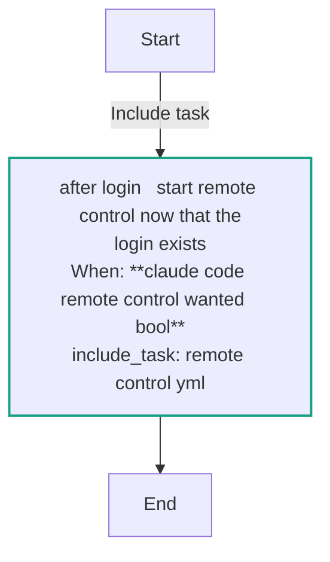
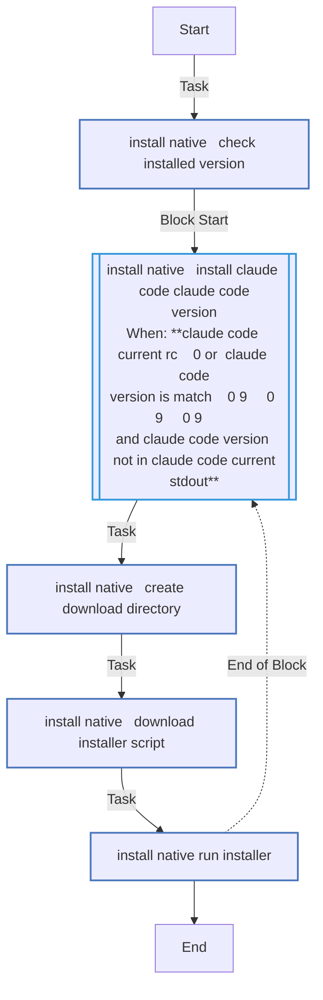
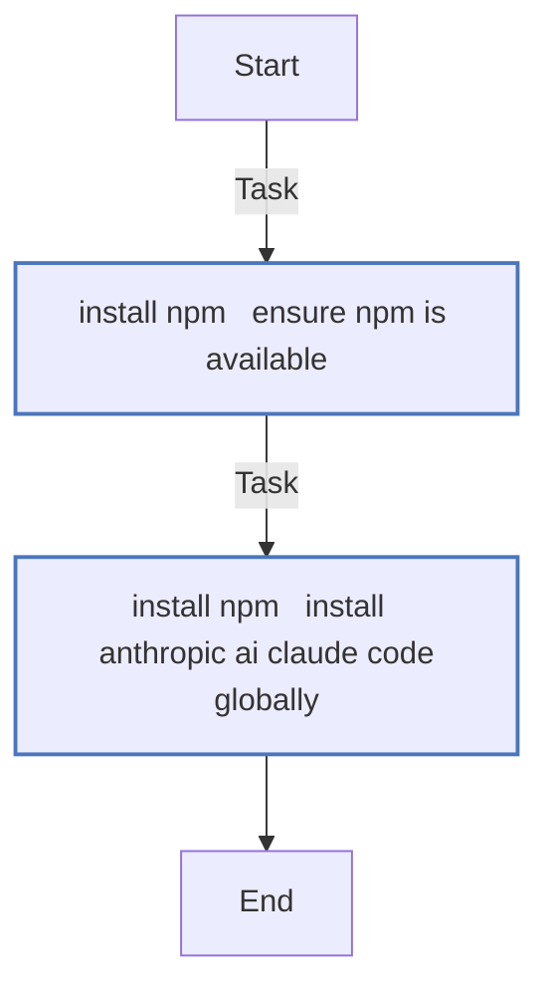
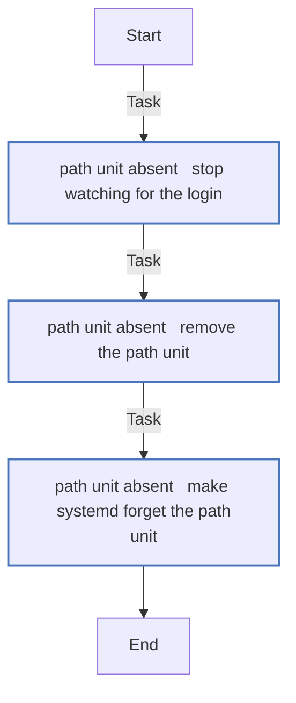
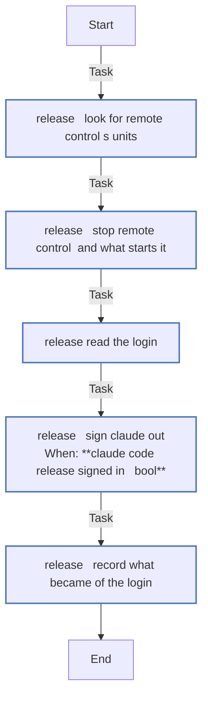

# `claude_code`

Installs Claude Code, writes `~/.claude/settings.json`, and runs Remote Control as a systemd service when the VM's credentials allow it. Four entry points: `main` for `just deploy --only configure` (`--tags claude_code`), `login` for `just login --only claude` and the sign-in in `just deploy`, `after_login`, which starts Remote Control once every VM has had its sign-in, and `release` for `just destroy`.

Using it: [Remote Control](../../guides/remote-control.md). How it works: [§5.5](../../architecture/roles.md#55-claude_code--install-claude-code).

<!-- BEGIN_GENERATED: role -->
<!-- Generated by `just docs` from roles/claude_code/meta/argument_specs.yml, vars/main.yml and tasks/: edit that, not this section. -->

## Entry point `main`

**Install and configure Claude Code for a user**

| Variable | Type | Default | Description |
|---|---|---|---|
| `claude_code_user` | str | `dev` | User Claude Code is set up for. Its ~/.claude is written, its login read, and Remote Control run as it. Set through vm_user in local.yml. |
| `claude_code_install_method` | str | `native` | native runs the official installer, a self-updating binary in the user's ~/.local/bin; npm installs @anthropic-ai/claude-code globally and needs Node.js. One of `native`, `npm`. |
| `claude_code_version` | str | `stable` | stable, latest or an exact semantic version. |
| `claude_code_installer_url` | str | `https://claude.ai/install.sh` | The installer script the native method downloads and runs. |
| `claude_code_anthropic_api_key` | str | `""` | Written to the env block of ~/.claude/settings.json. Clearing it removes the key an earlier run wrote there. Set through vault_anthropic_api_key in vault.yml. A secret: never logged. |
| `claude_code_settings` | dict | `{}` | Merged recursively into ~/.claude/settings.json. Its env block can carry a key or a token, which is why it is no_log. A secret: never logged. |
| `claude_code_global_instructions` | str | `""` | Content of ~/.claude/CLAUDE.md, the instructions Claude Code applies in every project. Empty writes nothing and leaves a file already there. |
| `claude_code_remote_control` | bool | `true` | Run a Claude Code Remote Control server on the VM, so its session appears at claude.ai/code and in the Claude mobile app while executing here. On by default, but it means "when this VM can". The role turns it off when claude_code_anthropic_api_key is set, because a key outranks the claude.ai login Remote Control requires; and it prepares but does not start the service when no login exists yet, because nothing can create one non- interactively. Set false to turn it off. Either way off, the service an earlier run installed is stopped, disabled and its unit removed. Set through claude_remote_control in local.yml. |
| `claude_code_remote_control_name` | str | same as `inventory_hostname` | Session title at claude.ai/code. Defaults to the VM name. Set through claude_remote_control in local.yml. |
| `claude_code_remote_control_dir` | str | `""` | Directory the sessions open in. Empty resolves to ~/projects. Not the home directory - Claude Code never saves workspace trust for one. Set through claude_remote_control in local.yml. |
| `claude_code_remote_control_permission_mode` | str | `default` | Starting permission mode for sessions the server creates, such as acceptEdits or plan. Passed as --permission- mode, which outranks permissions.defaultMode in claude_code_settings, so that setting does not reach these sessions. Deliberately not constrained to a list of choices here. Claude Code validates the mode at startup and prints the ones it accepts, so a mode added upstream works without a change to this role - whereas a hard- coded list would reject it before Claude Code ever saw it. Set through claude_remote_control in local.yml. |
| `claude_code_remote_control_spawn` | str | `same-dir` | How the server creates sessions. Set through claude_remote_control in local.yml. One of `same-dir`, `worktree`, `session`. |
| `claude_code_remote_control_service` | str | `claude-remote-control` | Name of the systemd unit installed for the server. Set through claude_remote_control in local.yml. |
| `claude_code_sign_in_follows` | bool | `false` | Set by just deploy's configure step, whose sign-in comes next in the same run. The message for a VM with no login then says so, rather than naming just login --only claude. |

## Entry point `login`

**Say whether Claude Code is signed in the way Remote Control needs, and sign it in when asked**

Runs `claude auth status` as claude_code_user and prints either that the VM is ready, or how to sign it in and what else to change.

With claude_code_login_interactive, signs a VM with no login in by the browser flow. Remote Control then starts from the after_login entry point, which the playbook runs once every VM has had its turn.

Decides with the same definitions the main entry point starts Remote Control from.

| Variable | Type | Default | Description |
|---|---|---|---|
| `claude_code_user` | str | `dev` | The user whose login is read and, when asked, made. The commands that read or make it run as this user, through become. Set through vm_user in local.yml. |
| `claude_code_anthropic_api_key` | str | `""` | With a key set the browser sign-in is not offered, and the report says Remote Control is off on purpose. Set through vault_anthropic_api_key in vault.yml. A secret: never logged. |
| `claude_code_login_interactive` | bool | `false` | Sign a VM with no Claude login and no API key in by the browser flow (browser_login.yml), then start Remote Control. Set by the playbooks; without it this entry point only reports. |
| `claude_code_login_desktop` | bool | `true` | Open the sign-in page in the controller's browser. Off in every test. Set through login_desktop in local.yml. |
| `claude_code_login_redirect` | bool | same as `claude_code_login_desktop` | Bring the browser back to the VM by itself once you authorise, with nothing to paste - claude's callback port forwarded from the controller over SSH for the sign-in. Defaults to claude_code_login_desktop, since only a browser on the controller reaches that forward; where the forward fails, the code is pasted. |
| `claude_code_login_approval_timeout` | int | `300` | Seconds the run waits for you to authorise in the browser when it comes back by itself. Set through claude_login_approval_timeout in local.yml. |
| `claude_code_login_args` | list of `str` | `[]` | Extra arguments for `claude auth login`, such as --sso or --email. Set through claude_login_args in local.yml. |
| `claude_code_login_timeout` | int | `120` | Seconds to wait, once the code is pasted, for claude to accept it. Set through claude_login_timeout in local.yml. |
| `claude_code_login_code` | str | `""` | The code the sign-in page shows, given instead of the prompt, for tests and scripts. No task logs it; pass it from a vars file (-e @file), never -e key=value, which ps and -vvvv show. A secret: never logged. |

## Entry point `after_login`

**Start Remote Control on a VM that was signed in just now**

Includes remote_control.yml as root when Remote Control is wanted, as just deploy --only configure would, now that the login it was waiting for exists.

| Variable | Type | Default | Description |
|---|---|---|---|
| `claude_code_remote_control` | bool | `true` | Run a Remote Control server on the VM. See the main entry point. Set through claude_remote_control in local.yml. |

Also takes, as described under `main`: `claude_code_remote_control_name`, `claude_code_remote_control_dir`, `claude_code_remote_control_permission_mode`, `claude_code_remote_control_spawn`, `claude_code_remote_control_service`.

## Entry point `release`

**Stop Remote Control and sign Claude Code out before the VM is destroyed**

Stops the Remote Control service and the path unit that starts it, then runs `claude auth logout` as claude_code_user. Records what became of the login in claude_code_release_said, for destroy's report. Set through claude_remote_control in local.yml.

Also takes, as described under `main`: `claude_code_user`, `claude_code_remote_control_service`.

## Internal values

Set in `roles/claude_code/vars/main.yml`. These are not settings: Ansible ranks a role's vars above `local.yml`, so a value set there has no effect. 43 of the 49 are computed during a run, from earlier tasks' results.

| Name | Value |
|---|---|
| `claude_code_remote_control_blocking_env` | `["DISABLE_TELEMETRY", "DO_NOT_TRACK", "CLAUDE_CODE_DISABLE_NONESSENTIAL_TRAFFIC", "DISABLE_GROWTHBOOK", "ANTHROPIC_AUTH_TOKEN", "CLAUDE_CODE_OAUTH_TOKEN", "CLAUDE_CODE_USE_BEDROCK", "CLAUDE_CODE_USE_VERTEX"]` |
| `claude_code_settings_existing_text` | <code>{{ (claude_code_settings_existing.content &#124; b64decode) if claude_code_settings_existing.content is defined else '' }}</code> |
| `claude_code_remote_control_settings_on_disk` | <code>{{ (claude_code_remote_control_settings_raw.content &#124; b64decode &#124; from_json) if claude_code_remote_control_settings_raw.content is defined and (claude_code_remote_control_settings_raw.content &#124; b64decode &#124; trim &#124; length > 0) else {} }}</code> |
| `claude_code_remote_control_settings_env` | <code>{{ claude_code_remote_control_settings_on_disk.env &#124; default({}, true) }}</code> |
| `claude_code_remote_control_base_url_ok` | <code>{{ 'ANTHROPIC_BASE_URL' not in claude_code_remote_control_settings_env or (claude_code_remote_control_settings_env.ANTHROPIC_BASE_URL &#124; urlsplit('hostname')) == 'api.anthropic.com' }}</code> |
| `claude_code_remote_control_settings_blockers` | <code>{{ (claude_code_remote_control_settings_env.keys() &#124; list &#124; intersect(claude_code_remote_control_blocking_env)) + (['apiKeyHelper'] if 'apiKeyHelper' in claude_code_remote_control_settings_on_disk else []) + (['ANTHROPIC_BASE_URL'] if not (claude_code_remote_control_base_url_ok &#124; bool) else []) }}</code> |
| `claude_code_remote_control_wanted` | <code>{{ claude_code_remote_control &#124; bool and claude_code_anthropic_api_key &#124; length == 0 }}</code> |
| `claude_code_remote_control_status` | <code>{{ (claude_code_remote_control_auth.stdout &#124; from_json) if claude_code_remote_control_auth.rc == 0 and (claude_code_remote_control_auth.stdout &#124; trim &#124; length > 0) else {} }}</code> |
| `claude_code_remote_control_eligible` | <code>{{ (claude_code_remote_control_status.loggedIn &#124; default(false)) &#124; bool and (claude_code_remote_control_status.authMethod &#124; default('')) == 'claude.ai' and (claude_code_remote_control_status.apiKeySource &#124; default('', true)) &#124; length == 0 and claude_code_remote_control_settings_blockers &#124; length == 0 }}</code> |
| `claude_code_remote_control_blocker` | <code>{{ '~/.claude/settings.json for ' ~ claude_code_user ~ ' on it disables Remote Control through ' ~ (claude_code_remote_control_settings_blockers &#124; join(', ')) ~ '. Each switches off the' ~ ' feature-flag evaluation Remote Control depends on, or routes the client away from the' ~ ' claude.ai login it needs. Remove it from claude_code_settings and from the file on the' ~ ' VM, or set claude_remote_control: false to leave Remote Control off.' if claude_code_remote_control_settings_blockers &#124; length > 0 else 'no Claude Code login is stored for ' ~ claude_code_user ~ ' on it.' if not (claude_code_remote_control_status.loggedIn &#124; default(false)) &#124; bool else 'Claude Code on it uses an API key from "' ~ claude_code_remote_control_status.apiKeySource ~ '", which outranks the claude.ai login Remote Control needs.' ~ ' Remove it wherever it is set (the shell environment, an env block' ~ ' in a settings file, apiKeyHelper), or run "claude auth logout" if' ~ ' it came from a Console login.' if (claude_code_remote_control_status.apiKeySource &#124; default('', true)) &#124; length > 0 else 'it is signed in through "' ~ (claude_code_remote_control_status.authMethod &#124; default('unknown')) ~ '", but Remote Control needs a claude.ai login on a Pro, Max, Team' ~ ' or Enterprise plan. Remove what selects that method wherever it is' ~ ' set - CLAUDE_CODE_OAUTH_TOKEN for a token from "claude setup-token",' ~ ' or a CLAUDE_CODE_USE_* setting that routes it to Bedrock, Vertex AI' ~ ' or another provider - or run "claude auth logout" for a stored login.' }}</code> |
| `claude_code_remote_control_login_command` | <code>ssh -t {{ claude_code_user }}@{{ ansible_host &#124; default(inventory_hostname) }} "bash -lc 'claude auth login'"</code> |
| `claude_code_remote_control_stayed_up` | <code>{{ (claude_code_remote_control_after.status.ActiveState &#124; default('')) == 'active' and (claude_code_remote_control_after.status.SubState &#124; default('')) == 'running' and (claude_code_remote_control_after.status.ExecMainPID &#124; default('0')) != '0' and (claude_code_remote_control_after.status.ExecMainPID &#124; default('0')) == (claude_code_remote_control_started.status.ExecMainPID &#124; default('')) and (claude_code_remote_control_after.status.NRestarts &#124; default('')) == (claude_code_remote_control_started.status.NRestarts &#124; default('')) }}</code> |
| `claude_code_remote_control_target_dir` | <code>{{ claude_code_remote_control_dir if claude_code_remote_control_dir &#124; length > 0 else claude_code_home ~ '/projects' }}</code> |
| `claude_code_remote_control_dialogs_seeded` | <code>{{ (claude_code_remote_control_cfg.hasCompletedOnboarding &#124; default(false)) &#124; bool and (claude_code_remote_control_cfg.remoteDialogSeen &#124; default(false)) &#124; bool and ((claude_code_remote_control_cfg.projects &#124; default({}, true)) .get(claude_code_remote_control_target_dir, {}) .get('hasTrustDialogAccepted', false)) &#124; bool }}</code> |
| `claude_code_remote_control_bridge_wanted` | <code>{{ not (claude_code_remote_control_status.loggedIn &#124; default(false)) &#124; bool and claude_code_remote_control_settings_blockers &#124; length == 0 }}</code> |
| `claude_code_login_dir` | `{{ claude_code_home }}/.config/claude-on-proxmox` |
| `claude_code_login_output` | `{{ claude_code_login_dir }}/claude-login.out` |
| `claude_code_login_pipe` | `{{ claude_code_login_dir }}/claude-login.in` |
| `claude_code_login_pidfile` | `{{ claude_code_login_dir }}/claude-login.pid` |
| `claude_code_login_text` | <code>{{ (claude_code_login_out.content &#124; b64decode) if claude_code_login_out.content is defined else '' }}</code> |
| `claude_code_login_url` | <code>{{ claude_code_login_text &#124; regex_search('https://[^\s\x07\x1b]+') or '' }}</code> |
| `claude_code_login_said` | <code>{{ claude_code_login_text &#124; plain_text }}</code> |
| `claude_code_login_answer` | <code>{{ ((claude_code_login_said &#124; regex_replace('(?s)^.*prompted >', '') &#124; trim).splitlines() or [''])[-1] }}</code> |
| `claude_code_login_attempt_seconds` | `1800` |
| `claude_code_login_start_seconds` | `30` |
| `claude_code_login_entered` | <code>{{ claude_code_login_code if claude_code_login_code &#124; length > 0 else ((claude_code_login_prompt &#124; default({})).user_input &#124; default('', true) &#124; trim) }}</code> |
| `claude_code_login_entered_again` | <code>{{ (claude_code_login_prompt_again &#124; default({})).user_input &#124; default('', true) &#124; trim }}</code> |
| `claude_code_login_command` | `just login {{ inventory_hostname }} --only claude` |
| `claude_code_login_browser` | `{{ claude_code_login_dir }}/claude-login.browser` |
| `claude_code_login_page_file` | `{{ claude_code_login_dir }}/claude-login.page` |
| `claude_code_login_forward_pidfile` | `{{ claude_code_login_dir }}/claude-login.forward.pid` |
| `claude_code_login_page_pattern` | <code>^https://(claude[.]com/cai&#124;claude[.]ai)/oauth/authorize[?]</code> |
| `claude_code_login_page_trusted` | `{{ claude_code_login_url is match(claude_code_login_page_pattern) }}` |
| `claude_code_login_auto_url` | <code>{{ (claude_code_login_page_read.content &#124; b64decode &#124; trim) if claude_code_login_page_read.content is defined else '' }}</code> |
| `claude_code_login_callback` | <code>{{ claude_code_login_auto_url &#124; regex_search('[?&amp;]redirect_uri=http%3A%2F%2Flocalhost%3A[0-9]+%2Fcallback(&amp;&#124;$)') or '' }}</code> |
| `claude_code_login_callback_port` | <code>{{ (claude_code_login_callback &#124; regex_replace('^.*localhost%3A', '') &#124; regex_replace('%2Fcallback.*$', '') &#124; int) if claude_code_login_callback &#124; length > 0 else 0 }}</code> |
| `claude_code_login_controller_remote` | <code>{{ lookup('ansible.builtin.env', 'SSH_CONNECTION') &#124; length > 0 }}</code> |
| `claude_code_login_browser_here` | <code>{{ not (claude_code_login_controller_remote &#124; bool) and claude_code_login_auto_url &#124; page_opener(lookup('ansible.builtin.env', 'BROWSER'), claude_code_login_tools.stdout_lines &#124; default([])) &#124; length > 0 }}</code> |
| `claude_code_login_redirect_ready` | <code>{{ claude_code_login_redirect &#124; bool and claude_code_login_code &#124; length == 0 and claude_code_login_browser_here &#124; bool and claude_code_login_auto_url is match(claude_code_login_page_pattern) and (claude_code_login_callback_port &#124; int) >= 1024 and (claude_code_login_callback_port &#124; int) &lt;= 65535 }}</code> |
| `claude_code_login_redirecting` | <code>{{ claude_code_login_redirect_ready &#124; bool and (claude_code_login_forward.rc &#124; default(1)) == 0 }}</code> |
| `claude_code_login_ssh` | `ssh` |
| `claude_code_login_forward_argv` | <code>{{ ['sh', '-c', 'exec "$@" >/dev/null 2>&amp;1', 'sh', claude_code_login_ssh, '-f', '-n', '-T', '-o', 'BatchMode=yes', '-o', 'ExitOnForwardFailure=yes', '-o', 'ConnectTimeout=15', '-o', 'StrictHostKeyChecking=accept-new', '-o', 'ControlMaster=no', '-o', 'ControlPath=none', '-p', (hostvars[inventory_hostname].ansible_port &#124; default(22)) &#124; string, '-L', 'localhost:' ~ claude_code_login_callback_port ~ ':127.0.0.1:' ~ claude_code_login_callback_port] + (['-i', hostvars[inventory_hostname].ansible_ssh_private_key_file] if hostvars[inventory_hostname].ansible_ssh_private_key_file is defined else []) + [(hostvars[inventory_hostname].ansible_user &#124; default(claude_code_user)) ~ '@' ~ hostvars[inventory_hostname].ansible_host &#124; default(inventory_hostname), 'echo $$ > ' ~ (claude_code_login_forward_pidfile &#124; quote) ~ ' &amp;&amp; exec sleep ' ~ (claude_code_login_approval_timeout &#124; int + 60)] }}</code> |
| `claude_code_login_responded` | <code>{{ claude_code_login_entered &#124; length > 0 or (claude_code_login_redirecting &#124; bool and (claude_code_login_landed.finished &#124; default(0) &#124; int) == 1) }}</code> |
| `claude_code_remote_control_stay_up_seconds` | `20` |
| `claude_code_release_state` | <code>{{ (claude_code_release_status.stdout &#124; from_json) if (claude_code_release_status.stdout &#124; default('') &#124; trim)[:1] == '{' else {} }}</code> |
| `claude_code_release_signed_in` | <code>{{ claude_code_release_state.loggedIn &#124; default(false) &#124; bool }}</code> |
| `claude_code_release_rc_stopped` | <code>{{ claude_code_release_stopped.results &#124; default([]) &#124; selectattr('changed', 'defined') &#124; selectattr('changed') &#124; selectattr('item.item', 'equalto', 'service') &#124; list &#124; length > 0 }}</code> |
| `claude_code_release_why` | <code>{{ (claude_code_release_logout.stderr &#124; default('') &#124; plain_text &#124; regex_replace('\s+', ' ') &#124; trim) or 'no reason given' }}</code> |
| `claude_code_release_summary` | <code>{{ ((['Remote Control stopped (its session stays in the Claude app, offline)'] if claude_code_release_rc_stopped &#124; bool else []) + ([('signed out' if (claude_code_release_logout.rc &#124; default(1)) == 0 else 'could not sign out (' ~ claude_code_release_why ~ ')')] if claude_code_release_signed_in &#124; bool else [])) &#124; join('; ') }}</code> |

## Tasks

Every task in `roles/claude_code/tasks/`, file by file, in the order the file lists them, with a flowchart of
each file. Generated from the task files, so a task added, renamed or removed shows here on the next `just docs`.

### `main.yml` - entry point `main`

| Task | Module | When |
|---|---|---|
| Look up home directory of {{ claude_code_user }} | `ansible.builtin.getent` |  |
| Set Claude Code paths | `ansible.builtin.set_fact` |  |
| Ensure ~/.claude exists | `ansible.builtin.file` |  |
| Install with the native installer | `ansible.builtin.include_tasks` | <code>claude_code_install_method == 'native'</code> |
| Install with npm | `ansible.builtin.include_tasks` | <code>claude_code_install_method == 'npm'</code> |
| Write user settings | `ansible.builtin.include_tasks` |  |
| Write global CLAUDE.md | `ansible.builtin.copy` | <code>claude_code_global_instructions &#124; length > 0</code> |
| Verify claude runs | `ansible.builtin.command` |  |
| Show installed version | `ansible.builtin.debug` |  |
| Set up Remote Control | `ansible.builtin.include_tasks` | <code>claude_code_remote_control_wanted &#124; bool</code> |
| Look for a Remote Control unit an earlier run installed | `ansible.builtin.stat` | <code>not (claude_code_remote_control_wanted &#124; bool)</code> |
| Look for the path unit an earlier run installed | `ansible.builtin.stat` | <code>not (claude_code_remote_control_wanted &#124; bool)</code> |
| Remove the path unit that would start Remote Control | `ansible.builtin.include_tasks` | <code>not (claude_code_remote_control_wanted &#124; bool) and claude_code_remote_control_bridge_leftover.stat.exists</code> |
| Remove Remote Control | block | <code>not (claude_code_remote_control_wanted &#124; bool) and claude_code_remote_control_leftover.stat.exists</code> |
| &emsp;Stop and disable the Remote Control service | `ansible.builtin.systemd_service` |  |
| &emsp;Remove the Remote Control unit | `ansible.builtin.file` |  |
| &emsp;Make systemd forget the removed unit | `ansible.builtin.systemd_service` |  |

```mermaid
flowchart TD
Start
classDef block stroke:#3498db,stroke-width:2px;
classDef task stroke:#4b76bb,stroke-width:2px;
classDef includeTasks stroke:#16a085,stroke-width:2px;
classDef importTasks stroke:#34495e,stroke-width:2px;
classDef includeRole stroke:#2980b9,stroke-width:2px;
classDef importRole stroke:#699ba7,stroke-width:2px;
classDef includeVars stroke:#8e44ad,stroke-width:2px;
classDef rescue stroke:#665352,stroke-width:2px;

  Start-->|Task| Look_up_home_directory_of_claude_code_user0[look up home directory of claude code user]:::task
  Look_up_home_directory_of_claude_code_user0-->|Task| Set_Claude_Code_paths1[set claude code paths]:::task
  Set_Claude_Code_paths1-->|Task| Ensure____claude_exists2[ensure    claude exists]:::task
  Ensure____claude_exists2-->|Include task| Install_with_the_native_installer_install_native_yml_3[install with the native installer<br>When: **claude code install method     native**<br>include_task: install native yml]:::includeTasks
  Install_with_the_native_installer_install_native_yml_3-->|Include task| Install_with_npm_install_npm_yml_4[install with npm<br>When: **claude code install method     npm**<br>include_task: install npm yml]:::includeTasks
  Install_with_npm_install_npm_yml_4-->|Include task| Write_user_settings_settings_yml_5[write user settings<br>include_task: settings yml]:::includeTasks
  Write_user_settings_settings_yml_5-->|Task| Write_global_CLAUDE_md6[write global claude md<br>When: **claude code global instructions   length   0**]:::task
  Write_global_CLAUDE_md6-->|Task| Verify_claude_runs7[verify claude runs]:::task
  Verify_claude_runs7-->|Task| Show_installed_version8[show installed version]:::task
  Show_installed_version8-->|Include task| Set_up_Remote_Control_remote_control_yml_9[set up remote control<br>When: **claude code remote control wanted   bool**<br>include_task: remote control yml]:::includeTasks
  Set_up_Remote_Control_remote_control_yml_9-->|Task| Look_for_a_Remote_Control_unit_an_earlier_run_installed10[look for a remote control unit an earlier run<br>installed<br>When: **not  claude code remote control wanted   bool**]:::task
  Look_for_a_Remote_Control_unit_an_earlier_run_installed10-->|Task| Look_for_the_path_unit_an_earlier_run_installed11[look for the path unit an earlier run installed<br>When: **not  claude code remote control wanted   bool**]:::task
  Look_for_the_path_unit_an_earlier_run_installed11-->|Include task| Remove_the_path_unit_that_would_start_Remote_Control_path_unit_absent_yml_12[remove the path unit that would start remote<br>control<br>When: **not  claude code remote control wanted   bool  and<br>claude code remote control bridge leftover stat<br>exists**<br>include_task: path unit absent yml]:::includeTasks
  Remove_the_path_unit_that_would_start_Remote_Control_path_unit_absent_yml_12-->|Block Start| Remove_Remote_Control13_block_start_0[[remove remote control<br>When: **not  claude code remote control wanted   bool  and<br>claude code remote control leftover stat exists**]]:::block
  Remove_Remote_Control13_block_start_0-->|Task| Stop_and_disable_the_Remote_Control_service0[stop and disable the remote control service]:::task
  Stop_and_disable_the_Remote_Control_service0-->|Task| Remove_the_Remote_Control_unit1[remove the remote control unit]:::task
  Remove_the_Remote_Control_unit1-->|Task| Make_systemd_forget_the_removed_unit2[make systemd forget the removed unit]:::task
  Make_systemd_forget_the_removed_unit2-.->|End of Block| Remove_Remote_Control13_block_start_0
  Make_systemd_forget_the_removed_unit2-->|Task| Explain_why_Remote_Control_was_skipped14[explain why remote control was skipped<br>When: **claude code remote control   bool and claude code<br>anthropic api key   length   0**]:::task
  Explain_why_Remote_Control_was_skipped14-->End
```

| Explain why Remote Control was skipped | `ansible.builtin.debug` | <code>claude_code_remote_control &#124; bool and claude_code_anthropic_api_key &#124; length > 0</code> |

### `after_login.yml` - entry point `after_login`

| Task | Module | When |
|---|---|---|
| Start Remote Control now that the login exists | `ansible.builtin.include_tasks` | <code>claude_code_remote_control_wanted &#124; bool</code> |

### `browser_login.yml`

| Task | Module | When |
|---|---|---|
| Refuse to prompt for more than one VM at a time | `ansible.builtin.assert` |  |
| Find claude | `ansible.builtin.command` |  |
| Fail when claude is not on the user's PATH | `ansible.builtin.assert` |  |
| Make the directory for the sign-in's files | `ansible.builtin.file` |  |
| Look for a sign-in of this VM still waiting | `ansible.builtin.command` |  |
| Refuse to start over a sign-in still waiting | `ansible.builtin.fail` | <code>claude_code_login_other.stdout &#124; trim &#124; length > 0</code> |
| Remove the files of an earlier attempt | `ansible.builtin.file` |  |
| Give claude a browser that hands its page over | `ansible.builtin.copy` |  |
| Make the pipe claude reads the code from | `ansible.builtin.command` |  |
| Start the sign-in in the background | `ansible.builtin.shell` |  |
| Sign in, then clean up whatever happened | block |  |
| &emsp;Wait for claude to show the sign-in page | `ansible.builtin.wait_for` |  |
| &emsp;Read what claude printed | `ansible.builtin.slurp` |  |
| &emsp;Fail when claude did not start the sign-in | `ansible.builtin.fail` | <code>claude_code_login_url &#124; length == 0</code> |
| &emsp;Wait for the page claude handed its browser | `ansible.builtin.wait_for` | <code>claude_code_login_redirect &#124; bool</code> |
| &emsp;Read the page claude handed its browser | `ansible.builtin.slurp` | <code>claude_code_login_redirect &#124; bool</code> |
| &emsp;Look for a browser opener on this machine | `ansible.builtin.command` | <code>claude_code_login_desktop &#124; bool</code> |
| &emsp;Forward the sign-in's callback from this machine to the VM | `ansible.builtin.command` | <code>claude_code_login_redirect_ready &#124; bool</code> |
| &emsp;Say the page and what happens next | `ansible.builtin.debug` |  |
| &emsp;Open the sign-in page in your browser | `ansible.builtin.command` | <code>claude_code_login_desktop &#124; bool and claude_code_login_redirecting &#124; bool or claude_code_login_page_trusted &#124; bool and claude_code_login_opener &#124; length > 0</code> |
| &emsp;Paste the code the browser shows for {{ inventory_hostname }} | `ansible.builtin.pause` | <code>claude_code_login_code &#124; length == 0 and not (claude_code_login_redirecting &#124; bool)</code> |
| &emsp;Wait for your browser to come back | `ansible.builtin.async_status` | <code>claude_code_login_redirecting &#124; bool</code> |
| &emsp;Remember whether someone answered for this VM | `ansible.builtin.set_fact` |  |
| &emsp;Say that no code was entered | `ansible.builtin.debug` | <code>not (claude_code_login_redirecting &#124; bool) and claude_code_login_entered &#124; length == 0</code> |
| &emsp;Keep what is left to do for the end of the run | `ansible.builtin.set_stats` | <code>not (claude_code_login_redirecting &#124; bool) and claude_code_login_entered &#124; length == 0</code> |
| &emsp;Say that the browser did not come back | `ansible.builtin.debug` | <code>claude_code_login_redirecting &#124; bool and not (claude_code_login_responded &#124; bool)</code> |
| &emsp;Keep what is left to do for the end of the run | `ansible.builtin.set_stats` | <code>claude_code_login_redirecting &#124; bool and not (claude_code_login_responded &#124; bool)</code> |
| &emsp;Check that the sign-in is still waiting | `ansible.builtin.async_status` | <code>claude_code_login_entered &#124; length > 0</code> |
| &emsp;Fail when the sign-in ended before the code came | `ansible.builtin.fail` | <code>claude_code_login_entered &#124; length > 0 and claude_code_login_still.finished &#124; default(0) &#124; int == 1</code> |
| &emsp;Hand the code to claude | `ansible.builtin.command` | <code>claude_code_login_entered &#124; length > 0</code> |
| &emsp;Wait for claude's answer | `ansible.builtin.wait_for` | <code>claude_code_login_entered &#124; length > 0</code> |
| &emsp;Read claude's answer | `ansible.builtin.slurp` | <code>claude_code_login_entered &#124; length > 0</code> |
| &emsp;Paste the whole code the browser shows, what follows # included, for {{ inventory_hostname }} | `ansible.builtin.pause` | <code>claude_code_login_code &#124; length == 0 and claude_code_login_answer is search('Invalid code')</code> |
| &emsp;Hand the whole code to claude | `ansible.builtin.command` | <code>claude_code_login_answer is search('Invalid code') and claude_code_login_entered_again &#124; length > 0</code> |
| &emsp;Wait for claude to finish with the whole code | `ansible.builtin.async_status` | <code>claude_code_login_answer is search('Invalid code') and claude_code_login_entered_again &#124; length > 0</code> |
| &emsp;*always:* | | |
| &emsp;&emsp;Give claude a moment to finish | `ansible.builtin.async_status` | <code>claude_code_login_entered &#124; length > 0</code> |
| &emsp;&emsp;End the sign-in if claude still waits | `ansible.builtin.command` | <code>claude_code_login_finished.finished &#124; default(0) &#124; int != 1 and claude_code_login_landed.finished &#124; default(0) &#124; int != 1</code> |
| &emsp;&emsp;Close the forward | `ansible.builtin.command` | <code>(claude_code_login_forward.rc &#124; default(1)) == 0</code> |
| &emsp;&emsp;Collect claude's result | `ansible.builtin.async_status` |  |
| &emsp;&emsp;Clean up claude's job | `ansible.builtin.async_status` |  |
| &emsp;&emsp;Read what claude printed, now it has finished | `ansible.builtin.slurp` |  |
| &emsp;&emsp;Remove the sign-in's files | `ansible.builtin.file` |  |
| Check the login again | `ansible.builtin.command` |  |

```mermaid
flowchart TD
Start
classDef block stroke:#3498db,stroke-width:2px;
classDef task stroke:#4b76bb,stroke-width:2px;
classDef includeTasks stroke:#16a085,stroke-width:2px;
classDef importTasks stroke:#34495e,stroke-width:2px;
classDef includeRole stroke:#2980b9,stroke-width:2px;
classDef importRole stroke:#699ba7,stroke-width:2px;
classDef includeVars stroke:#8e44ad,stroke-width:2px;
classDef rescue stroke:#665352,stroke-width:2px;

  Start-->|Task| browser_login___Refuse_to_prompt_for_more_than_one_VM_at_a_time0[browser login   refuse to prompt for more than one<br>vm at a time]:::task
  browser_login___Refuse_to_prompt_for_more_than_one_VM_at_a_time0-->|Task| browser_login___Find_claude1[browser login   find claude]:::task
  browser_login___Find_claude1-->|Task| browser_login___Fail_when_claude_is_not_on_the_user_s_PATH2[browser login   fail when claude is not on the<br>user s path]:::task
  browser_login___Fail_when_claude_is_not_on_the_user_s_PATH2-->|Task| browser_login___Make_the_directory_for_the_sign_in_s_files3[browser login   make the directory for the sign in<br>s files]:::task
  browser_login___Make_the_directory_for_the_sign_in_s_files3-->|Task| browser_login___Look_for_a_sign_in_of_this_VM_still_waiting4[browser login   look for a sign in of this vm<br>still waiting]:::task
  browser_login___Look_for_a_sign_in_of_this_VM_still_waiting4-->|Task| browser_login___Refuse_to_start_over_a_sign_in_still_waiting5[browser login   refuse to start over a sign in<br>still waiting<br>When: **claude code login other stdout   trim   length   0**]:::task
  browser_login___Refuse_to_start_over_a_sign_in_still_waiting5-->|Task| browser_login___Remove_the_files_of_an_earlier_attempt6[browser login   remove the files of an earlier<br>attempt]:::task
  browser_login___Remove_the_files_of_an_earlier_attempt6-->|Task| browser_login___Give_claude_a_browser_that_hands_its_page_over7[browser login   give claude a browser that hands<br>its page over]:::task
  browser_login___Give_claude_a_browser_that_hands_its_page_over7-->|Task| browser_login___Make_the_pipe_claude_reads_the_code_from8[browser login   make the pipe claude reads the<br>code from]:::task
  browser_login___Make_the_pipe_claude_reads_the_code_from8-->|Task| browser_login___Start_the_sign_in_in_the_background9[browser login   start the sign in in the<br>background]:::task
  browser_login___Start_the_sign_in_in_the_background9-->|Block Start| browser_login___Sign_in__then_clean_up_whatever_happened10_block_start_0[[browser login   sign in  then clean up whatever<br>happened]]:::block
  browser_login___Sign_in__then_clean_up_whatever_happened10_block_start_0-->|Task| browser_login___Wait_for_claude_to_show_the_sign_in_page0[browser login   wait for claude to show the sign<br>in page]:::task
  browser_login___Wait_for_claude_to_show_the_sign_in_page0-->|Task| browser_login___Read_what_claude_printed1[browser login   read what claude printed]:::task
  browser_login___Read_what_claude_printed1-->|Task| browser_login___Fail_when_claude_did_not_start_the_sign_in2[browser login   fail when claude did not start the<br>sign in<br>When: **claude code login url   length    0**]:::task
  browser_login___Fail_when_claude_did_not_start_the_sign_in2-->|Task| browser_login___Wait_for_the_page_claude_handed_its_browser3[browser login   wait for the page claude handed<br>its browser<br>When: **claude code login redirect   bool**]:::task
  browser_login___Wait_for_the_page_claude_handed_its_browser3-->|Task| browser_login___Read_the_page_claude_handed_its_browser4[browser login   read the page claude handed its<br>browser<br>When: **claude code login redirect   bool**]:::task
  browser_login___Read_the_page_claude_handed_its_browser4-->|Task| browser_login___Look_for_a_browser_opener_on_this_machine5[browser login   look for a browser opener on this<br>machine<br>When: **claude code login desktop   bool**]:::task
  browser_login___Look_for_a_browser_opener_on_this_machine5-->|Task| browser_login___Forward_the_sign_in_s_callback_from_this_machine_to_the_VM6[browser login   forward the sign in s callback<br>from this machine to the vm<br>When: **claude code login redirect ready   bool**]:::task
  browser_login___Forward_the_sign_in_s_callback_from_this_machine_to_the_VM6-->|Task| browser_login___Say_the_page_and_what_happens_next7[browser login   say the page and what happens next]:::task
  browser_login___Say_the_page_and_what_happens_next7-->|Task| browser_login___Open_the_sign_in_page_in_your_browser8[browser login   open the sign in page in your<br>browser<br>When: **claude code login desktop   bool and claude code<br>login redirecting   bool or claude code login page<br>trusted   bool and claude code login opener  <br>length   0**]:::task
  browser_login___Open_the_sign_in_page_in_your_browser8-->|Task| browser_login___Paste_the_code_the_browser_shows_for_inventory_hostname9[browser login   paste the code the browser shows<br>for inventory hostname<br>When: **claude code login code   length    0 and not <br>claude code login redirecting   bool**]:::task
  browser_login___Paste_the_code_the_browser_shows_for_inventory_hostname9-->|Task| browser_login___Wait_for_your_browser_to_come_back10[browser login   wait for your browser to come back<br>When: **claude code login redirecting   bool**]:::task
  browser_login___Wait_for_your_browser_to_come_back10-->|Task| browser_login___Remember_whether_someone_answered_for_this_VM11[browser login   remember whether someone answered<br>for this vm]:::task
  browser_login___Remember_whether_someone_answered_for_this_VM11-->|Task| browser_login___Say_that_no_code_was_entered12[browser login   say that no code was entered<br>When: **not  claude code login redirecting   bool  and<br>claude code login entered   length    0**]:::task
  browser_login___Say_that_no_code_was_entered12-->|Task| browser_login___Keep_what_is_left_to_do_for_the_end_of_the_run13[browser login   keep what is left to do for the<br>end of the run<br>When: **not  claude code login redirecting   bool  and<br>claude code login entered   length    0**]:::task
  browser_login___Keep_what_is_left_to_do_for_the_end_of_the_run13-->|Task| browser_login___Say_that_the_browser_did_not_come_back14[browser login   say that the browser did not come<br>back<br>When: **claude code login redirecting   bool and not <br>claude code login responded   bool**]:::task
  browser_login___Say_that_the_browser_did_not_come_back14-->|Task| browser_login___Keep_what_is_left_to_do_for_the_end_of_the_run15[browser login   keep what is left to do for the<br>end of the run<br>When: **claude code login redirecting   bool and not <br>claude code login responded   bool**]:::task
  browser_login___Keep_what_is_left_to_do_for_the_end_of_the_run15-->|Task| browser_login___Check_that_the_sign_in_is_still_waiting16[browser login   check that the sign in is still<br>waiting<br>When: **claude code login entered   length   0**]:::task
  browser_login___Check_that_the_sign_in_is_still_waiting16-->|Task| browser_login___Fail_when_the_sign_in_ended_before_the_code_came17[browser login   fail when the sign in ended before<br>the code came<br>When: **claude code login entered   length   0 and claude<br>code login still finished   default 0    int    1**]:::task
  browser_login___Fail_when_the_sign_in_ended_before_the_code_came17-->|Task| browser_login___Hand_the_code_to_claude18[browser login   hand the code to claude<br>When: **claude code login entered   length   0**]:::task
  browser_login___Hand_the_code_to_claude18-->|Task| browser_login___Wait_for_claude_s_answer19[browser login   wait for claude s answer<br>When: **claude code login entered   length   0**]:::task
  browser_login___Wait_for_claude_s_answer19-->|Task| browser_login___Read_claude_s_answer20[browser login   read claude s answer<br>When: **claude code login entered   length   0**]:::task
  browser_login___Read_claude_s_answer20-->|Task| browser_login___Paste_the_whole_code_the_browser_shows__what_follows___included__for_inventory_hostname21[browser login   paste the whole code the browser<br>shows  what follows   included  for inventory<br>hostname<br>When: **claude code login code   length    0 and claude<br>code login answer is search  invalid code**]:::task
  browser_login___Paste_the_whole_code_the_browser_shows__what_follows___included__for_inventory_hostname21-->|Task| browser_login___Hand_the_whole_code_to_claude22[browser login   hand the whole code to claude<br>When: **claude code login answer is search  invalid code  <br>and claude code login entered again   length   0**]:::task
  browser_login___Hand_the_whole_code_to_claude22-->|Task| browser_login___Wait_for_claude_to_finish_with_the_whole_code23[browser login   wait for claude to finish with the<br>whole code<br>When: **claude code login answer is search  invalid code  <br>and claude code login entered again   length   0**]:::task
  browser_login___Wait_for_claude_to_finish_with_the_whole_code23-.->|End of Block| browser_login___Sign_in__then_clean_up_whatever_happened10_block_start_0
  browser_login___Wait_for_claude_to_finish_with_the_whole_code23-->|Task| browser_login___Check_the_login_again11[browser login   check the login again]:::task
  browser_login___Check_the_login_again11-->|Task| browser_login___Fail_when_the_sign_in_did_not_complete12[browser login   fail when the sign in did not<br>complete<br>When: **claude code login responded   bool and not  claude<br>code remote control status loggedin   default<br>false     bool**]:::task
  browser_login___Fail_when_the_sign_in_did_not_complete12-->|Task| browser_login___Record_that_this_run_signed_the_VM_in13[browser login   record that this run signed the vm<br>in<br>When: **claude code login responded   bool**]:::task
  browser_login___Record_that_this_run_signed_the_VM_in13-->End
```

| Fail when the sign-in did not complete | `ansible.builtin.fail` | <code>claude_code_login_responded &#124; bool and not (claude_code_remote_control_status.loggedIn &#124; default(false)) &#124; bool</code> |
| Record that this run signed the VM in | `ansible.builtin.set_fact` | <code>claude_code_login_responded &#124; bool</code> |

### `install_native.yml`

| Task | Module | When |
|---|---|---|
| Check installed version | `ansible.builtin.command` |  |
| Install Claude Code {{ claude_code_version }} | block | <code>claude_code_current.rc != 0 or (claude_code_version is match('^[0-9]+\.[0-9]+\.[0-9]+')     and claude_code_version not in claude_code_current.stdout)</code> |
| &emsp;Create download directory | `ansible.builtin.tempfile` |  |
| &emsp;Download installer script | `ansible.builtin.get_url` |  |
| &emsp;Run installer | `ansible.builtin.command` |  |
| &emsp;*always:* | | |
| &emsp;&emsp;Remove download directory | `ansible.builtin.file` | <code>claude_code_tmp.path is defined</code> |

### `install_npm.yml`

| Task | Module | When |
|---|---|---|
| Ensure npm is available | `ansible.builtin.command` |  |
| Install @anthropic-ai/claude-code globally | `community.general.npm` |  |

### `login.yml` - entry point `login`

| Task | Module | When |
|---|---|---|
| Look up home directory of {{ claude_code_user }} | `ansible.builtin.getent` | <code>claude_code_home is not defined</code> |
| Record where the user's files are | `ansible.builtin.set_fact` | <code>claude_code_home is not defined</code> |
| Check whether this VM is logged in | `ansible.builtin.command` |  |
| Read the settings Claude Code will start with | `ansible.builtin.slurp` |  |
| Sign Claude Code in by the browser | `ansible.builtin.include_tasks` | <code>claude_code_login_interactive &#124; bool and claude_code_anthropic_api_key &#124; length == 0 and not (claude_code_remote_control_status.loggedIn &#124; default(false)) &#124; bool</code> |
| Report the login state and what to do about it | `ansible.builtin.debug` |  |
| Keep what is left to do for the end of the run | `ansible.builtin.set_stats` |  |

```mermaid
flowchart TD
Start
classDef block stroke:#3498db,stroke-width:2px;
classDef task stroke:#4b76bb,stroke-width:2px;
classDef includeTasks stroke:#16a085,stroke-width:2px;
classDef importTasks stroke:#34495e,stroke-width:2px;
classDef includeRole stroke:#2980b9,stroke-width:2px;
classDef importRole stroke:#699ba7,stroke-width:2px;
classDef includeVars stroke:#8e44ad,stroke-width:2px;
classDef rescue stroke:#665352,stroke-width:2px;

  Start-->|Task| login___Look_up_home_directory_of_claude_code_user0[login   look up home directory of claude code user<br>When: **claude code home is not defined**]:::task
  login___Look_up_home_directory_of_claude_code_user0-->|Task| login___Record_where_the_user_s_files_are1[login   record where the user s files are<br>When: **claude code home is not defined**]:::task
  login___Record_where_the_user_s_files_are1-->|Task| login___Check_whether_this_VM_is_logged_in2[login   check whether this vm is logged in]:::task
  login___Check_whether_this_VM_is_logged_in2-->|Task| login___Read_the_settings_Claude_Code_will_start_with3[login   read the settings claude code will start<br>with]:::task
  login___Read_the_settings_Claude_Code_will_start_with3-->|Include task| login___Sign_Claude_Code_in_by_the_browser_browser_login_yml_4[login   sign claude code in by the browser<br>When: **claude code login interactive   bool and claude<br>code anthropic api key   length    0 and not <br>claude code remote control status loggedin  <br>default false     bool**<br>include_task: browser login yml]:::includeTasks
  login___Sign_Claude_Code_in_by_the_browser_browser_login_yml_4-->|Task| login___Report_the_login_state_and_what_to_do_about_it5[login   report the login state and what to do<br>about it]:::task
  login___Report_the_login_state_and_what_to_do_about_it5-->|Task| login___Keep_what_is_left_to_do_for_the_end_of_the_run6[login   keep what is left to do for the end of the<br>run]:::task
  login___Keep_what_is_left_to_do_for_the_end_of_the_run6-->End
```

### `path_unit_absent.yml`

| Task | Module | When |
|---|---|---|
| Stop watching for the login | `ansible.builtin.systemd_service` |  |
| Remove the path unit | `ansible.builtin.file` |  |
| Make systemd forget the path unit | `ansible.builtin.systemd_service` |  |

### `release.yml` - entry point `release`

| Task | Module | When |
|---|---|---|
| Look for Remote Control's units | `ansible.builtin.stat` |  |
| Stop Remote Control, and what starts it | `ansible.builtin.systemd_service` |  |
| Read the login | `ansible.builtin.command` |  |
| Sign claude out | `ansible.builtin.command` | <code>claude_code_release_signed_in &#124; bool</code> |
| Record what became of the login | `ansible.builtin.set_fact` |  |

### `remote_control.yml`

| Task | Module | When |
|---|---|---|
| Read the settings Claude Code will start with | `ansible.builtin.slurp` |  |
| Ensure the session's working directory exists | `ansible.builtin.file` |  |
| Resolve the claude binary | `ansible.builtin.command` |  |
| Record the binary path | `ansible.builtin.set_fact` |  |
| Fail when claude is not on the user's PATH | `ansible.builtin.assert` |  |
| Read the Claude Code config | `ansible.builtin.slurp` |  |
| Record the current config | `ansible.builtin.set_fact` |  |
| Pre-accept onboarding, workspace trust and the Remote Control prompt | `ansible.builtin.copy` | <code>not (claude_code_remote_control_dialogs_seeded &#124; bool)</code> |
| Check whether this VM is logged in | `ansible.builtin.command` |  |
| Install the systemd unit | `ansible.builtin.template` |  |
| Look for the unit the service needs | `ansible.builtin.stat` |  |
| Require a git repository for worktree spawn | block | <code>claude_code_remote_control_eligible &#124; bool and claude_code_remote_control_spawn == 'worktree'</code> |
| &emsp;Look for a git repository in the session directory | `ansible.builtin.stat` |  |
| &emsp;Fail when worktree spawn has no git repository | `ansible.builtin.assert` |  |
| Look for the unit that starts Remote Control when a login lands | `ansible.builtin.stat` |  |
| Remove the unit that waited for the login | `ansible.builtin.include_tasks` | <code>not (claude_code_remote_control_bridge_wanted &#124; bool) and claude_code_remote_control_bridge.stat.exists</code> |
| Start Remote Control | block | <code>claude_code_remote_control_eligible &#124; bool and claude_code_remote_control_unit_file.stat.exists</code> |
| &emsp;Read the service state | `ansible.builtin.systemd_service` |  |
| &emsp;Enable and start the service | `ansible.builtin.systemd_service` |  |
| &emsp;Confirm the session stayed up | block | <code>not ansible_check_mode and claude_code_remote_control_start is changed</code> |
| &emsp;&emsp;Record the server process just started | `ansible.builtin.systemd_service` |  |
| &emsp;&emsp;Give the server time to fail | `ansible.builtin.wait_for` |  |
| &emsp;&emsp;Read the server process again | `ansible.builtin.systemd_service` |  |
| &emsp;&emsp;Fail when the session did not stay up | `ansible.builtin.assert` |  |
| &emsp;Report where to reach the session | `ansible.builtin.debug` | <code>not ansible_check_mode</code> |
| &emsp;Keep what is left to do for the end of the run | `ansible.builtin.set_stats` | <code>not ansible_check_mode</code> |
| Install the unit that starts Remote Control when a login lands | `ansible.builtin.template` | <code>claude_code_remote_control_bridge_wanted &#124; bool</code> |
| Look again for the unit that starts Remote Control when a login lands | `ansible.builtin.stat` | <code>claude_code_remote_control_bridge_wanted &#124; bool</code> |
| Watch for the login | `ansible.builtin.systemd_service` | <code>claude_code_remote_control_bridge_wanted &#124; bool and claude_code_remote_control_bridge_now.stat.exists</code> |
| Explain the one step that cannot be automated | block | <code>not (claude_code_remote_control_eligible &#124; bool)</code> |
| &emsp;Leave the service stopped until the login exists | `ansible.builtin.systemd_service` | <code>claude_code_remote_control_unit_file.stat.exists</code> |
| &emsp;Say exactly what to run | `ansible.builtin.debug` |  |
| &emsp;Keep what is left to do for the end of the run | `ansible.builtin.set_stats` |  |

```mermaid
flowchart TD
Start
classDef block stroke:#3498db,stroke-width:2px;
classDef task stroke:#4b76bb,stroke-width:2px;
classDef includeTasks stroke:#16a085,stroke-width:2px;
classDef importTasks stroke:#34495e,stroke-width:2px;
classDef includeRole stroke:#2980b9,stroke-width:2px;
classDef importRole stroke:#699ba7,stroke-width:2px;
classDef includeVars stroke:#8e44ad,stroke-width:2px;
classDef rescue stroke:#665352,stroke-width:2px;

  Start-->|Task| remote_control___Read_the_settings_Claude_Code_will_start_with0[remote control   read the settings claude code<br>will start with]:::task
  remote_control___Read_the_settings_Claude_Code_will_start_with0-->|Task| remote_control___Ensure_the_session_s_working_directory_exists1[remote control   ensure the session s working<br>directory exists]:::task
  remote_control___Ensure_the_session_s_working_directory_exists1-->|Task| remote_control___Resolve_the_claude_binary2[remote control   resolve the claude binary]:::task
  remote_control___Resolve_the_claude_binary2-->|Task| remote_control___Record_the_binary_path3[remote control   record the binary path]:::task
  remote_control___Record_the_binary_path3-->|Task| remote_control___Fail_when_claude_is_not_on_the_user_s_PATH4[remote control   fail when claude is not on the<br>user s path]:::task
  remote_control___Fail_when_claude_is_not_on_the_user_s_PATH4-->|Task| remote_control___Read_the_Claude_Code_config5[remote control   read the claude code config]:::task
  remote_control___Read_the_Claude_Code_config5-->|Task| remote_control___Record_the_current_config6[remote control   record the current config]:::task
  remote_control___Record_the_current_config6-->|Task| remote_control___Pre_accept_onboarding__workspace_trust_and_the_Remote_Control_prompt7[remote control   pre accept onboarding  workspace<br>trust and the remote control prompt<br>When: **not  claude code remote control dialogs seeded  <br>bool**]:::task
  remote_control___Pre_accept_onboarding__workspace_trust_and_the_Remote_Control_prompt7-->|Task| remote_control___Check_whether_this_VM_is_logged_in8[remote control   check whether this vm is logged<br>in]:::task
  remote_control___Check_whether_this_VM_is_logged_in8-->|Task| remote_control___Install_the_systemd_unit9[remote control   install the systemd unit]:::task
  remote_control___Install_the_systemd_unit9-->|Task| remote_control___Look_for_the_unit_the_service_needs10[remote control   look for the unit the service<br>needs]:::task
  remote_control___Look_for_the_unit_the_service_needs10-->|Block Start| remote_control___Require_a_git_repository_for_worktree_spawn11_block_start_0[[remote control   require a git repository for<br>worktree spawn<br>When: **claude code remote control eligible   bool and<br>claude code remote control spawn     worktree**]]:::block
  remote_control___Require_a_git_repository_for_worktree_spawn11_block_start_0-->|Task| remote_control___Look_for_a_git_repository_in_the_session_directory0[remote control   look for a git repository in the<br>session directory]:::task
  remote_control___Look_for_a_git_repository_in_the_session_directory0-->|Task| remote_control___Fail_when_worktree_spawn_has_no_git_repository1[remote control   fail when worktree spawn has no<br>git repository]:::task
  remote_control___Fail_when_worktree_spawn_has_no_git_repository1-.->|End of Block| remote_control___Require_a_git_repository_for_worktree_spawn11_block_start_0
  remote_control___Fail_when_worktree_spawn_has_no_git_repository1-->|Task| remote_control___Look_for_the_unit_that_starts_Remote_Control_when_a_login_lands12[remote control   look for the unit that starts<br>remote control when a login lands]:::task
  remote_control___Look_for_the_unit_that_starts_Remote_Control_when_a_login_lands12-->|Include task| remote_control___Remove_the_unit_that_waited_for_the_login_path_unit_absent_yml_13[remote control   remove the unit that waited for<br>the login<br>When: **not  claude code remote control bridge wanted  <br>bool  and claude code remote control bridge stat<br>exists**<br>include_task: path unit absent yml]:::includeTasks
  remote_control___Remove_the_unit_that_waited_for_the_login_path_unit_absent_yml_13-->|Block Start| remote_control___Start_Remote_Control14_block_start_0[[remote control   start remote control<br>When: **claude code remote control eligible   bool and<br>claude code remote control unit file stat exists**]]:::block
  remote_control___Start_Remote_Control14_block_start_0-->|Task| remote_control___Read_the_service_state0[remote control   read the service state]:::task
  remote_control___Read_the_service_state0-->|Task| remote_control___Enable_and_start_the_service1[remote control   enable and start the service]:::task
  remote_control___Enable_and_start_the_service1-->|Block Start| remote_control___Confirm_the_session_stayed_up2_block_start_1[[remote control   confirm the session stayed up<br>When: **not ansible check mode and claude code remote<br>control start is changed**]]:::block
  remote_control___Confirm_the_session_stayed_up2_block_start_1-->|Task| remote_control___Record_the_server_process_just_started0[remote control   record the server process just<br>started]:::task
  remote_control___Record_the_server_process_just_started0-->|Task| remote_control___Give_the_server_time_to_fail1[remote control   give the server time to fail]:::task
  remote_control___Give_the_server_time_to_fail1-->|Task| remote_control___Read_the_server_process_again2[remote control   read the server process again]:::task
  remote_control___Read_the_server_process_again2-->|Task| remote_control___Fail_when_the_session_did_not_stay_up3[remote control   fail when the session did not<br>stay up]:::task
  remote_control___Fail_when_the_session_did_not_stay_up3-.->|End of Block| remote_control___Confirm_the_session_stayed_up2_block_start_1
  remote_control___Fail_when_the_session_did_not_stay_up3-->|Task| remote_control___Report_where_to_reach_the_session3[remote control   report where to reach the session<br>When: **not ansible check mode**]:::task
  remote_control___Report_where_to_reach_the_session3-->|Task| remote_control___Keep_what_is_left_to_do_for_the_end_of_the_run4[remote control   keep what is left to do for the<br>end of the run<br>When: **not ansible check mode**]:::task
  remote_control___Keep_what_is_left_to_do_for_the_end_of_the_run4-.->|End of Block| remote_control___Start_Remote_Control14_block_start_0
  remote_control___Keep_what_is_left_to_do_for_the_end_of_the_run4-->|Task| remote_control___Install_the_unit_that_starts_Remote_Control_when_a_login_lands15[remote control   install the unit that starts<br>remote control when a login lands<br>When: **claude code remote control bridge wanted   bool**]:::task
  remote_control___Install_the_unit_that_starts_Remote_Control_when_a_login_lands15-->|Task| remote_control___Look_again_for_the_unit_that_starts_Remote_Control_when_a_login_lands16[remote control   look again for the unit that<br>starts remote control when a login lands<br>When: **claude code remote control bridge wanted   bool**]:::task
  remote_control___Look_again_for_the_unit_that_starts_Remote_Control_when_a_login_lands16-->|Task| remote_control___Watch_for_the_login17[remote control   watch for the login<br>When: **claude code remote control bridge wanted   bool<br>and claude code remote control bridge now stat<br>exists**]:::task
  remote_control___Watch_for_the_login17-->|Block Start| remote_control___Explain_the_one_step_that_cannot_be_automated18_block_start_0[[remote control   explain the one step that cannot<br>be automated<br>When: **not  claude code remote control eligible   bool**]]:::block
  remote_control___Explain_the_one_step_that_cannot_be_automated18_block_start_0-->|Task| remote_control___Leave_the_service_stopped_until_the_login_exists0[remote control   leave the service stopped until<br>the login exists<br>When: **claude code remote control unit file stat exists**]:::task
  remote_control___Leave_the_service_stopped_until_the_login_exists0-->|Task| remote_control___Say_exactly_what_to_run1[remote control   say exactly what to run]:::task
  remote_control___Say_exactly_what_to_run1-->|Task| remote_control___Keep_what_is_left_to_do_for_the_end_of_the_run2[remote control   keep what is left to do for the<br>end of the run]:::task
  remote_control___Keep_what_is_left_to_do_for_the_end_of_the_run2-.->|End of Block| remote_control___Explain_the_one_step_that_cannot_be_automated18_block_start_0
  remote_control___Keep_what_is_left_to_do_for_the_end_of_the_run2-->End
```

### `settings.yml`

| Task | Module | When |
|---|---|---|
| Build managed settings | `ansible.builtin.set_fact` |  |
| Read existing settings | `ansible.builtin.slurp` |  |
| Parse the settings on disk when they are needed | block | <code>claude_code_managed_settings &#124; length > 0 or 'ANTHROPIC_API_KEY' in claude_code_settings_existing_text</code> |
| &emsp;Parse the settings on disk | `ansible.builtin.set_fact` |  |
| &emsp;Require a JSON object | `ansible.builtin.assert` |  |
| &emsp;*rescue:* | | |
| &emsp;&emsp;Fail naming the file that could not be parsed | `ansible.builtin.fail` |  |
| Look for a key an earlier run left behind | `ansible.builtin.set_fact` |  |
| Manage ~/.claude/settings.json | block | <code>claude_code_managed_settings &#124; length > 0 or claude_code_settings_stale_key &#124; bool</code> |
| &emsp;Merge managed settings over existing ones | `ansible.builtin.set_fact` |  |
| &emsp;Write settings.json | `ansible.builtin.copy` |  |

```mermaid
flowchart TD
Start
classDef block stroke:#3498db,stroke-width:2px;
classDef task stroke:#4b76bb,stroke-width:2px;
classDef includeTasks stroke:#16a085,stroke-width:2px;
classDef importTasks stroke:#34495e,stroke-width:2px;
classDef includeRole stroke:#2980b9,stroke-width:2px;
classDef importRole stroke:#699ba7,stroke-width:2px;
classDef includeVars stroke:#8e44ad,stroke-width:2px;
classDef rescue stroke:#665352,stroke-width:2px;

  Start-->|Task| settings___Build_managed_settings0[settings   build managed settings]:::task
  settings___Build_managed_settings0-->|Task| settings___Read_existing_settings1[settings   read existing settings]:::task
  settings___Read_existing_settings1-->|Block Start| settings___Parse_the_settings_on_disk_when_they_are_needed2_block_start_0[[settings   parse the settings on disk when they<br>are needed<br>When: **claude code managed settings   length   0 or <br>anthropic api key  in claude code settings<br>existing text**]]:::block
  settings___Parse_the_settings_on_disk_when_they_are_needed2_block_start_0-->|Task| settings___Parse_the_settings_on_disk0[settings   parse the settings on disk]:::task
  settings___Parse_the_settings_on_disk0-->|Task| settings___Require_a_JSON_object1[settings   require a json object]:::task
  settings___Require_a_JSON_object1-.->|End of Block| settings___Parse_the_settings_on_disk_when_they_are_needed2_block_start_0
  settings___Require_a_JSON_object1-->|Rescue Start| settings___Parse_the_settings_on_disk_when_they_are_needed2_rescue_start_0[settings   parse the settings on disk when they<br>are needed<br>When: **claude code managed settings   length   0 or <br>anthropic api key  in claude code settings<br>existing text**]:::rescue
  settings___Parse_the_settings_on_disk_when_they_are_needed2_rescue_start_0-->|Task| settings___Fail_naming_the_file_that_could_not_be_parsed0[settings   fail naming the file that could not be<br>parsed]:::task
  settings___Fail_naming_the_file_that_could_not_be_parsed0-.->|End of Rescue Block| settings___Parse_the_settings_on_disk_when_they_are_needed2_block_start_0
  settings___Fail_naming_the_file_that_could_not_be_parsed0-->|Task| settings___Look_for_a_key_an_earlier_run_left_behind3[settings   look for a key an earlier run left<br>behind]:::task
  settings___Look_for_a_key_an_earlier_run_left_behind3-->|Block Start| settings___Manage____claude_settings_json4_block_start_0[[settings   manage    claude settings json<br>When: **claude code managed settings   length   0 or<br>claude code settings stale key   bool**]]:::block
  settings___Manage____claude_settings_json4_block_start_0-->|Task| settings___Merge_managed_settings_over_existing_ones0[settings   merge managed settings over existing<br>ones]:::task
  settings___Merge_managed_settings_over_existing_ones0-->|Task| settings___Write_settings_json1[settings   write settings json]:::task
  settings___Write_settings_json1-.->|End of Block| settings___Manage____claude_settings_json4_block_start_0
  settings___Write_settings_json1-->End
```

<!-- END_GENERATED: role -->
