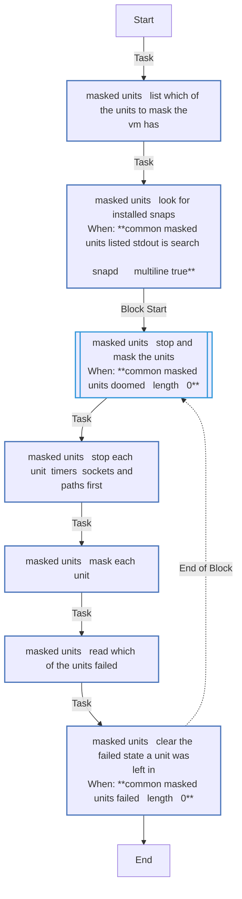
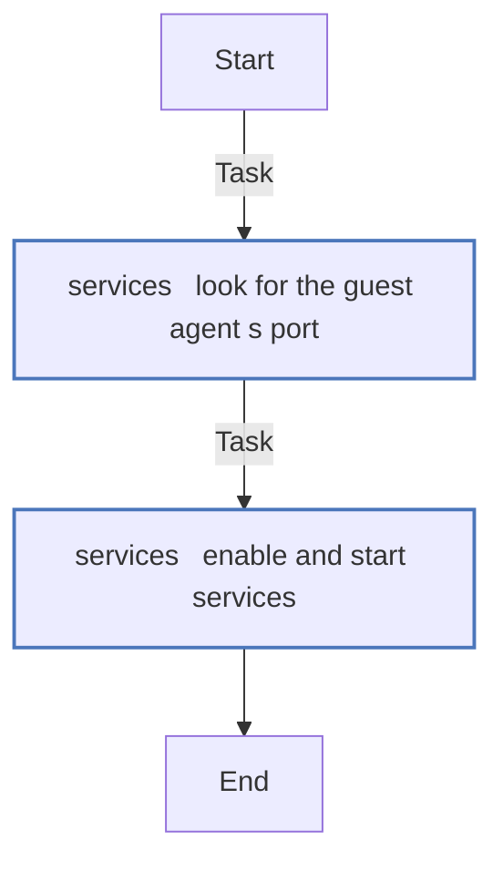

# `common`

The OS baseline every VM gets, first in `just deploy --only configure`: packages, the login user with its sudo rule and SSH keys, sshd hardening, the timezone and the guest agent. `--tags common` runs it alone.

What those defaults mean for the VM: [What the VM trusts](../../guides/what-the-vm-trusts.md). How it works: [§5.3](../../architecture/roles.md#53-common--os-baseline).

<!-- BEGIN_GENERATED: role -->
<!-- Generated by `just docs` from roles/common/meta/argument_specs.yml, vars/main.yml and tasks/: edit that, not this section. -->

## Entry point `main`

**OS baseline for a development VM**

| Variable | Type | Default | Description |
|---|---|---|---|
| `common_user` | str | `dev` | Login user, normally created by cloud-init, that the role gives its shell, groups, sudo rule and keys. Set through vm_user in local.yml. |
| `common_user_shell` | str | `/bin/bash` | Login shell of common_user. |
| `common_user_groups` | list of `str` | `["sudo"]` | Groups common_user is added to. Groups it already has are kept. |
| `common_user_passwordless_sudo` | bool | `true` | Let common_user run sudo without a password, through a sudoers drop-in, which the playbooks' become relies on. false removes the drop-in. |
| `common_user_ssh_public_keys` | list of `str` | `[]` | Public keys added to common_user's authorized_keys. Keys already there are kept. Set through vm_ssh_public_keys in local.yml. |
| `common_timezone` | str | `Etc/UTC` | Timezone name from /usr/share/zoneinfo, such as Europe/Berlin, linked to /etc/localtime. |
| `common_manage_hostname` | bool | `true` | Set the hostname to common_hostname. Never done in a container (common_container_virt_types). |
| `common_hostname` | str | same as `inventory_hostname` | Hostname given to the VM. Defaults to the inventory hostname, the VM's name. |
| `common_harden_ssh` | bool | `true` | Write an sshd drop-in that turns password logins off, root's included, even where cloud-init was given a password. false removes it. |
| `common_apt_upgrade` | bool | `true` | Upgrade the installed packages (apt safe upgrade) on every run. |
| `common_apt_cache_valid_time` | int | `3600` | Seconds the apt cache counts as fresh. An older one is refreshed at the start of the role. |
| `common_apt_lock_timeout` | int | `600` | Seconds each apt task waits for the apt lock, which unattended-upgrades holds on a fresh cloud image after first boot. |
| `common_apt_keep_downloads` | bool | `false` | false deletes each package apt downloads once it is installed, empties apt's download cache daily, and empties it once of what was left there. true keeps them, as apt-get does by default. |
| `common_container_virt_types` | list of `str` | `["docker", "container", "containerd", "podman", "lxc"]` | Virtualisation types under which the hostname is not set, because the host is a container. |
| `common_packages` | list of `str` | `[apt-transport-https, bash-completion, build-essential, ca-certificates, curl, fd-find, git, gnupg, htop, jq, less, openssh-server, python3, python3-pip, python3-debian, python3-venv, qemu-guest-agent, ripgrep, rsync, tmux, tree, unzip, vim, wget, zip, zstd]` | Baseline packages every VM gets. Setting it replaces the baseline; add packages with common_extra_packages instead. |
| `common_extra_packages` | list of `str` | `[]` | More packages to install on top of common_packages. |
| `common_enabled_services` | list of `str` | `["qemu-guest-agent"]` | Services enabled at boot and started, where systemd runs. qemu-guest-agent is started only where the VM has its port, /dev/virtio-ports/org.qemu.guest_agent.0, which Proxmox adds while the VM's agent is enabled. |
| `common_masked_units` | list of `str` | `["fwupd.service", "fwupd-refresh.timer", "multipathd.service", "multipathd.socket", "ModemManager.service", "udisks2.service", "snapd.service", "snapd.socket", "snapd.seeded.service"]` | Units masked and stopped where systemd runs, of those the VM has; snapd's only while no snap is installed. [] masks none, and a unit taken off the list stays masked. |

## Internal values

Set in `roles/common/vars/main.yml`. These are not settings: Ansible ranks a role's vars above `local.yml`, so a value set there has no effect.

| Name | Value |
|---|---|
| `common_guest_agent_port` | `/dev/virtio-ports/org.qemu.guest_agent.0` |

## Tasks

Every task in `roles/common/tasks/`, file by file, in the order the file lists them, with a flowchart of
each file. Generated from the task files, so a task added, renamed or removed shows here on the next `just docs`.

### `main.yml` - entry point `main`

| Task | Module | When |
|---|---|---|
| Delete each package apt downloads once it is installed | `ansible.builtin.copy` | <code>not common_apt_keep_downloads</code> |
| Let apt keep the packages it downloads | `ansible.builtin.file` | <code>common_apt_keep_downloads</code> |
| Refresh apt cache | `ansible.builtin.apt` |  |
| Upgrade installed packages | `ansible.builtin.apt` | <code>common_apt_upgrade</code> |
| Install baseline packages | `ansible.builtin.apt` |  |
| Look for packages left in apt's download cache | `ansible.builtin.find` |  |
| Empty apt's download cache | `ansible.builtin.apt` | <code>not common_apt_keep_downloads and common_apt_downloads.matched > 0</code> |
| Set timezone | `ansible.builtin.file` |  |
| Record timezone name | `ansible.builtin.copy` |  |
| Set hostname | `ansible.builtin.hostname` | <code>common_manage_hostname and ansible_facts['virtualization_type'] not in common_container_virt_types</code> |
| Create user {{ common_user }} | `ansible.builtin.user` |  |
| Grant passwordless sudo | `ansible.builtin.template` | <code>common_user_passwordless_sudo</code> |
| Revoke passwordless sudo | `ansible.builtin.file` | <code>not common_user_passwordless_sudo</code> |
| Authorise SSH keys | `ansible.posix.authorized_key` |  |
| Ensure sshd privilege separation directory exists | `ansible.builtin.file` | <code>common_harden_ssh</code> |
| Harden sshd | `ansible.builtin.template` | <code>common_harden_ssh</code> |
| Remove sshd hardening | `ansible.builtin.file` | <code>not common_harden_ssh</code> |
| Put ~/.local/bin on PATH for all users | `ansible.builtin.template` |  |

```mermaid
flowchart TD
Start
classDef block stroke:#3498db,stroke-width:2px;
classDef task stroke:#4b76bb,stroke-width:2px;
classDef includeTasks stroke:#16a085,stroke-width:2px;
classDef importTasks stroke:#34495e,stroke-width:2px;
classDef includeRole stroke:#2980b9,stroke-width:2px;
classDef importRole stroke:#699ba7,stroke-width:2px;
classDef includeVars stroke:#8e44ad,stroke-width:2px;
classDef rescue stroke:#665352,stroke-width:2px;

  Start-->|Task| Delete_each_package_apt_downloads_once_it_is_installed0[delete each package apt downloads once it is<br>installed<br>When: **not common apt keep downloads**]:::task
  Delete_each_package_apt_downloads_once_it_is_installed0-->|Task| Let_apt_keep_the_packages_it_downloads1[let apt keep the packages it downloads<br>When: **common apt keep downloads**]:::task
  Let_apt_keep_the_packages_it_downloads1-->|Task| Refresh_apt_cache2[refresh apt cache]:::task
  Refresh_apt_cache2-->|Task| Upgrade_installed_packages3[upgrade installed packages<br>When: **common apt upgrade**]:::task
  Upgrade_installed_packages3-->|Task| Install_baseline_packages4[install baseline packages]:::task
  Install_baseline_packages4-->|Task| Look_for_packages_left_in_apt_s_download_cache5[look for packages left in apt s download cache]:::task
  Look_for_packages_left_in_apt_s_download_cache5-->|Task| Empty_apt_s_download_cache6[empty apt s download cache<br>When: **not common apt keep downloads and common apt<br>downloads matched   0**]:::task
  Empty_apt_s_download_cache6-->|Task| Set_timezone7[set timezone]:::task
  Set_timezone7-->|Task| Record_timezone_name8[record timezone name]:::task
  Record_timezone_name8-->|Task| Set_hostname9[set hostname<br>When: **common manage hostname and ansible facts <br>virtualization type   not in common container virt<br>types**]:::task
  Set_hostname9-->|Task| Create_user_common_user10[create user common user]:::task
  Create_user_common_user10-->|Task| Grant_passwordless_sudo11[grant passwordless sudo<br>When: **common user passwordless sudo**]:::task
  Grant_passwordless_sudo11-->|Task| Revoke_passwordless_sudo12[revoke passwordless sudo<br>When: **not common user passwordless sudo**]:::task
  Revoke_passwordless_sudo12-->|Task| Authorise_SSH_keys13[authorise ssh keys]:::task
  Authorise_SSH_keys13-->|Task| Ensure_sshd_privilege_separation_directory_exists14[ensure sshd privilege separation directory exists<br>When: **common harden ssh**]:::task
  Ensure_sshd_privilege_separation_directory_exists14-->|Task| Harden_sshd15[harden sshd<br>When: **common harden ssh**]:::task
  Harden_sshd15-->|Task| Remove_sshd_hardening16[remove sshd hardening<br>When: **not common harden ssh**]:::task
  Remove_sshd_hardening16-->|Task| Put____local_bin_on_PATH_for_all_users17[put    local bin on path for all users]:::task
  Put____local_bin_on_PATH_for_all_users17-->|Include task| Enable_and_start_services_services_yml_18[enable and start services<br>When: **ansible facts  service mgr       systemd**<br>include_task: services yml]:::includeTasks
  Enable_and_start_services_services_yml_18-->|Include task| Mask_the_services_a_headless_VM_has_no_use_for_masked_units_yml_19[mask the services a headless vm has no use for<br>When: **ansible facts  service mgr       systemd  and<br>common masked units   length   0**<br>include_task: masked units yml]:::includeTasks
  Mask_the_services_a_headless_VM_has_no_use_for_masked_units_yml_19-->End
```

| Enable and start services | `ansible.builtin.include_tasks` | <code>ansible_facts['service_mgr'] == 'systemd'</code> |
| Mask the services a headless VM has no use for | `ansible.builtin.include_tasks` | <code>ansible_facts['service_mgr'] == 'systemd' and common_masked_units &#124; length > 0</code> |

### `masked_units.yml`

| Task | Module | When |
|---|---|---|
| List which of the units to mask the VM has | `ansible.builtin.command` |  |
| Look for installed snaps | `ansible.builtin.find` | <code>common_masked_units_listed.stdout is search('^snapd[.]', multiline=True)</code> |
| Stop and mask the units | block | <code>common_masked_units_doomed &#124; length > 0</code> |
| &emsp;Stop each unit, timers, sockets and paths first | `ansible.builtin.systemd_service` |  |
| &emsp;Mask each unit | `ansible.builtin.systemd_service` |  |
| &emsp;Read which of the units failed | `ansible.builtin.command` |  |
| &emsp;Clear the failed state a unit was left in | `ansible.builtin.command` | <code>common_masked_units_failed &#124; length > 0</code> |

### `services.yml`

| Task | Module | When |
|---|---|---|
| Look for the guest agent's port | `ansible.builtin.stat` |  |
| Enable and start services | `ansible.builtin.service` |  |

<!-- END_GENERATED: role -->
