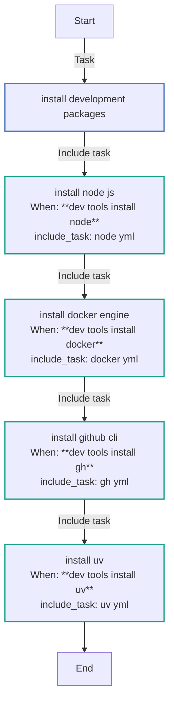
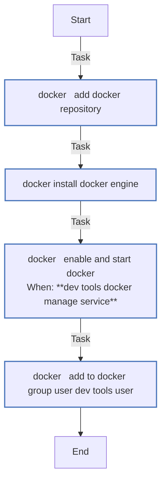
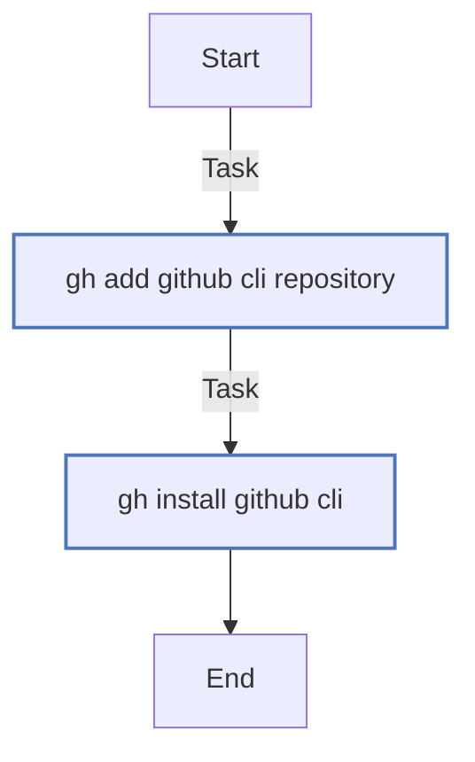
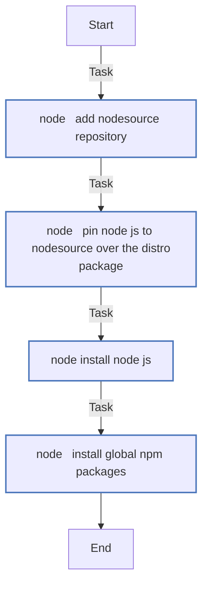
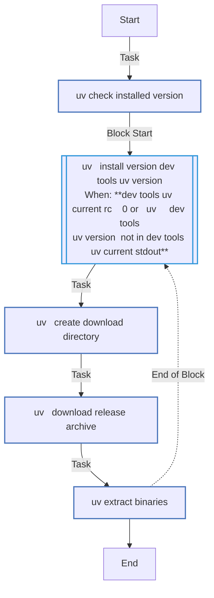

# `dev_tools`

Developer tooling from each vendor's own source: Node.js from NodeSource, Docker Engine, the GitHub CLI, and uv from a release pinned by version and SHA256. The apt signing keys are vendored in `roles/dev_tools/files`. `TAGS=dev_tools` runs it alone.

How it works: [§5.4](../../architecture/roles.md#54-dev_tools--developer-tooling).

<!-- BEGIN_GENERATED: role -->
<!-- Generated by `make docs` from roles/dev_tools/meta/argument_specs.yml, vars/main.yml and tasks/: edit that, not this section. -->

## Entry point `main`

**Install developer tooling on an Ubuntu VM**

| Variable | Type | Default | Description |
|---|---|---|---|
| `dev_tools_user` | str | `dev` | User added to the docker group. Set through vm_user in local.yml. |
| `dev_tools_install_node` | bool | `true` | Install Node.js from NodeSource, and the packages in dev_tools_npm_global_packages. false skips it and removes nothing. |
| `dev_tools_install_docker` | bool | `true` | Install Docker Engine from Docker's repository and add dev_tools_user to the docker group. false skips it and removes nothing. |
| `dev_tools_install_gh` | bool | `true` | Install the GitHub CLI from its repository; github_projects signs in and clones private repositories through it. false skips it and removes nothing. |
| `dev_tools_install_uv` | bool | `true` | Install uv and uvx, a pinned release checked against dev_tools_uv_sha256, into dev_tools_uv_install_dir. false skips it and removes nothing. |
| `dev_tools_apt_packages` | list of `str` | `[cmake, libffi-dev, libssl-dev, make, pipx, pkg-config, python3-debian, python3-dev, shellcheck, sqlite3]` | Development packages installed from Ubuntu's archive. Keep python3-debian, which the role adds the Node.js, Docker and GitHub CLI repositories with. |
| `dev_tools_node_major` | int | `22` | Node.js major version, which picks the NodeSource repository. |
| `dev_tools_npm_global_packages` | list of `str` | `[]` | Packages npm installs globally, with dev_tools_install_node. |
| `dev_tools_docker_packages` | list of `str` | `[docker-ce, docker-ce-cli, containerd.io, docker-buildx-plugin, docker-compose-plugin]` | Packages installed from Docker's repository. |
| `dev_tools_container_virt_types` | list of `str` | `["docker", "container", "containerd", "podman", "lxc"]` | Virtualisation types under which Docker is installed but its service neither enabled nor started, since the daemon cannot run there. |
| `dev_tools_docker_manage_service` | bool | computed | Defaults to true unless running inside a container. |
| `dev_tools_deb_arch` | str | computed | Derived from the architecture fact by default. One of `amd64`, `arm64`. |
| `dev_tools_uv_version` | str | `0.9.5` | uv release to install. Changing it needs the new release's digests in dev_tools_uv_sha256. |
| `dev_tools_uv_arch_map` | dict | `{aarch64: aarch64-unknown-linux-gnu, x86_64: x86_64-unknown-linux-gnu}` | uv's release target for each value of the architecture fact, which names the archive downloaded. |
| `dev_tools_uv_sha256` | dict | `{aarch64: 9db0c2f6683099f86bfeea47f4134e915f382512278de95b2a0e625957594ff3, x86_64: 2cf10babba653310606f8b49876cfb679928669e7ddaa1fb41fb00ce73e64f66}` | SHA256 of the uv release archive per architecture key of dev_tools_uv_arch_map. |
| `dev_tools_uv_install_dir` | path | `/usr/local/bin` | Directory uv and uvx are installed into. |

## Tasks

Every task in `roles/dev_tools/tasks/`, file by file, in the order the file lists them, with a flowchart of
each file. Generated from the task files, so a task added, renamed or removed shows here on the next `make docs`.

### `main.yml` - entry point `main`

| Task | Module | When |
|---|---|---|
| Install development packages | `ansible.builtin.apt` |  |
| Install Node.js | `ansible.builtin.include_tasks` | <code>dev_tools_install_node</code> |
| Install Docker Engine | `ansible.builtin.include_tasks` | <code>dev_tools_install_docker</code> |
| Install GitHub CLI | `ansible.builtin.include_tasks` | <code>dev_tools_install_gh</code> |
| Install uv | `ansible.builtin.include_tasks` | <code>dev_tools_install_uv</code> |

### `docker.yml`

| Task | Module | When |
|---|---|---|
| Add Docker repository | `ansible.builtin.deb822_repository` |  |
| Install Docker Engine | `ansible.builtin.apt` |  |
| Enable and start Docker | `ansible.builtin.service` | <code>dev_tools_docker_manage_service</code> |
| Add to docker group user {{ dev_tools_user }} | `ansible.builtin.user` |  |

### `gh.yml`

| Task | Module | When |
|---|---|---|
| Add GitHub CLI repository | `ansible.builtin.deb822_repository` |  |
| Install GitHub CLI | `ansible.builtin.apt` |  |

### `node.yml`

| Task | Module | When |
|---|---|---|
| Add NodeSource repository | `ansible.builtin.deb822_repository` |  |
| Pin Node.js to NodeSource over the distro package | `ansible.builtin.copy` |  |
| Install Node.js | `ansible.builtin.apt` |  |
| Install global npm packages | `community.general.npm` |  |

### `uv.yml`

| Task | Module | When |
|---|---|---|
| Check installed version | `ansible.builtin.command` |  |
| Install version {{ dev_tools_uv_version }} | block | <code>dev_tools_uv_current.rc != 0 or ('uv ' ~ dev_tools_uv_version) not in dev_tools_uv_current.stdout</code> |
| &amp;emsp;Create download directory | `ansible.builtin.tempfile` |  |
| &amp;emsp;Download release archive | `ansible.builtin.get_url` |  |
| &amp;emsp;Extract binaries | `ansible.builtin.unarchive` |  |
| &amp;emsp;*always:* | | |
| &amp;emsp;&amp;emsp;Remove download directory | `ansible.builtin.file` | <code>dev_tools_uv_tmp.path is defined</code> |

<!-- END_GENERATED: role -->
