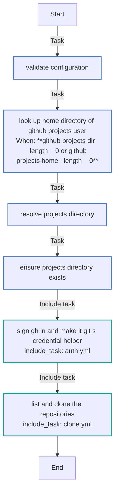
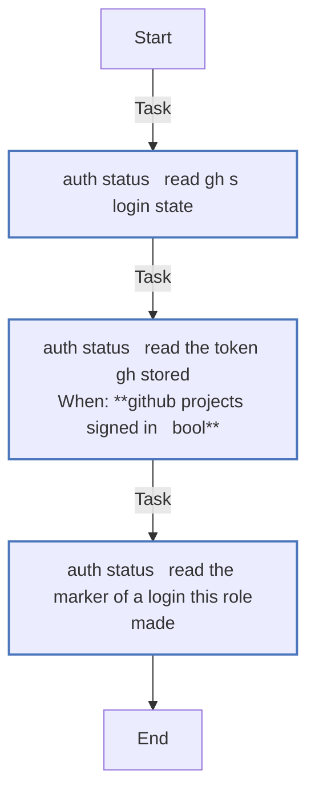
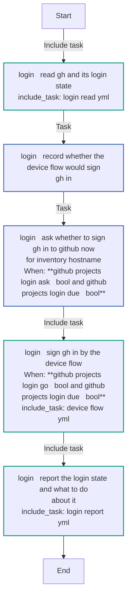
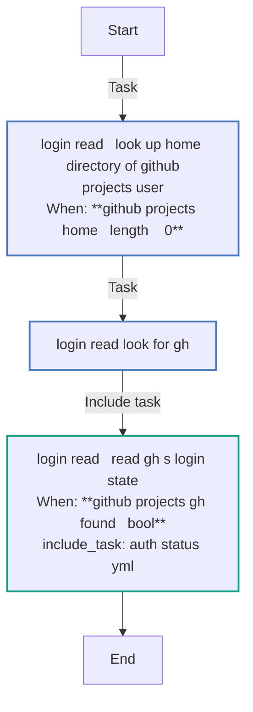
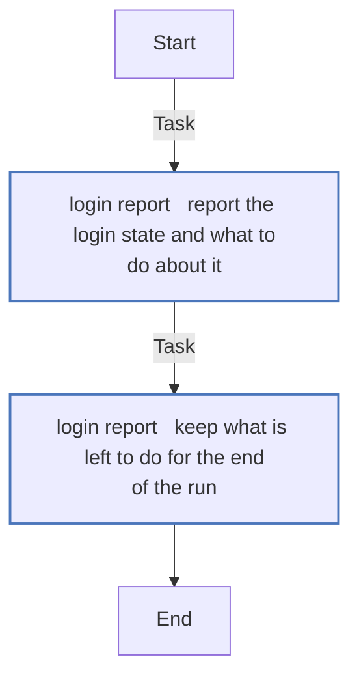
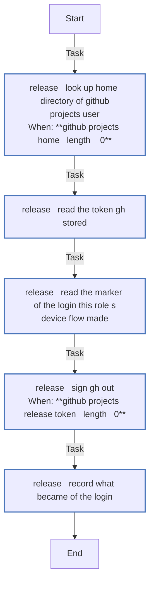
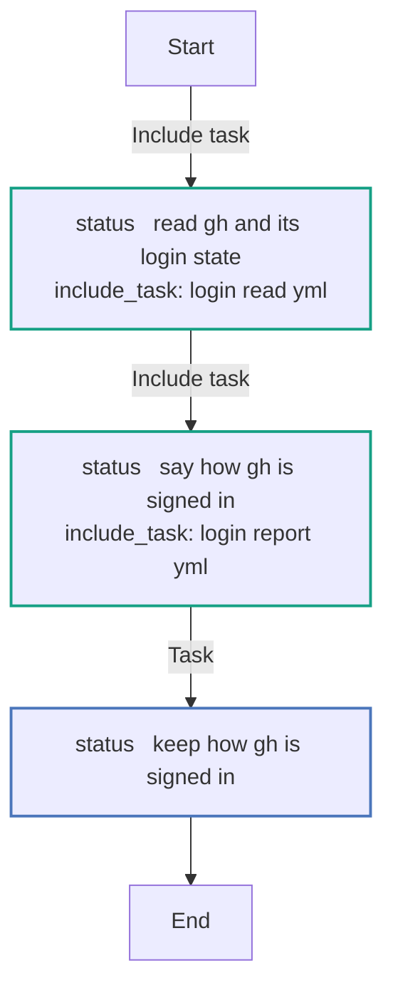

# `github_projects`

Signs `gh` in to GitHub on the VM - from a token, or by the device flow - makes it git's credential helper, and clones your repositories into the projects directory. Three entry points: `main` for `just deploy --only configure` (`--tags github_projects`), `login` for `just login --only github` and the sign-in in `just deploy`, and `release` for `just destroy`.

Using it: [GitHub](../../guides/github.md). How it works: [§5.6](../../architecture/roles.md#56-github_projects--sign-in-to-github-clone-an-accounts-repositories).

<!-- BEGIN_GENERATED: role -->
<!-- Generated by `just docs` from roles/github_projects/meta/argument_specs.yml, vars/main.yml and tasks/: edit that, not this section. -->

## Entry point `main`

**Clone every GitHub repository of a user**

| Variable | Type | Default | Description |
|---|---|---|---|
| `github_projects_user` | str | `dev` | Local user that owns the checkouts. Set through vm_user in local.yml. |
| `github_projects_username` | str | `""` | **Required.** GitHub account to list repositories for. Set through vault_github_username in vault.yml. |
| `github_projects_token` | str | `""` | Lists private repositories and, with github_projects_auth, signs gh in on the VM where gh is signed out or signed in by this role. A login made by hand stays, and the token then only lists. Set through vault_github_token in vault.yml. A secret: never logged. |
| `github_projects_api_url` | str | `https://api.github.com` | Base URL of the GitHub REST API that lists the repositories and, for ssh clones, GitHub's host keys. Tests point it at a stand-in. |
| `github_projects_home` | path | `""` | Home directory of github_projects_user. Empty looks it up on the VM. |
| `github_projects_dir` | path | `""` | Destination directory. Defaults to ~/projects. Set through vm_projects_dir in local.yml. |
| `github_projects_include_forks` | bool | `false` | Also clone repositories that are forks. |
| `github_projects_include_archived` | bool | `false` | Also clone archived repositories. |
| `github_projects_include` | list of `str` | `[]` | Repository names to clone. Empty means every repository of the user. Set through github_projects in local.yml. |
| `github_projects_exclude` | list of `str` | `[]` | Repository names never cloned, even when github_projects_include names them. |
| `github_projects_clone_protocol` | str | `https` | https clones private repositories through gh; ssh needs a key of the user's own on the VM, and trusts GitHub's published host keys. One of `https`, `ssh`. |
| `github_projects_update_existing` | bool | `false` | Pull checkouts that already exist on every run. Off, a re-run never disturbs local work. |
| `github_projects_depth` | str | `""` | Shallow clone depth. Empty clones the full history. |
| `github_projects_auth` | bool | `true` | Sign gh in (from the token, or by a device-flow login the user makes once) and make it git's credential helper. Set through github_auth in local.yml. |
| `github_projects_auth_method` | str | `auto` | auto takes the token when set, else the device flow; web is the device flow always; token is the token only, put over any login gh holds. Set through github_auth_method in local.yml. One of `auto`, `web`, `token`. |
| `github_projects_login_scopes` | list of `str` | `["workflow"]` | Scopes the device flow asks for on top of gh's own (repo, read:org, gist). Set through github_login_scopes in local.yml. |
| `github_projects_login_desktop` | bool | `true` | During the device flow, open the page and copy the code on the controller. Off in every test. Set through login_desktop in local.yml. |
| `github_projects_sign_in_follows` | bool | `false` | The sign-ins come next in this run (just deploy), so the message for a signed-out VM says so rather than naming just login --only github. |
| `github_projects_git_user_name` | str | `""` | git user.name for github_projects_user, written always. Empty derives it from the GitHub account, and only where ~/.gitconfig has none yet. Set through git_user_name in local.yml. |
| `github_projects_git_user_email` | str | `""` | git user.email for github_projects_user, written always. Empty uses GitHub's noreply address for the account, and only where ~/.gitconfig has none yet. Set through git_user_email in local.yml. |

## Entry point `login`

**Say whether gh is signed in to GitHub, and how, and sign it in by the device flow when asked**

Reads gh's login state on the VM and prints it, with the one command to run when it is signed out. With github_projects_login_interactive, or the answer to the question github_projects_login_ask puts, signs a signed-out VM in by GitHub's device flow; playbooks/github_login.yml then runs the whole role. Set through git_user_email in local.yml.

| Variable | Type | Default | Description |
|---|---|---|---|
| `github_projects_login_interactive` | bool | `false` | Run the device flow for a signed-out VM. Set by playbooks/github_login.yml when names were given, and by just deploy for a VM whose Claude code was entered in the same run. |
| `github_projects_login_ask` | bool | `false` | Ask at a prompt first. just deploy sets it for every VM but one whose Claude prompt got Enter. For a VM with github_projects_login_interactive, Enter runs the device flow and "n" skips it; for any other, "y" runs it and Enter skips it. With no terminal the answer is nothing. |
| `github_projects_login_role_follows` | bool | `false` | The whole role runs for this VM next, in the same run, so a vault token gh is not yet signed in with is said to be signed in by it rather than by a command to run. |

## Entry point `status`

**Say whether gh is signed in to GitHub, and how, changing nothing**

Reads gh's login state on the VM, as the login entry point does, and gives its report, keeping what just status shows in github_projects_status_found. A check gh could not make with GitHub - no network - is kept as not checked, never as signed out. Never signs in, writes a token or clones.

| Variable | Type | Default | Description |
|---|---|---|---|
| `github_projects_auth` | bool | `true` | Whether gh's login is this project's business; with it off, gh is left alone and only said. |

## Entry point `release`

**Sign gh out before the VM is destroyed**

Signs gh out, and records what became of the login in github_projects_release_said, for destroy's report. No token is revoked at GitHub - revoking one gh sign-in there ends every gh sign-in of the account - so the report says where to revoke it, and what that does.

| Variable | Type | Default | Description |
|---|---|---|---|
| `github_projects_token` | str | `""` | The vault token, only to say that a login with it is every VM's. Set through vault_github_token in vault.yml. A secret: never logged. |

Also takes, as described under `main`: `github_projects_user`, `github_projects_home`.

## Internal values

Set in `roles/github_projects/vars/main.yml`. These are not settings: Ansible ranks a role's vars above `local.yml`, so a value set there has no effect. 55 of the 58 are computed during a run, from earlier tasks' results.

| Name | Value |
|---|---|
| `github_projects_gh_found` | <code>{{ github_projects_gh_which.rc &#124; default(1) == 0 }}</code> |
| `github_projects_auth_hosts` | <code>{{ (github_projects_auth_status.stdout &#124; from_json).hosts &#124; default({}) if github_projects_auth_status.rc &#124; default(1) == 0 and (github_projects_auth_status.stdout &#124; default('') &#124; trim).startswith('{') else {} }}</code> |
| `github_projects_auth_account` | <code>{{ github_projects_auth_hosts['github.com'] &#124; default([]) &#124; selectattr('active', 'defined') &#124; selectattr('active') &#124; list &#124; first &#124; default({}) }}</code> |
| `github_projects_signed_in` | <code>{{ (github_projects_auth_account.state &#124; default('')) == 'success' }}</code> |
| `github_projects_auth_unchecked` | <code>{{ (github_projects_auth_account.state &#124; default('')) == 'error' and not ((github_projects_auth_account.error &#124; default('')) is match('HTTP 40[13]')) }}</code> |
| `github_projects_status_said` | <code>{{ github_projects_auth_status.stderr &#124; default('') &#124; plain_text &#124; trim }}</code> |
| `github_projects_token_said` | <code>{{ github_projects_login.stderr &#124; default('') &#124; plain_text &#124; trim }}</code> |
| `github_projects_login_kind` | <code>{{ 'none' if not github_projects_signed_in &#124; bool else 'env' if (github_projects_auth_account.tokenSource &#124; default('')) is match('.*_TOKEN$') else 'pat' if github_projects_stored_token is match('(ghp_&#124;github_pat_)') else 'oauth' if github_projects_stored_token is match('gho_') else 'other' }}</code> |
| `github_projects_auth_wanted` | <code>{{ github_projects_auth &#124; bool and github_projects_gh_found &#124; bool }}</code> |
| `github_projects_token_wanted` | <code>{{ github_projects_auth_method == 'token' or (github_projects_auth_method == 'auto' and github_projects_token &#124; length > 0) }}</code> |
| `github_projects_web_wanted` | <code>{{ github_projects_auth_method == 'web' or (github_projects_auth_method == 'auto' and github_projects_token &#124; length == 0) }}</code> |
| `github_projects_token_short` | <code>{{ github_projects_auth_method == 'auto' and 'missing required scope' in (github_projects_login.stderr &#124; default('')) }}</code> |
| `github_projects_token_sign_in` | <code>{{ github_projects_auth_wanted &#124; bool and github_projects_token_wanted &#124; bool and github_projects_stored_token != github_projects_token and (not github_projects_signed_in &#124; bool or github_projects_login_is_ours &#124; bool or github_projects_auth_method == 'token') }}</code> |
| `github_projects_token_beside` | <code>{{ github_projects_auth_wanted &#124; bool and github_projects_token_wanted &#124; bool and github_projects_signed_in &#124; bool and github_projects_stored_token != github_projects_token and not github_projects_login_is_ours &#124; bool and github_projects_auth_method != 'token' }}</code> |
| `github_projects_login_args` | <code>{{ ['gh', 'auth', 'login', '--hostname', 'github.com', '--git-protocol', github_projects_clone_protocol, '--web', '--skip-ssh-key'] + (['--scopes', github_projects_login_scopes &#124; join(',')] if github_projects_login_scopes &#124; length > 0 else []) }}</code> |
| `github_projects_login_output` | `{{ github_projects_home_dir }}/.config/claude-on-proxmox/gh-login.out` |
| `github_projects_login_pidfile` | `{{ github_projects_home_dir }}/.config/claude-on-proxmox/gh-login.pid` |
| `github_projects_login_start_seconds` | `30` |
| `github_projects_login_wait_seconds` | `930` |
| `github_projects_login_async_seconds` | `960` |
| `github_projects_login_text` | <code>{{ ((github_projects_login_out.content &#124; b64decode) if github_projects_login_out.content is defined else '') &#124; plain_text }}</code> |
| `github_projects_login_code` | <code>{{ github_projects_login_text &#124; regex_search('[A-Z0-9]{4}-[A-Z0-9]{4}') or '' }}</code> |
| `github_projects_login_page` | <code>{{ github_projects_login_text &#124; regex_search('https://[^ \n]+') or 'https://github.com/login/device' }}</code> |
| `github_projects_login_said` | <code>{{ github_projects_login_text.splitlines() &#124; map('trim') &#124; select &#124; reject('match', 'gh exited: ') &#124; list }}</code> |
| `github_projects_login_expired` | <code>{{ (github_projects_login_result.msg &#124; default('')) is search('Timeout exceeded') or (github_projects_login_finished.finished &#124; default(1) &#124; int) != 1 }}</code> |
| `github_projects_login_answer` | <code>{{ (github_projects_login_asked &#124; default({})).user_input &#124; default('', true) &#124; trim &#124; lower }}</code> |
| `github_projects_login_go` | <code>{{ github_projects_login_answer in (['', 'y', 'yes'] if github_projects_login_interactive &#124; bool else ['y', 'yes']) if github_projects_login_ask &#124; bool else github_projects_login_interactive &#124; bool }}</code> |
| `github_projects_stored_token` | <code>{{ github_projects_stored_token_raw.stdout &#124; default('') &#124; trim if github_projects_stored_token_raw.rc &#124; default(1) == 0 else '' }}</code> |
| `github_projects_home_dir` | <code>{{ github_projects_home if github_projects_home &#124; length > 0 else ansible_facts.getent_passwd[github_projects_user][4] }}</code> |
| `github_projects_marker_file` | `{{ github_projects_home_dir }}/.config/claude-on-proxmox/gh-login` |
| `github_projects_device_marker_file` | `{{ github_projects_home_dir }}/.config/claude-on-proxmox/gh-device-login` |
| `github_projects_marker_digest` | <code>{{ (github_projects_marker_raw.content &#124; b64decode &#124; trim) if github_projects_marker_raw.content is defined else '' }}</code> |
| `github_projects_token_digest` | <code>{{ github_projects_token &#124; hash('sha256') }}</code> |
| `github_projects_login_is_ours` | <code>{{ github_projects_signed_in &#124; bool and github_projects_stored_token &#124; length > 0 and github_projects_marker_digest &#124; length > 0 and github_projects_marker_digest == github_projects_stored_token &#124; hash('sha256') }}</code> |
| `github_projects_listing_token` | <code>{{ github_projects_token if github_projects_token &#124; length > 0 else github_projects_stored_token }}</code> |
| `github_projects_token_set` | <code>{{ github_projects_token &#124; length > 0 }}</code> |
| `github_projects_listing_token_set` | <code>{{ github_projects_listing_token &#124; length > 0 }}</code> |
| `github_projects_candidates` | <code>{{ github_projects_listing.repos &#124; rejectattr('empty') &#124; rejectattr('name', 'in', github_projects_exclude) &#124; selectattr('name', 'in', github_projects_include if github_projects_include else github_projects_listing.repos &#124; map(attribute='name') &#124; list) &#124; list }}</code> |
| `github_projects_gh_helper` | <code>{{ github_projects_helpers.stdout_lines &#124; default([]) &#124; select('search', '^!([^ ]*/)?gh( &#124;$)') &#124; list &#124; length > 0 }}</code> |
| `github_projects_private_cloneable` | <code>{{ github_projects_clone_protocol == 'ssh' or (github_projects_signed_in &#124; bool and (github_projects_auth_wanted &#124; bool or github_projects_gh_helper &#124; bool)) }}</code> |
| `github_projects_private_skipped` | <code>{{ [] if github_projects_private_cloneable &#124; bool else github_projects_candidates &#124; selectattr('private') &#124; map(attribute='name') &#124; list }}</code> |
| `github_projects_private_skip_reason` | <code>{{ 'private, skipped as git has no credential for them (gh is not installed)' if not github_projects_gh_found &#124; bool else 'private, skipped until gh is signed in' if not github_projects_signed_in &#124; bool else 'private, skipped as git has no credential for them (github_auth is false, and gh is not its credential helper)' }}</code> |
| `github_projects_selected` | <code>{{ github_projects_candidates &#124; rejectattr('name', 'in', github_projects_private_skipped) &#124; list }}</code> |
| `github_projects_git_identity_set` | <code>{{ github_projects_git_identity.results &#124; default([]) &#124; selectattr('stdout', 'defined') &#124; selectattr('stdout') &#124; map(attribute='item') &#124; list }}</code> |
| `github_projects_git_identity_needed` | <code>{{ github_projects_auth &#124; bool and ((github_projects_git_user_name &#124; length == 0 and 'user.name' not in github_projects_git_identity_set) or (github_projects_git_user_email &#124; length == 0 and 'user.email' not in github_projects_git_identity_set)) }}</code> |
| `github_projects_git_person` | <code>{{ (github_projects_listing.user &#124; default({})).login &#124; default('', true) &#124; length > 0 and (github_projects_listing.user.type &#124; default('User', true)) != 'Organization' }}</code> |
| `github_projects_git_name` | <code>{{ ((github_projects_listing.user.name &#124; default('', true)) or github_projects_listing.user.login) if github_projects_git_person &#124; bool else '' }}</code> |
| `github_projects_git_email` | <code>{{ (github_projects_listing.user.id ~ '+' ~ github_projects_listing.user.login ~ '@users.noreply.github.com') if github_projects_git_person &#124; bool else '' }}</code> |
| `github_projects_git_identity_wanted` | <code>{{ {'user.name': github_projects_git_user_name if github_projects_git_user_name &#124; length > 0 else '' if 'user.name' in github_projects_git_identity_set else github_projects_git_name, 'user.email': github_projects_git_user_email if github_projects_git_user_email &#124; length > 0 else '' if 'user.email' in github_projects_git_identity_set else github_projects_git_email} &#124; dict2items &#124; selectattr('value') &#124; items2dict }}</code> |
| `github_projects_login_command` | `just login {{ inventory_hostname }} --only github` |
| `github_projects_configure_command` | `just deploy {{ inventory_hostname }} --tags github_projects` |
| `github_projects_release_token` | <code>{{ github_projects_release_token_raw.stdout &#124; default('') &#124; trim if (github_projects_release_token_raw.rc &#124; default(1)) == 0 else '' }}</code> |
| `github_projects_device_marker_digest` | <code>{{ (github_projects_device_marker_raw.content &#124; b64decode &#124; trim) if github_projects_device_marker_raw.content is defined else '' }}</code> |
| `github_projects_release_ours` | <code>{{ github_projects_release_token &#124; length > 0 and github_projects_device_marker_digest &#124; length > 0 and github_projects_device_marker_digest == github_projects_release_token &#124; hash('sha256') and github_projects_release_token != github_projects_token }}</code> |
| `github_projects_release_signed_out` | <code>{{ 'gh signed out' if (github_projects_release_logout.rc &#124; default(1)) == 0 else ('gh could not sign out (' ~ ((github_projects_release_logout.stderr &#124; default('') &#124; plain_text &#124; regex_replace('\s+', ' ') &#124; trim) or 'no reason given') ~ ')') }}</code> |
| `github_projects_release_unrevoked` | <code>{{ github_projects_release_token &#124; length > 0 and (github_projects_release_ours &#124; bool or not (github_projects_token &#124; length > 0 and github_projects_release_token == github_projects_token)) }}</code> |
| `github_projects_release_summary` | <code>{{ '' if github_projects_release_token &#124; length == 0 else (github_projects_release_signed_out ~ '; the token this project signed it in with stays valid until revoked at' ~ ' https://github.com/settings/applications, under GitHub CLI - which signs out every gh you have, so' ~ ' destroy does not') if github_projects_release_ours &#124; bool else (github_projects_release_signed_out ~ " (vault_github_token is every VM's, so it is not revoked)") if github_projects_token &#124; length > 0 and github_projects_release_token == github_projects_token else (github_projects_release_signed_out ~ '; its token is not one this project recorded making (a sign-in by' ~ ' hand, or one before this version), and stays valid until revoked - at https://github.com/settings/tokens' ~ ' if it is a personal access token, or under GitHub CLI at https://github.com/settings/applications,' ~ ' which signs out every gh you have') }}</code> |
| `github_projects_login_left` | <code>{{ github_projects_gh_found &#124; bool and ((github_projects_auth_status.rc &#124; default(0) != 0 and github_projects_auth &#124; bool) or (github_projects_signed_in &#124; bool and github_projects_login_kind == 'oauth' and 'workflow' not in (github_projects_auth_account.scopes &#124; default(''))) or (not github_projects_signed_in &#124; bool and github_projects_auth &#124; bool and not (github_projects_token_wanted &#124; bool and github_projects_token_set &#124; bool and github_projects_login_role_follows &#124; bool))) }}</code> |

## Tasks

Every task in `roles/github_projects/tasks/`, file by file, in the order the file lists them, with a flowchart of
each file. Generated from the task files, so a task added, renamed or removed shows here on the next `just docs`.

### `main.yml` - entry point `main`

| Task | Module | When |
|---|---|---|
| Validate configuration | `ansible.builtin.assert` |  |
| Look up home directory of {{ github_projects_user }} | `ansible.builtin.getent` | <code>github_projects_dir &#124; length == 0 or github_projects_home &#124; length == 0</code> |
| Resolve projects directory | `ansible.builtin.set_fact` |  |
| Ensure projects directory exists | `ansible.builtin.file` |  |
| Sign gh in and make it git's credential helper | `ansible.builtin.include_tasks` |  |
| List and clone the repositories | `ansible.builtin.include_tasks` |  |

### `auth.yml`

| Task | Module | When |
|---|---|---|
| Look for gh | `ansible.builtin.command` |  |
| Read gh's login state | `ansible.builtin.include_tasks` | <code>github_projects_gh_found &#124; bool</code> |
| Fail when gh could not report its login state | `ansible.builtin.fail` | <code>github_projects_auth &#124; bool and github_projects_gh_found &#124; bool and github_projects_auth_status.rc &#124; default(0) != 0</code> |
| Fail when the token method has no token | `ansible.builtin.fail` | <code>github_projects_auth &#124; bool and github_projects_auth_method == 'token' and github_projects_token &#124; length == 0</code> |
| Say that gh is missing | `ansible.builtin.debug` | <code>github_projects_auth &#124; bool and not github_projects_gh_found &#124; bool</code> |
| Sign gh in with the token | `ansible.builtin.command` | <code>github_projects_token_sign_in &#124; bool</code> |
| Fail when GitHub refused the token | `ansible.builtin.fail` | <code>github_projects_login is not skipped and github_projects_login.rc &#124; default(0) != 0 and not github_projects_token_short &#124; bool</code> |
| Say that the token only lists | `ansible.builtin.debug` | <code>github_projects_token_short &#124; bool</code> |
| Keep what is left to do for the end of the run | `ansible.builtin.set_stats` | <code>github_projects_token_short &#124; bool</code> |
| Say that the token only lists beside a login of your own | `ansible.builtin.debug` | <code>github_projects_token_beside &#124; bool</code> |
| Keep what is left to do for the end of the run | `ansible.builtin.set_stats` | <code>github_projects_token_beside &#124; bool</code> |
| Sign gh out of the login this role made, now that no token is configured | `ansible.builtin.command` | <code>github_projects_auth_wanted &#124; bool and not github_projects_token_wanted &#124; bool and github_projects_login_is_ours &#124; bool</code> |
| Read gh's login state again | `ansible.builtin.include_tasks` | <code>github_projects_login is changed or github_projects_logout is changed</code> |
| Forget the login this role made | `ansible.builtin.file` | <code>github_projects_auth_wanted &#124; bool and not github_projects_token_wanted &#124; bool and not github_projects_signed_in &#124; bool and github_projects_marker_digest &#124; length > 0</code> |
| Make the directory for the marker of this role's login | `ansible.builtin.file` | <code>github_projects_auth_wanted &#124; bool and github_projects_token_wanted &#124; bool and github_projects_signed_in &#124; bool and github_projects_stored_token == github_projects_token</code> |
| Remember that the login is this role's | `ansible.builtin.copy` | <code>github_projects_auth_wanted &#124; bool and github_projects_token_wanted &#124; bool and github_projects_signed_in &#124; bool and github_projects_stored_token == github_projects_token</code> |
| Read git's credential helpers for github.com | `ansible.builtin.command` | <code>github_projects_signed_in &#124; bool</code> |
| Make gh git's credential helper for github.com | `ansible.builtin.command` | <code>github_projects_auth_wanted &#124; bool and github_projects_signed_in &#124; bool and not github_projects_gh_helper &#124; bool</code> |
| Say how to sign gh in | `ansible.builtin.debug` | <code>github_projects_auth_wanted &#124; bool and not github_projects_signed_in &#124; bool and not github_projects_token_short &#124; bool</code> |
| Keep what is left to do for the end of the run | `ansible.builtin.set_stats` | <code>github_projects_auth_wanted &#124; bool and not github_projects_signed_in &#124; bool and not github_projects_token_short &#124; bool</code> |

```mermaid
flowchart TD
Start
classDef block stroke:#3498db,stroke-width:2px;
classDef task stroke:#4b76bb,stroke-width:2px;
classDef includeTasks stroke:#16a085,stroke-width:2px;
classDef importTasks stroke:#34495e,stroke-width:2px;
classDef includeRole stroke:#2980b9,stroke-width:2px;
classDef importRole stroke:#699ba7,stroke-width:2px;
classDef includeVars stroke:#8e44ad,stroke-width:2px;
classDef rescue stroke:#665352,stroke-width:2px;

  Start-->|Task| auth___Look_for_gh0[auth   look for gh]:::task
  auth___Look_for_gh0-->|Include task| auth___Read_gh_s_login_state_auth_status_yml_1[auth   read gh s login state<br>When: **github projects gh found   bool**<br>include_task: auth status yml]:::includeTasks
  auth___Read_gh_s_login_state_auth_status_yml_1-->|Task| auth___Fail_when_gh_could_not_report_its_login_state2[auth   fail when gh could not report its login<br>state<br>When: **github projects auth   bool and github projects gh<br>found   bool and github projects auth status rc  <br>default 0     0**]:::task
  auth___Fail_when_gh_could_not_report_its_login_state2-->|Task| auth___Fail_when_the_token_method_has_no_token3[auth   fail when the token method has no token<br>When: **github projects auth   bool and github projects<br>auth method     token  and github projects token  <br>length    0**]:::task
  auth___Fail_when_the_token_method_has_no_token3-->|Task| auth___Say_that_gh_is_missing4[auth   say that gh is missing<br>When: **github projects auth   bool and not github<br>projects gh found   bool**]:::task
  auth___Say_that_gh_is_missing4-->|Task| auth___Sign_gh_in_with_the_token5[auth   sign gh in with the token<br>When: **github projects token sign in   bool**]:::task
  auth___Sign_gh_in_with_the_token5-->|Task| auth___Fail_when_GitHub_refused_the_token6[auth   fail when github refused the token<br>When: **github projects login is not skipped and github<br>projects login rc   default 0     0 and not github<br>projects token short   bool**]:::task
  auth___Fail_when_GitHub_refused_the_token6-->|Task| auth___Say_that_the_token_only_lists7[auth   say that the token only lists<br>When: **github projects token short   bool**]:::task
  auth___Say_that_the_token_only_lists7-->|Task| auth___Keep_what_is_left_to_do_for_the_end_of_the_run8[auth   keep what is left to do for the end of the<br>run<br>When: **github projects token short   bool**]:::task
  auth___Keep_what_is_left_to_do_for_the_end_of_the_run8-->|Task| auth___Say_that_the_token_only_lists_beside_a_login_of_your_own9[auth   say that the token only lists beside a<br>login of your own<br>When: **github projects token beside   bool**]:::task
  auth___Say_that_the_token_only_lists_beside_a_login_of_your_own9-->|Task| auth___Keep_what_is_left_to_do_for_the_end_of_the_run10[auth   keep what is left to do for the end of the<br>run<br>When: **github projects token beside   bool**]:::task
  auth___Keep_what_is_left_to_do_for_the_end_of_the_run10-->|Task| auth___Sign_gh_out_of_the_login_this_role_made__now_that_no_token_is_configured11[auth   sign gh out of the login this role made <br>now that no token is configured<br>When: **github projects auth wanted   bool and not github<br>projects token wanted   bool and github projects<br>login is ours   bool**]:::task
  auth___Sign_gh_out_of_the_login_this_role_made__now_that_no_token_is_configured11-->|Include task| auth___Read_gh_s_login_state_again_auth_status_yml_12[auth   read gh s login state again<br>When: **github projects login is changed or github<br>projects logout is changed**<br>include_task: auth status yml]:::includeTasks
  auth___Read_gh_s_login_state_again_auth_status_yml_12-->|Task| auth___Forget_the_login_this_role_made13[auth   forget the login this role made<br>When: **github projects auth wanted   bool and not github<br>projects token wanted   bool and not github<br>projects signed in   bool and github projects<br>marker digest   length   0**]:::task
  auth___Forget_the_login_this_role_made13-->|Task| auth___Make_the_directory_for_the_marker_of_this_role_s_login14[auth   make the directory for the marker of this<br>role s login<br>When: **github projects auth wanted   bool and github<br>projects token wanted   bool and github projects<br>signed in   bool and github projects stored token <br>  github projects token**]:::task
  auth___Make_the_directory_for_the_marker_of_this_role_s_login14-->|Task| auth___Remember_that_the_login_is_this_role_s15[auth   remember that the login is this role s<br>When: **github projects auth wanted   bool and github<br>projects token wanted   bool and github projects<br>signed in   bool and github projects stored token <br>  github projects token**]:::task
  auth___Remember_that_the_login_is_this_role_s15-->|Task| auth___Read_git_s_credential_helpers_for_github_com16[auth   read git s credential helpers for github<br>com<br>When: **github projects signed in   bool**]:::task
  auth___Read_git_s_credential_helpers_for_github_com16-->|Task| auth___Make_gh_git_s_credential_helper_for_github_com17[auth   make gh git s credential helper for github<br>com<br>When: **github projects auth wanted   bool and github<br>projects signed in   bool and not github projects<br>gh helper   bool**]:::task
  auth___Make_gh_git_s_credential_helper_for_github_com17-->|Task| auth___Say_how_to_sign_gh_in18[auth   say how to sign gh in<br>When: **github projects auth wanted   bool and not github<br>projects signed in   bool and not github projects<br>token short   bool**]:::task
  auth___Say_how_to_sign_gh_in18-->|Task| auth___Keep_what_is_left_to_do_for_the_end_of_the_run19[auth   keep what is left to do for the end of the<br>run<br>When: **github projects auth wanted   bool and not github<br>projects signed in   bool and not github projects<br>token short   bool**]:::task
  auth___Keep_what_is_left_to_do_for_the_end_of_the_run19-->End
```

### `auth_status.yml`

| Task | Module | When |
|---|---|---|
| Read gh's login state | `ansible.builtin.command` |  |
| Read the token gh stored | `ansible.builtin.command` | <code>github_projects_signed_in &#124; bool</code> |
| Read the marker of a login this role made | `ansible.builtin.slurp` |  |

### `clone.yml`

| Task | Module | When |
|---|---|---|
| Read the git identity of {{ github_projects_user }} | `ansible.builtin.command` | <code>github_projects_auth &#124; bool</code> |
| List repositories of {{ github_projects_username }} | `github_repos` |  |
| Fail when GitHub did not list the repositories | `ansible.builtin.fail` | <code>github_projects_listing.repos is not defined</code> |
| Report selection | `ansible.builtin.debug` |  |
| Set the git identity of {{ github_projects_user }} | `community.general.git_config` | <code>github_projects_auth &#124; bool</code> |
| Say that an organisation gives no git identity | `ansible.builtin.debug` | <code>github_projects_git_identity_needed &#124; bool and (github_projects_listing.user.type &#124; default('')) == 'Organization'</code> |
| Keep what is left to do for the end of the run | `ansible.builtin.set_stats` | <code>github_projects_git_identity_needed &#124; bool and (github_projects_listing.user.type &#124; default('')) == 'Organization'</code> |
| Fetch GitHub's published SSH host keys | `ansible.builtin.uri` | <code>github_projects_clone_protocol == 'ssh'</code> |
| Trust GitHub's SSH host keys | `ansible.builtin.known_hosts` | <code>github_projects_clone_protocol == 'ssh'</code> |
| Clone repositories | `ansible.builtin.git` |  |

```mermaid
flowchart TD
Start
classDef block stroke:#3498db,stroke-width:2px;
classDef task stroke:#4b76bb,stroke-width:2px;
classDef includeTasks stroke:#16a085,stroke-width:2px;
classDef importTasks stroke:#34495e,stroke-width:2px;
classDef includeRole stroke:#2980b9,stroke-width:2px;
classDef importRole stroke:#699ba7,stroke-width:2px;
classDef includeVars stroke:#8e44ad,stroke-width:2px;
classDef rescue stroke:#665352,stroke-width:2px;

  Start-->|Task| clone___Read_the_git_identity_of_github_projects_user0[clone   read the git identity of github projects<br>user<br>When: **github projects auth   bool**]:::task
  clone___Read_the_git_identity_of_github_projects_user0-->|Task| clone___List_repositories_of_github_projects_username1[clone   list repositories of github projects<br>username]:::task
  clone___List_repositories_of_github_projects_username1-->|Task| clone___Fail_when_GitHub_did_not_list_the_repositories2[clone   fail when github did not list the<br>repositories<br>When: **github projects listing repos is not defined**]:::task
  clone___Fail_when_GitHub_did_not_list_the_repositories2-->|Task| clone___Report_selection3[clone   report selection]:::task
  clone___Report_selection3-->|Task| clone___Set_the_git_identity_of_github_projects_user4[clone   set the git identity of github projects<br>user<br>When: **github projects auth   bool**]:::task
  clone___Set_the_git_identity_of_github_projects_user4-->|Task| clone___Say_that_an_organisation_gives_no_git_identity5[clone   say that an organisation gives no git<br>identity<br>When: **github projects git identity needed   bool and <br>github projects listing user type   default       <br>  organization**]:::task
  clone___Say_that_an_organisation_gives_no_git_identity5-->|Task| clone___Keep_what_is_left_to_do_for_the_end_of_the_run6[clone   keep what is left to do for the end of the<br>run<br>When: **github projects git identity needed   bool and <br>github projects listing user type   default       <br>  organization**]:::task
  clone___Keep_what_is_left_to_do_for_the_end_of_the_run6-->|Task| clone___Fetch_GitHub_s_published_SSH_host_keys7[clone   fetch github s published ssh host keys<br>When: **github projects clone protocol     ssh**]:::task
  clone___Fetch_GitHub_s_published_SSH_host_keys7-->|Task| clone___Trust_GitHub_s_SSH_host_keys8[clone   trust github s ssh host keys<br>When: **github projects clone protocol     ssh**]:::task
  clone___Trust_GitHub_s_SSH_host_keys8-->|Task| clone___Clone_repositories9[clone   clone repositories]:::task
  clone___Clone_repositories9-->End
```

### `device_flow.yml`

| Task | Module | When |
|---|---|---|
| Refuse to prompt for more than one VM at a time | `ansible.builtin.assert` |  |
| Make the directory for gh's files | `ansible.builtin.file` |  |
| Remove the files of an earlier run | `ansible.builtin.file` |  |
| Start gh's device flow in the background | `ansible.builtin.shell` |  |
| Show the code, wait for the approval, and clean up whatever happened | block |  |
| &emsp;Wait for gh to show the code | `ansible.builtin.wait_for` |  |
| &emsp;Read what gh printed | `ansible.builtin.slurp` |  |
| &emsp;Fail when gh did not start the device flow | `ansible.builtin.fail` | <code>github_projects_login_code &#124; length == 0</code> |
| &emsp;Say the code and the page | `ansible.builtin.debug` |  |
| &emsp;Look for a browser opener and a clipboard on this machine | `ansible.builtin.command` | <code>github_projects_login_desktop &#124; bool</code> |
| &emsp;Open the page in your browser | `ansible.builtin.command` | <code>github_projects_login_desktop &#124; bool and github_projects_login_opener &#124; length > 0</code> |
| &emsp;Copy the code to your clipboard | `ansible.builtin.command` | <code>github_projects_login_desktop &#124; bool and github_projects_login_found &#124; intersect(['pbcopy', 'wl-copy', 'xclip']) &#124; length > 0</code> |
| &emsp;Wait for the approval | `ansible.builtin.wait_for` |  |
| &emsp;*always:* | | |
| &emsp;&emsp;Give gh a moment to finish | `ansible.builtin.async_status` |  |
| &emsp;&emsp;End gh if it still runs | `ansible.builtin.command` | <code>github_projects_login_finished.finished &#124; default(0) &#124; int != 1</code> |
| &emsp;&emsp;Collect gh's result | `ansible.builtin.async_status` |  |
| &emsp;&emsp;Clean up gh's job | `ansible.builtin.async_status` |  |
| &emsp;&emsp;Read what gh printed, now it has finished | `ansible.builtin.slurp` |  |
| &emsp;&emsp;Remove gh's files | `ansible.builtin.file` |  |
| Read gh's login state again | `ansible.builtin.include_tasks` |  |
| Fail when the code was not approved | `ansible.builtin.fail` | <code>not github_projects_signed_in &#124; bool</code> |
| Record that this run signed the VM in | `ansible.builtin.set_fact` |  |
| Remember the token this sign-in made for the VM | `ansible.builtin.copy` |  |

```mermaid
flowchart TD
Start
classDef block stroke:#3498db,stroke-width:2px;
classDef task stroke:#4b76bb,stroke-width:2px;
classDef includeTasks stroke:#16a085,stroke-width:2px;
classDef importTasks stroke:#34495e,stroke-width:2px;
classDef includeRole stroke:#2980b9,stroke-width:2px;
classDef importRole stroke:#699ba7,stroke-width:2px;
classDef includeVars stroke:#8e44ad,stroke-width:2px;
classDef rescue stroke:#665352,stroke-width:2px;

  Start-->|Task| device_flow___Refuse_to_prompt_for_more_than_one_VM_at_a_time0[device flow   refuse to prompt for more than one<br>vm at a time]:::task
  device_flow___Refuse_to_prompt_for_more_than_one_VM_at_a_time0-->|Task| device_flow___Make_the_directory_for_gh_s_files1[device flow   make the directory for gh s files]:::task
  device_flow___Make_the_directory_for_gh_s_files1-->|Task| device_flow___Remove_the_files_of_an_earlier_run2[device flow   remove the files of an earlier run]:::task
  device_flow___Remove_the_files_of_an_earlier_run2-->|Task| device_flow___Start_gh_s_device_flow_in_the_background3[device flow   start gh s device flow in the<br>background]:::task
  device_flow___Start_gh_s_device_flow_in_the_background3-->|Block Start| device_flow___Show_the_code__wait_for_the_approval__and_clean_up_whatever_happened4_block_start_0[[device flow   show the code  wait for the approval<br> and clean up whatever happened]]:::block
  device_flow___Show_the_code__wait_for_the_approval__and_clean_up_whatever_happened4_block_start_0-->|Task| device_flow___Wait_for_gh_to_show_the_code0[device flow   wait for gh to show the code]:::task
  device_flow___Wait_for_gh_to_show_the_code0-->|Task| device_flow___Read_what_gh_printed1[device flow   read what gh printed]:::task
  device_flow___Read_what_gh_printed1-->|Task| device_flow___Fail_when_gh_did_not_start_the_device_flow2[device flow   fail when gh did not start the<br>device flow<br>When: **github projects login code   length    0**]:::task
  device_flow___Fail_when_gh_did_not_start_the_device_flow2-->|Task| device_flow___Say_the_code_and_the_page3[device flow   say the code and the page]:::task
  device_flow___Say_the_code_and_the_page3-->|Task| device_flow___Look_for_a_browser_opener_and_a_clipboard_on_this_machine4[device flow   look for a browser opener and a<br>clipboard on this machine<br>When: **github projects login desktop   bool**]:::task
  device_flow___Look_for_a_browser_opener_and_a_clipboard_on_this_machine4-->|Task| device_flow___Open_the_page_in_your_browser5[device flow   open the page in your browser<br>When: **github projects login desktop   bool and github<br>projects login opener   length   0**]:::task
  device_flow___Open_the_page_in_your_browser5-->|Task| device_flow___Copy_the_code_to_your_clipboard6[device flow   copy the code to your clipboard<br>When: **github projects login desktop   bool and github<br>projects login found   intersect   pbcopy    wl<br>copy    xclip      length   0**]:::task
  device_flow___Copy_the_code_to_your_clipboard6-->|Task| device_flow___Wait_for_the_approval7[device flow   wait for the approval]:::task
  device_flow___Wait_for_the_approval7-.->|End of Block| device_flow___Show_the_code__wait_for_the_approval__and_clean_up_whatever_happened4_block_start_0
  device_flow___Wait_for_the_approval7-->|Include task| device_flow___Read_gh_s_login_state_again_auth_status_yml_5[device flow   read gh s login state again<br>include_task: auth status yml]:::includeTasks
  device_flow___Read_gh_s_login_state_again_auth_status_yml_5-->|Task| device_flow___Fail_when_the_code_was_not_approved6[device flow   fail when the code was not approved<br>When: **not github projects signed in   bool**]:::task
  device_flow___Fail_when_the_code_was_not_approved6-->|Task| device_flow___Record_that_this_run_signed_the_VM_in7[device flow   record that this run signed the vm<br>in]:::task
  device_flow___Record_that_this_run_signed_the_VM_in7-->|Task| device_flow___Remember_the_token_this_sign_in_made_for_the_VM8[device flow   remember the token this sign in made<br>for the vm]:::task
  device_flow___Remember_the_token_this_sign_in_made_for_the_VM8-->End
```

### `login.yml` - entry point `login`

| Task | Module | When |
|---|---|---|
| Read gh and its login state | `ansible.builtin.include_tasks` |  |
| Record whether the device flow would sign gh in | `ansible.builtin.set_fact` |  |
| Ask whether to sign gh in to GitHub now for {{ inventory_hostname }} | `ansible.builtin.pause` | <code>github_projects_login_ask &#124; bool and github_projects_login_due &#124; bool</code> |
| Sign gh in by the device flow | `ansible.builtin.include_tasks` | <code>github_projects_login_go &#124; bool and github_projects_login_due &#124; bool</code> |
| Report the login state and what to do about it | `ansible.builtin.include_tasks` |  |

### `login_read.yml`

| Task | Module | When |
|---|---|---|
| Look up home directory of {{ github_projects_user }} | `ansible.builtin.getent` | <code>github_projects_home &#124; length == 0</code> |
| Look for gh | `ansible.builtin.command` |  |
| Read gh's login state | `ansible.builtin.include_tasks` | <code>github_projects_gh_found &#124; bool</code> |

### `login_report.yml`

| Task | Module | When |
|---|---|---|
| Report the login state and what to do about it | `ansible.builtin.debug` |  |
| Keep what is left to do for the end of the run | `ansible.builtin.set_stats` |  |

### `release.yml` - entry point `release`

| Task | Module | When |
|---|---|---|
| Look up home directory of {{ github_projects_user }} | `ansible.builtin.getent` | <code>github_projects_home &#124; length == 0</code> |
| Read the token gh stored | `ansible.builtin.command` |  |
| Read the marker of the login this role's device flow made | `ansible.builtin.slurp` |  |
| Sign gh out | `ansible.builtin.command` | <code>github_projects_release_token &#124; length > 0</code> |
| Record what became of the login | `ansible.builtin.set_fact` |  |

### `status.yml` - entry point `status`

| Task | Module | When |
|---|---|---|
| Read gh and its login state | `ansible.builtin.include_tasks` |  |
| Say how gh is signed in | `ansible.builtin.include_tasks` |  |
| Keep how gh is signed in | `ansible.builtin.set_fact` |  |

<!-- END_GENERATED: role -->
