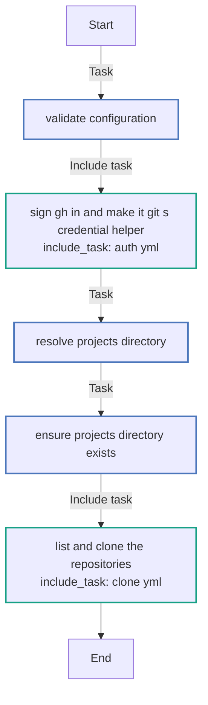
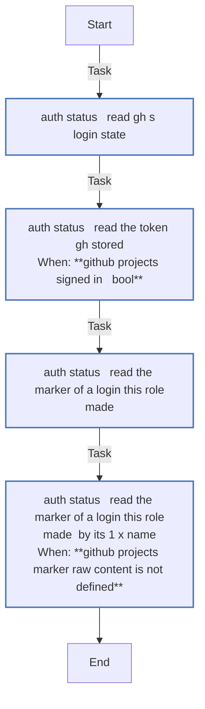
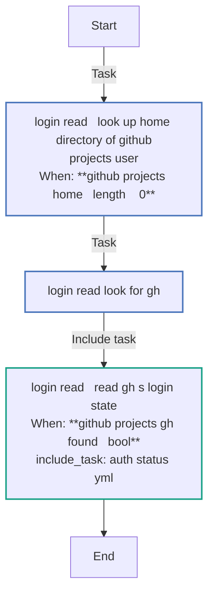
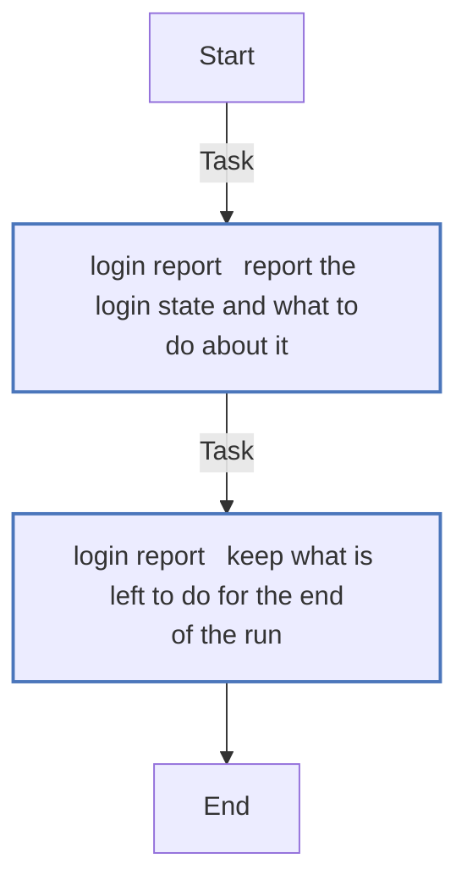
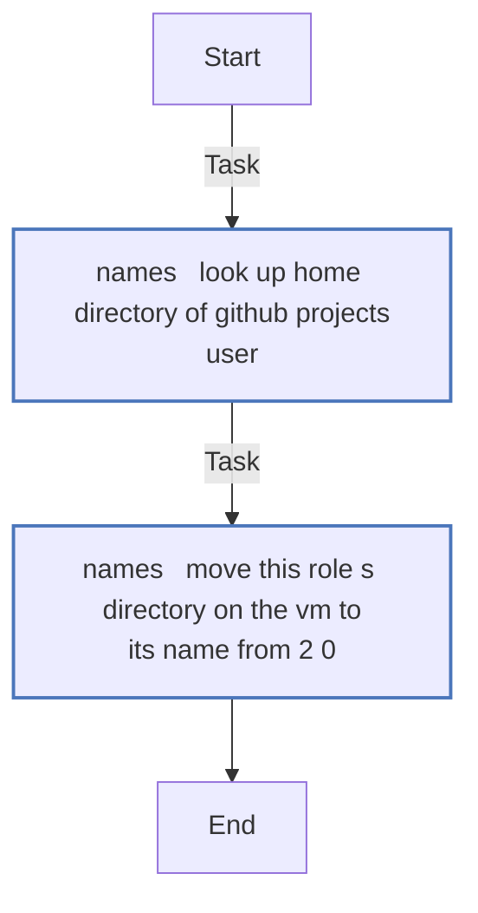
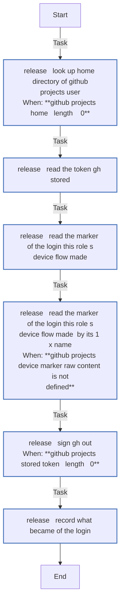

# `github_projects`

Signs `gh` in to GitHub on the VM - from a token, or by the device flow - makes it git's credential helper, and clones your repositories into the projects directory. Three entry points: `main` for `just deploy --only configure` (`--tags github_projects`), `login` for `just login --only github` and the sign-in in `just deploy`, and `release` for `just destroy`.

Using it: [GitHub](../../guides/github.md). How it works: [§5.6](../../architecture/roles.md#56-github_projects--sign-in-to-github-clone-an-accounts-repositories).

<!-- BEGIN_GENERATED: role -->
<!-- Generated by `just docs` from roles/github_projects/meta/argument_specs.yml, vars/main.yml and tasks/: edit that, not this section. -->

## Entry point `main`

**Clone every GitHub repository of a user**

| Variable | Type | Default | Description |
|---|---|---|---|
| `github_projects_user` | str | `dev` | Local user that owns the checkouts. Set through `vm_user` in local.yml. |
| `github_projects_username` | str | `""` | **Required.** GitHub account to list repositories for. Set through `vault_github_username` in vault.yml. |
| `github_projects_token` | str | `""` | Lists private repositories and, with github_projects_auth, signs gh in on the VM where gh is signed out or signed in by this role. A login made by hand stays, and the token then only lists. A secret: never logged. Set through `vault_github_token` in vault.yml. |
| `github_projects_api_url` | str | `https://api.github.com` | Base URL of the GitHub REST API that lists the repositories and, for ssh clones, GitHub's host keys. Tests point it at a stand-in. |
| `github_projects_home` | path | `""` | Home directory of github_projects_user. Empty looks it up on the VM. |
| `github_projects_dir` | path | `""` | Destination directory. Defaults to ~/projects. Set through `vm_projects_dir` in local.yml. |
| `github_projects_include_forks` | bool | `false` | Also clone repositories that are forks. |
| `github_projects_include_archived` | bool | `false` | Also clone archived repositories. |
| `github_projects_include` | list of `str` | `[]` | Repository names to clone. Empty means every repository of the user. Set through `github_projects` in local.yml. |
| `github_projects_exclude` | list of `str` | `[]` | Repository names never cloned, even when github_projects_include names them. |
| `github_projects_vm_repos` | dict | `{}` | This VM's own list of repositories, when it has one - own (true) and names - in place of github_projects_include. A fork or an archived repository named on it is cloned. Published with the VM from its notes in Proxmox (just deploy --repos), never read from the VM. |
| `github_projects_clone_protocol` | str | `https` | https clones private repositories through gh; ssh needs a key of the user's own on the VM, and trusts GitHub's published host keys. One of `https`, `ssh`. |
| `github_projects_update_existing` | bool | `false` | Pull checkouts that already exist on every run. Off, a re-run never disturbs local work. |
| `github_projects_depth` | str | `""` | Shallow clone depth. Empty clones the full history. |
| `github_projects_clone_jobs` | int | `8` | How many repositories are cloned at once, each into a partial folder renamed into place once whole. 1 clones them one at a time. |
| `github_projects_auth` | bool | `true` | Sign gh in (from the token, or by a device-flow login the user makes once) and make it git's credential helper. Set through `github_auth` in local.yml. |
| `github_projects_auth_method` | str | `auto` | auto takes the token when set, else the device flow; web is the device flow always; token is the token only, put over any login gh holds. One of `auto`, `web`, `token`. Set through `github_auth_method` in local.yml. |
| `github_projects_login_scopes` | list of `str` | `[workflow]` | Scopes the device flow asks for on top of gh's own (repo, read:org, gist). Set through `github_login_scopes` in local.yml. |
| `github_projects_login_desktop` | bool | `true` | During the device flow, open the page and copy the code on the controller. Off in every test. Set through `login_desktop` in local.yml. |
| `github_projects_sign_in_follows` | bool | `false` | The sign-ins come next in this run (just deploy), so the message for a signed-out VM says so rather than naming just login --only github. |
| `github_projects_git_user_name` | str | `""` | git user.name for github_projects_user, written always. Empty derives it from the GitHub account, and only where ~/.gitconfig has none yet. Set through `git_user_name` in local.yml. |
| `github_projects_git_user_email` | str | `""` | git user.email for github_projects_user, written always. Empty uses GitHub's noreply address for the account, and only where ~/.gitconfig has none yet. Set through `git_user_email` in local.yml. |
| `github_projects_host_flag` | str | `""` | What ends each just line naming this VM, in NEXT STEPS, a retry or a message - " --host &lt;name&gt;" where the checkout has more than one Proxmox host (claude_host_flag), so a line pasted later reaches the VM's host. Empty with one host. |

## Entry point `login`

**Say whether gh is signed in to GitHub, and how, and sign it in by the device flow when asked**

Reads gh's login state on the VM and prints it, with the one command to run when it is signed out. With github_projects_login_interactive, or the answer to the question github_projects_login_ask puts, signs a signed-out VM in by GitHub's device flow; playbooks/github_login.yml then runs the whole role.

| Variable | Type | Default | Description |
|---|---|---|---|
| `github_projects_login_interactive` | bool | `false` | Run the device flow for a signed-out VM. Set by playbooks/github_login.yml when names were given, and by just deploy for a VM whose Claude code was entered in the same run. |
| `github_projects_login_ask` | bool | `false` | Ask at a prompt first. just deploy sets it for every VM but one whose Claude prompt got Enter. For a VM with github_projects_login_interactive, Enter runs the device flow and "n" skips it; for any other, "y" runs it and Enter skips it. With no terminal the answer would be nothing, which is Enter, so playbooks/github_login.yml never sets it in a run without one. |
| `github_projects_login_role_follows` | bool | `false` | The whole role runs for this VM next, in the same run, so a vault token gh is not yet signed in with is said to be signed in by it rather than by a command to run. |
| `github_projects_host_flag` | str | `""` | What ends each just line for this VM, as main has it. |

## Entry point `release`

**Sign gh out before the VM is destroyed**

Signs gh out, and records what became of the login in github_projects_release_said, for destroy's report. No token is revoked at GitHub - revoking one gh sign-in there ends every gh sign-in of the account - so the report says where to revoke it, and what that does.

| Variable | Type | Default | Description |
|---|---|---|---|
| `github_projects_token` | str | `""` | The vault token, only to say that a login with it is every VM's. A secret: never logged. Set through `vault_github_token` in vault.yml. |

Also takes, as described under `main`: `github_projects_user`, `github_projects_home`.

## Internal values

Set in `roles/github_projects/vars/main.yml`. These are not settings: Ansible ranks a role's vars above `local.yml`, so a value set there has no effect. 66 of the 73 are computed during a run, from earlier tasks' results. Each one's purpose is the first sentence of the comment above it, where it has one of its own.

| Name | Purpose | Value |
|---|---|---|
| `github_projects_gh_found` | Whether gh is on the VM at all. | <code>{{ github_projects_gh_which.rc &#124; default(1) == 0 }}</code> |
| `github_projects_auth_hosts` | What `gh auth status --hostname github.com --json hosts` printed, parsed: {"hosts": {}} when signed out, otherwise one entry per account under "github.com". | <code>{{ (github_projects_auth_status.stdout &#124; from_json).hosts &#124; default({}) if github_projects_auth_status.rc &#124; default(1) == 0 and (github_projects_auth_status.stdout &#124; default('') &#124; trim).startswith('{') else {} }}</code> |
| `github_projects_auth_account` | The active github.com account, or {}. | <code>{{ github_projects_auth_hosts['github.com'] &#124; default([]) &#124; selectattr('active', 'defined') &#124; selectattr('active') &#124; list &#124; first &#124; default({}) }}</code> |
| `github_projects_signed_in` |  | <code>{{ (github_projects_auth_account.state &#124; default('')) == 'success' }}</code> |
| `github_projects_auth_unchecked` | Whether gh could not check its login with GitHub - no network, GitHub down - rather than GitHub refusing the token: `gh auth status --json` says both as state "error", and only a refusal carries GitHub's own "HTTP 401" or "HTTP 403". | <code>{{ (github_projects_auth_account.state &#124; default('')) == 'error' and not ((github_projects_auth_account.error &#124; default('')) is match('HTTP 40[13]')) }}</code> |
| `github_projects_status_said` | What gh wrote to stderr - when it could not report its state, and when it would not sign in with the vault token - for the messages that quote it, without escape sequences or control characters (the plain_text filter, filter_plugins/text.py). | <code>{{ github_projects_auth_status.stderr &#124; default('') &#124; plain_text &#124; trim }}</code> |
| `github_projects_gh_too_old_said` | What follows gh's own words when it could not report its state - a non-zero exit from `gh auth status --json`, which only a gh too old for --json gives - in auth.yml's failure and in login_report.yml's line alike. | <code>{{ github_projects_auth &#124; bool &#124; github_too_old_said }}</code> |
| `github_projects_token_said` |  | <code>{{ github_projects_login.stderr &#124; default('') &#124; plain_text &#124; trim }}</code> |
| `github_projects_login_kind` | How gh came to be signed in: `env` for a GH_TOKEN or GITHUB_TOKEN in gh's environment (which the reset environment of sudo -H rarely carries), and otherwise from the prefix of the token gh holds, read under no_log below: `pat` for a token like the one this role writes (ghp_ classic, github_pat_ fine-grained), `oauth` for the gho_ token of a device-flow login the user made, `none` signed out. | <code>{{ 'none' if not github_projects_signed_in &#124; bool else 'env' if (github_projects_auth_account.tokenSource &#124; default('')) is match('.*_TOKEN$') else 'pat' if github_projects_stored_token is match('(ghp_&#124;github_pat_)') else 'oauth' if github_projects_stored_token is match('gho_') else 'other' }}</code> |
| `github_projects_auth_wanted` | Whether this run manages gh's login and the credential helper at all. | <code>{{ github_projects_auth &#124; bool and github_projects_gh_found &#124; bool }}</code> |
| `github_projects_token_wanted` | Which credential signs gh in, from github_projects_auth_method: the token path takes the vault token (auto only when there is one), the web path is the device flow (auto only when there is none). | <code>{{ github_projects_auth_method == 'token' or (github_projects_auth_method == 'auto' and github_projects_token &#124; length > 0) }}</code> |
| `github_projects_web_wanted` |  | <code>{{ github_projects_auth_method == 'web' or (github_projects_auth_method == 'auto' and github_projects_token &#124; length == 0) }}</code> |
| `github_projects_token_short` | Whether gh would not sign in with the vault token for want of a scope - a classic token with repo alone, as earlier versions asked for, lacks the read:org gh requires. | <code>{{ github_projects_auth_method == 'auto' and 'missing required scope' in (github_projects_login.stderr &#124; default('')) }}</code> |
| `github_projects_token_sign_in` | Whether auth.yml signs gh in with the vault token - when the token gh holds differs from it, so a second run changes nothing, and only over a login that is not the user's own: gh signed out, signed in by this role (the marker below), or github_auth_method: token, which asks for the token whatever gh holds. | <code>{{ github_projects_auth_wanted &#124; bool and github_projects_token_wanted &#124; bool and github_projects_stored_token != github_projects_token and (not github_projects_signed_in &#124; bool or github_projects_login_is_ours &#124; bool or github_projects_auth_method == 'token') }}</code> |
| `github_projects_token_beside` |  | <code>{{ github_projects_auth_wanted &#124; bool and github_projects_token_wanted &#124; bool and github_projects_signed_in &#124; bool and github_projects_stored_token != github_projects_token and not github_projects_login_is_ours &#124; bool and github_projects_auth_method != 'token' }}</code> |
| `github_projects_login_args` | The device flow as gh runs it with no terminal: it prints the code and the page at once and polls until the code is approved or expires. | <code>{{ ['gh', 'auth', 'login', '--hostname', 'github.com', '--git-protocol', github_projects_clone_protocol, '--web', '--skip-ssh-key'] + (['--scopes', github_projects_login_scopes &#124; join(',')] if github_projects_login_scopes &#124; length > 0 else []) }}</code> |
| `github_projects_login_output` | Where gh's output lands while it runs - a code that is public by design and expires, never a token - and gh's pid, which ends a gh nobody waits for any more. | `{{ github_projects_state_dir }}/gh-login.out` |
| `github_projects_login_pidfile` |  | `{{ github_projects_state_dir }}/gh-login.pid` |
| `github_projects_login_files` | Both, unlinked before the flow starts and again once it ends - one list, so the two cannot drift. | `["{{ github_projects_login_output }}", "{{ github_projects_login_pidfile }}"]` |
| `github_projects_login_start_seconds` | How long gh may take to show the code; how long the approval is waited for, a little longer than the fifteen minutes GitHub's code lives and gh polls, so that gh's own word on an expired code is what ends the wait; and Ansible's async limit, longer again, so that its watchdog never kills gh before gh has said why it stopped. | `30` |
| `github_projects_login_wait_seconds` |  | `930` |
| `github_projects_login_async_seconds` |  | `960` |
| `github_projects_login_text` | What gh printed there, without escape sequences or control characters (see github_projects_status_said), and the code read out of it: a word of its own in GitHub's shape, XXXX-XXXX. | <code>{{ ((github_projects_login_out.content &#124; b64decode) if github_projects_login_out.content is defined else '') &#124; plain_text }}</code> |
| `github_projects_login_code` |  | <code>{{ github_projects_login_text &#124; regex_search('(?&lt;![A-Za-z0-9-])[A-Z0-9]{4}-[A-Z0-9]{4}(?![A-Za-z0-9-])') or '' }}</code> |
| `github_projects_login_page` | The page the code is entered at, opened on this machine. | `https://github.com/login/device` |
| `github_projects_login_page_pattern` |  | `^https://github[.]com/login/device$` |
| `github_projects_login_pages_foreign` | Every page gh printed that the pattern does not match, each once, and whether there is one, which the message showing the code says: never shown or opened, and quoted only as the placeholder below. | <code>{{ github_projects_login_text &#124; regex_findall('https?://[^ \t\n]+') &#124; reject('match', github_projects_login_page_pattern) &#124; unique &#124; list }}</code> |
| `github_projects_login_page_foreign` |  | <code>{{ github_projects_login_pages_foreign &#124; length > 0 }}</code> |
| `github_projects_login_page_withheld` |  | `<a page that is not GitHub's own>` |
| `github_projects_login_said` | The lines gh printed, without the closing line the start task writes after it ("gh exited: N"), for the messages that quote what gh said - a failure's among them - with each of those pages replaced, whole, by the placeholder: a page of the VM's choosing is never printed for you to follow. | <code>{{ (github_projects_login_text &#124; regex_replace('(?:' ~ github_projects_login_pages_foreign &#124; map('regex_escape') &#124; join('&#124;') ~ ')(?![^ \t\n])', github_projects_login_page_withheld) if github_projects_login_pages_foreign &#124; length > 0 else github_projects_login_text).splitlines() &#124; map('trim') &#124; select &#124; reject('match', 'gh exited: ') &#124; list }}</code> |
| `github_projects_login_expired` | Whether the code ran out: Ansible's async limit ended the job, or the run had to end gh itself once the wait for the approval was over. | <code>{{ (github_projects_login_result.msg &#124; default('')) is search('Timeout exceeded') or (github_projects_login_finished.finished &#124; default(1) &#124; int) != 1 }}</code> |
| `github_projects_login_answer` | What was typed at login.yml's question, if it was asked. | <code>{{ (github_projects_login_asked &#124; default({})).user_input &#124; default('', true) &#124; trim &#124; lower }}</code> |
| `github_projects_login_go` | Whether login.yml runs the device flow. | <code>{{ github_projects_login_answer in (['', 'y', 'yes'] if github_projects_login_interactive &#124; bool else ['y', 'yes']) if github_projects_login_ask &#124; bool else github_projects_login_interactive &#124; bool }}</code> |
| `github_projects_stored_token` | The token gh stored, read with `gh auth token` under no_log; '' when signed out. | <code>{{ github_projects_stored_token_raw.stdout &#124; default('') &#124; trim if github_projects_stored_token_raw.rc &#124; default(1) == 0 else '' }}</code> |
| `github_projects_home_dir` | The user's home, absolute, from the one main.yml resolved: a "~" in a copy task's dest is expanded through the connection's shell, not the module's environment. | <code>{{ github_projects_home if github_projects_home &#124; length > 0 else ansible_facts.getent_passwd[github_projects_user][4] }}</code> |
| `github_projects_marker_file` | The marker that tells a login this role made. | `{{ github_projects_state_dir }}/gh-login` |
| `github_projects_device_marker_file` | The same, for a login this role's device flow made: the digest of the token it left gh, apart from the marker above, whose logout rules are the vault token's. | `{{ github_projects_state_dir }}/gh-device-login` |
| `github_projects_state_dir` | The directory the role keeps these in, which claude_code shares: agent-warehouse from 2.0, claude-on-proxmox through 1.x, which names.yml moves it from before anything reads or writes it (2.x); just status and the release read the 1.x one while it is the one there, never moving it. | `{{ github_projects_home_dir }}/.config/agent-warehouse` |
| `github_projects_state_dir_1x` |  | `{{ github_projects_home_dir }}/.config/claude-on-proxmox` |
| `github_projects_marker_digest` | The digest the first marker holds, by its name from 2.0 or through 1.x, or ''. | <code>{{ (github_projects_marker_raw.content &#124; b64decode &#124; trim) if github_projects_marker_raw.content is defined else (github_projects_marker_raw_1x.content &#124; b64decode &#124; trim) if github_projects_marker_raw_1x.content is defined else '' }}</code> |
| `github_projects_token_digest` | What the marker holds for the vault token: its digest, never the token. | <code>{{ github_projects_token &#124; hash('sha256') }}</code> |
| `github_projects_login_is_ours` | Whether the login gh holds is one this role made: the stored token's digest is the marker's. | <code>{{ github_projects_signed_in &#124; bool and github_projects_stored_token &#124; length > 0 and github_projects_marker_digest &#124; length > 0 and github_projects_marker_digest == github_projects_stored_token &#124; hash('sha256') }}</code> |
| `github_projects_marker_due` | Whether the marker is due: the login is the vault token's, so auth.yml writes it (and its directory) whenever it is, not only straight after a sign-in, and a marker that went missing comes back. | <code>{{ github_projects_auth_wanted &#124; bool and github_projects_token_wanted &#124; bool and github_projects_signed_in &#124; bool and github_projects_stored_token == github_projects_token }}</code> |
| `github_projects_listing_token` | What the listing is made with: the vault token when there is one, else whatever gh holds. | <code>{{ github_projects_token if github_projects_token &#124; length > 0 else github_projects_stored_token }}</code> |
| `github_projects_token_set` | Whether there is a vault token, and a token to list with: what a message or a task var asks of them, so that only a task that hands a token on names one (tests/unit/test_github_auth.py holds every such task to no_log). | <code>{{ github_projects_token &#124; length > 0 }}</code> |
| `github_projects_listing_token_set` |  | <code>{{ github_projects_listing_token &#124; length > 0 }}</code> |
| `github_projects_dotted` | A repository whose name starts with a dot would land in the projects folder as a folder of settings: .claude for every Claude Code session started there, whose trust Remote Control accepts in advance, an editor's settings folder (.vscode) for the window just code opens, .agent-warehouse for just code's own folder. | <code>{{ github_projects_listing.repos &#124; map(attribute='name') &#124; select('match', '[.]') &#124; list }}</code> |
| `github_projects_own_list` | A VM's own list, when it has one (just deploy --repos): read from its notes in Proxmox by the play that publishes the VM, never from the VM, whose root could otherwise choose what is cloned onto it. | <code>{{ github_projects_vm_repos.own &#124; default(false) &#124; bool }}</code> |
| `github_projects_own_names` |  | <code>{{ github_projects_vm_repos.names &#124; default([]) }}</code> |
| `github_projects_own_missing` |  | <code>{{ github_projects_own_names &#124; reject('in', github_projects_listing.repos &#124; map(attribute='name') &#124; list) &#124; list }}</code> |
| `github_projects_wanted` | The repositories after the role's own filters: empty ones out (no branch to check out), the exclude list out, and in, the VM's own list when it has one, else the include list when there is one. | <code>{{ github_projects_own_names if github_projects_own_list &#124; bool else github_projects_include if github_projects_include else github_projects_listing.repos &#124; map(attribute='name') &#124; list }}</code> |
| `github_projects_candidates` |  | <code>{{ github_projects_listing.repos &#124; rejectattr('empty') &#124; rejectattr('name', 'in', github_projects_dotted) &#124; rejectattr('name', 'in', github_projects_exclude) &#124; selectattr('name', 'in', github_projects_wanted) &#124; list }}</code> |
| `github_projects_gh_helper` | Whether gh is git's credential helper for github.com already, recognised the way gh recognises it, by the gh after the "!", so one installed elsewhere than /usr/bin counts too. | <code>{{ github_projects_helpers.stdout_lines &#124; default([]) &#124; select('search', '^!([^ ]*/)?gh( &#124;$)') &#124; list &#124; length > 0 }}</code> |
| `github_projects_private_cloneable` | A private repository the listing shows but git has no credential for would fail to clone, so it is skipped and named instead. | <code>{{ github_projects_clone_protocol == 'ssh' or (github_projects_signed_in &#124; bool and (github_projects_auth_wanted &#124; bool or github_projects_gh_helper &#124; bool)) }}</code> |
| `github_projects_private_skipped` |  | <code>{{ [] if github_projects_private_cloneable &#124; bool else github_projects_candidates &#124; selectattr('private') &#124; map(attribute='name') &#124; list }}</code> |
| `github_projects_private_skip_reason` |  | <code>{{ 'private, skipped as git has no credential for them (gh is not installed)' if not github_projects_gh_found &#124; bool else 'private, skipped until gh is signed in' if not github_projects_signed_in &#124; bool else 'private, skipped as git has no credential for them (github_auth is false, and gh is not its credential helper)' }}</code> |
| `github_projects_selected` |  | <code>{{ github_projects_candidates &#124; rejectattr('name', 'in', github_projects_private_skipped) &#124; list }}</code> |
| `github_projects_git_identity_set` | The git identity, key by key: a value set here is written always; otherwise the account's, and only where ~/.gitconfig has none yet, so an identity set by hand on the VM stays. | <code>{{ github_projects_git_identity.results &#124; default([]) &#124; selectattr('stdout', 'defined') &#124; selectattr('stdout') &#124; map(attribute='item') &#124; list }}</code> |
| `github_projects_git_identity_needed` |  | <code>{{ github_projects_auth &#124; bool and ((github_projects_git_user_name &#124; length == 0 and 'user.name' not in github_projects_git_identity_set) or (github_projects_git_user_email &#124; length == 0 and 'user.email' not in github_projects_git_identity_set)) }}</code> |
| `github_projects_git_person` |  | <code>{{ (github_projects_listing.user &#124; default({})).login &#124; default('', true) &#124; length > 0 and (github_projects_listing.user.type &#124; default('User', true)) != 'Organization' }}</code> |
| `github_projects_git_name` |  | <code>{{ ((github_projects_listing.user.name &#124; default('', true)) or github_projects_listing.user.login) if github_projects_git_person &#124; bool else '' }}</code> |
| `github_projects_git_email` |  | <code>{{ (github_projects_listing.user.id ~ '+' ~ github_projects_listing.user.login ~ '@users.noreply.github.com') if github_projects_git_person &#124; bool else '' }}</code> |
| `github_projects_git_identity_wanted` |  | <code>{{ {'user.name': github_projects_git_user_name if github_projects_git_user_name &#124; length > 0 else '' if 'user.name' in github_projects_git_identity_set else github_projects_git_name, 'user.email': github_projects_git_user_email if github_projects_git_user_email &#124; length > 0 else '' if 'user.email' in github_projects_git_identity_set else github_projects_git_email} &#124; dict2items &#124; selectattr('value') &#124; items2dict }}</code> |
| `github_projects_login_command` | The command that signs gh in by the device flow, run on the controller: it opens the page there, copies the code, waits for the approval, and then runs this role so the private repositories arrive in the same run. | `just login {{ inventory_hostname }} --only github{{ github_projects_host_flag }}` |
| `github_projects_configure_command` | The command that runs this role alone: the token sign-in, the listing and the clones, with nothing else of just deploy --only configure. | `just deploy {{ inventory_hostname }} --tags github_projects{{ github_projects_host_flag }}` |
| `github_projects_device_marker_digest` | The digest the device flow's marker holds, or ''. | <code>{{ (github_projects_device_marker_raw.content &#124; b64decode &#124; trim) if github_projects_device_marker_raw.content is defined else (github_projects_device_marker_raw_1x.content &#124; b64decode &#124; trim) if github_projects_device_marker_raw_1x.content is defined else '' }}</code> |
| `github_projects_release_ours` | Whether that token is the one this role's device flow made for the VM. | <code>{{ github_projects_stored_token &#124; length > 0 and github_projects_device_marker_digest &#124; length > 0 and github_projects_device_marker_digest == github_projects_stored_token &#124; hash('sha256') and github_projects_stored_token != github_projects_token }}</code> |
| `github_projects_release_signed_out` | Whether `gh auth logout` ended the login, said as the summary below says it: a logout gh refused - two accounts, say, where it asks which - is named. | <code>{{ 'gh signed out' if (github_projects_release_logout.rc &#124; default(1)) == 0 else ('gh could not sign out (' ~ (github_projects_release_logout.stderr &#124; default('') &#124; one_line(none) or 'no reason given') ~ ')') }}</code> |
| `github_projects_release_unrevoked` | Whether the summary says the token stays valid until the user revokes it - any but the vault's, which is every VM's: something left to do, for destroy's NEXT STEPS. | <code>{{ github_projects_stored_token &#124; length > 0 and (github_projects_release_ours &#124; bool or not (github_projects_token &#124; length > 0 and github_projects_stored_token == github_projects_token)) }}</code> |
| `github_projects_release_summary` | One clause for destroy's report on the VM; empty where gh held no login. | <code>{{ '' if github_projects_stored_token &#124; length == 0 else (github_projects_release_signed_out ~ '; the token this project signed it in with stays valid until revoked at' ~ ' https://github.com/settings/applications, under GitHub CLI - which signs out every gh you have, so' ~ ' destroy does not') if github_projects_release_ours &#124; bool else (github_projects_release_signed_out ~ " (vault_github_token is every VM's, so it is not revoked)") if github_projects_token &#124; length > 0 and github_projects_stored_token == github_projects_token else (github_projects_release_signed_out ~ '; its token is not one this project recorded making (a sign-in by' ~ ' hand, or one before this version), and stays valid until revoked - at https://github.com/settings/tokens' ~ ' if it is a personal access token, or under GitHub CLI at https://github.com/settings/applications,' ~ ' which signs out every gh you have') }}</code> |
| `github_projects_login_lacks_workflow` | Whether gh's login is a device-flow one without the workflow scope, which GitHub refuses a push that changes .github/workflows/ for: said by login_report.yml, with the gh auth refresh that adds it, and left to do. | <code>{{ github_projects_login_kind == 'oauth' and 'workflow' not in (github_projects_auth_account.scopes &#124; default('')) }}</code> |
| `github_projects_login_report` | What login_report.yml says of gh's login, and whether it is something left to do, which NEXT STEPS records and just status says: the core's words (lib/claude_vm/status/lines.py), one definition for both, from what the registers hold. | <code>{{ {'gh_found': github_projects_gh_found &#124; bool, 'status_rc': github_projects_auth_status.rc &#124; default(0), 'status_said': github_projects_status_said, 'signed_in': github_projects_signed_in &#124; bool, 'login_done': github_projects_login_done &#124; default(false) &#124; bool, 'account': github_projects_auth_account.login &#124; default('', true), 'kind': github_projects_login_kind, 'is_ours': github_projects_login_is_ours &#124; bool, 'lacks_workflow': github_projects_login_lacks_workflow &#124; bool, 'user': github_projects_user, 'host': ansible_host &#124; default(inventory_hostname), 'auth': github_projects_auth &#124; bool, 'auth_method': github_projects_auth_method, 'token_wanted': github_projects_token_wanted &#124; bool, 'token_set': github_projects_token_set &#124; bool, 'role_follows': github_projects_login_role_follows &#124; bool, 'configure_command': github_projects_configure_command, 'login_command': github_projects_login_command} &#124; github_login_report }}</code> |
| `github_projects_login_left` |  | `{{ github_projects_login_report.left }}` |

## Tasks

Every task in `roles/github_projects/tasks/`, file by file, in the order the file lists them, with a flowchart of
each file. Generated from the task files, so a task added, renamed or removed shows here on the next `just docs`.

### `main.yml` - entry point `main`

| Task | Module | When |
|---|---|---|
| Validate configuration | `ansible.builtin.assert` |  |
| Sign gh in and make it git's credential helper | `ansible.builtin.include_tasks` |  |
| Resolve projects directory | `ansible.builtin.set_fact` |  |
| Ensure projects directory exists | `ansible.builtin.file` |  |
| List and clone the repositories | `ansible.builtin.include_tasks` |  |

### `auth.yml`

| Task | Module | When |
|---|---|---|
| Move this role's files on the VM from their 1.x names | `ansible.builtin.include_tasks` |  |
| Read gh and its login state | `ansible.builtin.include_tasks` |  |
| Fail when gh could not report its login state | `ansible.builtin.fail` | <code>github_projects_auth &#124; bool and github_projects_gh_found &#124; bool and github_projects_auth_status.rc &#124; default(0) != 0</code> |
| Fail when the token method has no token | `ansible.builtin.fail` | <code>github_projects_auth &#124; bool and github_projects_auth_method == 'token' and github_projects_token &#124; length == 0</code> |
| Say that gh is missing | `ansible.builtin.debug` | <code>github_projects_auth &#124; bool and not github_projects_gh_found &#124; bool</code> |
| Sign gh in with the token | `ansible.builtin.command` | <code>github_projects_token_sign_in &#124; bool</code> |
| Fail when GitHub refused the token | `ansible.builtin.fail` | <code>github_projects_login is not skipped and github_projects_login.rc &#124; default(0) != 0 and not github_projects_token_short &#124; bool</code> |
| Say that the token only lists | `ansible.builtin.debug` | <code>github_projects_token_short &#124; bool</code> |
| Keep what is left to do for the end of the run | `ansible.builtin.set_stats` | <code>github_projects_token_short &#124; bool</code> |
| Say that the token only lists beside a login of your own | `ansible.builtin.debug` | <code>github_projects_token_beside &#124; bool</code> |
| Keep what is left to do for the end of the run | `ansible.builtin.set_stats` | <code>github_projects_token_beside &#124; bool</code> |
| Sign gh out of the login this role made, now that no token is configured | `ansible.builtin.command` | <code>github_projects_auth_wanted &#124; bool and not github_projects_token_wanted &#124; bool and github_projects_login_is_ours &#124; bool</code> |
| Read gh's login state again | `ansible.builtin.include_tasks` | <code>github_projects_login is changed or github_projects_logout is changed</code> |
| Forget the login this role made | `ansible.builtin.file` | <code>github_projects_auth_wanted &#124; bool and not github_projects_token_wanted &#124; bool and not github_projects_signed_in &#124; bool and github_projects_marker_digest &#124; length > 0</code> |
| Make the directory for the marker of this role's login | `ansible.builtin.file` | <code>github_projects_marker_due &#124; bool</code> |
| Remember that the login is this role's | `ansible.builtin.copy` | <code>github_projects_marker_due &#124; bool</code> |
| Read git's credential helpers for github.com | `ansible.builtin.command` | <code>github_projects_signed_in &#124; bool</code> |
| Make gh git's credential helper for github.com | `ansible.builtin.command` | <code>github_projects_auth_wanted &#124; bool and github_projects_signed_in &#124; bool and not github_projects_gh_helper &#124; bool</code> |
| Say how to sign gh in | `ansible.builtin.debug` | <code>github_projects_auth_wanted &#124; bool and not github_projects_signed_in &#124; bool and not github_projects_token_short &#124; bool</code> |
| Keep what is left to do for the end of the run | `ansible.builtin.set_stats` | <code>github_projects_auth_wanted &#124; bool and not github_projects_signed_in &#124; bool and not github_projects_token_short &#124; bool</code> |

```mermaid
flowchart TD
Start
classDef block stroke:#3498db,stroke-width:2px;
classDef task stroke:#4b76bb,stroke-width:2px;
classDef includeTasks stroke:#16a085,stroke-width:2px;
classDef importTasks stroke:#34495e,stroke-width:2px;
classDef includeRole stroke:#2980b9,stroke-width:2px;
classDef importRole stroke:#699ba7,stroke-width:2px;
classDef includeVars stroke:#8e44ad,stroke-width:2px;
classDef rescue stroke:#665352,stroke-width:2px;

  Start-->|Include task| auth___Move_this_role_s_files_on_the_VM_from_their_1_x_names_names_yml_0[auth   move this role s files on the vm from their<br>1 x names<br>include_task: names yml]:::includeTasks
  auth___Move_this_role_s_files_on_the_VM_from_their_1_x_names_names_yml_0-->|Include task| auth___Read_gh_and_its_login_state_login_read_yml_1[auth   read gh and its login state<br>include_task: login read yml]:::includeTasks
  auth___Read_gh_and_its_login_state_login_read_yml_1-->|Task| auth___Fail_when_gh_could_not_report_its_login_state2[auth   fail when gh could not report its login<br>state<br>When: **github projects auth   bool and github projects gh<br>found   bool and github projects auth status rc  <br>default 0     0**]:::task
  auth___Fail_when_gh_could_not_report_its_login_state2-->|Task| auth___Fail_when_the_token_method_has_no_token3[auth   fail when the token method has no token<br>When: **github projects auth   bool and github projects<br>auth method     token  and github projects token  <br>length    0**]:::task
  auth___Fail_when_the_token_method_has_no_token3-->|Task| auth___Say_that_gh_is_missing4[auth   say that gh is missing<br>When: **github projects auth   bool and not github<br>projects gh found   bool**]:::task
  auth___Say_that_gh_is_missing4-->|Task| auth___Sign_gh_in_with_the_token5[auth   sign gh in with the token<br>When: **github projects token sign in   bool**]:::task
  auth___Sign_gh_in_with_the_token5-->|Task| auth___Fail_when_GitHub_refused_the_token6[auth   fail when github refused the token<br>When: **github projects login is not skipped and github<br>projects login rc   default 0     0 and not github<br>projects token short   bool**]:::task
  auth___Fail_when_GitHub_refused_the_token6-->|Task| auth___Say_that_the_token_only_lists7[auth   say that the token only lists<br>When: **github projects token short   bool**]:::task
  auth___Say_that_the_token_only_lists7-->|Task| auth___Keep_what_is_left_to_do_for_the_end_of_the_run8[auth   keep what is left to do for the end of the<br>run<br>When: **github projects token short   bool**]:::task
  auth___Keep_what_is_left_to_do_for_the_end_of_the_run8-->|Task| auth___Say_that_the_token_only_lists_beside_a_login_of_your_own9[auth   say that the token only lists beside a<br>login of your own<br>When: **github projects token beside   bool**]:::task
  auth___Say_that_the_token_only_lists_beside_a_login_of_your_own9-->|Task| auth___Keep_what_is_left_to_do_for_the_end_of_the_run10[auth   keep what is left to do for the end of the<br>run<br>When: **github projects token beside   bool**]:::task
  auth___Keep_what_is_left_to_do_for_the_end_of_the_run10-->|Task| auth___Sign_gh_out_of_the_login_this_role_made__now_that_no_token_is_configured11[auth   sign gh out of the login this role made <br>now that no token is configured<br>When: **github projects auth wanted   bool and not github<br>projects token wanted   bool and github projects<br>login is ours   bool**]:::task
  auth___Sign_gh_out_of_the_login_this_role_made__now_that_no_token_is_configured11-->|Include task| auth___Read_gh_s_login_state_again_auth_status_yml_12[auth   read gh s login state again<br>When: **github projects login is changed or github<br>projects logout is changed**<br>include_task: auth status yml]:::includeTasks
  auth___Read_gh_s_login_state_again_auth_status_yml_12-->|Task| auth___Forget_the_login_this_role_made13[auth   forget the login this role made<br>When: **github projects auth wanted   bool and not github<br>projects token wanted   bool and not github<br>projects signed in   bool and github projects<br>marker digest   length   0**]:::task
  auth___Forget_the_login_this_role_made13-->|Task| auth___Make_the_directory_for_the_marker_of_this_role_s_login14[auth   make the directory for the marker of this<br>role s login<br>When: **github projects marker due   bool**]:::task
  auth___Make_the_directory_for_the_marker_of_this_role_s_login14-->|Task| auth___Remember_that_the_login_is_this_role_s15[auth   remember that the login is this role s<br>When: **github projects marker due   bool**]:::task
  auth___Remember_that_the_login_is_this_role_s15-->|Task| auth___Read_git_s_credential_helpers_for_github_com16[auth   read git s credential helpers for github<br>com<br>When: **github projects signed in   bool**]:::task
  auth___Read_git_s_credential_helpers_for_github_com16-->|Task| auth___Make_gh_git_s_credential_helper_for_github_com17[auth   make gh git s credential helper for github<br>com<br>When: **github projects auth wanted   bool and github<br>projects signed in   bool and not github projects<br>gh helper   bool**]:::task
  auth___Make_gh_git_s_credential_helper_for_github_com17-->|Task| auth___Say_how_to_sign_gh_in18[auth   say how to sign gh in<br>When: **github projects auth wanted   bool and not github<br>projects signed in   bool and not github projects<br>token short   bool**]:::task
  auth___Say_how_to_sign_gh_in18-->|Task| auth___Keep_what_is_left_to_do_for_the_end_of_the_run19[auth   keep what is left to do for the end of the<br>run<br>When: **github projects auth wanted   bool and not github<br>projects signed in   bool and not github projects<br>token short   bool**]:::task
  auth___Keep_what_is_left_to_do_for_the_end_of_the_run19-->End
```

### `auth_status.yml`

| Task | Module | When |
|---|---|---|
| Read gh's login state | `ansible.builtin.command` |  |
| Read the token gh stored | `ansible.builtin.command` | <code>github_projects_signed_in &#124; bool</code> |
| Read the marker of a login this role made | `ansible.builtin.slurp` |  |
| Read the marker of a login this role made, by its 1.x name | `ansible.builtin.slurp` | <code>github_projects_marker_raw.content is not defined</code> |

### `clone.yml`

| Task | Module | When |
|---|---|---|
| Read the git identity of {{ github_projects_user }} | `ansible.builtin.command` | <code>github_projects_auth &#124; bool</code> |
| List repositories of {{ github_projects_username }} | `github_repos` |  |
| Fail when GitHub did not list the repositories | `ansible.builtin.fail` | <code>github_projects_listing.repos is not defined</code> |
| Report selection | `ansible.builtin.debug` |  |
| Name what of the VM's own list was not found | `ansible.builtin.debug` | <code>github_projects_own_missing &#124; length > 0</code> |
| Keep what is left to do for the end of the run | `ansible.builtin.set_stats` | <code>github_projects_own_list &#124; bool</code> |
| Set the git identity of {{ github_projects_user }} | `community.general.git_config` | <code>github_projects_auth &#124; bool</code> |
| Say that an organisation gives no git identity | `ansible.builtin.debug` | <code>github_projects_git_identity_needed &#124; bool and (github_projects_listing.user.type &#124; default('')) == 'Organization'</code> |
| Keep what is left to do for the end of the run | `ansible.builtin.set_stats` | <code>github_projects_git_identity_needed &#124; bool and (github_projects_listing.user.type &#124; default('')) == 'Organization'</code> |
| Fetch GitHub's published SSH host keys | `ansible.builtin.uri` | <code>github_projects_clone_protocol == 'ssh'</code> |
| Trust GitHub's SSH host keys | `ansible.builtin.known_hosts` | <code>github_projects_clone_protocol == 'ssh'</code> |
| Clone repositories | `git_clone_many` |  |

```mermaid
flowchart TD
Start
classDef block stroke:#3498db,stroke-width:2px;
classDef task stroke:#4b76bb,stroke-width:2px;
classDef includeTasks stroke:#16a085,stroke-width:2px;
classDef importTasks stroke:#34495e,stroke-width:2px;
classDef includeRole stroke:#2980b9,stroke-width:2px;
classDef importRole stroke:#699ba7,stroke-width:2px;
classDef includeVars stroke:#8e44ad,stroke-width:2px;
classDef rescue stroke:#665352,stroke-width:2px;

  Start-->|Task| clone___Read_the_git_identity_of_github_projects_user0[clone   read the git identity of github projects<br>user<br>When: **github projects auth   bool**]:::task
  clone___Read_the_git_identity_of_github_projects_user0-->|Task| clone___List_repositories_of_github_projects_username1[clone   list repositories of github projects<br>username]:::task
  clone___List_repositories_of_github_projects_username1-->|Task| clone___Fail_when_GitHub_did_not_list_the_repositories2[clone   fail when github did not list the<br>repositories<br>When: **github projects listing repos is not defined**]:::task
  clone___Fail_when_GitHub_did_not_list_the_repositories2-->|Task| clone___Report_selection3[clone   report selection]:::task
  clone___Report_selection3-->|Task| clone___Name_what_of_the_VM_s_own_list_was_not_found4[clone   name what of the vm s own list was not<br>found<br>When: **github projects own missing   length   0**]:::task
  clone___Name_what_of_the_VM_s_own_list_was_not_found4-->|Task| clone___Keep_what_is_left_to_do_for_the_end_of_the_run5[clone   keep what is left to do for the end of the<br>run<br>When: **github projects own list   bool**]:::task
  clone___Keep_what_is_left_to_do_for_the_end_of_the_run5-->|Task| clone___Set_the_git_identity_of_github_projects_user6[clone   set the git identity of github projects<br>user<br>When: **github projects auth   bool**]:::task
  clone___Set_the_git_identity_of_github_projects_user6-->|Task| clone___Say_that_an_organisation_gives_no_git_identity7[clone   say that an organisation gives no git<br>identity<br>When: **github projects git identity needed   bool and <br>github projects listing user type   default       <br>  organization**]:::task
  clone___Say_that_an_organisation_gives_no_git_identity7-->|Task| clone___Keep_what_is_left_to_do_for_the_end_of_the_run8[clone   keep what is left to do for the end of the<br>run<br>When: **github projects git identity needed   bool and <br>github projects listing user type   default       <br>  organization**]:::task
  clone___Keep_what_is_left_to_do_for_the_end_of_the_run8-->|Task| clone___Fetch_GitHub_s_published_SSH_host_keys9[clone   fetch github s published ssh host keys<br>When: **github projects clone protocol     ssh**]:::task
  clone___Fetch_GitHub_s_published_SSH_host_keys9-->|Task| clone___Trust_GitHub_s_SSH_host_keys10[clone   trust github s ssh host keys<br>When: **github projects clone protocol     ssh**]:::task
  clone___Trust_GitHub_s_SSH_host_keys10-->|Task| clone___Clone_repositories11[clone   clone repositories]:::task
  clone___Clone_repositories11-->|Task| clone___Fail_when_a_repository_could_not_be_cloned12[clone   fail when a repository could not be cloned<br>When: **github projects clones cloned is not defined or<br>github projects clones not cloned   default      <br>length   0**]:::task
  clone___Fail_when_a_repository_could_not_be_cloned12-->|Task| clone___Pull_the_checkouts_that_already_existed13[clone   pull the checkouts that already existed<br>When: **github projects update existing   bool**]:::task
  clone___Pull_the_checkouts_that_already_existed13-->End
```

| Fail when a repository could not be cloned | `ansible.builtin.fail` | <code>github_projects_clones.cloned is not defined or github_projects_clones.not_cloned &#124; default([]) &#124; length > 0</code> |
| Pull the checkouts that already existed | `ansible.builtin.git` | <code>github_projects_update_existing &#124; bool</code> |

### `device_flow.yml`

| Task | Module | When |
|---|---|---|
| Refuse to prompt for more than one VM at a time | `ansible.builtin.assert` |  |
| Make the directory for gh's files | `ansible.builtin.file` |  |
| Remove the files of an earlier run | `ansible.builtin.file` |  |
| Start gh's device flow in the background | `ansible.builtin.shell` |  |
| Show the code, wait for the approval, and clean up whatever happened | block |  |
| &emsp;Wait for gh to show the code | `ansible.builtin.wait_for` |  |
| &emsp;Read what gh printed | `ansible.builtin.slurp` |  |
| &emsp;Fail when gh did not start the device flow | `ansible.builtin.fail` | <code>github_projects_login_code &#124; length == 0</code> |
| &emsp;Say the code and the page | `ansible.builtin.debug` |  |
| &emsp;Look for a browser opener and a clipboard on this machine | `ansible.builtin.command` | <code>github_projects_login_desktop &#124; bool</code> |
| &emsp;Open the page in your browser | `ansible.builtin.command` | <code>github_projects_login_desktop &#124; bool and github_projects_login_opener &#124; length > 0</code> |
| &emsp;Copy the code to your clipboard | `ansible.builtin.command` | <code>github_projects_login_desktop &#124; bool and github_projects_login_found &#124; intersect(['pbcopy', 'wl-copy', 'xclip']) &#124; length > 0</code> |
| &emsp;Wait for the approval | `ansible.builtin.wait_for` |  |
| &emsp;*always:* | | |
| &emsp;&emsp;Give gh a moment to finish | `ansible.builtin.async_status` |  |
| &emsp;&emsp;End gh if it still runs | `ansible.builtin.command` | <code>github_projects_login_finished.finished &#124; default(0) &#124; int != 1</code> |
| &emsp;&emsp;Collect gh's result | `ansible.builtin.async_status` |  |
| &emsp;&emsp;Clean up gh's job | `ansible.builtin.async_status` |  |
| &emsp;&emsp;Read what gh printed, now it has finished | `ansible.builtin.slurp` |  |
| &emsp;&emsp;Remove gh's files | `ansible.builtin.file` |  |
| Read gh's login state again | `ansible.builtin.include_tasks` |  |
| Fail when the code was not approved | `ansible.builtin.fail` | <code>not github_projects_signed_in &#124; bool</code> |
| Record that this run signed the VM in | `ansible.builtin.set_fact` |  |
| Remember the token this sign-in made for the VM | `ansible.builtin.copy` |  |

```mermaid
flowchart TD
Start
classDef block stroke:#3498db,stroke-width:2px;
classDef task stroke:#4b76bb,stroke-width:2px;
classDef includeTasks stroke:#16a085,stroke-width:2px;
classDef importTasks stroke:#34495e,stroke-width:2px;
classDef includeRole stroke:#2980b9,stroke-width:2px;
classDef importRole stroke:#699ba7,stroke-width:2px;
classDef includeVars stroke:#8e44ad,stroke-width:2px;
classDef rescue stroke:#665352,stroke-width:2px;

  Start-->|Task| device_flow___Refuse_to_prompt_for_more_than_one_VM_at_a_time0[device flow   refuse to prompt for more than one<br>vm at a time]:::task
  device_flow___Refuse_to_prompt_for_more_than_one_VM_at_a_time0-->|Task| device_flow___Make_the_directory_for_gh_s_files1[device flow   make the directory for gh s files]:::task
  device_flow___Make_the_directory_for_gh_s_files1-->|Task| device_flow___Remove_the_files_of_an_earlier_run2[device flow   remove the files of an earlier run]:::task
  device_flow___Remove_the_files_of_an_earlier_run2-->|Task| device_flow___Start_gh_s_device_flow_in_the_background3[device flow   start gh s device flow in the<br>background]:::task
  device_flow___Start_gh_s_device_flow_in_the_background3-->|Block Start| device_flow___Show_the_code__wait_for_the_approval__and_clean_up_whatever_happened4_block_start_0[[device flow   show the code  wait for the approval<br> and clean up whatever happened]]:::block
  device_flow___Show_the_code__wait_for_the_approval__and_clean_up_whatever_happened4_block_start_0-->|Task| device_flow___Wait_for_gh_to_show_the_code0[device flow   wait for gh to show the code]:::task
  device_flow___Wait_for_gh_to_show_the_code0-->|Task| device_flow___Read_what_gh_printed1[device flow   read what gh printed]:::task
  device_flow___Read_what_gh_printed1-->|Task| device_flow___Fail_when_gh_did_not_start_the_device_flow2[device flow   fail when gh did not start the<br>device flow<br>When: **github projects login code   length    0**]:::task
  device_flow___Fail_when_gh_did_not_start_the_device_flow2-->|Task| device_flow___Say_the_code_and_the_page3[device flow   say the code and the page]:::task
  device_flow___Say_the_code_and_the_page3-->|Task| device_flow___Look_for_a_browser_opener_and_a_clipboard_on_this_machine4[device flow   look for a browser opener and a<br>clipboard on this machine<br>When: **github projects login desktop   bool**]:::task
  device_flow___Look_for_a_browser_opener_and_a_clipboard_on_this_machine4-->|Task| device_flow___Open_the_page_in_your_browser5[device flow   open the page in your browser<br>When: **github projects login desktop   bool and github<br>projects login opener   length   0**]:::task
  device_flow___Open_the_page_in_your_browser5-->|Task| device_flow___Copy_the_code_to_your_clipboard6[device flow   copy the code to your clipboard<br>When: **github projects login desktop   bool and github<br>projects login found   intersect   pbcopy    wl<br>copy    xclip      length   0**]:::task
  device_flow___Copy_the_code_to_your_clipboard6-->|Task| device_flow___Wait_for_the_approval7[device flow   wait for the approval]:::task
  device_flow___Wait_for_the_approval7-.->|End of Block| device_flow___Show_the_code__wait_for_the_approval__and_clean_up_whatever_happened4_block_start_0
  device_flow___Wait_for_the_approval7-->|Include task| device_flow___Read_gh_s_login_state_again_auth_status_yml_5[device flow   read gh s login state again<br>include_task: auth status yml]:::includeTasks
  device_flow___Read_gh_s_login_state_again_auth_status_yml_5-->|Task| device_flow___Fail_when_the_code_was_not_approved6[device flow   fail when the code was not approved<br>When: **not github projects signed in   bool**]:::task
  device_flow___Fail_when_the_code_was_not_approved6-->|Task| device_flow___Record_that_this_run_signed_the_VM_in7[device flow   record that this run signed the vm<br>in]:::task
  device_flow___Record_that_this_run_signed_the_VM_in7-->|Task| device_flow___Remember_the_token_this_sign_in_made_for_the_VM8[device flow   remember the token this sign in made<br>for the vm]:::task
  device_flow___Remember_the_token_this_sign_in_made_for_the_VM8-->End
```

### `login.yml` - entry point `login`

| Task | Module | When |
|---|---|---|
| Move this role's files on the VM from their 1.x names | `ansible.builtin.include_tasks` |  |
| Read gh and its login state | `ansible.builtin.include_tasks` |  |
| Record whether the device flow would sign gh in | `ansible.builtin.set_fact` |  |
| Ask whether to sign gh in to GitHub now for {{ inventory_hostname }} | `ansible.builtin.pause` | <code>github_projects_login_ask &#124; bool and github_projects_login_due &#124; bool</code> |
| Sign gh in by the device flow | `ansible.builtin.include_tasks` | <code>github_projects_login_go &#124; bool and github_projects_login_due &#124; bool</code> |
| Report the login state and what to do about it | `ansible.builtin.include_tasks` |  |

```mermaid
flowchart TD
Start
classDef block stroke:#3498db,stroke-width:2px;
classDef task stroke:#4b76bb,stroke-width:2px;
classDef includeTasks stroke:#16a085,stroke-width:2px;
classDef importTasks stroke:#34495e,stroke-width:2px;
classDef includeRole stroke:#2980b9,stroke-width:2px;
classDef importRole stroke:#699ba7,stroke-width:2px;
classDef includeVars stroke:#8e44ad,stroke-width:2px;
classDef rescue stroke:#665352,stroke-width:2px;

  Start-->|Include task| login___Move_this_role_s_files_on_the_VM_from_their_1_x_names_names_yml_0[login   move this role s files on the vm from<br>their 1 x names<br>include_task: names yml]:::includeTasks
  login___Move_this_role_s_files_on_the_VM_from_their_1_x_names_names_yml_0-->|Include task| login___Read_gh_and_its_login_state_login_read_yml_1[login   read gh and its login state<br>include_task: login read yml]:::includeTasks
  login___Read_gh_and_its_login_state_login_read_yml_1-->|Task| login___Record_whether_the_device_flow_would_sign_gh_in2[login   record whether the device flow would sign<br>gh in]:::task
  login___Record_whether_the_device_flow_would_sign_gh_in2-->|Task| login___Ask_whether_to_sign_gh_in_to_GitHub_now_for_inventory_hostname3[login   ask whether to sign gh in to github now<br>for inventory hostname<br>When: **github projects login ask   bool and github<br>projects login due   bool**]:::task
  login___Ask_whether_to_sign_gh_in_to_GitHub_now_for_inventory_hostname3-->|Include task| login___Sign_gh_in_by_the_device_flow_device_flow_yml_4[login   sign gh in by the device flow<br>When: **github projects login go   bool and github<br>projects login due   bool**<br>include_task: device flow yml]:::includeTasks
  login___Sign_gh_in_by_the_device_flow_device_flow_yml_4-->|Include task| login___Report_the_login_state_and_what_to_do_about_it_login_report_yml_5[login   report the login state and what to do<br>about it<br>include_task: login report yml]:::includeTasks
  login___Report_the_login_state_and_what_to_do_about_it_login_report_yml_5-->End
```

### `login_read.yml`

| Task | Module | When |
|---|---|---|
| Look up home directory of {{ github_projects_user }} | `ansible.builtin.getent` | <code>github_projects_home &#124; length == 0</code> |
| Look for gh | `ansible.builtin.command` |  |
| Read gh's login state | `ansible.builtin.include_tasks` | <code>github_projects_gh_found &#124; bool</code> |

### `login_report.yml`

| Task | Module | When |
|---|---|---|
| Report the login state and what to do about it | `ansible.builtin.debug` |  |
| Keep what is left to do for the end of the run | `ansible.builtin.set_stats` |  |

### `names.yml`

| Task | Module | When |
|---|---|---|
| Look up home directory of {{ github_projects_user }} | `ansible.builtin.getent` |  |
| Move this role's directory on the VM to its name from 2.0 | `ansible.builtin.command` |  |

### `release.yml` - entry point `release`

| Task | Module | When |
|---|---|---|
| Look up home directory of {{ github_projects_user }} | `ansible.builtin.getent` | <code>github_projects_home &#124; length == 0</code> |
| Read the token gh stored | `ansible.builtin.command` |  |
| Read the marker of the login this role's device flow made | `ansible.builtin.slurp` |  |
| Read the marker of the login this role's device flow made, by its 1.x name | `ansible.builtin.slurp` | <code>github_projects_device_marker_raw.content is not defined</code> |
| Sign gh out | `ansible.builtin.command` | <code>github_projects_stored_token &#124; length > 0</code> |
| Record what became of the login | `ansible.builtin.set_fact` |  |

<!-- END_GENERATED: role -->
