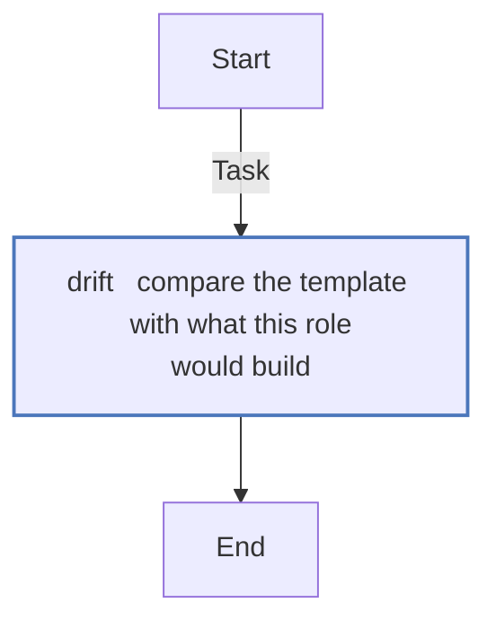

# `proxmox_template`

Builds the cloud-init Ubuntu template every VM is cloned from: downloads the cloud image, checks it against Ubuntu's `SHA256SUMS`, bakes the QEMU guest agent in, and imports it with `qm`. It runs on the Proxmox host over SSH as root, once - `just deploy --only template`, or `just deploy` when the template is missing.

What the host needs for it: [Requirements](../../getting-started/requirements.md). How it works: [§5.1](../../architecture/roles.md#51-proxmox_template--build-the-golden-image).

<!-- BEGIN_GENERATED: role -->
<!-- Generated by `just docs` from roles/proxmox_template/meta/argument_specs.yml, vars/main.yml and tasks/: edit that, not this section. -->

## Entry point `main`

**Build a cloud-init enabled VM template on a Proxmox VE host**

Runs on the PVE node over SSH. Downloads a cloud image, creates a VM with `qm`, imports the image as its root disk, adds a cloud-init drive and converts the VM to a template, recording in its notes what went into the disk. Skipped if the VMID already holds the finished template and it is what these settings would build; rebuilt at the same VMID when it differs (proxmox_template_rebuild); refused if the VMID holds anything else, on this node or another.

| Variable | Type | Default | Description |
|---|---|---|---|
| `proxmox_template_vmid` | int | `9000` | VMID the template is built under. Anything but the finished template there, on this node or another, fails the run. |
| `proxmox_template_name` | str | `ubuntu-24.04-cloudinit` | Template name. VMs are cloned from it by name, and a finished template at the VMID is recognised by it. |
| `proxmox_template_image_url` | str | `https://cloud-images.ubuntu.com/minimal/releases/noble/release/ubuntu-24.04-minimal-cloudimg-amd64.img` | Cloud image downloaded and imported as the template's root disk. |
| `proxmox_template_image_checksum` | str | `sha256:https://cloud-images.ubuntu.com/minimal/releases/noble/release/SHA256SUMS` | get_url checksum spec. Set to an empty string to skip verification. |
| `proxmox_template_image_dir` | path | `/var/lib/vz/claude-on-proxmox` | Directory on the node that keeps the pristine download. Created if missing. Keep it outside the content directories of a storage, or Proxmox lists the image in the UI (under template/iso it appeared as an ISO). |
| `proxmox_template_storage` | str | `local-lvm` | Proxmox storage the root disk and the cloud-init drive are created on. Set through proxmox_storage in local.yml. |
| `proxmox_template_bridge` | str | `vmbr0` | Bridge the template's net0 is attached to, and so every clone's. Set through proxmox_bridge in local.yml. |
| `proxmox_template_cores` | int | `2` | CPU cores of the template itself. proxmox_vm sets each VM's own. |
| `proxmox_template_memory_mb` | int | `2048` | Memory of the template itself, in MB. proxmox_vm sets each VM's own. |
| `proxmox_template_cpu_type` | str | `host` | CPU type (qm --cpu), which every VM cloned from the template keeps. |
| `proxmox_template_ostype` | str | `l26` | Guest OS type (qm --ostype). l26 is Linux 2.6 or later. |
| `proxmox_template_qm` | path | `/usr/sbin/qm` | Path of qm on the node. Tests point it at a stand-in. |
| `proxmox_template_install_guest_agent` | bool | `true` | Bake qemu-guest-agent into the image with virt-customize. Required for Proxmox to report a DHCP-assigned address. |
| `proxmox_template_customize_packages` | list of `str` | `["qemu-guest-agent"]` | Packages installed into the image by virt-customize. |
| `proxmox_template_manage_libguestfs` | bool | `true` | Install libguestfs-tools on the node. Disable where it is already present or faked. |
| `proxmox_template_virt_customize` | path | `/usr/bin/virt-customize` | Path of virt-customize on the node. Tests point it at a stand-in. |
| `proxmox_template_rebuild` | bool | `true` | Rebuild the template at the same VMID when it differs from what these settings would build - its CPU type, OS type, bridge, storage, image, packages or this version's build - or keeps no record of its build, as one an earlier version built does. VMs are full clones, which do not depend on it. Off, it is kept as it is and the differences are said, for a template a linked clone still uses, which Proxmox will not remove, or one changed by hand on purpose. |

## Entry point `drift`

**Say how the template differs from what this role would build, changing nothing**

Compares the template's config, as the caller read it from Proxmox, with what this role would build - the qm settings every clone inherits and, from the record in its notes, the image, packages and build version - and records the differences in proxmox_template_drift, empty when there are none. Proxmox is asked nothing, and nothing is changed.

| Variable | Type | Default | Description |
|---|---|---|---|
| `proxmox_template_drift_config` | dict |  | **Required.** The template's config, as /nodes/&lt;node&gt;/qemu/&lt;vmid&gt;/config gives it. |

## Internal values

Set in `roles/proxmox_template/vars/main.yml`. These are not settings: Ansible ranks a role's vars above `local.yml`, so a value set there has no effect. 3 of the 8 are computed during a run, from earlier tasks' results.

| Name | Value |
|---|---|
| `proxmox_template_build` | `1` |
| `proxmox_template_scsihw` | `virtio-scsi-pci` |
| `proxmox_template_serial0` | `socket` |
| `proxmox_template_vga` | `serial0` |
| `proxmox_template_packages` | <code>{{ proxmox_template_customize_packages &#124; join(',') if proxmox_template_install_guest_agent &#124; bool else '' }}</code> |
| `proxmox_template_wanted` | `{"cpu": "{{ proxmox_template_cpu_type }}", "ostype": "{{ proxmox_template_ostype }}", "bridge": "{{ proxmox_template_bridge }}", "storage": "{{ proxmox_template_storage }}", "scsihw": "{{ proxmox_template_scsihw }}", "agent": "1", "serial0": "{{ proxmox_template_serial0 }}", "vga": "{{ proxmox_template_vga }}", "build": "{{ proxmox_template_build }}", "image": "{{ proxmox_template_image_url }}", "packages": "{{ proxmox_template_packages }}"}` |
| `proxmox_template_differences` | <code>{{ (proxmox_template_existing.stdout &#124; qm_config) &#124; proxmox_template_drift(proxmox_template_wanted) if proxmox_template_existing.rc &#124; default(1) == 0 else [] }}</code> |
| `proxmox_template_rebuilding` | <code>{{ proxmox_template_differences &#124; length > 0 and proxmox_template_rebuild &#124; bool }}</code> |

## Tasks

Every task in `roles/proxmox_template/tasks/`, file by file, in the order the file lists them, with a flowchart of
each file. Generated from the task files, so a task added, renamed or removed shows here on the next `just docs`.

### `main.yml` - entry point `main`

| Task | Module | When |
|---|---|---|
| Check for existing VM {{ proxmox_template_vmid }} | `ansible.builtin.command` |  |
| Refuse to reuse VMID {{ proxmox_template_vmid }} | `ansible.builtin.assert` | <code>proxmox_template_existing.rc == 0</code> |
| Read the cluster-wide VM list | `ansible.builtin.slurp` | <code>proxmox_template_existing.rc != 0</code> |
| Refuse a VMID another node holds, {{ proxmox_template_vmid }} | `ansible.builtin.assert` | <code>proxmox_template_existing.rc != 0</code> |
| Say how the template differs from its settings | `ansible.builtin.debug` | <code>proxmox_template_differences &#124; length > 0</code> |
| Build the template | block | <code>proxmox_template_existing.rc != 0 or proxmox_template_rebuilding &#124; bool</code> |
| &emsp;Ensure image directory exists | `ansible.builtin.file` |  |
| &emsp;Download cloud image | `ansible.builtin.get_url` |  |
| &emsp;Read the image's SHA-256 | `ansible.builtin.stat` |  |
| &emsp;Decide which image to import | `ansible.builtin.set_fact` |  |
| &emsp;Prepare the image for customization | block | <code>proxmox_template_install_guest_agent &#124; bool</code> |
| &emsp;&emsp;Install libguestfs-tools | `ansible.builtin.apt` | <code>proxmox_template_manage_libguestfs &#124; bool</code> |
| &emsp;&emsp;Copy the cloud image for customization | `ansible.builtin.copy` |  |
| &emsp;&emsp;Install packages into the image with virt-customize | `ansible.builtin.command` |  |
| &emsp;Remove the template that differs from its settings | `ansible.builtin.command` | <code>proxmox_template_existing.rc == 0</code> |
| &emsp;Fail when Proxmox kept the template | `ansible.builtin.assert` | <code>proxmox_template_existing.rc == 0</code> |
| &emsp;Create VM {{ proxmox_template_vmid }} | `ansible.builtin.command` |  |
| &emsp;Import the cloud image as the root disk | `ansible.builtin.command` |  |
| &emsp;Add cloud-init drive and set boot order | `ansible.builtin.command` |  |
| &emsp;Convert VM to template | `ansible.builtin.command` |  |
| &emsp;Read the template as it was built | `ansible.builtin.command` |  |
| &emsp;Fail when the template differs from its settings as built | `ansible.builtin.assert` |  |
| &emsp;*always:* | | |

```mermaid
flowchart TD
Start
classDef block stroke:#3498db,stroke-width:2px;
classDef task stroke:#4b76bb,stroke-width:2px;
classDef includeTasks stroke:#16a085,stroke-width:2px;
classDef importTasks stroke:#34495e,stroke-width:2px;
classDef includeRole stroke:#2980b9,stroke-width:2px;
classDef importRole stroke:#699ba7,stroke-width:2px;
classDef includeVars stroke:#8e44ad,stroke-width:2px;
classDef rescue stroke:#665352,stroke-width:2px;

  Start-->|Task| Check_for_existing_VM_proxmox_template_vmid0[check for existing vm proxmox template vmid]:::task
  Check_for_existing_VM_proxmox_template_vmid0-->|Task| Refuse_to_reuse_VMID_proxmox_template_vmid1[refuse to reuse vmid proxmox template vmid<br>When: **proxmox template existing rc    0**]:::task
  Refuse_to_reuse_VMID_proxmox_template_vmid1-->|Task| Read_the_cluster_wide_VM_list2[read the cluster wide vm list<br>When: **proxmox template existing rc    0**]:::task
  Read_the_cluster_wide_VM_list2-->|Task| Refuse_a_VMID_another_node_holds__proxmox_template_vmid3[refuse a vmid another node holds  proxmox template<br>vmid<br>When: **proxmox template existing rc    0**]:::task
  Refuse_a_VMID_another_node_holds__proxmox_template_vmid3-->|Task| Say_how_the_template_differs_from_its_settings4[say how the template differs from its settings<br>When: **proxmox template differences   length   0**]:::task
  Say_how_the_template_differs_from_its_settings4-->|Block Start| Build_the_template5_block_start_0[[build the template<br>When: **proxmox template existing rc    0 or proxmox<br>template rebuilding   bool**]]:::block
  Build_the_template5_block_start_0-->|Task| Ensure_image_directory_exists0[ensure image directory exists]:::task
  Ensure_image_directory_exists0-->|Task| Download_cloud_image1[download cloud image]:::task
  Download_cloud_image1-->|Task| Read_the_image_s_SHA_2562[read the image s sha 256]:::task
  Read_the_image_s_SHA_2562-->|Task| Decide_which_image_to_import3[decide which image to import]:::task
  Decide_which_image_to_import3-->|Block Start| Prepare_the_image_for_customization4_block_start_1[[prepare the image for customization<br>When: **proxmox template install guest agent   bool**]]:::block
  Prepare_the_image_for_customization4_block_start_1-->|Task| Install_libguestfs_tools0[install libguestfs tools<br>When: **proxmox template manage libguestfs   bool**]:::task
  Install_libguestfs_tools0-->|Task| Copy_the_cloud_image_for_customization1[copy the cloud image for customization]:::task
  Copy_the_cloud_image_for_customization1-->|Task| Install_packages_into_the_image_with_virt_customize2[install packages into the image with virt<br>customize]:::task
  Install_packages_into_the_image_with_virt_customize2-.->|End of Block| Prepare_the_image_for_customization4_block_start_1
  Install_packages_into_the_image_with_virt_customize2-->|Task| Remove_the_template_that_differs_from_its_settings5[remove the template that differs from its settings<br>When: **proxmox template existing rc    0**]:::task
  Remove_the_template_that_differs_from_its_settings5-->|Task| Fail_when_Proxmox_kept_the_template6[fail when proxmox kept the template<br>When: **proxmox template existing rc    0**]:::task
  Fail_when_Proxmox_kept_the_template6-->|Task| Create_VM_proxmox_template_vmid7[create vm proxmox template vmid]:::task
  Create_VM_proxmox_template_vmid7-->|Task| Import_the_cloud_image_as_the_root_disk8[import the cloud image as the root disk]:::task
  Import_the_cloud_image_as_the_root_disk8-->|Task| Add_cloud_init_drive_and_set_boot_order9[add cloud init drive and set boot order]:::task
  Add_cloud_init_drive_and_set_boot_order9-->|Task| Convert_VM_to_template10[convert vm to template]:::task
  Convert_VM_to_template10-->|Task| Read_the_template_as_it_was_built11[read the template as it was built]:::task
  Read_the_template_as_it_was_built11-->|Task| Fail_when_the_template_differs_from_its_settings_as_built12[fail when the template differs from its settings<br>as built]:::task
  Fail_when_the_template_differs_from_its_settings_as_built12-.->|End of Block| Build_the_template5_block_start_0
  Fail_when_the_template_differs_from_its_settings_as_built12-->End
```

| &emsp;&emsp;Remove the customised image | `ansible.builtin.file` | <code>proxmox_template_import_path is defined and proxmox_template_image.dest is defined and proxmox_template_import_path != proxmox_template_image.dest</code> |

### `drift.yml` - entry point `drift`

| Task | Module | When |
|---|---|---|
| Compare the template with what this role would build | `ansible.builtin.set_fact` |  |

<!-- END_GENERATED: role -->
