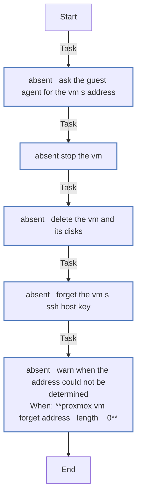

# `proxmox_vm`

Creates, starts and deletes VMs through the Proxmox API, finding each by name and refusing any it did not tag. `playbooks/provision.yml` runs it for `just deploy --only provision` and `just deploy`, and `playbooks/destroy.yml` with `proxmox_vm_state: absent`. Most of its variables are set through the shorter names in [Settings](../settings.md#proxmox).

Using it: [VMs and fleets](../../guides/vms.md). How it works: [§5.2](../../architecture/roles.md#52-proxmox_vm--the-core-role).

<!-- BEGIN_GENERATED: role -->
<!-- Generated by `just docs` from roles/proxmox_vm/meta/argument_specs.yml, vars/main.yml and tasks/: edit that, not this section. -->

## Entry point `main`

**Clone, configure and start (or delete) a VM on Proxmox VE**

Looks the VM up by name, clones it from a cloud-init template if missing, applies hardware and cloud-init settings, resizes the root disk, starts it and waits for the guest agent to report an address.

An existing VM that is stopped is left stopped unless proxmox_vm_start_existing is set. It is not waited on; the role sets proxmox_vm_stopped and an empty proxmox_vm_address instead.

A VM an earlier run did not finish is finished instead - configured, resized and started - whatever its status. The settings call tags it "&lt;first tag&gt;-unfinished", and only a successful start removes that tag.

Deleting refuses any VM that does not carry the ownership tag, and creating refuses an existing VM that lacks it or is a template.

All API calls are delegated to the controller.

| Variable | Type | Default | Description |
|---|---|---|---|
| `proxmox_vm_api_host` | str | `""` | Proxmox VE API host (IP or DNS name). Not marked required. The role defaults it to "" and asserts on it instead, so an unset host is reported with the name of the file to put it in rather than as "missing required arguments". |
| `proxmox_vm_api_port` | int | `8006` | Port of the Proxmox VE API. Set through `proxmox_api_port` in local.yml. |
| `proxmox_vm_api_user` | str | `ansible@pve` | Proxmox user the API token belongs to, realm included. Set through `proxmox_api_user` in local.yml. |
| `proxmox_vm_api_token_id` | str | `ansible` | Name of the API token, the part after the ! in user!token. Set through `proxmox_api_token_id` in local.yml. |
| `proxmox_vm_api_token_secret` | str | `""` | API token secret. Keep it in an ansible-vault file. Asserted by the role rather than marked required, for the same reason as proxmox_vm_api_host. A secret: never logged. Set through `vault_proxmox_api_token_secret` in vault.yml. |
| `proxmox_vm_validate_certs` | bool | `false` | Verify the API's TLS certificate. Turn it on once the controller trusts the Proxmox CA. Set through `proxmox_validate_certs` in local.yml. |
| `proxmox_vm_api_timeout` | int | `30` | Seconds each API request waits for Proxmox's answer. Not the modules' own 5, which a host busy copying a disk outlasts in the middle of a clone, failing a run whose clone was made. |
| `proxmox_vm_node` | str | `pve` | Node that holds the template, where new VMs are cloned. Set through `proxmox_node` in local.yml. |
| `proxmox_vm_storage` | str | `local-lvm` | Storage a full clone's disks are created on. Set through `proxmox_storage` in local.yml. |
| `proxmox_vm_template_name` | str | `ubuntu-24.04-cloudinit` | Name of the template VMs are cloned from. |
| `proxmox_vm_template_vmid` | str | `""` | The VMID of a golden template to clone, always as a full clone, in place of proxmox_vm_template_name. Empty, as when provision.yml runs on its own, clones the template by its name. |
| `proxmox_vm_full_clone` | bool | `true` | Make a full clone, independent of the template. false makes a linked clone, which keeps depending on the template's disk. |
| `proxmox_vm_timeout` | int | `600` | Seconds the clone, start, stop and delete calls may each take. |
| `proxmox_vm_state` | str | `present` | present clones and configures the VM where it is missing or unfinished, and starts it; an existing, finished VM is left as it is, a stopped one stopped. absent stops and deletes it. One of `present`, `absent`. |
| `proxmox_vm_start_existing` | bool | `false` | Start an already-configured VM that is stopped. Off by default so a re-run does not boot a VM that was shut down deliberately. When off, such a VM is reported as stopped (proxmox_vm_stopped) with an empty proxmox_vm_address, without waiting for its guest agent. |
| `proxmox_vm_nic` | str | `net0` | Which NIC of the template carries the LAN address; its MAC is what the guest agent's reply is matched against. Set through `proxmox_nic` in local.yml. |
| `proxmox_vm_lookup_retries` | int | `6` | How many more times a just-cloned VM's configuration is read, after the first, before giving up, since the cluster listing can lag behind a clone. |
| `proxmox_vm_lookup_delay` | int | `5` | Seconds between reads of a just-cloned VM's configuration. |
| `proxmox_vm_allow_untagged_delete` | bool | `false` | Allow state=absent to delete a VM that does not carry the ownership tag. Off by default so a name collision cannot destroy a VM this project never created. |
| `proxmox_vm_known_hosts_domain` | str | `""` | The DNS domain SSH reaches the VMs by on this machine, when not their address (claude_ssh_host_domain). state=absent forgets the host key recorded under &lt;name&gt;.&lt;domain&gt; too, besides the one under the address. Set through claude_ssh_host_domain in local.yml. Set through `claude_ssh_host_domain` in local.yml. |
| `proxmox_vm_known_hosts_kept` | list of `str` | `[]` | Addresses whose host key state=absent never forgets, whatever address the VM's guest agent reported, or &lt;name&gt;.&lt;domain&gt; it is reached by - the inventory's other hosts'. The Proxmox host's (proxmox_vm_api_host) is never forgotten either way. Wired from the inventory's hosts in group_vars/all. |
| `proxmox_vm_name` | str | same as `inventory_hostname` | VM name in Proxmox. Defaults to the inventory hostname. |
| `proxmox_vm_id` | raw | `""` | Pin the VM to a specific VMID. Left empty, Proxmox assigns the next free one. The VM is identified by name, not by ID, so this is rarely needed. Run across several hosts at once, the role clones one VM at a time unless each has a distinct VMID here, because concurrent clones that ask Proxmox for one are handed the same. provision.yml sets one for every new VM of a fleet. Declared raw so the role can validate it and report a helpful message. |
| `proxmox_vm_size` | dict | `{}` | This run's size for a VM it creates, each part optional - cores, memory_mb, disk (as 64G) - in place of proxmox_vm_cores, proxmox_vm_memory_mb and proxmox_vm_disk_size. Set by provision.yml from just deploy's --cores, --memory and --disk. A VM created with one is tagged &lt;ownership tag&gt;-sized, its size its own from then on - just status calls no difference from the size settings drift, and proxmox_vm_force_update keeps it. A VM that exists is refused when it has another size, but under proxmox_vm_force_update, which applies it. |
| `proxmox_vm_repos` | list of `str` | `[]` | This run's list of repositories for the VM, in place of the github_projects setting. Set by provision.yml from just deploy's --repos. Written as one line of the VM's notes, added to what is there; empty leaves the notes alone. Refused for a finished VM with no list of its own, which follows the setting, but under proxmox_vm_force_update. |
| `proxmox_vm_cores` | int | `2` | Defaults to the vm_cores host var, else 2. proxmox_vm_size's takes its place for a VM this run creates. Set through `vm_cores` in local.yml. |
| `proxmox_vm_memory_mb` | int | `4096` | Defaults to the vm_memory_mb host var, else 4096. proxmox_vm_size's memory_mb takes its place for a VM this run creates. Set through `vm_memory_mb` in local.yml. |
| `proxmox_vm_memory_min_mb` | int | computed | The least memory the host may leave the VM (Proxmox's minimum memory, ballooning), from 1 to proxmox_vm_memory_mb. Below it, the host takes the difference back once its memory use passes the node's ballooning target. Defaults to the vm_memory_min_mb host var, else proxmox_vm_memory_mb, a fixed allocation. Under proxmox_vm_size's memory_mb, it stays where it is below proxmox_vm_memory_mb - and below the size's memory - and is the size's memory where it is a fixed allocation. Applied when the VM is created. Set through `vm_memory_min_mb` in local.yml. |
| `proxmox_vm_disk` | str | `scsi0` | The root disk, as the template names it, resized to proxmox_vm_disk_size. |
| `proxmox_vm_disk_size` | str | `32G` | Absolute root disk size with unit suffix (K, M, G, T). Applied when the VM is created or an unfinished one is repaired, and with proxmox_vm_force_update. Proxmox cannot shrink a disk, so a size below the current one fails. Defaults to the vm_disk_size host var, else 32G. proxmox_vm_size's disk takes its place for a VM this run creates. Set through `vm_disk_size` in local.yml. |
| `proxmox_vm_onboot` | bool | `true` | Start the VM when its Proxmox node boots. |
| `proxmox_vm_tags` | list of `str` | `[agent-warehouse]` | Tags stamped on every VM this role creates. The first one is the ownership marker - discovery finds VMs by it, and both deleting and provisioning refuse to touch an existing VM that does not carry it. |
| `proxmox_vm_tags_1x` | list of `str` | `[claude-on-proxmox]` | The ownership tag through 1.x. A VM that carries it, or a mark or the unfinished tag under it, is the role's as if it carried the first of proxmox_vm_tags, and the role writes each under that tag instead. Empty for a tag of one's own. |
| `proxmox_vm_user` | str | `dev` | Cloud-init user created on the VM. The playbooks also log in as it. Set through `vm_user` in local.yml. |
| `proxmox_vm_password` | str | `""` | Optional cloud-init password for the user (vault_vm_password in vault.yml). Key-based login is the default. Either this or proxmox_vm_ssh_public_keys must be set. A secret: never logged. Set through `vault_vm_password` in vault.yml. |
| `proxmox_vm_ssh_public_keys` | list of `str` | `[]` | Public keys cloud-init authorises for proxmox_vm_user. These or proxmox_vm_password must be set. Set through `vm_ssh_public_keys` in local.yml. |
| `proxmox_vm_ipconfig` | str | `ip=dhcp` | Proxmox ipconfig0 string. DHCP by default, with the address read back from the guest agent. Set to something like "ip=192.0.2.50/24,gw=192.0.2.1" to assign a fixed address. One value for every VM it applies to. Set fleet-wide (local.yml, -e), every VM a run provisions is given that same address, so use it only for a single VM. Set through `vm_ipconfig` in local.yml. |
| `proxmox_vm_nameservers` | list of `str` | `[]` | Defaults to the vm_nameservers host var. Set through `vm_nameservers` in local.yml. |
| `proxmox_vm_searchdomain` | str | `""` | Defaults to the vm_searchdomain host var. Set through `vm_searchdomain` in local.yml. |
| `proxmox_vm_agent_retries` | int | `60` | How many times to poll the guest agent for an address. A count, not a wall-clock budget. With the defaults the wait is five minutes of delay plus the time each poll takes; a running VM with no agent answers each poll only after Proxmox's own ~3 s agent ping, so the role gives up on it after about nine minutes. |
| `proxmox_vm_agent_delay` | int | `5` | Seconds between guest agent polls. |
| `proxmox_vm_force_update` | bool | `false` | Re-apply the hardware and cloud-init settings to a VM that exists. Off by default because Proxmox reports every update as a change. On, every VM the run covers has its settings re-applied, its tag list replaced with proxmox_vm_tags (tags added by hand are dropped; the record that it joined Tailscale is kept), and is started, whether or not it was shut down on purpose. |

## Internal values

Set in `roles/proxmox_vm/vars/main.yml`. These are not settings: Ansible ranks a role's vars above `local.yml`, so a value set there has no effect. All 28 are computed during a run, from earlier tasks' results. Each one's purpose is the first sentence of the comment above it, where it has one of its own.

| Name | Purpose | Value |
|---|---|---|
| `proxmox_vm_found_config` | The config of the VM this run is acting on. | <code>{{ ((proxmox_vm_lookup.proxmox_vms if proxmox_vm_exists &#124; bool else proxmox_vm_config.proxmox_vms) &#124; default([], true) &#124; first &#124; default({}, true)).get('config', {}) }}</code> |
| `proxmox_vm_found_mac` | The MAC of the VM's own NIC, or "" when it cannot be read - an empty config, or a template whose NIC is not proxmox_vm_nic. | <code>{{ proxmox_vm_found_config.get(proxmox_vm_nic, '') &#124; net_mac('') }}</code> |
| `proxmox_vm_found_node` | The node that holds the VM the name lookup found, which is where every call about an existing VM has to go - a VM migrated since it was created is no longer on proxmox_vm_node, and proxmox_kvm's update sends a settings call to the node it is given rather than looking the VM up. | <code>{{ proxmox_vm_lookup.proxmox_vms[0].node &#124; default(proxmox_vm_node, true) }}</code> |
| `proxmox_vm_reported_address` | The address the guest agent reports for the VM's own NIC, or "" while the agent has not answered yet. | <code>{{ proxmox_vm_net.proxmox_vms &#124; default([], true) &#124; map(attribute='network') &#124; first &#124; default([], true) &#124; guest_ipv4(proxmox_vm_found_mac) &#124; default('', true) }}</code> |
| `proxmox_vm_found_tags` | The tags of the VM the name lookup found, as a list, split on ";" or "," as proxmox_tags splits every VM's. | <code>{{ proxmox_vm_tags_now &#124; map('lower') &#124; list }}</code> |
| `proxmox_vm_tags_given` | The VM's tags as Proxmox gave them, which a refusal names. | <code>{{ proxmox_vm_lookup.proxmox_vms[0].tags &#124; default('', true) &#124; proxmox_tags }}</code> |
| `proxmox_vm_tags_now` | Those tags, each the project gave the VM through 1.x under its name from 2.0, in its place, every other as given: what present.yml writes. | <code>{{ proxmox_vm_tags_given &#124; proxmox_tags_moved(proxmox_vm_sent_tags[0], proxmox_vm_tags_1x) }}</code> |
| `proxmox_vm_tags_moving` | Whether the VM carries a tag under its 1.x name, which present.yml writes anew once. | `{{ proxmox_vm_tags_now != proxmox_vm_tags_given }}` |
| `proxmox_vm_sent_tags` | The tags this role writes - proxmox_vm_tags, lowercased the way Proxmox stores them, so that what is sent is what the lookup finds again even on a datacenter whose tag style keeps case. | <code>{{ proxmox_vm_tags &#124; map('lower') &#124; list }}</code> |
| `proxmox_vm_unfinished_tag` | The tag a VM carries from the settings call until the start that follows it has succeeded. | `{{ proxmox_vm_sent_tags[0] }}-unfinished` |
| `proxmox_vm_tailscale_tag` | The mark configure.yml writes (tasks/vm_marks.yml), kept by every call below that replaces the tag list: the tag it writes once the VM has held a Tailscale login of the tailscale role's (claude_vm_tailscale_tag). | `{{ proxmox_vm_sent_tags[0] }}-tailscale` |
| `proxmox_vm_kept_tags` |  | <code>{{ ([proxmox_vm_tailscale_tag] if proxmox_vm_tailscale_tag in proxmox_vm_found_tags else []) + ([proxmox_vm_sized_tag] if proxmox_vm_sized_found &#124; bool else []) }}</code> |
| `proxmox_vm_sized_tag` | A VM whose size is its own, chosen when it was created (just deploy alpha --cores 8 --memory 16G): the tag says so where the VM cannot change it, and the fleet's size settings are then not this VM's - just status calls no difference from them drift, and a repair (proxmox_vm_force_update) keeps the size it has. | `{{ proxmox_vm_sent_tags[0] }}-sized` |
| `proxmox_vm_cores_sent` | What the settings call and the resize send: this run's size (proxmox_vm_size) where it gives one, else the settings'. | <code>{{ proxmox_vm_size.cores &#124; default(proxmox_vm_cores) }}</code> |
| `proxmox_vm_memory_sent` |  | <code>{{ proxmox_vm_size.memory_mb &#124; default(proxmox_vm_memory_mb) }}</code> |
| `proxmox_vm_memory_min_sent` |  | <code>{{ proxmox_vm_memory_min_mb if proxmox_vm_size.memory_mb is not defined else ([proxmox_vm_memory_min_mb &#124; int, proxmox_vm_memory_sent &#124; int] &#124; min) if proxmox_vm_memory_min_mb &#124; int &lt; proxmox_vm_memory_mb &#124; int else proxmox_vm_memory_sent }}</code> |
| `proxmox_vm_disk_size_sent` |  | <code>{{ proxmox_vm_size.disk &#124; default(proxmox_vm_disk_size) }}</code> |
| `proxmox_vm_size_given` |  | <code>{{ proxmox_vm_size &#124; length > 0 }}</code> |
| `proxmox_vm_sized_found` |  | <code>{{ (proxmox_vm_exists &#124; bool) and (proxmox_vm_sized_tag in proxmox_vm_found_tags) }}</code> |
| `proxmox_vm_sized` |  | <code>{{ (proxmox_vm_size_given &#124; bool) or (proxmox_vm_sized_found &#124; bool) }}</code> |
| `proxmox_vm_kept_size` | The parts of its size a VM found sized keeps on a repair - each one this run does not give: the settings call sends none of them (cores, or memory and its minimum) and the disk is not resized, so a part given changes that part alone, never the rest to the settings'. | <code>{{ ['cores', 'memory_mb', 'disk'] &#124; reject('in', proxmox_vm_size) &#124; list if proxmox_vm_sized_found &#124; bool else [] }}</code> |
| `proxmox_vm_size_differs` |  | <code>{{ (proxmox_vm_size.cores is defined and proxmox_vm_found_config.cores &#124; default(0) &#124; int != proxmox_vm_size.cores &#124; int) or (proxmox_vm_size.memory_mb is defined and proxmox_vm_found_config.memory &#124; default(0) &#124; int != proxmox_vm_size.memory_mb &#124; int) or (proxmox_vm_size.disk is defined and (proxmox_vm_found_config.scsi0 &#124; default('') &#124; proxmox_disk_bytes) &lt; (proxmox_vm_size.disk &#124; proxmox_disk_bytes)) }}</code> |
| `proxmox_vm_found_notes` | The VM's own list of repositories (just deploy --repos), one line of its notes in Proxmox: the notes found - a new VM's are those its clone carries, which present.yml reads - what is on the line, and the notes this run sends. | <code>{{ ((proxmox_vm_lookup.proxmox_vms if proxmox_vm_exists &#124; bool else proxmox_vm_clone_read.proxmox_vms) &#124; default([], true) &#124; first &#124; default({}, true)).get('config', {}).description &#124; default('', true) }}</code> |
| `proxmox_vm_found_repos` |  | <code>{{ proxmox_vm_found_notes &#124; proxmox_notes_repos }}</code> |
| `proxmox_vm_notes_sent` |  | <code>{{ proxmox_vm_found_notes &#124; proxmox_notes_with_repos(proxmox_vm_repos) }}</code> |
| `proxmox_vm_needs_configuration` | Whether the VM still needs its settings applied, its disk resized and a start. | <code>{{ (not proxmox_vm_exists) or (proxmox_vm_force_update &#124; bool) or ((proxmox_vm_lookup.proxmox_vms[0].config &#124; default({}, true)).ciuser &#124; default('', true) &#124; length == 0) or (proxmox_vm_unfinished_tag in proxmox_vm_found_tags) }}</code> |
| `proxmox_vm_forget_address` | The address whose host key should be forgotten when the VM is deleted, as the guest agent reports it while the VM still exists. | `{{ proxmox_vm_reported_address }}` |
| `proxmox_vm_forget_names` | Every name this machine may hold the VM's host key under - the address, and &lt;name&gt;.&lt;domain&gt; when the SSH aliases and just code connect by name (proxmox_vm_known_hosts_domain). | <code>{{ (([proxmox_vm_forget_address] if proxmox_vm_forget_address &#124; length > 0 else []) + ([proxmox_vm_name ~ '.' ~ proxmox_vm_known_hosts_domain] if proxmox_vm_known_hosts_domain &#124; length > 0 else [])) &#124; reject('in', [proxmox_vm_api_host] + proxmox_vm_known_hosts_kept) &#124; list }}</code> |

## Tasks

Every task in `roles/proxmox_vm/tasks/`, file by file, in the order the file lists them, with a flowchart of
each file. Generated from the task files, so a task added, renamed or removed shows here on the next `just docs`.

### `main.yml` - entry point `main`

| Task | Module | When |
|---|---|---|
| Validate the Proxmox connection settings | `ansible.builtin.assert` |  |
| Validate the VM name | `ansible.builtin.assert` |  |
| Refuse the console password's old name | `ansible.builtin.assert` | <code>proxmox_vm_state == 'present'</code> |
| Validate the login credentials for the VM | `ansible.builtin.assert` |  |
| Validate the minimum memory | `ansible.builtin.assert` |  |
| Validate the VM ID | `ansible.builtin.assert` |  |
| Manage the VM | block |  |
| &emsp;Look up Proxmox VM {{ proxmox_vm_name }} | `community.proxmox.proxmox_vm_info` |  |
| &emsp;Refuse to act on a duplicated VM name | `ansible.builtin.assert` |  |
| &emsp;Record whether the VM already exists | `ansible.builtin.set_fact` |  |
| &emsp;Refuse to configure a template | `ansible.builtin.assert` | <code>proxmox_vm_state == 'present' and proxmox_vm_exists</code> |
| &emsp;Refuse to change a VM this project does not own | `ansible.builtin.assert` | <code>proxmox_vm_state == 'present' and proxmox_vm_exists</code> |
| &emsp;Create the VM | `ansible.builtin.include_tasks` | <code>proxmox_vm_state == 'present'</code> |
| &emsp;Refuse to delete a template | `ansible.builtin.assert` | <code>proxmox_vm_state == 'absent' and proxmox_vm_exists</code> |
| &emsp;Refuse to delete a VM this project does not own | `ansible.builtin.assert` | <code>proxmox_vm_state == 'absent' and proxmox_vm_exists and not (proxmox_vm_allow_untagged_delete &#124; bool)</code> |
| &emsp;Delete the VM | `ansible.builtin.include_tasks` | <code>proxmox_vm_state == 'absent' and proxmox_vm_exists</code> |

```mermaid
flowchart TD
Start
classDef block stroke:#3498db,stroke-width:2px;
classDef task stroke:#4b76bb,stroke-width:2px;
classDef includeTasks stroke:#16a085,stroke-width:2px;
classDef importTasks stroke:#34495e,stroke-width:2px;
classDef includeRole stroke:#2980b9,stroke-width:2px;
classDef importRole stroke:#699ba7,stroke-width:2px;
classDef includeVars stroke:#8e44ad,stroke-width:2px;
classDef rescue stroke:#665352,stroke-width:2px;

  Start-->|Task| Validate_the_Proxmox_connection_settings0[validate the proxmox connection settings]:::task
  Validate_the_Proxmox_connection_settings0-->|Task| Validate_the_VM_name1[validate the vm name]:::task
  Validate_the_VM_name1-->|Task| Refuse_the_console_password_s_old_name2[refuse the console password s old name<br>When: **proxmox vm state     present**]:::task
  Refuse_the_console_password_s_old_name2-->|Task| Validate_the_login_credentials_for_the_VM3[validate the login credentials for the vm]:::task
  Validate_the_login_credentials_for_the_VM3-->|Task| Validate_the_minimum_memory4[validate the minimum memory]:::task
  Validate_the_minimum_memory4-->|Task| Validate_the_VM_ID5[validate the vm id]:::task
  Validate_the_VM_ID5-->|Block Start| Manage_the_VM6_block_start_0[[manage the vm]]:::block
  Manage_the_VM6_block_start_0-->|Task| Look_up_Proxmox_VM_proxmox_vm_name0[look up proxmox vm proxmox vm name]:::task
  Look_up_Proxmox_VM_proxmox_vm_name0-->|Task| Refuse_to_act_on_a_duplicated_VM_name1[refuse to act on a duplicated vm name]:::task
  Refuse_to_act_on_a_duplicated_VM_name1-->|Task| Record_whether_the_VM_already_exists2[record whether the vm already exists]:::task
  Record_whether_the_VM_already_exists2-->|Task| Refuse_to_configure_a_template3[refuse to configure a template<br>When: **proxmox vm state     present  and proxmox vm<br>exists**]:::task
  Refuse_to_configure_a_template3-->|Task| Refuse_to_change_a_VM_this_project_does_not_own4[refuse to change a vm this project does not own<br>When: **proxmox vm state     present  and proxmox vm<br>exists**]:::task
  Refuse_to_change_a_VM_this_project_does_not_own4-->|Include task| Create_the_VM_present_yml_5[create the vm<br>When: **proxmox vm state     present**<br>include_task: present yml]:::includeTasks
  Create_the_VM_present_yml_5-->|Task| Refuse_to_delete_a_template6[refuse to delete a template<br>When: **proxmox vm state     absent  and proxmox vm exists**]:::task
  Refuse_to_delete_a_template6-->|Task| Refuse_to_delete_a_VM_this_project_does_not_own7[refuse to delete a vm this project does not own<br>When: **proxmox vm state     absent  and proxmox vm exists<br>and not  proxmox vm allow untagged delete   bool**]:::task
  Refuse_to_delete_a_VM_this_project_does_not_own7-->|Include task| Delete_the_VM_absent_yml_8[delete the vm<br>When: **proxmox vm state     absent  and proxmox vm exists**<br>include_task: absent yml]:::includeTasks
  Delete_the_VM_absent_yml_8-.->|End of Block| Manage_the_VM6_block_start_0
  Delete_the_VM_absent_yml_8-->End
```

### `absent.yml`

| Task | Module | When |
|---|---|---|
| Ask the guest agent for the VM's address | `community.proxmox.proxmox_vm_info` |  |
| Stop the VM | `community.proxmox.proxmox_kvm` |  |
| Delete the VM and its disks | `community.proxmox.proxmox_kvm` |  |
| Forget the VM's SSH host key | `ansible.builtin.known_hosts` |  |
| Warn when the address could not be determined | `ansible.builtin.debug` | <code>proxmox_vm_forget_address &#124; length == 0</code> |

### `present.yml`

| Task | Module | When |
|---|---|---|
| Refuse a size for a VM that exists with another | `ansible.builtin.assert` | <code>proxmox_vm_exists and proxmox_vm_size_given &#124; bool and not (proxmox_vm_needs_configuration &#124; bool)</code> |
| Refuse a list of repositories for a finished VM that has none | `ansible.builtin.assert` | <code>proxmox_vm_exists and proxmox_vm_repos &#124; length > 0 and not (proxmox_vm_needs_configuration &#124; bool)</code> |
| Clone from template {{ proxmox_vm_template_name }} | `community.proxmox.proxmox_kvm` | <code>not proxmox_vm_exists</code> |
| Fail when the clone did not create a new VM | `ansible.builtin.assert` | <code>not proxmox_vm_exists</code> |
| Record the VMID | `ansible.builtin.set_fact` | <code>not proxmox_vm_exists</code> |
| Tag the new VM as created by this project | `community.proxmox.proxmox_kvm` | <code>not proxmox_vm_exists</code> |
| Move the VM's tags to their names from 2.0 | `community.proxmox.proxmox_kvm` | <code>proxmox_vm_exists and proxmox_vm_tags_moving &#124; bool and not (proxmox_vm_needs_configuration &#124; bool)</code> |
| Read the notes the new VM was cloned with | `community.proxmox.proxmox_vm_info` | <code>not proxmox_vm_exists and proxmox_vm_repos &#124; length > 0</code> |
| Add to the VM's own list of repositories | `community.proxmox.proxmox_kvm` | <code>proxmox_vm_exists and not (proxmox_vm_needs_configuration &#124; bool) and proxmox_vm_repos &#124; difference(proxmox_vm_found_repos.names) &#124; length > 0</code> |
| Apply hardware and cloud-init settings | `community.proxmox.proxmox_kvm` | <code>proxmox_vm_needs_configuration &#124; bool</code> |
| Resize the root disk to {{ proxmox_vm_disk_size_sent }} | `community.proxmox.proxmox_disk` | <code>proxmox_vm_needs_configuration &#124; bool and 'disk' not in proxmox_vm_kept_size</code> |
| Start the VM | `community.proxmox.proxmox_kvm` | <code>proxmox_vm_needs_configuration &#124; bool or proxmox_vm_start_existing &#124; bool</code> |
| Mark the VM as finished | `community.proxmox.proxmox_kvm` | <code>proxmox_vm_needs_configuration &#124; bool</code> |
| Record whether the VM is being left stopped | `ansible.builtin.set_fact` |  |
| Read the new VM's network configuration | `community.proxmox.proxmox_vm_info` | <code>not proxmox_vm_exists</code> |
| Fail when the VM's NIC could not be read | `ansible.builtin.assert` | <code>not (proxmox_vm_stopped &#124; bool)</code> |
| Wait for the guest agent to report an address | `community.proxmox.proxmox_vm_info` | <code>not (proxmox_vm_stopped &#124; bool)</code> |
| Record the VM's address | `ansible.builtin.set_fact` |  |

```mermaid
flowchart TD
Start
classDef block stroke:#3498db,stroke-width:2px;
classDef task stroke:#4b76bb,stroke-width:2px;
classDef includeTasks stroke:#16a085,stroke-width:2px;
classDef importTasks stroke:#34495e,stroke-width:2px;
classDef includeRole stroke:#2980b9,stroke-width:2px;
classDef importRole stroke:#699ba7,stroke-width:2px;
classDef includeVars stroke:#8e44ad,stroke-width:2px;
classDef rescue stroke:#665352,stroke-width:2px;

  Start-->|Task| present___Refuse_a_size_for_a_VM_that_exists_with_another0[present   refuse a size for a vm that exists with<br>another<br>When: **proxmox vm exists and proxmox vm size given   bool<br>and not  proxmox vm needs configuration   bool**]:::task
  present___Refuse_a_size_for_a_VM_that_exists_with_another0-->|Task| present___Refuse_a_list_of_repositories_for_a_finished_VM_that_has_none1[present   refuse a list of repositories for a<br>finished vm that has none<br>When: **proxmox vm exists and proxmox vm repos   length  <br>0 and not  proxmox vm needs configuration   bool**]:::task
  present___Refuse_a_list_of_repositories_for_a_finished_VM_that_has_none1-->|Task| present___Clone_from_template_proxmox_vm_template_name2[present   clone from template proxmox vm template<br>name<br>When: **not proxmox vm exists**]:::task
  present___Clone_from_template_proxmox_vm_template_name2-->|Task| present___Fail_when_the_clone_did_not_create_a_new_VM3[present   fail when the clone did not create a new<br>vm<br>When: **not proxmox vm exists**]:::task
  present___Fail_when_the_clone_did_not_create_a_new_VM3-->|Task| present___Record_the_VMID4[present   record the vmid<br>When: **not proxmox vm exists**]:::task
  present___Record_the_VMID4-->|Task| present___Tag_the_new_VM_as_created_by_this_project5[present   tag the new vm as created by this<br>project<br>When: **not proxmox vm exists**]:::task
  present___Tag_the_new_VM_as_created_by_this_project5-->|Task| present___Move_the_VM_s_tags_to_their_names_from_2_06[present   move the vm s tags to their names from 2<br>0<br>When: **proxmox vm exists and proxmox vm tags moving  <br>bool and not  proxmox vm needs configuration  <br>bool**]:::task
  present___Move_the_VM_s_tags_to_their_names_from_2_06-->|Task| present___Read_the_notes_the_new_VM_was_cloned_with7[present   read the notes the new vm was cloned<br>with<br>When: **not proxmox vm exists and proxmox vm repos  <br>length   0**]:::task
  present___Read_the_notes_the_new_VM_was_cloned_with7-->|Task| present___Add_to_the_VM_s_own_list_of_repositories8[present   add to the vm s own list of repositories<br>When: **proxmox vm exists and not  proxmox vm needs<br>configuration   bool  and proxmox vm repos  <br>difference proxmox vm found repos names    length <br> 0**]:::task
  present___Add_to_the_VM_s_own_list_of_repositories8-->|Task| present___Apply_hardware_and_cloud_init_settings9[present   apply hardware and cloud init settings<br>When: **proxmox vm needs configuration   bool**]:::task
  present___Apply_hardware_and_cloud_init_settings9-->|Task| present___Resize_the_root_disk_to_proxmox_vm_disk_size_sent10[present   resize the root disk to proxmox vm disk<br>size sent<br>When: **proxmox vm needs configuration   bool and  disk <br>not in proxmox vm kept size**]:::task
  present___Resize_the_root_disk_to_proxmox_vm_disk_size_sent10-->|Task| present___Start_the_VM11[present   start the vm<br>When: **proxmox vm needs configuration   bool or proxmox<br>vm start existing   bool**]:::task
  present___Start_the_VM11-->|Task| present___Mark_the_VM_as_finished12[present   mark the vm as finished<br>When: **proxmox vm needs configuration   bool**]:::task
  present___Mark_the_VM_as_finished12-->|Task| present___Record_whether_the_VM_is_being_left_stopped13[present   record whether the vm is being left<br>stopped]:::task
  present___Record_whether_the_VM_is_being_left_stopped13-->|Task| present___Read_the_new_VM_s_network_configuration14[present   read the new vm s network configuration<br>When: **not proxmox vm exists**]:::task
  present___Read_the_new_VM_s_network_configuration14-->|Task| present___Fail_when_the_VM_s_NIC_could_not_be_read15[present   fail when the vm s nic could not be read<br>When: **not  proxmox vm stopped   bool**]:::task
  present___Fail_when_the_VM_s_NIC_could_not_be_read15-->|Task| present___Wait_for_the_guest_agent_to_report_an_address16[present   wait for the guest agent to report an<br>address<br>When: **not  proxmox vm stopped   bool**]:::task
  present___Wait_for_the_guest_agent_to_report_an_address16-->|Task| present___Record_the_VM_s_address17[present   record the vm s address]:::task
  present___Record_the_VM_s_address17-->|Task| present___Fail_when_no_address_was_reported18[present   fail when no address was reported<br>When: **not  proxmox vm stopped   bool**]:::task
  present___Fail_when_no_address_was_reported18-->|Task| present___Report_that_the_VM_was_left_stopped19[present   report that the vm was left stopped<br>When: **proxmox vm stopped   bool**]:::task
  present___Report_that_the_VM_was_left_stopped19-->End
```

| Fail when no address was reported | `ansible.builtin.assert` | <code>not (proxmox_vm_stopped &#124; bool)</code> |
| Report that the VM was left stopped | `ansible.builtin.debug` | <code>proxmox_vm_stopped &#124; bool</code> |

<!-- END_GENERATED: role -->
