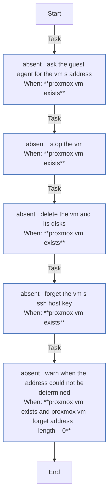

# `proxmox_vm`

Creates, starts and deletes VMs through the Proxmox API, finding each by name and refusing any it did not tag. `playbooks/provision.yml` runs it for `make deploy TYPE=provision` and `make deploy`, and `playbooks/destroy.yml` with `proxmox_vm_state: absent`. Most of its variables are set through the shorter names in [Settings](../settings.md#proxmox).

Using it: [VMs and fleets](../../guides/vms.md). How it works: [§5.2](../../architecture/roles.md#52-proxmox_vm--the-core-role).

<!-- BEGIN_GENERATED: role -->
<!-- Generated by `make docs` from roles/proxmox_vm/meta/argument_specs.yml, vars/main.yml and tasks/: edit that, not this section. -->

## Entry point `main`

**Clone, configure and start (or delete) a VM on Proxmox VE**

Looks the VM up by name, clones it from a cloud-init template if missing, applies hardware and cloud-init settings, resizes the root disk, starts it and waits for the guest agent to report an address.

An existing VM that is stopped is left stopped unless proxmox_vm_start_existing is set. It is not waited on; the role sets proxmox_vm_stopped and an empty proxmox_vm_address instead.

A VM an earlier run did not finish is finished instead - configured, resized and started - whatever its status. The settings call tags it "&lt;first tag&gt;-unfinished", and only a successful start removes that tag.

Deleting refuses any VM that does not carry the ownership tag, and creating refuses an existing VM that lacks it or is a template.

All API calls are delegated to the controller.

| Variable | Type | Default | Description |
|---|---|---|---|
| `proxmox_vm_api_host` | str | `""` | Proxmox VE API host (IP or DNS name). Not marked required. The role defaults it to "" and asserts on it instead, so an unset host is reported with the name of the file to put it in rather than as "missing required arguments". |
| `proxmox_vm_api_port` | int | `8006` | Port of the Proxmox VE API. Set through proxmox_api_port in local.yml. |
| `proxmox_vm_api_user` | str | `ansible@pve` | Proxmox user the API token belongs to, realm included. Set through proxmox_api_user in local.yml. |
| `proxmox_vm_api_token_id` | str | `ansible` | Name of the API token, the part after the ! in user!token. Set through proxmox_api_token_id in local.yml. |
| `proxmox_vm_api_token_secret` | str | `""` | API token secret. Keep it in an ansible-vault file. Asserted by the role rather than marked required, for the same reason as proxmox_vm_api_host. Set through vault_proxmox_api_token_secret in vault.yml. A secret: never logged. |
| `proxmox_vm_validate_certs` | bool | `false` | Verify the API's TLS certificate. Turn it on once the controller trusts the Proxmox CA. Set through proxmox_validate_certs in local.yml. |
| `proxmox_vm_node` | str | `pve` | Node that holds the template, where new VMs are cloned. Set through proxmox_node in local.yml. |
| `proxmox_vm_storage` | str | `local-lvm` | Storage a full clone's disks are created on. Set through proxmox_storage in local.yml. |
| `proxmox_vm_template_name` | str | `ubuntu-24.04-cloudinit` | Name of the template VMs are cloned from. Set through proxmox_template_name in local.yml. |
| `proxmox_vm_full_clone` | bool | `true` | Make a full clone, independent of the template. false makes a linked clone, which keeps depending on the template's disk. |
| `proxmox_vm_timeout` | int | `600` | Seconds the clone, start, stop and delete calls may each take. |
| `proxmox_vm_state` | str | `present` | present clones and configures the VM where it is missing or unfinished, and starts it; an existing, finished VM is left as it is, a stopped one stopped. absent stops and deletes it. One of `present`, `absent`. |
| `proxmox_vm_start_existing` | bool | `false` | Start an already-configured VM that is stopped. Off by default so a re-run does not boot a VM that was shut down deliberately. When off, such a VM is reported as stopped (proxmox_vm_stopped) with an empty proxmox_vm_address, without waiting for its guest agent. |
| `proxmox_vm_nic` | str | `net0` | Which NIC of the template carries the LAN address; its MAC is what the guest agent's reply is matched against. Set through proxmox_nic in local.yml. |
| `proxmox_vm_lookup_retries` | int | `6` | How many more times a just-cloned VM's configuration is read, after the first, before giving up, since the cluster listing can lag behind a clone. |
| `proxmox_vm_lookup_delay` | int | `5` | Seconds between reads of a just-cloned VM's configuration. |
| `proxmox_vm_allow_untagged_delete` | bool | `false` | Allow state=absent to delete a VM that does not carry the ownership tag. Off by default so a name collision cannot destroy a VM this project never created. |
| `proxmox_vm_known_hosts_domain` | str | `""` | The DNS domain SSH reaches the VMs by on this machine, when not their address (claude_ssh_host_domain). state=absent forgets the host key recorded under &lt;name&gt;.&lt;domain&gt; too, besides the one under the address. Set through claude_ssh_host_domain in local.yml. |
| `proxmox_vm_name` | str | same as `inventory_hostname` | VM name in Proxmox. Defaults to the inventory hostname. |
| `proxmox_vm_id` | raw | `""` | Pin the VM to a specific VMID. Left empty, Proxmox assigns the next free one. The VM is identified by name, not by ID, so this is rarely needed. Run across several hosts at once, the role clones one VM at a time unless each has a distinct VMID here, because concurrent clones that ask Proxmox for one are handed the same. provision.yml sets one for every new VM of a fleet. Declared raw so the role can validate it and report a helpful message. |
| `proxmox_vm_cores` | int | `2` | Defaults to the vm_cores host var, else 2. Set through vm_cores in local.yml. |
| `proxmox_vm_memory_mb` | int | `4096` | Defaults to the vm_memory_mb host var, else 4096. Set through vm_memory_mb in local.yml. |
| `proxmox_vm_memory_min_mb` | int | computed | The least memory the host may leave the VM (Proxmox's minimum memory, ballooning), from 1 to proxmox_vm_memory_mb. Below it, the host takes the difference back once its memory use passes the node's ballooning target. Defaults to the vm_memory_min_mb host var, else proxmox_vm_memory_mb, a fixed allocation. Applied when the VM is created. Set through vm_memory_min_mb in local.yml. |
| `proxmox_vm_disk` | str | `scsi0` | The root disk, as the template names it, resized to proxmox_vm_disk_size. |
| `proxmox_vm_disk_size` | str | `32G` | Absolute root disk size with unit suffix (K, M, G, T). Applied when the VM is created or an unfinished one is repaired, and with proxmox_vm_force_update. Proxmox cannot shrink a disk, so a size below the current one fails. Defaults to the vm_disk_size host var, else 32G. Set through vm_disk_size in local.yml. |
| `proxmox_vm_onboot` | bool | `true` | Start the VM when its Proxmox node boots. |
| `proxmox_vm_tags` | list of `str` | `["claude-on-proxmox"]` | Tags stamped on every VM this role creates. The first one is the ownership marker - discovery finds VMs by it, and both deleting and provisioning refuse to touch an existing VM that does not carry it. |
| `proxmox_vm_user` | str | `dev` | Cloud-init user created on the VM. The playbooks also log in as it. Set through vm_user in local.yml. |
| `proxmox_vm_password` | str | `""` | Optional cloud-init password for the user (vm_password host var). Key-based login is the default. Either this or proxmox_vm_ssh_public_keys must be set. Set through vm_password in local.yml. A secret: never logged. |
| `proxmox_vm_ssh_public_keys` | list of `str` | `[]` | Public keys cloud-init authorises for proxmox_vm_user. These or proxmox_vm_password must be set. Set through vm_ssh_public_keys in local.yml. |
| `proxmox_vm_ipconfig` | str | `ip=dhcp` | Proxmox ipconfig0 string. DHCP by default, with the address read back from the guest agent. Set to something like "ip=192.0.2.50/24,gw=192.0.2.1" to assign a fixed address. One value for every VM it applies to. Set fleet-wide (local.yml, -e), every VM a run provisions is given that same address, so use it only for a single VM. |
| `proxmox_vm_nameservers` | list of `str` | `[]` | Defaults to the vm_nameservers host var. Set through vm_nameservers in local.yml. |
| `proxmox_vm_searchdomain` | str | `""` | Defaults to the vm_searchdomain host var. Set through vm_searchdomain in local.yml. |
| `proxmox_vm_agent_retries` | int | `60` | How many times to poll the guest agent for an address. A count, not a wall-clock budget. With the defaults the wait is five minutes of delay plus the time each poll takes; a running VM with no agent answers each poll only after Proxmox's own ~3 s agent ping, so the role gives up on it after about nine minutes. |
| `proxmox_vm_agent_delay` | int | `5` | Seconds between guest agent polls. |
| `proxmox_vm_force_update` | bool | `false` | Re-apply the hardware and cloud-init settings to a VM that exists. Off by default because Proxmox reports every update as a change. On, every VM the run covers has its settings re-applied, its tag list replaced with proxmox_vm_tags (tags added by hand are dropped), and is started, whether or not it was shut down on purpose. |

## Internal values

Set in `roles/proxmox_vm/vars/main.yml`. These are not settings: Ansible ranks a role's vars above `local.yml`, so a value set there has no effect. All 10 are computed during a run, from earlier tasks' results.

| Name | Value |
|---|---|
| `proxmox_vm_found_config` | <code>{{ ((proxmox_vm_lookup.proxmox_vms if proxmox_vm_exists &#124; bool else proxmox_vm_config.proxmox_vms) &#124; default([], true) &#124; first &#124; default({}, true)).get('config', {}) }}</code> |
| `proxmox_vm_found_mac` | <code>{{ proxmox_vm_found_config.get(proxmox_vm_nic, '') &#124; net_mac('') }}</code> |
| `proxmox_vm_found_node` | <code>{{ proxmox_vm_lookup.proxmox_vms[0].node &#124; default(proxmox_vm_node, true) }}</code> |
| `proxmox_vm_reported_address` | <code>{{ proxmox_vm_net.proxmox_vms &#124; default([], true) &#124; map(attribute='network') &#124; first &#124; default([], true) &#124; guest_ipv4(proxmox_vm_found_mac) &#124; default('', true) }}</code> |
| `proxmox_vm_found_tags` | <code>{{ proxmox_vm_lookup.proxmox_vms[0].tags &#124; default('', true) &#124; replace(',', ';') &#124; split(';') &#124; map('trim') &#124; select &#124; map('lower') &#124; list }}</code> |
| `proxmox_vm_sent_tags` | <code>{{ proxmox_vm_tags &#124; map('lower') &#124; list }}</code> |
| `proxmox_vm_unfinished_tag` | `{{ proxmox_vm_sent_tags[0] }}-unfinished` |
| `proxmox_vm_needs_configuration` | <code>{{ (not proxmox_vm_exists) or (proxmox_vm_force_update &#124; bool) or ((proxmox_vm_lookup.proxmox_vms[0].config &#124; default({}, true)).ciuser &#124; default('', true) &#124; length == 0) or (proxmox_vm_unfinished_tag in proxmox_vm_found_tags) }}</code> |
| `proxmox_vm_forget_address` | `{{ proxmox_vm_reported_address }}` |
| `proxmox_vm_forget_names` | <code>{{ ([proxmox_vm_forget_address] if proxmox_vm_forget_address &#124; length > 0 else []) + ([proxmox_vm_name ~ '.' ~ proxmox_vm_known_hosts_domain] if proxmox_vm_known_hosts_domain &#124; length > 0 else []) }}</code> |

## Tasks

Every task in `roles/proxmox_vm/tasks/`, file by file, in the order the file lists them, with a flowchart of
each file. Generated from the task files, so a task added, renamed or removed shows here on the next `make docs`.

### `main.yml` - entry point `main`

| Task | Module | When |
|---|---|---|
| Validate the Proxmox connection settings | `ansible.builtin.assert` |  |
| Validate the VM name | `ansible.builtin.assert` |  |
| Validate the login credentials for the VM | `ansible.builtin.assert` |  |
| Validate the minimum memory | `ansible.builtin.assert` |  |
| Validate the VM ID | `ansible.builtin.assert` |  |
| Manage the VM | block |  |
| &emsp;Look up Proxmox VM {{ proxmox_vm_name }} | `community.proxmox.proxmox_vm_info` |  |
| &emsp;Refuse to act on a duplicated VM name | `ansible.builtin.assert` |  |
| &emsp;Record whether the VM already exists | `ansible.builtin.set_fact` |  |
| &emsp;Refuse to configure a template | `ansible.builtin.assert` | <code>proxmox_vm_state == 'present' and proxmox_vm_exists</code> |
| &emsp;Refuse to change a VM this project does not own | `ansible.builtin.assert` | <code>proxmox_vm_state == 'present' and proxmox_vm_exists</code> |
| &emsp;Create the VM | `ansible.builtin.include_tasks` | <code>proxmox_vm_state == 'present'</code> |
| &emsp;Refuse to delete a template | `ansible.builtin.assert` | <code>proxmox_vm_state == 'absent' and proxmox_vm_exists</code> |
| &emsp;Refuse to delete a VM this project does not own | `ansible.builtin.assert` | <code>proxmox_vm_state == 'absent' and proxmox_vm_exists and not (proxmox_vm_allow_untagged_delete &#124; bool)</code> |
| &emsp;Delete the VM | `ansible.builtin.include_tasks` | <code>proxmox_vm_state == 'absent'</code> |

```mermaid
flowchart TD
Start
classDef block stroke:#3498db,stroke-width:2px;
classDef task stroke:#4b76bb,stroke-width:2px;
classDef includeTasks stroke:#16a085,stroke-width:2px;
classDef importTasks stroke:#34495e,stroke-width:2px;
classDef includeRole stroke:#2980b9,stroke-width:2px;
classDef importRole stroke:#699ba7,stroke-width:2px;
classDef includeVars stroke:#8e44ad,stroke-width:2px;
classDef rescue stroke:#665352,stroke-width:2px;

  Start-->|Task| Validate_the_Proxmox_connection_settings0[validate the proxmox connection settings]:::task
  Validate_the_Proxmox_connection_settings0-->|Task| Validate_the_VM_name1[validate the vm name]:::task
  Validate_the_VM_name1-->|Task| Validate_the_login_credentials_for_the_VM2[validate the login credentials for the vm]:::task
  Validate_the_login_credentials_for_the_VM2-->|Task| Validate_the_minimum_memory3[validate the minimum memory]:::task
  Validate_the_minimum_memory3-->|Task| Validate_the_VM_ID4[validate the vm id]:::task
  Validate_the_VM_ID4-->|Block Start| Manage_the_VM5_block_start_0[[manage the vm]]:::block
  Manage_the_VM5_block_start_0-->|Task| Look_up_Proxmox_VM_proxmox_vm_name0[look up proxmox vm proxmox vm name]:::task
  Look_up_Proxmox_VM_proxmox_vm_name0-->|Task| Refuse_to_act_on_a_duplicated_VM_name1[refuse to act on a duplicated vm name]:::task
  Refuse_to_act_on_a_duplicated_VM_name1-->|Task| Record_whether_the_VM_already_exists2[record whether the vm already exists]:::task
  Record_whether_the_VM_already_exists2-->|Task| Refuse_to_configure_a_template3[refuse to configure a template<br>When: **proxmox vm state     present  and proxmox vm<br>exists**]:::task
  Refuse_to_configure_a_template3-->|Task| Refuse_to_change_a_VM_this_project_does_not_own4[refuse to change a vm this project does not own<br>When: **proxmox vm state     present  and proxmox vm<br>exists**]:::task
  Refuse_to_change_a_VM_this_project_does_not_own4-->|Include task| Create_the_VM_present_yml_5[create the vm<br>When: **proxmox vm state     present**<br>include_task: present yml]:::includeTasks
  Create_the_VM_present_yml_5-->|Task| Refuse_to_delete_a_template6[refuse to delete a template<br>When: **proxmox vm state     absent  and proxmox vm exists**]:::task
  Refuse_to_delete_a_template6-->|Task| Refuse_to_delete_a_VM_this_project_does_not_own7[refuse to delete a vm this project does not own<br>When: **proxmox vm state     absent  and proxmox vm exists<br>and not  proxmox vm allow untagged delete   bool**]:::task
  Refuse_to_delete_a_VM_this_project_does_not_own7-->|Include task| Delete_the_VM_absent_yml_8[delete the vm<br>When: **proxmox vm state     absent**<br>include_task: absent yml]:::includeTasks
  Delete_the_VM_absent_yml_8-.->|End of Block| Manage_the_VM5_block_start_0
  Delete_the_VM_absent_yml_8-->End
```

### `absent.yml`

| Task | Module | When |
|---|---|---|
| Ask the guest agent for the VM's address | `community.proxmox.proxmox_vm_info` | <code>proxmox_vm_exists</code> |
| Stop the VM | `community.proxmox.proxmox_kvm` | <code>proxmox_vm_exists</code> |
| Delete the VM and its disks | `community.proxmox.proxmox_kvm` | <code>proxmox_vm_exists</code> |
| Forget the VM's SSH host key | `ansible.builtin.known_hosts` | <code>proxmox_vm_exists</code> |
| Warn when the address could not be determined | `ansible.builtin.debug` | <code>proxmox_vm_exists and proxmox_vm_forget_address &#124; length == 0</code> |

### `present.yml`

| Task | Module | When |
|---|---|---|
| Clone from template {{ proxmox_vm_template_name }} | `community.proxmox.proxmox_kvm` | <code>not proxmox_vm_exists</code> |
| Fail when the clone did not create a new VM | `ansible.builtin.assert` | <code>not proxmox_vm_exists</code> |
| Record the VMID | `ansible.builtin.set_fact` | <code>not proxmox_vm_exists</code> |
| Tag the new VM as created by this project | `community.proxmox.proxmox_kvm` | <code>not proxmox_vm_exists</code> |
| Apply hardware and cloud-init settings | `community.proxmox.proxmox_kvm` | <code>proxmox_vm_needs_configuration &#124; bool</code> |
| Resize the root disk to {{ proxmox_vm_disk_size }} | `community.proxmox.proxmox_disk` | <code>proxmox_vm_needs_configuration &#124; bool</code> |
| Start the VM | `community.proxmox.proxmox_kvm` | <code>proxmox_vm_needs_configuration &#124; bool or proxmox_vm_start_existing &#124; bool</code> |
| Mark the VM as finished | `community.proxmox.proxmox_kvm` | <code>proxmox_vm_needs_configuration &#124; bool</code> |
| Record whether the VM is being left stopped | `ansible.builtin.set_fact` |  |
| Read the new VM's network configuration | `community.proxmox.proxmox_vm_info` | <code>not proxmox_vm_exists</code> |
| Fail when the VM's NIC could not be read | `ansible.builtin.assert` | <code>not (proxmox_vm_stopped &#124; bool)</code> |
| Wait for the guest agent to report an address | `community.proxmox.proxmox_vm_info` | <code>not (proxmox_vm_stopped &#124; bool)</code> |
| Record the VM's address | `ansible.builtin.set_fact` |  |

```mermaid
flowchart TD
Start
classDef block stroke:#3498db,stroke-width:2px;
classDef task stroke:#4b76bb,stroke-width:2px;
classDef includeTasks stroke:#16a085,stroke-width:2px;
classDef importTasks stroke:#34495e,stroke-width:2px;
classDef includeRole stroke:#2980b9,stroke-width:2px;
classDef importRole stroke:#699ba7,stroke-width:2px;
classDef includeVars stroke:#8e44ad,stroke-width:2px;
classDef rescue stroke:#665352,stroke-width:2px;

  Start-->|Task| present___Clone_from_template_proxmox_vm_template_name0[present   clone from template proxmox vm template<br>name<br>When: **not proxmox vm exists**]:::task
  present___Clone_from_template_proxmox_vm_template_name0-->|Task| present___Fail_when_the_clone_did_not_create_a_new_VM1[present   fail when the clone did not create a new<br>vm<br>When: **not proxmox vm exists**]:::task
  present___Fail_when_the_clone_did_not_create_a_new_VM1-->|Task| present___Record_the_VMID2[present   record the vmid<br>When: **not proxmox vm exists**]:::task
  present___Record_the_VMID2-->|Task| present___Tag_the_new_VM_as_created_by_this_project3[present   tag the new vm as created by this<br>project<br>When: **not proxmox vm exists**]:::task
  present___Tag_the_new_VM_as_created_by_this_project3-->|Task| present___Apply_hardware_and_cloud_init_settings4[present   apply hardware and cloud init settings<br>When: **proxmox vm needs configuration   bool**]:::task
  present___Apply_hardware_and_cloud_init_settings4-->|Task| present___Resize_the_root_disk_to_proxmox_vm_disk_size5[present   resize the root disk to proxmox vm disk<br>size<br>When: **proxmox vm needs configuration   bool**]:::task
  present___Resize_the_root_disk_to_proxmox_vm_disk_size5-->|Task| present___Start_the_VM6[present   start the vm<br>When: **proxmox vm needs configuration   bool or proxmox<br>vm start existing   bool**]:::task
  present___Start_the_VM6-->|Task| present___Mark_the_VM_as_finished7[present   mark the vm as finished<br>When: **proxmox vm needs configuration   bool**]:::task
  present___Mark_the_VM_as_finished7-->|Task| present___Record_whether_the_VM_is_being_left_stopped8[present   record whether the vm is being left<br>stopped]:::task
  present___Record_whether_the_VM_is_being_left_stopped8-->|Task| present___Read_the_new_VM_s_network_configuration9[present   read the new vm s network configuration<br>When: **not proxmox vm exists**]:::task
  present___Read_the_new_VM_s_network_configuration9-->|Task| present___Fail_when_the_VM_s_NIC_could_not_be_read10[present   fail when the vm s nic could not be read<br>When: **not  proxmox vm stopped   bool**]:::task
  present___Fail_when_the_VM_s_NIC_could_not_be_read10-->|Task| present___Wait_for_the_guest_agent_to_report_an_address11[present   wait for the guest agent to report an<br>address<br>When: **not  proxmox vm stopped   bool**]:::task
  present___Wait_for_the_guest_agent_to_report_an_address11-->|Task| present___Record_the_VM_s_address12[present   record the vm s address]:::task
  present___Record_the_VM_s_address12-->|Task| present___Fail_when_no_address_was_reported13[present   fail when no address was reported<br>When: **not  proxmox vm stopped   bool**]:::task
  present___Fail_when_no_address_was_reported13-->|Task| present___Report_that_the_VM_was_left_stopped14[present   report that the vm was left stopped<br>When: **proxmox vm stopped   bool**]:::task
  present___Report_that_the_VM_was_left_stopped14-->End
```

| Fail when no address was reported | `ansible.builtin.assert` | <code>not (proxmox_vm_stopped &#124; bool)</code> |
| Report that the VM was left stopped | `ansible.builtin.debug` | <code>proxmox_vm_stopped &#124; bool</code> |

<!-- END_GENERATED: role -->
