# `tailscale`

Joins each VM to your tailnet, by an auth key or Tailscale's web login, and keeps the settings of the login it made. Outside `just destroy` it only touches a Tailscale it installed; `release` logs out whatever Tailscale the VM has, since the VM is about to go. Three entry points: `main`, last in `just deploy --only configure` (`--tags tailscale`), `login` for `just login --only tailscale` and the sign-in in `just deploy`, and `release` for `just destroy`.

Using it: [Tailscale](../../guides/tailscale.md). How it works: [§5.8](../../architecture/roles.md#58-tailscale--join-the-vm-to-a-tailnet).

<!-- BEGIN_GENERATED: role -->
<!-- Generated by `just docs` from roles/tailscale/meta/argument_specs.yml, vars/main.yml and tasks/: edit that, not this section. -->

## Entry point `main`

**Install Tailscale, join the tailnet and keep the VM as configured**

Installs Tailscale from its apt repository, joins the tailnet with tailscale_auth_key on a first join, keeps the managed settings with tailscale set on a login this role made, and reports the VM's tailnet name and address. With tailscale_enabled false it removes what it installed. A Tailscale installed or signed in by hand is reported and left alone.

| Variable | Type | Default | Description |
|---|---|---|---|
| `tailscale_enabled` | bool | `true` | Install and join; false logs out and removes what this role installed. |
| `tailscale_auth_key` | str | `""` | A key for the first join only (tskey-auth-..., or a tskey-client-... OAuth secret, which needs tailscale_advertise_tags). Empty leaves the VM for the web login. Set through vault_tailscale_auth_key in vault.yml. A secret: never logged. |
| `tailscale_auth_method` | str | `auto` | auto joins with tailscale_auth_key when there is one and leaves the VM for the web login otherwise; key joins with the key only, and an empty one fails by name; web leaves every VM for the web login. One of `auto`, `key`, `web`. |
| `tailscale_api_auth_method` | str | `auto` | How the device is deleted from the tailnet through Tailscale's API, on this machine. auto uses whichever credential is set, tailscale_api_token first, and is none when neither is; none leaves the device there, logged out, and names it; token uses tailscale_api_token; oauth exchanges tailscale_oauth_client_id and tailscale_oauth_client_secret, a client with the devices:core scope, for an access token. One of `auto`, `none`, `token`, `oauth`. |
| `tailscale_api_token` | str | `""` | An API access token (tskey-api-...), used under tailscale_api_auth_method auto or token. Set through vault_tailscale_api_token in vault.yml. A secret: never logged. |
| `tailscale_oauth_client_id` | str | `""` | An OAuth client's ID, used under tailscale_api_auth_method auto or oauth. Set through vault_tailscale_oauth_client_id in vault.yml. |
| `tailscale_oauth_client_secret` | str | `""` | That client's secret (tskey-client-...), used under tailscale_api_auth_method auto or oauth. Set through vault_tailscale_oauth_client_secret in vault.yml. A secret: never logged. |
| `tailscale_api_url` | str | `https://api.tailscale.com` | Tailscale's API. Tests point it at a stand-in. |
| `tailscale_hostname` | str | computed | The machine name asked for. One DNS label - letters, digits and hyphens, at most 63, not starting or ending with a hyphen - which Tailscale requires. Defaults to the VM's name made one. |
| `tailscale_ssh` | bool | `false` | Tailscale SSH on the tailnet address, in place of sshd there. |
| `tailscale_accept_routes` | bool | `false` | Use the subnet routes other devices on the tailnet advertise. |
| `tailscale_accept_dns` | bool | `false` | Let the tailnet's DNS settings change the VM's resolver. |
| `tailscale_advertise_tags` | list of `str` | `[]` | Tags asked for at the join. Compared with the node's tags and reported, never changed. |
| `tailscale_login_server` | str | `""` | Another control server, such as Headscale. Empty is Tailscale's. |
| `tailscale_upload_logs` | bool | `true` | false keeps tailscaled from uploading its logs, from its first start. |
| `tailscale_up_args` | list of `str` | `[]` | More tailscale up flags, added to every join, by key or by the web login. A node that has joined already does not get them. |
| `tailscale_daemon_flags` | list of `str` | `[]` | More tailscaled flags, in /etc/default/tailscaled's FLAGS. |
| `tailscale_login_timeout` | int | `300` | Seconds the web login waits for the approval. |
| `tailscale_marker_dir` | path | `/var/lib/claude-on-proxmox` | Where the markers saying what this role installed and which login it made are kept. |
| `tailscale_login_desktop` | bool | `true` | Open the sign-in page in a browser on the machine running Ansible. Set through login_desktop in local.yml. |
| `tailscale_sign_in_follows` | bool | `false` | just deploy signs the VM in next, in the same run, and the report says so. |

## Entry point `login`

**Say how the VM is on Tailscale, and sign it in by the web login when asked to**

Reads the VM's Tailscale state and prints it, with the one command that does the next thing.

With tailscale_login_interactive, or the answer to the question tailscale_login_ask puts, signs a VM that is not signed in by Tailscale's web login - one `tailscale up`, the page opened on this machine, the approval waited for - for a Tailscale this role installed. Run by playbooks/tailscale_login.yml.

| Variable | Type | Default | Description |
|---|---|---|---|
| `tailscale_login_interactive` | bool | `false` | Sign in; the question below, when asked, takes Enter as yes. |
| `tailscale_login_ask` | bool | `false` | Ask first, at a prompt here. With no terminal it returns at once with no answer. |
| `tailscale_auth_method` | str | `auto` | Under key, a VM is joined by just deploy --only configure with the key, never by the web login. One of `auto`, `key`, `web`. |

Also takes, as described under `main`: `tailscale_enabled`, `tailscale_login_timeout`, `tailscale_login_desktop`, `tailscale_login_server`, `tailscale_advertise_tags`, `tailscale_marker_dir`.

## Entry point `release`

**Take the VM off the tailnet before it is destroyed**

Logs the node out, which expires its key at once, and with an API credential deletes its device from the tailnet, so it leaves the admin console and its name is free for a VM built again. Whatever Tailscale the VM has. Records what became of it in tailscale_release_said, for destroy's report.

Also takes, as described under `main`: `tailscale_api_auth_method`, `tailscale_api_token`, `tailscale_oauth_client_id`, `tailscale_oauth_client_secret`, `tailscale_api_url`, `tailscale_login_server`.

## Internal values

Set in `roles/tailscale/vars/main.yml`. These are not settings: Ansible ranks a role's vars above `local.yml`, so a value set there has no effect. 67 of the 75 are computed during a run, from earlier tasks' results.

| Name | Value |
|---|---|
| `tailscale_deb_arch` | `{{ 'arm64' if ansible_facts.architecture == 'aarch64' else 'amd64' }}` |
| `tailscale_installed_marker_path` | `{{ tailscale_marker_dir }}/tailscale-installed` |
| `tailscale_joined_marker_path` | `{{ tailscale_marker_dir }}/tailscale-joined` |
| `tailscale_dropin_path` | `/etc/systemd/system/tailscaled.service.d/10-claude-on-proxmox.conf` |
| `tailscale_unit_path` | `/lib/systemd/system/tailscaled.service` |
| `tailscale_join_timeout` | `90` |
| `tailscale_settle_seconds` | `30` |
| `tailscale_package_present` | <code>{{ (tailscale_dpkg.stdout &#124; default('')) == 'installed' }}</code> |
| `tailscale_foreign_paths` | `["/usr/sbin/tailscaled", "/usr/local/sbin/tailscaled", "/usr/local/bin/tailscaled", "/snap/bin/tailscale"]` |
| `tailscale_foreign_present` | <code>{{ not (tailscale_package_present &#124; bool) and tailscale_foreign.results &#124; default([]) &#124; selectattr('stat.exists', 'defined') &#124; selectattr('stat.exists') &#124; list &#124; length > 0 }}</code> |
| `tailscale_installed` | <code>{{ tailscale_package_present &#124; bool or tailscale_foreign_present &#124; bool }}</code> |
| `tailscale_ours` | <code>{{ (tailscale_installed_marker.stat.exists &#124; default(false)) or not (tailscale_installed &#124; bool) }}</code> |
| `tailscale_check_without_package` | <code>{{ ansible_check_mode and not (tailscale_package_present &#124; bool) }}</code> |
| `tailscale_joined_marker_text` | <code>{{ (tailscale_joined_marker.content &#124; b64decode &#124; trim) if tailscale_joined_marker.content is defined else '' }}</code> |
| `tailscale_daemon_up` | <code>{{ (tailscale_status_raw.rc &#124; default(1)) == 0 }}</code> |
| `tailscale_state` | <code>{{ (tailscale_status_raw.stdout &#124; from_json) if tailscale_daemon_up &#124; bool else {} }}</code> |
| `tailscale_backend` | <code>{{ tailscale_state.BackendState &#124; default('NoState') }}</code> |
| `tailscale_settled` | `{{ tailscale_backend not in ['NoState', 'Starting'] }}` |
| `tailscale_joined` | <code>{{ tailscale_state.HaveNodeKey &#124; default(false) &#124; bool }}</code> |
| `tailscale_auth_url` | <code>{{ tailscale_state.AuthURL &#124; default('') }}</code> |
| `tailscale_self` | <code>{{ tailscale_state.Self &#124; default({}, true) }}</code> |
| `tailscale_node_key` | <code>{{ tailscale_self.PublicKey &#124; default('') }}</code> |
| `tailscale_dns_name` | <code>{{ (tailscale_self.DNSName &#124; default('')) &#124; regex_replace('[.]$', '') }}</code> |
| `tailscale_ipv4` | <code>{{ tailscale_self.TailscaleIPs &#124; default([], true) &#124; tailnet_ipv4 }}</code> |
| `tailscale_tailnet` | <code>{{ (tailscale_state.CurrentTailnet &#124; default({}, true)).Name &#124; default('') }}</code> |
| `tailscale_first_join` | <code>{{ tailscale_backend == 'NeedsLogin' and not (tailscale_joined &#124; bool) }}</code> |
| `tailscale_name_taken` | <code>{{ tailscale_dns_name.split('.')[0] is match('^' ~ (tailscale_hostname &#124; lower &#124; regex_escape) ~ '-[0-9]+$') }}</code> |
| `tailscale_signed_in` | <code>{{ (tailscale_joined &#124; bool) and tailscale_backend in ['Running', 'NeedsMachineAuth'] }}</code> |
| `tailscale_login_pending` | `{{ tailscale_joined_marker_text == 'pending' }}` |
| `tailscale_login_ours` | <code>{{ tailscale_node_key &#124; length > 0 and ((tailscale_joined &#124; bool) and tailscale_joined_marker_text == tailscale_node_key or (tailscale_signed_in &#124; bool) and tailscale_login_pending &#124; bool) }}</code> |
| `tailscale_prefs` | <code>{{ (tailscale_prefs_raw.stdout &#124; from_json) if (tailscale_prefs_raw.rc &#124; default(1)) == 0 else {} }}</code> |
| `tailscale_up_flags` | <code>{{ ['--reset', '--hostname=' ~ tailscale_hostname, '--ssh=' ~ (tailscale_ssh &#124; bool &#124; lower), '--accept-routes=' ~ (tailscale_accept_routes &#124; bool &#124; lower), '--accept-dns=' ~ (tailscale_accept_dns &#124; bool &#124; lower)] + (['--advertise-tags=' ~ (tailscale_advertise_tags &#124; join(','))] if tailscale_advertise_tags &#124; length > 0 else []) + (['--login-server=' ~ tailscale_login_server] if tailscale_login_server &#124; length > 0 else []) + tailscale_up_args }}</code> |
| `tailscale_auth_key_set` | <code>{{ tailscale_auth_key &#124; length > 0 }}</code> |
| `tailscale_key_wanted` | <code>{{ tailscale_auth_method != 'web' and tailscale_auth_key_set &#124; bool }}</code> |
| `tailscale_key_refused_locally` | <code>{{ tailscale_key_wanted &#124; bool and tailscale_auth_key is match('tskey-client-') and tailscale_advertise_tags &#124; length == 0 }}</code> |
| `tailscale_refused_why` | <code>{{ ('oauth authkeys require --advertise-tags' if tailscale_key_refused_locally &#124; bool else ((tailscale_join.stderr &#124; default('') &#124; plain_text &#124; regex_search('invalid key: .*')) or (tailscale_state.Health &#124; default([], true) &#124; map('plain_text') &#124; reject('in', tailscale_health_before_join &#124; default([], true)) &#124; select('search', 'invalid key: ') &#124; first &#124; default('') &#124; regex_search('invalid key: .*')) or '')) &#124; trim }}</code> |
| `tailscale_up_timeout_said` | `timeout waiting for Tailscale service to enter a Running state` |
| `tailscale_join_under_way` | <code>{{ (tailscale_join.stderr &#124; default('')) is search(tailscale_up_timeout_said &#124; regex_escape) and tailscale_refused_why &#124; length == 0 }}</code> |
| `tailscale_set_flags` | <code>{{ (['--hostname=' ~ tailscale_hostname] if (tailscale_prefs.Hostname &#124; default('')) != tailscale_hostname else []) + (['--ssh=' ~ (tailscale_ssh &#124; bool &#124; lower), '--accept-risk=lose-ssh'] if (tailscale_prefs.RunSSH &#124; default(false)) != (tailscale_ssh &#124; bool) else []) + (['--accept-routes=' ~ (tailscale_accept_routes &#124; bool &#124; lower)] if (tailscale_prefs.RouteAll &#124; default(false)) != (tailscale_accept_routes &#124; bool) else []) + (['--accept-dns=' ~ (tailscale_accept_dns &#124; bool &#124; lower)] if (tailscale_prefs.CorpDNS &#124; default(true)) != (tailscale_accept_dns &#124; bool) else []) }}</code> |
| `tailscale_tags_missing` | <code>{{ (tailscale_advertise_tags &#124; difference(tailscale_self.Tags &#124; default([], true))) if tailscale_advertise_tags &#124; length > 0 else [] }}</code> |
| `tailscale_join_ran` | <code>{{ (tailscale_join &#124; default({'skipped': true})) is not skipped }}</code> |
| `tailscale_joined_now` | <code>{{ ((tailscale_join &#124; default({})) is changed and not (tailscale_report_from_login &#124; default(false) &#124; bool) or (tailscale_web_up &#124; default({'skipped': true})) is not skipped) and tailscale_backend == 'Running' }}</code> |
| `tailscale_login_answer` | <code>{{ (tailscale_login_asked &#124; default({})).user_input &#124; default('', true) &#124; trim &#124; lower }}</code> |
| `tailscale_login_go` | <code>{{ tailscale_login_answer in (['', 'y', 'yes'] if tailscale_login_interactive &#124; bool else ['y', 'yes']) if tailscale_login_ask &#124; bool else tailscale_login_interactive &#124; bool }}</code> |
| `tailscale_login_expired_elsewhere` | <code>{{ tailscale_joined &#124; bool and not (tailscale_login_ours &#124; bool) and not (tailscale_login_pending &#124; bool) }}</code> |
| `tailscale_login_possible` | <code>{{ tailscale_enabled &#124; bool and tailscale_package_present &#124; bool and tailscale_ours &#124; bool and tailscale_backend == 'NeedsLogin' and tailscale_auth_method != 'key' and not (tailscale_login_expired_elsewhere &#124; bool) }}</code> |
| `tailscale_login_wait_said` | <code>{{ ((tailscale_login_timeout &#124; int) // 60) ~ ' minutes' if (tailscale_login_timeout &#124; int) % 60 == 0 and (tailscale_login_timeout &#124; int) >= 120 else (tailscale_login_timeout &#124; int) ~ ' seconds' }}</code> |
| `tailscale_login_poll_seconds` | `5` |
| `tailscale_web_page` | <code>{{ ((tailscale_web_state.stdout &#124; from_json).AuthURL &#124; default('')) if (tailscale_web_state.rc &#124; default(1)) == 0 else '' }}</code> |
| `tailscale_web_page_trusted` | <code>{{ (tailscale_web_page is match('https://login[.]tailscale[.]com/a/[0-9a-f]+$')) if tailscale_login_server &#124; length == 0 else (tailscale_web_page is match((tailscale_login_server &#124; regex_replace('/+$', '') &#124; regex_escape) ~ '/[A-Za-z0-9/_:.?=&amp;%-]+$')) }}</code> |
| `tailscale_api_credential` | <code>{{ tailscale_api_auth_method if tailscale_api_auth_method != 'auto' else 'token' if tailscale_api_token &#124; length > 0 else 'oauth' if (tailscale_oauth_client_id &#124; length > 0 or tailscale_oauth_client_secret &#124; length > 0) else 'none' }}</code> |
| `tailscale_api_oauth_whole` | <code>{{ tailscale_oauth_client_id &#124; length > 0 and tailscale_oauth_client_secret &#124; length > 0 }}</code> |
| `tailscale_api_bearer` | <code>{{ tailscale_api_token if tailscale_api_credential == 'token' else ((tailscale_api_oauth.json &#124; default({}, true)).access_token &#124; default('', true)) if tailscale_api_credential == 'oauth' else '' }}</code> |
| `tailscale_api_device` | <code>{{ (tailscale_api_lookup.json &#124; default({}, true)) if (tailscale_api_lookup.status &#124; default(0)) == 200 else {} }}</code> |
| `tailscale_api_device_name` | <code>{{ ((tailscale_api_device.name &#124; default('', true)) or (tailscale_api_device.hostname &#124; default('', true))) &#124; string &#124; lower &#124; regex_replace('[.].*$', '') }}</code> |
| `tailscale_api_device_ours` | <code>{{ tailscale_api_device_name is match('^' ~ (tailscale_hostname &#124; lower &#124; regex_escape) ~ '(-[0-9]+)?$') }}</code> |
| `tailscale_api_deleted` | <code>{{ (tailscale_api_delete.status &#124; default(0)) in [200, 204] }}</code> |
| `tailscale_api_gone_already` | <code>{{ (tailscale_api_lookup.status &#124; default(0)) == 404 or (tailscale_api_delete.status &#124; default(0)) == 404 }}</code> |
| `tailscale_api_gone_said` | `Tailscale had no such device (HTTP 404) - it was gone already, or is in a tailnet the API credential does not reach` |
| `tailscale_api_by_hand` | <code>{{ ("; find this VM's own device at " ~ tailscale_admin_page ~ ' and delete it') if (tailscale_api_lookup.status &#124; default(0)) == 200 and not (tailscale_api_device_ours &#124; bool) else ': delete it at ' ~ tailscale_admin_page }}</code> |
| `tailscale_api_last` | <code>{{ tailscale_api_delete if (tailscale_api_delete &#124; default({'skipped': true})) is not skipped else tailscale_api_lookup if (tailscale_api_lookup &#124; default({'skipped': true})) is not skipped else tailscale_api_oauth &#124; default({}) }}</code> |
| `tailscale_api_refused_why` | <code>{{ 'the OAuth client needs both tailscale_oauth_client_id and tailscale_oauth_client_secret' if tailscale_api_credential == 'oauth' and not (tailscale_api_oauth_whole &#124; bool) else ('Tailscale refused the OAuth client (HTTP ' ~ (tailscale_api_oauth.status &#124; default('?')) ~ ')') if tailscale_api_credential == 'oauth' and tailscale_api_bearer &#124; length == 0 else 'no API access token is set (tailscale_api_token)' if tailscale_api_bearer &#124; length == 0 else ('the device under the ID the VM reported is named ' ~ (tailscale_api_device_name &#124; plain_text &#124; to_json) ~ ', not ' ~ (tailscale_hostname &#124; to_json) ~ ", so it is not this VM's") if (tailscale_api_lookup.status &#124; default(0)) == 200 and not (tailscale_api_device_ours &#124; bool) else ('Tailscale refused the call (HTTP 403): the ' ~ ('OAuth client' if tailscale_api_credential == 'oauth' else 'API access token') ~ ' may not delete this device - an OAuth client only those with its tags') if (tailscale_api_last.status &#124; default(0)) == 403 else ('Tailscale answered HTTP ' ~ (tailscale_api_last.status &#124; default('?')) ~ ': ' ~ ((tailscale_api_last.msg &#124; default('') &#124; plain_text)[:200] or 'no reason given')) }}</code> |
| `tailscale_release_state` | <code>{{ (tailscale_release_status.stdout &#124; from_json) if (tailscale_release_status.rc &#124; default(1)) == 0 else {} }}</code> |
| `tailscale_release_joined` | <code>{{ tailscale_release_state.HaveNodeKey &#124; default(false) &#124; bool }}</code> |
| `tailscale_release_node` | <code>{{ (tailscale_release_state.Self &#124; default({}, true)).ID &#124; default('', true) }}</code> |
| `tailscale_release_installed` | <code>{{ tailscale_release_unit.stat.exists &#124; default(false) or (tailscale_release_status.rc &#124; default(1)) == 0 }}</code> |
| `tailscale_release_device_left` | <code>{{ tailscale_release_installed &#124; bool and ((tailscale_release_status.rc &#124; default(1)) != 0 or (tailscale_release_joined &#124; bool and ((tailscale_release_logout.rc &#124; default(1)) != 0 or tailscale_api_credential == 'none' or not (tailscale_api_deleted &#124; bool or tailscale_api_gone_already &#124; bool)))) }}</code> |
| `tailscale_release_summary` | <code>{{ '' if not (tailscale_release_installed &#124; bool) else ('tailscaled did not answer, so the node could not be logged out: delete its device at ' ~ tailscale_admin_page ~ ', or its login stays valid') if (tailscale_release_status.rc &#124; default(1)) != 0 else '' if not (tailscale_release_joined &#124; bool) else ('its node could not be logged out (' ~ ((tailscale_release_logout.stderr &#124; default('') &#124; plain_text &#124; regex_replace('\s+', ' ') &#124; trim) or 'no reason given') ~ '): delete its device at ' ~ tailscale_admin_page) if (tailscale_release_logout.rc &#124; default(1)) != 0 else ('logged out; its device stays in your tailnet until you delete it at ' ~ tailscale_admin_page ~ ', or a VM built again under its name joins as &lt;name>-1') if tailscale_api_credential == 'none' else 'removed from your tailnet' if tailscale_api_deleted &#124; bool else ('logged out; ' ~ tailscale_api_gone_said) if tailscale_api_gone_already &#124; bool else ('logged out, but its device was not deleted - ' ~ tailscale_api_refused_why ~ tailscale_api_by_hand) }}</code> |
| `tailscale_absent_node` | <code>{{ (((tailscale_absent_status.stdout &#124; from_json).Self &#124; default({}, true)).ID &#124; default('', true)) if (tailscale_absent_status.rc &#124; default(1)) == 0 else '' }}</code> |
| `tailscale_absent_unasked` | <code>{{ tailscale_package_present &#124; bool and (tailscale_absent_status.rc &#124; default(1)) != 0 }}</code> |
| `tailscale_absent_logout_failed` | <code>{{ (tailscale_logout &#124; default({'skipped': true})) is not skipped and (tailscale_logout.rc &#124; default(0)) != 0 }}</code> |
| `tailscale_absent_login_left` | <code>{{ tailscale_absent_unasked &#124; bool or tailscale_absent_logout_failed &#124; bool }}</code> |
| `tailscale_admin_page` | <code>{{ 'your control server' if tailscale_login_server &#124; length > 0 else 'https://login.tailscale.com/admin/machines' }}</code> |
| `tailscale_configure_command` | `just deploy {{ inventory_hostname }} --tags tailscale` |
| `tailscale_login_command` | `just login {{ inventory_hostname }} --only tailscale` |

## Tasks

Every task in `roles/tailscale/tasks/`, file by file, in the order the file lists them, with a flowchart of
each file. Generated from the task files, so a task added, renamed or removed shows here on the next `just docs`.

### `main.yml` - entry point `main`

| Task | Module | When |
|---|---|---|
| Fail when tailscale_hostname is not one DNS label | `ansible.builtin.assert` | <code>tailscale_enabled &#124; bool</code> |
| Fail when tailscale_auth_method is key and there is no key | `ansible.builtin.assert` | <code>tailscale_enabled &#124; bool and tailscale_auth_method == 'key'</code> |
| Read what is installed, and who installed it | `ansible.builtin.include_tasks` |  |
| Install Tailscale where this role installed it, or nothing has | `ansible.builtin.include_tasks` | <code>tailscale_enabled &#124; bool and tailscale_ours &#124; bool</code> |
| Read Tailscale's state | `ansible.builtin.include_tasks` | <code>tailscale_enabled &#124; bool</code> |
| Join the tailnet with the vault key, the first time | `ansible.builtin.include_tasks` | <code>tailscale_enabled &#124; bool</code> |
| Keep the settings of a login this role made | `ansible.builtin.include_tasks` | <code>tailscale_enabled &#124; bool</code> |
| Report how the VM is on Tailscale | `ansible.builtin.include_tasks` | <code>tailscale_enabled &#124; bool</code> |
| Turn Tailscale off where this role turned it on | `ansible.builtin.include_tasks` | <code>not (tailscale_enabled &#124; bool)</code> |

```mermaid
flowchart TD
Start
classDef block stroke:#3498db,stroke-width:2px;
classDef task stroke:#4b76bb,stroke-width:2px;
classDef includeTasks stroke:#16a085,stroke-width:2px;
classDef importTasks stroke:#34495e,stroke-width:2px;
classDef includeRole stroke:#2980b9,stroke-width:2px;
classDef importRole stroke:#699ba7,stroke-width:2px;
classDef includeVars stroke:#8e44ad,stroke-width:2px;
classDef rescue stroke:#665352,stroke-width:2px;

  Start-->|Task| Fail_when_tailscale_hostname_is_not_one_DNS_label0[fail when tailscale hostname is not one dns label<br>When: **tailscale enabled   bool**]:::task
  Fail_when_tailscale_hostname_is_not_one_DNS_label0-->|Task| Fail_when_tailscale_auth_method_is_key_and_there_is_no_key1[fail when tailscale auth method is key and there<br>is no key<br>When: **tailscale enabled   bool and tailscale auth method<br>    key**]:::task
  Fail_when_tailscale_auth_method_is_key_and_there_is_no_key1-->|Include task| Read_what_is_installed__and_who_installed_it_ownership_yml_2[read what is installed  and who installed it<br>include_task: ownership yml]:::includeTasks
  Read_what_is_installed__and_who_installed_it_ownership_yml_2-->|Include task| Install_Tailscale_where_this_role_installed_it__or_nothing_has_install_yml_3[install tailscale where this role installed it  or<br>nothing has<br>When: **tailscale enabled   bool and tailscale ours   bool**<br>include_task: install yml]:::includeTasks
  Install_Tailscale_where_this_role_installed_it__or_nothing_has_install_yml_3-->|Include task| Read_Tailscale_s_state_status_yml_4[read tailscale s state<br>When: **tailscale enabled   bool**<br>include_task: status yml]:::includeTasks
  Read_Tailscale_s_state_status_yml_4-->|Include task| Join_the_tailnet_with_the_vault_key__the_first_time_connect_yml_5[join the tailnet with the vault key  the first<br>time<br>When: **tailscale enabled   bool**<br>include_task: connect yml]:::includeTasks
  Join_the_tailnet_with_the_vault_key__the_first_time_connect_yml_5-->|Include task| Keep_the_settings_of_a_login_this_role_made_settings_yml_6[keep the settings of a login this role made<br>When: **tailscale enabled   bool**<br>include_task: settings yml]:::includeTasks
  Keep_the_settings_of_a_login_this_role_made_settings_yml_6-->|Include task| Report_how_the_VM_is_on_Tailscale_report_yml_7[report how the vm is on tailscale<br>When: **tailscale enabled   bool**<br>include_task: report yml]:::includeTasks
  Report_how_the_VM_is_on_Tailscale_report_yml_7-->|Include task| Turn_Tailscale_off_where_this_role_turned_it_on_absent_yml_8[turn tailscale off where this role turned it on<br>When: **not  tailscale enabled   bool**<br>include_task: absent yml]:::includeTasks
  Turn_Tailscale_off_where_this_role_turned_it_on_absent_yml_8-->End
```

### `absent.yml`

| Task | Module | When |
|---|---|---|
| Leave a Tailscale installed outside this project alone | `ansible.builtin.debug` | <code>tailscale_installed &#124; bool and not tailscale_installed_marker.stat.exists</code> |
| Remove what this role installed | block | <code>tailscale_installed_marker.stat.exists</code> |
| &emsp;Look for tailscaled's unit | `ansible.builtin.stat` |  |
| &emsp;Start tailscaled, so that its login can be ended | `ansible.builtin.systemd_service` | <code>tailscale_package_present &#124; bool and tailscale_unit.stat.exists</code> |
| &emsp;Read whether a login is there to end | `ansible.builtin.command` | <code>tailscale_package_present &#124; bool</code> |
| &emsp;Log the node out | `ansible.builtin.command` | <code>tailscale_package_present &#124; bool and tailscale_absent_status.rc &#124; default(1) == 0 and (tailscale_absent_status.stdout &#124; from_json).HaveNodeKey &#124; default(false) &#124; bool</code> |
| &emsp;Delete the node's device from the tailnet | `ansible.builtin.include_tasks` |  |
| &emsp;Stop tailscaled | `ansible.builtin.systemd_service` | <code>tailscale_unit.stat.exists</code> |
| &emsp;Remove the package | `ansible.builtin.apt` | <code>tailscale_package_present &#124; bool</code> |
| &emsp;Remove the repository | `ansible.builtin.deb822_repository` |  |
| &emsp;Remove the log switch and the markers | `ansible.builtin.file` |  |
| &emsp;Say what is gone, and what stays in the tailnet | `ansible.builtin.debug` |  |

```mermaid
flowchart TD
Start
classDef block stroke:#3498db,stroke-width:2px;
classDef task stroke:#4b76bb,stroke-width:2px;
classDef includeTasks stroke:#16a085,stroke-width:2px;
classDef importTasks stroke:#34495e,stroke-width:2px;
classDef includeRole stroke:#2980b9,stroke-width:2px;
classDef importRole stroke:#699ba7,stroke-width:2px;
classDef includeVars stroke:#8e44ad,stroke-width:2px;
classDef rescue stroke:#665352,stroke-width:2px;

  Start-->|Task| absent___Leave_a_Tailscale_installed_outside_this_project_alone0[absent   leave a tailscale installed outside this<br>project alone<br>When: **tailscale installed   bool and not tailscale<br>installed marker stat exists**]:::task
  absent___Leave_a_Tailscale_installed_outside_this_project_alone0-->|Block Start| absent___Remove_what_this_role_installed1_block_start_0[[absent   remove what this role installed<br>When: **tailscale installed marker stat exists**]]:::block
  absent___Remove_what_this_role_installed1_block_start_0-->|Task| absent___Look_for_tailscaled_s_unit0[absent   look for tailscaled s unit]:::task
  absent___Look_for_tailscaled_s_unit0-->|Task| absent___Start_tailscaled__so_that_its_login_can_be_ended1[absent   start tailscaled  so that its login can<br>be ended<br>When: **tailscale package present   bool and tailscale<br>unit stat exists**]:::task
  absent___Start_tailscaled__so_that_its_login_can_be_ended1-->|Task| absent___Read_whether_a_login_is_there_to_end2[absent   read whether a login is there to end<br>When: **tailscale package present   bool**]:::task
  absent___Read_whether_a_login_is_there_to_end2-->|Task| absent___Log_the_node_out3[absent   log the node out<br>When: **tailscale package present   bool and tailscale<br>absent status rc   default 1     0 and  tailscale<br>absent status stdout   from json  havenodekey  <br>default false    bool**]:::task
  absent___Log_the_node_out3-->|Include task| absent___Delete_the_node_s_device_from_the_tailnet_api_delete_yml_4[absent   delete the node s device from the tailnet<br>include_task: api delete yml]:::includeTasks
  absent___Delete_the_node_s_device_from_the_tailnet_api_delete_yml_4-->|Task| absent___Stop_tailscaled5[absent   stop tailscaled<br>When: **tailscale unit stat exists**]:::task
  absent___Stop_tailscaled5-->|Task| absent___Remove_the_package6[absent   remove the package<br>When: **tailscale package present   bool**]:::task
  absent___Remove_the_package6-->|Task| absent___Remove_the_repository7[absent   remove the repository]:::task
  absent___Remove_the_repository7-->|Task| absent___Remove_the_log_switch_and_the_markers8[absent   remove the log switch and the markers]:::task
  absent___Remove_the_log_switch_and_the_markers8-->|Task| absent___Say_what_is_gone__and_what_stays_in_the_tailnet9[absent   say what is gone  and what stays in the<br>tailnet]:::task
  absent___Say_what_is_gone__and_what_stays_in_the_tailnet9-.->|End of Block| absent___Remove_what_this_role_installed1_block_start_0
  absent___Say_what_is_gone__and_what_stays_in_the_tailnet9-->End
```

### `api_delete.yml`

| Task | Module | When |
|---|---|---|
| Exchange the OAuth client for an access token | `ansible.builtin.uri` | <code>tailscale_api_go &#124; bool and tailscale_api_credential == 'oauth' and tailscale_api_oauth_whole &#124; bool</code> |
| Look the device up | `ansible.builtin.uri` | <code>tailscale_api_go &#124; bool and tailscale_api_bearer &#124; length > 0</code> |
| Delete the device from the tailnet | `ansible.builtin.uri` | <code>tailscale_api_go &#124; bool and tailscale_api_bearer &#124; length > 0 and tailscale_api_device_ours &#124; bool</code> |

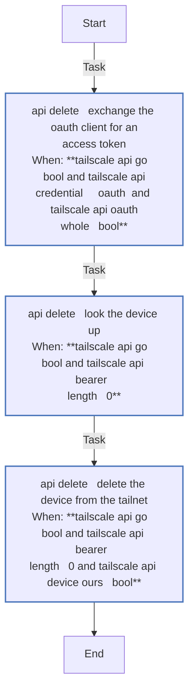

### `connect.yml`

| Task | Module | When |
|---|---|---|
| Record the login a pending sign-in of this role's ended in | `ansible.builtin.copy` | <code>tailscale_login_pending &#124; bool and tailscale_signed_in &#124; bool</code> |
| Read what this role has made, now that it has recorded the login | `ansible.builtin.include_tasks` | <code>tailscale_adopted is not skipped</code> |
| Remember what tailscaled said before the join | `ansible.builtin.set_fact` | <code>not ansible_check_mode and tailscale_ours &#124; bool and tailscale_key_wanted &#124; bool and tailscale_first_join &#124; bool and not (tailscale_key_refused_locally &#124; bool)</code> |
| Join the tailnet with the key | `ansible.builtin.command` | <code>not ansible_check_mode and tailscale_ours &#124; bool and tailscale_key_wanted &#124; bool and tailscale_first_join &#124; bool and not (tailscale_key_refused_locally &#124; bool)</code> |
| Read the state after the join | `ansible.builtin.include_tasks` | <code>tailscale_join is not skipped</code> |
| Remember that this login is this role's | `ansible.builtin.copy` | <code>tailscale_join is not skipped and tailscale_signed_in &#124; bool</code> |
| Mark a join still under way as this role's | `ansible.builtin.copy` | <code>tailscale_join is not skipped and not (tailscale_signed_in &#124; bool) and tailscale_join_under_way &#124; bool</code> |
| Forget the sign-in a failed join ended | `ansible.builtin.file` | <code>tailscale_join is not skipped and not (tailscale_signed_in &#124; bool) and not (tailscale_join_under_way &#124; bool)</code> |
| Read what this role has made, now that it has joined | `ansible.builtin.include_tasks` | <code>tailscale_join is not skipped and tailscale_signed_in &#124; bool</code> |

```mermaid
flowchart TD
Start
classDef block stroke:#3498db,stroke-width:2px;
classDef task stroke:#4b76bb,stroke-width:2px;
classDef includeTasks stroke:#16a085,stroke-width:2px;
classDef importTasks stroke:#34495e,stroke-width:2px;
classDef includeRole stroke:#2980b9,stroke-width:2px;
classDef importRole stroke:#699ba7,stroke-width:2px;
classDef includeVars stroke:#8e44ad,stroke-width:2px;
classDef rescue stroke:#665352,stroke-width:2px;

  Start-->|Task| connect___Record_the_login_a_pending_sign_in_of_this_role_s_ended_in0[connect   record the login a pending sign in of<br>this role s ended in<br>When: **tailscale login pending   bool and tailscale<br>signed in   bool**]:::task
  connect___Record_the_login_a_pending_sign_in_of_this_role_s_ended_in0-->|Include task| connect___Read_what_this_role_has_made__now_that_it_has_recorded_the_login_ownership_yml_1[connect   read what this role has made  now that<br>it has recorded the login<br>When: **tailscale adopted is not skipped**<br>include_task: ownership yml]:::includeTasks
  connect___Read_what_this_role_has_made__now_that_it_has_recorded_the_login_ownership_yml_1-->|Task| connect___Remember_what_tailscaled_said_before_the_join2[connect   remember what tailscaled said before the<br>join<br>When: **not ansible check mode and tailscale ours   bool<br>and tailscale key wanted   bool and tailscale<br>first join   bool and not  tailscale key refused<br>locally   bool**]:::task
  connect___Remember_what_tailscaled_said_before_the_join2-->|Task| connect___Join_the_tailnet_with_the_key3[connect   join the tailnet with the key<br>When: **not ansible check mode and tailscale ours   bool<br>and tailscale key wanted   bool and tailscale<br>first join   bool and not  tailscale key refused<br>locally   bool**]:::task
  connect___Join_the_tailnet_with_the_key3-->|Include task| connect___Read_the_state_after_the_join_status_yml_4[connect   read the state after the join<br>When: **tailscale join is not skipped**<br>include_task: status yml]:::includeTasks
  connect___Read_the_state_after_the_join_status_yml_4-->|Task| connect___Remember_that_this_login_is_this_role_s5[connect   remember that this login is this role s<br>When: **tailscale join is not skipped and tailscale signed<br>in   bool**]:::task
  connect___Remember_that_this_login_is_this_role_s5-->|Task| connect___Mark_a_join_still_under_way_as_this_role_s6[connect   mark a join still under way as this role<br>s<br>When: **tailscale join is not skipped and not  tailscale<br>signed in   bool  and tailscale join under way  <br>bool**]:::task
  connect___Mark_a_join_still_under_way_as_this_role_s6-->|Task| connect___Forget_the_sign_in_a_failed_join_ended7[connect   forget the sign in a failed join ended<br>When: **tailscale join is not skipped and not  tailscale<br>signed in   bool  and not  tailscale join under<br>way   bool**]:::task
  connect___Forget_the_sign_in_a_failed_join_ended7-->|Include task| connect___Read_what_this_role_has_made__now_that_it_has_joined_ownership_yml_8[connect   read what this role has made  now that<br>it has joined<br>When: **tailscale join is not skipped and tailscale signed<br>in   bool**<br>include_task: ownership yml]:::includeTasks
  connect___Read_what_this_role_has_made__now_that_it_has_joined_ownership_yml_8-->End
```

### `install.yml`

| Task | Module | When |
|---|---|---|
| Make the directory for this project's markers | `ansible.builtin.file` |  |
| Mark Tailscale on this VM as this project's | `ansible.builtin.copy` |  |
| Make the drop-in directory for tailscaled | `ansible.builtin.file` | <code>not (tailscale_upload_logs &#124; bool)</code> |
| Keep tailscaled from uploading its logs, from its first start | `ansible.builtin.copy` | <code>not (tailscale_upload_logs &#124; bool)</code> |
| Leave tailscaled's log upload as Tailscale ships it | `ansible.builtin.file` | <code>tailscale_upload_logs &#124; bool</code> |
| Remove the source list Tailscale's own instructions write | `ansible.builtin.file` |  |
| Install what managing an apt repository needs | `ansible.builtin.apt` |  |
| Install Tailscale from its repository | block |  |
| &emsp;Add Tailscale's apt repository | `ansible.builtin.deb822_repository` |  |
| &emsp;Install Tailscale | `ansible.builtin.apt` | <code>not (tailscale_check_without_package &#124; bool)</code> |
| &emsp;*rescue:* | | |
| &emsp;&emsp;Ask dpkg whether the install got as far as the package | `ansible.builtin.command` |  |
| &emsp;&emsp;Take the repository back out while there is no package | `ansible.builtin.deb822_repository` | <code>tailscale_dpkg_after.stdout &#124; default('') != 'installed'</code> |
| &emsp;&emsp;Install Tailscale | `ansible.builtin.fail` |  |
| Hand tailscaled its extra flags | `ansible.builtin.lineinfile` | <code>not (tailscale_check_without_package &#124; bool)</code> |
| Reload systemd for the changed drop-in | `ansible.builtin.systemd_service` | <code>tailscale_dropin_on is changed or tailscale_dropin_off is changed</code> |
| Start tailscaled, and keep it enabled | `ansible.builtin.systemd_service` | <code>not (tailscale_check_without_package &#124; bool)</code> |

```mermaid
flowchart TD
Start
classDef block stroke:#3498db,stroke-width:2px;
classDef task stroke:#4b76bb,stroke-width:2px;
classDef includeTasks stroke:#16a085,stroke-width:2px;
classDef importTasks stroke:#34495e,stroke-width:2px;
classDef includeRole stroke:#2980b9,stroke-width:2px;
classDef importRole stroke:#699ba7,stroke-width:2px;
classDef includeVars stroke:#8e44ad,stroke-width:2px;
classDef rescue stroke:#665352,stroke-width:2px;

  Start-->|Task| install___Make_the_directory_for_this_project_s_markers0[install   make the directory for this project s<br>markers]:::task
  install___Make_the_directory_for_this_project_s_markers0-->|Task| install___Mark_Tailscale_on_this_VM_as_this_project_s1[install   mark tailscale on this vm as this<br>project s]:::task
  install___Mark_Tailscale_on_this_VM_as_this_project_s1-->|Task| install___Make_the_drop_in_directory_for_tailscaled2[install   make the drop in directory for<br>tailscaled<br>When: **not  tailscale upload logs   bool**]:::task
  install___Make_the_drop_in_directory_for_tailscaled2-->|Task| install___Keep_tailscaled_from_uploading_its_logs__from_its_first_start3[install   keep tailscaled from uploading its logs <br>from its first start<br>When: **not  tailscale upload logs   bool**]:::task
  install___Keep_tailscaled_from_uploading_its_logs__from_its_first_start3-->|Task| install___Leave_tailscaled_s_log_upload_as_Tailscale_ships_it4[install   leave tailscaled s log upload as<br>tailscale ships it<br>When: **tailscale upload logs   bool**]:::task
  install___Leave_tailscaled_s_log_upload_as_Tailscale_ships_it4-->|Task| install___Remove_the_source_list_Tailscale_s_own_instructions_write5[install   remove the source list tailscale s own<br>instructions write]:::task
  install___Remove_the_source_list_Tailscale_s_own_instructions_write5-->|Task| install___Install_what_managing_an_apt_repository_needs6[install   install what managing an apt repository<br>needs]:::task
  install___Install_what_managing_an_apt_repository_needs6-->|Block Start| install___Install_Tailscale_from_its_repository7_block_start_0[[install   install tailscale from its repository]]:::block
  install___Install_Tailscale_from_its_repository7_block_start_0-->|Task| install___Add_Tailscale_s_apt_repository0[install   add tailscale s apt repository]:::task
  install___Add_Tailscale_s_apt_repository0-->|Task| install___Install_Tailscale1[install   install tailscale<br>When: **not  tailscale check without package   bool**]:::task
  install___Install_Tailscale1-.->|End of Block| install___Install_Tailscale_from_its_repository7_block_start_0
  install___Install_Tailscale1-->|Rescue Start| install___Install_Tailscale_from_its_repository7_rescue_start_0[install   install tailscale from its repository]:::rescue
  install___Install_Tailscale_from_its_repository7_rescue_start_0-->|Task| install___Ask_dpkg_whether_the_install_got_as_far_as_the_package0[install   ask dpkg whether the install got as far<br>as the package]:::task
  install___Ask_dpkg_whether_the_install_got_as_far_as_the_package0-->|Task| install___Take_the_repository_back_out_while_there_is_no_package1[install   take the repository back out while there<br>is no package<br>When: **tailscale dpkg after stdout   default        <br>installed**]:::task
  install___Take_the_repository_back_out_while_there_is_no_package1-->|Task| install___Install_Tailscale2[install   install tailscale]:::task
  install___Install_Tailscale2-.->|End of Rescue Block| install___Install_Tailscale_from_its_repository7_block_start_0
  install___Install_Tailscale2-->|Task| install___Hand_tailscaled_its_extra_flags8[install   hand tailscaled its extra flags<br>When: **not  tailscale check without package   bool**]:::task
  install___Hand_tailscaled_its_extra_flags8-->|Task| install___Reload_systemd_for_the_changed_drop_in9[install   reload systemd for the changed drop in<br>When: **tailscale dropin on is changed or tailscale dropin<br>off is changed**]:::task
  install___Reload_systemd_for_the_changed_drop_in9-->|Task| install___Start_tailscaled__and_keep_it_enabled10[install   start tailscaled  and keep it enabled<br>When: **not  tailscale check without package   bool**]:::task
  install___Start_tailscaled__and_keep_it_enabled10-->End
```

### `login.yml` - entry point `login`

| Task | Module | When |
|---|---|---|
| Read what is installed, and who installed it | `ansible.builtin.include_tasks` |  |
| Read Tailscale's state | `ansible.builtin.include_tasks` | <code>tailscale_enabled &#124; bool and tailscale_installed &#124; bool</code> |
| Say why there is nothing to sign in | `ansible.builtin.debug` | <code>not (tailscale_enabled &#124; bool) or not (tailscale_installed &#124; bool)</code> |
| Keep what is left to do for the end of the run | `ansible.builtin.set_stats` | <code>not (tailscale_enabled &#124; bool) or not (tailscale_installed &#124; bool)</code> |
| Ask whether to sign this VM in to Tailscale now | `ansible.builtin.pause` | <code>tailscale_login_ask &#124; bool and tailscale_login_possible &#124; bool</code> |
| Sign in by Tailscale's web login | `ansible.builtin.include_tasks` | <code>tailscale_login_go &#124; bool and tailscale_login_possible &#124; bool</code> |
| Report how the VM is on Tailscale | `ansible.builtin.include_tasks` | <code>tailscale_enabled &#124; bool and tailscale_installed &#124; bool</code> |

```mermaid
flowchart TD
Start
classDef block stroke:#3498db,stroke-width:2px;
classDef task stroke:#4b76bb,stroke-width:2px;
classDef includeTasks stroke:#16a085,stroke-width:2px;
classDef importTasks stroke:#34495e,stroke-width:2px;
classDef includeRole stroke:#2980b9,stroke-width:2px;
classDef importRole stroke:#699ba7,stroke-width:2px;
classDef includeVars stroke:#8e44ad,stroke-width:2px;
classDef rescue stroke:#665352,stroke-width:2px;

  Start-->|Include task| login___Read_what_is_installed__and_who_installed_it_ownership_yml_0[login   read what is installed  and who installed<br>it<br>include_task: ownership yml]:::includeTasks
  login___Read_what_is_installed__and_who_installed_it_ownership_yml_0-->|Include task| login___Read_Tailscale_s_state_status_yml_1[login   read tailscale s state<br>When: **tailscale enabled   bool and tailscale installed  <br>bool**<br>include_task: status yml]:::includeTasks
  login___Read_Tailscale_s_state_status_yml_1-->|Task| login___Say_why_there_is_nothing_to_sign_in2[login   say why there is nothing to sign in<br>When: **not  tailscale enabled   bool  or not  tailscale<br>installed   bool**]:::task
  login___Say_why_there_is_nothing_to_sign_in2-->|Task| login___Keep_what_is_left_to_do_for_the_end_of_the_run3[login   keep what is left to do for the end of the<br>run<br>When: **not  tailscale enabled   bool  or not  tailscale<br>installed   bool**]:::task
  login___Keep_what_is_left_to_do_for_the_end_of_the_run3-->|Task| login___Ask_whether_to_sign_this_VM_in_to_Tailscale_now4[login   ask whether to sign this vm in to<br>tailscale now<br>When: **tailscale login ask   bool and tailscale login<br>possible   bool**]:::task
  login___Ask_whether_to_sign_this_VM_in_to_Tailscale_now4-->|Include task| login___Sign_in_by_Tailscale_s_web_login_web_login_yml_5[login   sign in by tailscale s web login<br>When: **tailscale login go   bool and tailscale login<br>possible   bool**<br>include_task: web login yml]:::includeTasks
  login___Sign_in_by_Tailscale_s_web_login_web_login_yml_5-->|Include task| login___Report_how_the_VM_is_on_Tailscale_report_yml_6[login   report how the vm is on tailscale<br>When: **tailscale enabled   bool and tailscale installed  <br>bool**<br>include_task: report yml]:::includeTasks
  login___Report_how_the_VM_is_on_Tailscale_report_yml_6-->End
```

### `ownership.yml`

| Task | Module | When |
|---|---|---|
| Ask dpkg whether Tailscale is installed | `ansible.builtin.command` |  |
| Look for a Tailscale installed outside dpkg | `ansible.builtin.stat` |  |
| Look for the marker this role leaves when it installs Tailscale | `ansible.builtin.stat` |  |
| Read the node key of the login this role made | `ansible.builtin.slurp` |  |

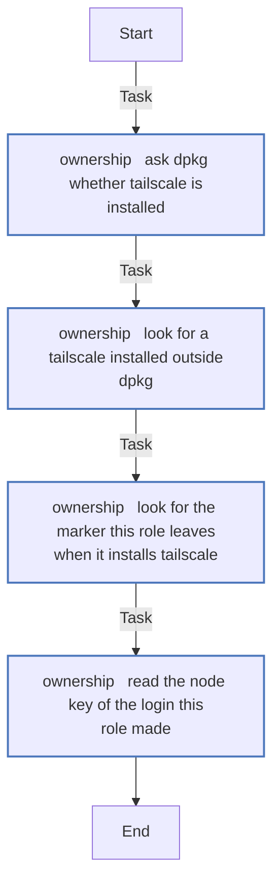

### `release.yml` - entry point `release`

| Task | Module | When |
|---|---|---|
| Look for tailscaled's unit | `ansible.builtin.stat` |  |
| Start tailscaled, so that its login can be ended | `ansible.builtin.systemd_service` | <code>tailscale_release_unit.stat.exists</code> |
| Read the node's state | `ansible.builtin.command` |  |
| Log the node out | `ansible.builtin.command` | <code>tailscale_release_joined &#124; bool</code> |
| Delete the node's device from the tailnet | `ansible.builtin.include_tasks` |  |
| Record what became of the node | `ansible.builtin.set_fact` |  |

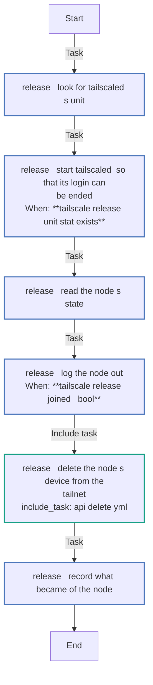

### `report.yml`

| Task | Module | When |
|---|---|---|
| Report how this VM is on Tailscale, and keep what is left to do | block |  |
| &emsp;Say how this VM is on Tailscale | `ansible.builtin.debug` |  |
| &emsp;Keep what is left to do for the end of the run | `ansible.builtin.set_stats` |  |

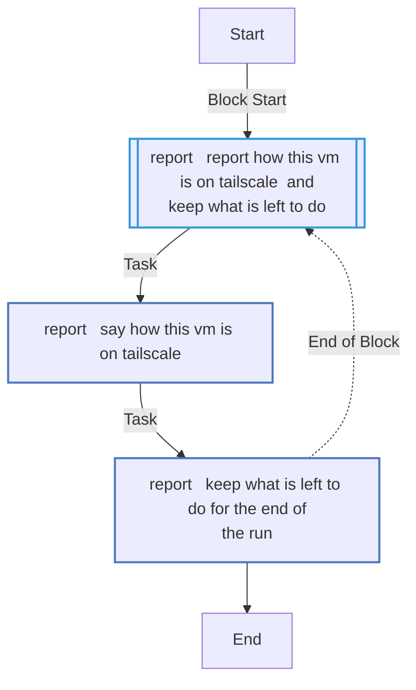

### `settings.yml`

| Task | Module | When |
|---|---|---|
| Change the settings that differ from what is configured | `ansible.builtin.command` | <code>tailscale_backend == 'Running' and tailscale_login_ours &#124; bool and tailscale_set_flags &#124; length > 0</code> |
| Read the state after the change | `ansible.builtin.include_tasks` | <code>tailscale_set is not skipped</code> |

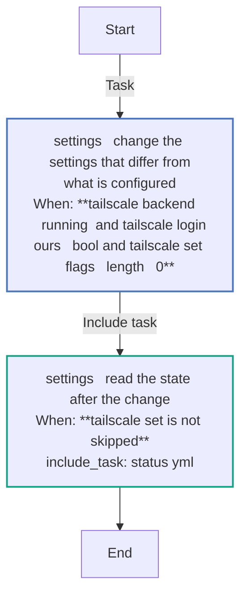

### `status.yml`

| Task | Module | When |
|---|---|---|
| Read Tailscale's state once it has settled | `ansible.builtin.command` | <code>not (tailscale_check_without_package &#124; bool)</code> |
| Fail when the tailscaled this role started does not answer | `ansible.builtin.assert` | <code>tailscale_ours &#124; bool and not ansible_check_mode and not (tailscale_check_without_package &#124; bool)</code> |
| Read the settings of a running node | `ansible.builtin.command` | <code>tailscale_backend == 'Running'</code> |

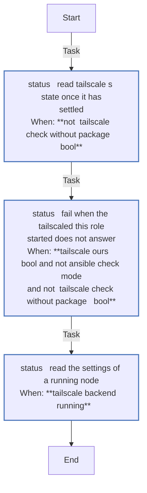

### `web_login.yml`

| Task | Module | When |
|---|---|---|
| Refuse more than one VM at a time | `ansible.builtin.assert` |  |
| Start the login inside tailscaled | `ansible.builtin.command` |  |
| Fail with what tailscale said, when it would not start the login | `ansible.builtin.assert` |  |
| Wait for the page's address | `ansible.builtin.command` |  |
| Fail when tailscale gave no sign-in page | `ansible.builtin.assert` |  |
| Mark the sign-in as this role's | `ansible.builtin.copy` | <code>tailscale_web_page &#124; length > 0</code> |
| Say where to sign in | `ansible.builtin.debug` | <code>tailscale_web_page &#124; length > 0</code> |
| Look for a browser opener on this machine | `ansible.builtin.command` | <code>tailscale_login_desktop &#124; bool and tailscale_web_page_trusted &#124; bool</code> |
| Open the sign-in page in your browser | `ansible.builtin.command` | <code>tailscale_login_desktop &#124; bool and tailscale_web_page_trusted &#124; bool and tailscale_web_opener &#124; length > 0</code> |
| Wait for the page to be approved | `ansible.builtin.command` |  |
| Read the state after the wait | `ansible.builtin.include_tasks` |  |
| Remember that this login is this role's | `ansible.builtin.copy` | <code>tailscale_signed_in &#124; bool</code> |
| Read what this role has made, now that it has signed in | `ansible.builtin.include_tasks` | <code>tailscale_signed_in &#124; bool</code> |

```mermaid
flowchart TD
Start
classDef block stroke:#3498db,stroke-width:2px;
classDef task stroke:#4b76bb,stroke-width:2px;
classDef includeTasks stroke:#16a085,stroke-width:2px;
classDef importTasks stroke:#34495e,stroke-width:2px;
classDef includeRole stroke:#2980b9,stroke-width:2px;
classDef importRole stroke:#699ba7,stroke-width:2px;
classDef includeVars stroke:#8e44ad,stroke-width:2px;
classDef rescue stroke:#665352,stroke-width:2px;

  Start-->|Task| web_login___Refuse_more_than_one_VM_at_a_time0[web login   refuse more than one vm at a time]:::task
  web_login___Refuse_more_than_one_VM_at_a_time0-->|Task| web_login___Start_the_login_inside_tailscaled1[web login   start the login inside tailscaled]:::task
  web_login___Start_the_login_inside_tailscaled1-->|Task| web_login___Fail_with_what_tailscale_said__when_it_would_not_start_the_login2[web login   fail with what tailscale said  when it<br>would not start the login]:::task
  web_login___Fail_with_what_tailscale_said__when_it_would_not_start_the_login2-->|Task| web_login___Wait_for_the_page_s_address3[web login   wait for the page s address]:::task
  web_login___Wait_for_the_page_s_address3-->|Task| web_login___Fail_when_tailscale_gave_no_sign_in_page4[web login   fail when tailscale gave no sign in<br>page]:::task
  web_login___Fail_when_tailscale_gave_no_sign_in_page4-->|Task| web_login___Mark_the_sign_in_as_this_role_s5[web login   mark the sign in as this role s<br>When: **tailscale web page   length   0**]:::task
  web_login___Mark_the_sign_in_as_this_role_s5-->|Task| web_login___Say_where_to_sign_in6[web login   say where to sign in<br>When: **tailscale web page   length   0**]:::task
  web_login___Say_where_to_sign_in6-->|Task| web_login___Look_for_a_browser_opener_on_this_machine7[web login   look for a browser opener on this<br>machine<br>When: **tailscale login desktop   bool and tailscale web<br>page trusted   bool**]:::task
  web_login___Look_for_a_browser_opener_on_this_machine7-->|Task| web_login___Open_the_sign_in_page_in_your_browser8[web login   open the sign in page in your browser<br>When: **tailscale login desktop   bool and tailscale web<br>page trusted   bool and tailscale web opener  <br>length   0**]:::task
  web_login___Open_the_sign_in_page_in_your_browser8-->|Task| web_login___Wait_for_the_page_to_be_approved9[web login   wait for the page to be approved]:::task
  web_login___Wait_for_the_page_to_be_approved9-->|Include task| web_login___Read_the_state_after_the_wait_status_yml_10[web login   read the state after the wait<br>include_task: status yml]:::includeTasks
  web_login___Read_the_state_after_the_wait_status_yml_10-->|Task| web_login___Remember_that_this_login_is_this_role_s11[web login   remember that this login is this role<br>s<br>When: **tailscale signed in   bool**]:::task
  web_login___Remember_that_this_login_is_this_role_s11-->|Include task| web_login___Read_what_this_role_has_made__now_that_it_has_signed_in_ownership_yml_12[web login   read what this role has made  now that<br>it has signed in<br>When: **tailscale signed in   bool**<br>include_task: ownership yml]:::includeTasks
  web_login___Read_what_this_role_has_made__now_that_it_has_signed_in_ownership_yml_12-->End
```

<!-- END_GENERATED: role -->
