# `tailscale`

Joins each VM to your tailnet, by an auth key or Tailscale's web login, and keeps the settings of the login it made. Outside `just destroy` it only touches a Tailscale it installed; `release` logs out whatever Tailscale the VM has, since the VM is about to go. Three entry points: `main`, last in `just deploy --only configure` (`--tags tailscale`), `login` for `just login --only tailscale` and the sign-in in `just deploy`, and `release` for `just destroy`.

Using it: [Tailscale](../../guides/tailscale.md). How it works: [§5.8](../../architecture/roles.md#58-tailscale--join-the-vm-to-a-tailnet).

<!-- BEGIN_GENERATED: role -->
<!-- Generated by `just docs` from roles/tailscale/meta/argument_specs.yml, vars/main.yml and tasks/: edit that, not this section. -->

## Entry point `main`

**Install Tailscale, join the tailnet and keep the VM as configured**

Installs Tailscale from its apt repository, joins the tailnet with tailscale_auth_key on a first join, keeps the managed settings with tailscale set on a login this role made, and reports the VM's tailnet name and address. With tailscale_wanted false it leaves what it installed as it is, saying so. A Tailscale installed or signed in by hand is reported and left alone.

| Variable | Type | Default | Description |
|---|---|---|---|
| `tailscale_enabled` | bool | `false` | Install and join; false leaves what this role installed as it is, unmanaged. |
| `tailscale_wanted` | bool | same as `tailscale_enabled` | Whether Tailscale is the VPN; what every task reads. Wired from the vpn setting (tailscale while tailscale_enabled is true); alone, the role follows tailscale_enabled, off by default. Set through `tailscale_enabled` in local.yml. |
| `tailscale_off_setting` | dict | `{name: tailscale_enabled, value: 'false'}` | The setting that turned Tailscale off, as name and value, which the messages name. |
| `tailscale_auth_key` | str | `""` | A key for the first join only (tskey-auth-..., or a tskey-client-... OAuth secret, which needs tailscale_advertise_tags). Empty leaves the VM for the web login. A secret: never logged. Set through `vault_tailscale_auth_key` in vault.yml. |
| `tailscale_auth_method` | str | `auto` | auto joins with tailscale_auth_key when there is one and leaves the VM for the web login otherwise; key joins with the key only, and an empty one fails by name; web leaves every VM for the web login. One of `auto`, `key`, `web`. |
| `tailscale_joined_before` | bool | `false` | Whether the VM's Tailscale had a login before, as the playbooks read it from the VM's tag in Proxmox (tailscale_joined_tag), which the VM cannot change. Such a VM is never sent the key again; under auto it is left for the web login, under key it fails. |
| `tailscale_joined_tag` | str | `agent-warehouse-tailscale` | The tag in Proxmox that records a VM's join, named as the one to remove for one more join with the key; wired from claude_vm_tailscale_tag (&lt;ownership tag&gt;-tailscale). |
| `tailscale_api_auth_method` | str | `auto` | How the device is deleted from the tailnet through Tailscale's API, on this machine. auto uses whichever credential is set, tailscale_api_token first, and is none when neither is; none leaves the device there, logged out, and names it; token uses tailscale_api_token; oauth exchanges tailscale_oauth_client_id and tailscale_oauth_client_secret, a client with the devices:core scope, for an access token. One of `auto`, `none`, `token`, `oauth`. |
| `tailscale_api_token` | str | `""` | An API access token (tskey-api-...), used under tailscale_api_auth_method auto or token. A secret: never logged. Set through `vault_tailscale_api_token` in vault.yml. |
| `tailscale_oauth_client_id` | str | `""` | An OAuth client's ID, used under tailscale_api_auth_method auto or oauth. Set through `vault_tailscale_oauth_client_id` in vault.yml. |
| `tailscale_oauth_client_secret` | str | `""` | That client's secret (tskey-client-...), used under tailscale_api_auth_method auto or oauth. A secret: never logged. Set through `vault_tailscale_oauth_client_secret` in vault.yml. |
| `tailscale_api_url` | str | `https://api.tailscale.com` | Tailscale's API. Tests point it at a stand-in. |
| `tailscale_hostname` | str | computed | The machine name asked for. One DNS label - letters, digits and hyphens, at most 63, not starting or ending with a hyphen - which Tailscale requires. Defaults to the VM's name made one. |
| `tailscale_ssh` | bool | `false` | Tailscale SSH on the tailnet address, in place of sshd there. |
| `tailscale_accept_routes` | bool | `false` | Use the subnet routes other devices on the tailnet advertise. |
| `tailscale_accept_dns` | bool | `false` | Let the tailnet's DNS settings change the VM's resolver. |
| `tailscale_advertise_tags` | list of `str` | `[]` | Tags asked for at the join. Compared with the node's tags and reported, never changed. |
| `tailscale_login_server` | str | `""` | Another control server, such as Headscale. Empty is Tailscale's. |
| `tailscale_upload_logs` | bool | `true` | false keeps tailscaled from uploading its logs, from its first start. |
| `tailscale_up_args` | list of `str` | `[]` | More tailscale up flags, added to every join, by key or by the web login. A node that has joined already does not get them. |
| `tailscale_daemon_flags` | list of `str` | `[]` | More tailscaled flags, in /etc/default/tailscaled's FLAGS. |
| `tailscale_login_timeout` | int | `300` | Seconds the web login waits for the approval. |
| `tailscale_marker_dir` | path | `/var/lib/agent-warehouse` | Where the markers saying what this role installed and which login it made are kept. |
| `tailscale_login_desktop` | bool | `true` | Open the sign-in page in a browser on the machine running Ansible. Set through `login_desktop` in local.yml. |
| `tailscale_sign_in_follows` | bool | `false` | just deploy signs the VM in next, in the same run, and the report says so. |
| `tailscale_host_flag` | str | `""` | What ends each just line naming this VM, in NEXT STEPS, a retry or a message - " --host &lt;name&gt;" where the checkout has more than one Proxmox host (claude_host_flag), so a line pasted later reaches the VM's host. Empty with one host. |

## Entry point `login`

**Say how the VM is on Tailscale, and sign it in by the web login when asked to**

Reads the VM's Tailscale state and prints it, with the one command that does the next thing.

With tailscale_login_interactive, or the answer to the question tailscale_login_ask puts, signs a VM that is not signed in by Tailscale's web login - one `tailscale up`, the page opened on this machine, the approval waited for - for a Tailscale this role installed. Run by playbooks/tailscale_login.yml.

| Variable | Type | Default | Description |
|---|---|---|---|
| `tailscale_login_interactive` | bool | `false` | Sign in; the question below, when asked, takes Enter as yes. |
| `tailscale_login_ask` | bool | `false` | Ask first, at a prompt here. With no terminal it would return at once with no answer, which is Enter, so playbooks/tailscale_login.yml never sets it in a run without one. |
| `tailscale_auth_method` | str | `auto` | Under key, a VM is joined by just deploy --only configure with the key, never by the web login. One of `auto`, `key`, `web`. |
| `tailscale_joined_before` | bool | `false` | Whether the VM joined before, so that the report never says the key will join it again. |
| `tailscale_joined_tag` | str | `agent-warehouse-tailscale` | The tag in Proxmox that records a VM's join, which the report names. |

Also takes, as described under `main`: `tailscale_enabled`, `tailscale_wanted`, `tailscale_off_setting`, `tailscale_login_timeout`, `tailscale_login_desktop`, `tailscale_login_server`, `tailscale_advertise_tags`, `tailscale_marker_dir`, `tailscale_host_flag`.

## Entry point `release`

**Take the VM off the tailnet before it is destroyed**

Logs the node out, which expires its key at once, and with an API credential deletes its device from the tailnet, so it leaves the admin console and its name is free for a VM built again. Whatever Tailscale the VM has. Records what became of it in tailscale_release_said, for destroy's report.

Also takes, as described under `main`: `tailscale_api_auth_method`, `tailscale_api_token`, `tailscale_oauth_client_id`, `tailscale_oauth_client_secret`, `tailscale_api_url`, `tailscale_login_server`.

## Internal values

Set in `roles/tailscale/vars/main.yml`. These are not settings: Ansible ranks a role's vars above `local.yml`, so a value set there has no effect. 73 of the 84 are computed during a run, from earlier tasks' results. Each one's purpose is the first sentence of the comment above it, where it has one of its own.

| Name | Purpose | Value |
|---|---|---|
| `tailscale_deb_arch` |  | `{{ 'arm64' if ansible_facts.architecture == 'aarch64' else 'amd64' }}` |
| `tailscale_installed_marker_path` |  | `{{ tailscale_marker_dir }}/tailscale-installed` |
| `tailscale_joined_marker_path` |  | `{{ tailscale_marker_dir }}/tailscale-joined` |
| `tailscale_dropin_path` | Written before the package, so the daemon's first start already has it. | `/etc/systemd/system/tailscaled.service.d/10-agent-warehouse.conf` |
| `tailscale_marker_dir_default` | The markers' directory and the drop-in by their names through 1.x, which names.yml moves them from (the directory only while tailscale_marker_dir is the default) and ownership.yml reads while they are the ones there (2.x). | `/var/lib/agent-warehouse` |
| `tailscale_marker_dir_1x` |  | `{{ '/var/lib/claude-on-proxmox' if tailscale_marker_dir == tailscale_marker_dir_default else '' }}` |
| `tailscale_dropin_path_1x` |  | `/etc/systemd/system/tailscaled.service.d/10-claude-on-proxmox.conf` |
| `tailscale_installed_marker_found` | Whether the marker install.yml writes is there, by its name from 2.0 or 1.x. | <code>{{ tailscale_installed_marker.stat.exists &#124; default(false) or tailscale_installed_marker_1x.stat.exists &#124; default(false) }}</code> |
| `tailscale_unit_path` |  | `/lib/systemd/system/tailscaled.service` |
| `tailscale_join_timeout` | How long a join with the key may take: Tailscale took up to 14 s to refuse a key while probing, and artis3n's collection settled on 120. | `90` |
| `tailscale_settle_seconds` | How long a read waits for the state to settle after a start (state.yml). | `30` |
| `tailscale_package_present` |  | <code>{{ (tailscale_dpkg.stdout &#124; default('')) == 'installed' }}</code> |
| `tailscale_foreign_paths` | Where a Tailscale that dpkg does not know keeps itself: the daemon of Tailscale's static binaries - in /usr/sbin, as their unit has it, or under /usr/local - and the snap's command. | `["/usr/sbin/tailscaled", "/usr/local/sbin/tailscaled", "/usr/local/bin/tailscaled", "/snap/bin/tailscale"]` |
| `tailscale_foreign_present` |  | <code>{{ not (tailscale_package_present &#124; bool) and tailscale_foreign.results &#124; default([]) &#124; selectattr('stat.exists', 'defined') &#124; selectattr('stat.exists') &#124; list &#124; length > 0 }}</code> |
| `tailscale_installed` | A Tailscale on the VM, however it got there. | <code>{{ tailscale_package_present &#124; bool or tailscale_foreign_present &#124; bool }}</code> |
| `tailscale_ours` | A VM with no Tailscale (the role is about to install it), or the one this role installed. | <code>{{ tailscale_installed_marker_found &#124; bool or not (tailscale_installed &#124; bool) }}</code> |
| `tailscale_check_without_package` | Check mode on a VM without the package: nothing to install from (no repository is written in check mode) and no daemon to read. | <code>{{ ansible_check_mode and not (tailscale_package_present &#124; bool) }}</code> |
| `tailscale_joined_marker_text` |  | <code>{{ (tailscale_joined_marker.content &#124; b64decode &#124; trim) if tailscale_joined_marker.content is defined else (tailscale_joined_marker_1x.content &#124; b64decode &#124; trim) if tailscale_joined_marker_1x.content is defined else '' }}</code> |
| `tailscale_daemon_up` |  | <code>{{ (tailscale_status_raw.rc &#124; default(1)) == 0 }}</code> |
| `tailscale_state` |  | <code>{{ (tailscale_status_raw.stdout &#124; from_json) if tailscale_daemon_up &#124; bool else {} }}</code> |
| `tailscale_backend` |  | <code>{{ tailscale_state.BackendState &#124; default('NoState') }}</code> |
| `tailscale_settled` | Whether the state has settled: NoState is a tailscaled that has not heard from its control server yet, Starting one joined and waiting for a relay or a peer, and neither says anything to act on. | `{{ tailscale_backend not in ['NoState', 'Starting'] }}` |
| `tailscale_joined` |  | <code>{{ tailscale_state.HaveNodeKey &#124; default(false) &#124; bool }}</code> |
| `tailscale_auth_url` |  | <code>{{ tailscale_state.AuthURL &#124; default('') }}</code> |
| `tailscale_self` |  | <code>{{ tailscale_state.Self &#124; default({}, true) }}</code> |
| `tailscale_node_key` |  | <code>{{ tailscale_self.PublicKey &#124; default('') }}</code> |
| `tailscale_dns_name` |  | <code>{{ (tailscale_self.DNSName &#124; default('')) &#124; regex_replace('[.]$', '') }}</code> |
| `tailscale_ipv4` |  | <code>{{ tailscale_self.TailscaleIPs &#124; default([], true) &#124; tailnet_ipv4 }}</code> |
| `tailscale_tailnet` |  | <code>{{ (tailscale_state.CurrentTailnet &#124; default({}, true)).Name &#124; default('') }}</code> |
| `tailscale_no_login` | No login at all: a settled NeedsLogin with no node key - a node that never joined, or one logged out with `tailscale logout`, which reads the same. | <code>{{ tailscale_backend == 'NeedsLogin' and not (tailscale_joined &#124; bool) }}</code> |
| `tailscale_first_join` | A first join: a node with no login whose VM never had one, as Proxmox records it (tailscale_joined_before) - never from the VM, whose root can log the node out, or make tailscale say anything, to be handed the fleet's key again. | <code>{{ tailscale_no_login &#124; bool and not (tailscale_joined_before &#124; bool) }}</code> |
| `tailscale_key_held_back` | The key held back: a node with no login, on a VM that held a login of this role's before, where a first join would have used the key. | <code>{{ tailscale_no_login &#124; bool and tailscale_joined_before &#124; bool and tailscale_key_wanted &#124; bool }}</code> |
| `tailscale_name_taken` | Joined under another name than asked: &lt;hostname&gt;-&lt;n&gt;, the name already taken. | <code>{{ tailscale_dns_name.split('.')[0] is match('^' ~ (tailscale_hostname &#124; lower &#124; regex_escape) ~ '-[0-9]+$') }}</code> |
| `tailscale_signed_in` | A login that is complete: a node key the control server took. | <code>{{ (tailscale_joined &#124; bool) and tailscale_backend in ['Running', 'NeedsMachineAuth'] }}</code> |
| `tailscale_login_pending` | A sign-in this role started that has not ended in a login yet: web_login.yml marks one before it shows the page, and connect.yml a join with the key that ran out of time, which tailscaled goes on with. | `{{ tailscale_joined_marker_text == 'pending' }}` |
| `tailscale_login_ours` | The current login is the one this role's join produced - the marker holds its node key - or the one a pending sign-in of this role's ended in. | <code>{{ tailscale_node_key &#124; length > 0 and ((tailscale_joined &#124; bool) and tailscale_joined_marker_text == tailscale_node_key or (tailscale_signed_in &#124; bool) and tailscale_login_pending &#124; bool) }}</code> |
| `tailscale_login_seen` | Whether the Tailscale this role installed has had a login - any: the role's, one made by hand, one expired (each leaves a node key) - or has a sign-in under way (the role's pending marker, or a page tailscaled holds): what Proxmox records (tasks/vpn_members.yml), so that the vault's key is never sent to the VM again. | <code>{{ tailscale_installed_marker_found &#124; bool and (tailscale_joined &#124; bool or tailscale_login_pending &#124; bool or tailscale_auth_url &#124; length > 0) }}</code> |
| `tailscale_prefs` |  | <code>{{ (tailscale_prefs_raw.stdout &#124; from_json) if (tailscale_prefs_raw.rc &#124; default(1)) == 0 else {} }}</code> |
| `tailscale_up_flags` | Every managed setting explicit, after --reset: `tailscale up` refuses one that leaves out a non-default setting an earlier up made. | <code>{{ ['--reset', '--hostname=' ~ tailscale_hostname, '--ssh=' ~ (tailscale_ssh &#124; bool &#124; lower), '--accept-routes=' ~ (tailscale_accept_routes &#124; bool &#124; lower), '--accept-dns=' ~ (tailscale_accept_dns &#124; bool &#124; lower)] + (['--advertise-tags=' ~ (tailscale_advertise_tags &#124; join(','))] if tailscale_advertise_tags &#124; length > 0 else []) + (['--login-server=' ~ tailscale_login_server] if tailscale_login_server &#124; length > 0 else []) + tailscale_up_args }}</code> |
| `tailscale_auth_key_set` | Whether there is a key, for the tasks and messages that ask: they never name the key itself, so that only the join renders it (tests/unit/test_tailscale.py). | <code>{{ tailscale_auth_key &#124; length > 0 }}</code> |
| `tailscale_key_wanted` | Whether a first join uses the key: there is one, and tailscale_auth_method does not leave every VM for the web login. | <code>{{ tailscale_auth_method != 'web' and tailscale_auth_key_set &#124; bool }}</code> |
| `tailscale_key_refused_locally` | An OAuth client secret needs tags; tailscale refuses it locally otherwise. | <code>{{ tailscale_key_wanted &#124; bool and tailscale_auth_key is match('tskey-client-') and tailscale_advertise_tags &#124; length == 0 }}</code> |
| `tailscale_refused_why` | Why a join with the key did not happen, from what tailscale said - the join's own line, else the health message that repeats it after a timeout, when it was not there before the join (connect.yml): an earlier key's refusal stays in Health until a later attempt ends. | <code>{{ ('oauth authkeys require --advertise-tags' if tailscale_key_refused_locally &#124; bool else ((tailscale_join.stderr &#124; default('') &#124; plain_text &#124; regex_search('invalid key: .*')) or (tailscale_state.Health &#124; default([], true) &#124; map('plain_text') &#124; reject('in', tailscale_health_before_join &#124; default([], true)) &#124; select('search', 'invalid key: ') &#124; first &#124; default('') &#124; regex_search('invalid key: .*')) or '')) &#124; trim }}</code> |
| `tailscale_up_timeout_said` | What `up` prints when its --timeout runs out before the node is Running: the one failure tailscaled goes on from. | `timeout waiting for Tailscale service to enter a Running state` |
| `tailscale_join_under_way` | A join with the key that ran out of time, unrefused: still under way in tailscaled, so the login it may end in is this role's (connect.yml). | <code>{{ (tailscale_join.stderr &#124; default('')) is search(tailscale_up_timeout_said &#124; regex_escape) and tailscale_refused_why &#124; length == 0 }}</code> |
| `tailscale_set_flags` |  | <code>{{ (['--hostname=' ~ tailscale_hostname] if (tailscale_prefs.Hostname &#124; default('')) != tailscale_hostname else []) + (['--ssh=' ~ (tailscale_ssh &#124; bool &#124; lower), '--accept-risk=lose-ssh'] if (tailscale_prefs.RunSSH &#124; default(false)) != (tailscale_ssh &#124; bool) else []) + (['--accept-routes=' ~ (tailscale_accept_routes &#124; bool &#124; lower)] if (tailscale_prefs.RouteAll &#124; default(false)) != (tailscale_accept_routes &#124; bool) else []) + (['--accept-dns=' ~ (tailscale_accept_dns &#124; bool &#124; lower)] if (tailscale_prefs.CorpDNS &#124; default(true)) != (tailscale_accept_dns &#124; bool) else []) }}</code> |
| `tailscale_tags_missing` |  | <code>{{ (tailscale_advertise_tags &#124; difference(tailscale_self.Tags &#124; default([], true))) if tailscale_advertise_tags &#124; length > 0 else [] }}</code> |
| `tailscale_join_ran` | What this run did: a join with the key, or a web login's `up`. | <code>{{ (tailscale_join &#124; default({'skipped': true})) is not skipped }}</code> |
| `tailscale_joined_now` |  | <code>{{ ((tailscale_join &#124; default({})) is changed and not (tailscale_report_from_login &#124; default(false) &#124; bool) or (tailscale_web_up &#124; default({'skipped': true})) is not skipped) and tailscale_backend == 'Running' }}</code> |
| `tailscale_login_answer` | What was typed at login.yml's question, and whether the web login runs. | <code>{{ (tailscale_login_asked &#124; default({})).user_input &#124; default('', true) &#124; trim &#124; lower }}</code> |
| `tailscale_login_go` |  | <code>{{ tailscale_login_answer in (['', 'y', 'yes'] if tailscale_login_interactive &#124; bool else ['y', 'yes']) if tailscale_login_ask &#124; bool else tailscale_login_interactive &#124; bool }}</code> |
| `tailscale_login_expired_elsewhere` | A Tailscale this role installed, settled in NeedsLogin - never signed in, logged out, or with a login of the role's whose key expired (an expired node keeps its node key, which the marker holds) or a sign-in of the role's pending. | <code>{{ tailscale_joined &#124; bool and not (tailscale_login_ours &#124; bool) and not (tailscale_login_pending &#124; bool) }}</code> |
| `tailscale_login_possible` |  | <code>{{ tailscale_wanted &#124; bool and tailscale_package_present &#124; bool and tailscale_ours &#124; bool and tailscale_backend == 'NeedsLogin' and tailscale_auth_method != 'key' and not (tailscale_login_expired_elsewhere &#124; bool) }}</code> |
| `tailscale_login_wait_said` |  | <code>{{ ((tailscale_login_timeout &#124; int) // 60) ~ ' minutes' if (tailscale_login_timeout &#124; int) % 60 == 0 and (tailscale_login_timeout &#124; int) >= 120 else (tailscale_login_timeout &#124; int) ~ ' seconds' }}</code> |
| `tailscale_login_poll_seconds` | How often the wait for the approval reads the state. | `5` |
| `tailscale_web_page` | The page this attempt's `up` made, as tailscaled reports it - the VM's to choose, so it is opened on this machine only when it is Tailscale's own sign-in page, or one under tailscale_login_server: a path on that server (however its address ends, `/` or not), in the characters a control server's page uses - Headscale's /register/&lt;id&gt;, an older one's /register/nodekey:&lt;hex&gt;, a query. | <code>{{ ((tailscale_web_state.stdout &#124; from_json).AuthURL &#124; default('')) if (tailscale_web_state.rc &#124; default(1)) == 0 else '' }}</code> |
| `tailscale_web_page_trusted` |  | <code>{{ (tailscale_web_page is match('https://login[.]tailscale[.]com/a/[0-9a-f]+$')) if tailscale_login_server &#124; length == 0 else (tailscale_web_page is match((tailscale_login_server &#124; regex_replace('/+$', '') &#124; regex_escape) ~ '/[A-Za-z0-9/_:.?=&amp;%-]+$')) }}</code> |
| `tailscale_node_id_pattern` | A node's stable ID as Tailscale gives it: letters and digits, and nothing after them - \Z, since $ lets a trailing newline through. | `^[A-Za-z0-9]+\Z` |
| `tailscale_api_credential` | The credential a device is deleted with: tailscale_api_auth_method, or under auto whatever the vault holds - the API access token first, since it can delete every device this project makes, where an OAuth client reaches only those with its tags; else the OAuth client, even half of one, so that a missing half is said rather than ignored; else none. | <code>{{ tailscale_api_auth_method if tailscale_api_auth_method != 'auto' else 'token' if tailscale_api_token &#124; length > 0 else 'oauth' if (tailscale_oauth_client_id &#124; length > 0 or tailscale_oauth_client_secret &#124; length > 0) else 'none' }}</code> |
| `tailscale_api_oauth_whole` | Both halves of the OAuth client: only then is it sent to Tailscale. | <code>{{ tailscale_oauth_client_id &#124; length > 0 and tailscale_oauth_client_secret &#124; length > 0 }}</code> |
| `tailscale_api_bearer` | The bearer the device's deletion is made with: the API access token, or the one-hour token the OAuth client was exchanged for. | <code>{{ tailscale_api_token if tailscale_api_credential == 'token' else ((tailscale_api_oauth.json &#124; default({}, true)).access_token &#124; default('', true)) if tailscale_api_credential == 'oauth' else '' }}</code> |
| `tailscale_api_device` | The device the API has under that ID, and its name's first label: the MagicDNS name, &lt;machine name&gt;.&lt;tailnet&gt;. | <code>{{ (tailscale_api_lookup.json &#124; default({}, true)) if (tailscale_api_lookup.status &#124; default(0)) == 200 else {} }}</code> |
| `tailscale_api_device_name` |  | <code>{{ ((tailscale_api_device.name &#124; default('', true)) or (tailscale_api_device.hostname &#124; default('', true))) &#124; string &#124; lower &#124; regex_replace('[.].*$', '') }}</code> |
| `tailscale_api_device_ours` |  | <code>{{ tailscale_api_device_name is match('^' ~ (tailscale_hostname &#124; lower &#124; regex_escape) ~ '(-[0-9]+)?$') }}</code> |
| `tailscale_api_deleted` |  | <code>{{ (tailscale_api_delete.status &#124; default(0)) in [200, 204] }}</code> |
| `tailscale_api_gone_already` |  | <code>{{ (tailscale_api_lookup.status &#124; default(0)) == 404 or (tailscale_api_delete.status &#124; default(0)) == 404 }}</code> |
| `tailscale_api_gone_said` |  | `Tailscale had no such device (HTTP 404) - it was gone already, or is in a tailnet the API credential does not reach` |
| `tailscale_api_by_hand` | What to do by hand when the device was not deleted: delete it - or, when the ID the VM reported is another device's, find this VM's own. | <code>{{ ("; find this VM's own device at " ~ tailscale_admin_page ~ ' and delete it') if (tailscale_api_lookup.status &#124; default(0)) == 200 and not (tailscale_api_device_ours &#124; bool) else ': delete it at ' ~ tailscale_admin_page }}</code> |
| `tailscale_api_last` | The last call made, for its status: the deletion, else the lookup, else the OAuth exchange. | <code>{{ tailscale_api_delete if (tailscale_api_delete &#124; default({'skipped': true})) is not skipped else tailscale_api_lookup if (tailscale_api_lookup &#124; default({'skipped': true})) is not skipped else tailscale_api_oauth &#124; default({}) }}</code> |
| `tailscale_api_refused_why` | Why a device could not be deleted, in words. | <code>{{ ('the node ID it reported, ' ~ ((tailscale_api_refused_node &#124; plain_text)[:200] &#124; to_json) ~ ", is not one Tailscale gives, so Tailscale's API was not asked") if tailscale_api_refused_node &#124; default('') &#124; length > 0 else 'the OAuth client needs both tailscale_oauth_client_id and tailscale_oauth_client_secret' if tailscale_api_credential == 'oauth' and not (tailscale_api_oauth_whole &#124; bool) else ('Tailscale refused the OAuth client (HTTP ' ~ (tailscale_api_oauth.status &#124; default('?')) ~ ')') if tailscale_api_credential == 'oauth' and tailscale_api_bearer &#124; length == 0 else 'no API access token is set (tailscale_api_token)' if tailscale_api_bearer &#124; length == 0 else ('the device under the ID the VM reported is named ' ~ (tailscale_api_device_name &#124; plain_text &#124; to_json) ~ ', not ' ~ (tailscale_hostname &#124; to_json) ~ ", so it is not this VM's") if (tailscale_api_lookup.status &#124; default(0)) == 200 and not (tailscale_api_device_ours &#124; bool) else ('Tailscale refused the call (HTTP 403): the ' ~ ('OAuth client' if tailscale_api_credential == 'oauth' else 'API access token') ~ ' may not delete this device - an OAuth client only those with its tags') if (tailscale_api_last.status &#124; default(0)) == 403 else ('Tailscale answered HTTP ' ~ (tailscale_api_last.status &#124; default('?')) ~ ': ' ~ ((tailscale_api_last.msg &#124; default('') &#124; plain_text)[:200] or 'no reason given')) }}</code> |
| `tailscale_release_state` |  | <code>{{ (tailscale_release_status.stdout &#124; from_json) if (tailscale_release_status.rc &#124; default(1)) == 0 else {} }}</code> |
| `tailscale_release_joined` |  | <code>{{ tailscale_release_state.HaveNodeKey &#124; default(false) &#124; bool }}</code> |
| `tailscale_release_node` | The node's stable ID, read before the logout clears it: what the API deletes. | <code>{{ (tailscale_release_state.Self &#124; default({}, true)).ID &#124; default('', true) }}</code> |
| `tailscale_release_installed` |  | <code>{{ tailscale_release_unit.stat.exists &#124; default(false) or (tailscale_release_status.rc &#124; default(1)) == 0 }}</code> |
| `tailscale_release_device_left` | Whether the summary names a device to delete by hand: something left to do, for destroy's NEXT STEPS. | <code>{{ tailscale_release_installed &#124; bool and ((tailscale_release_status.rc &#124; default(1)) != 0 or (tailscale_release_joined &#124; bool and ((tailscale_release_logout.rc &#124; default(1)) != 0 or tailscale_api_credential == 'none' or not (tailscale_api_deleted &#124; bool or tailscale_api_gone_already &#124; bool)))) }}</code> |
| `tailscale_release_summary` | One clause for destroy's report on the VM; empty where there was nothing on Tailscale to release. | <code>{{ '' if not (tailscale_release_installed &#124; bool) else ('tailscaled did not answer, so the node could not be logged out: delete its device at ' ~ tailscale_admin_page ~ ', or its login stays valid') if (tailscale_release_status.rc &#124; default(1)) != 0 else '' if not (tailscale_release_joined &#124; bool) else ('its node could not be logged out (' ~ (tailscale_release_logout.stderr &#124; default('') &#124; one_line(none) or 'no reason given') ~ '): delete its device at ' ~ tailscale_admin_page) if (tailscale_release_logout.rc &#124; default(1)) != 0 else ('logged out; its device stays in your tailnet until you delete it at ' ~ tailscale_admin_page ~ ', or a VM built again under its name joins as &lt;name>-1') if tailscale_api_credential == 'none' else 'removed from your tailnet' if tailscale_api_deleted &#124; bool else ('logged out; ' ~ tailscale_api_gone_said) if tailscale_api_gone_already &#124; bool else ('logged out, but its device was not deleted - ' ~ tailscale_api_refused_why ~ tailscale_api_by_hand) }}</code> |
| `tailscale_status_unmanaged` | A Tailscale this role installed, its package still there, where Tailscale is not the VPN: left as it is, and read by just status, which shows it unmanaged. | <code>{{ not (tailscale_wanted &#124; bool) and tailscale_installed_marker_found &#124; bool and tailscale_package_present &#124; bool }}</code> |
| `tailscale_report_result` | Which of the report's lines applies, the line itself, and whether it leaves something to do, which NEXT STEPS records: the core's words (lib/claude_vm/status/lines.py), one definition for both, from the state read above. | <code>{{ {'name': inventory_hostname, 'hostname': tailscale_hostname, 'check_mode': ansible_check_mode, 'ours': tailscale_ours &#124; bool, 'check_without_package': tailscale_check_without_package &#124; bool, 'daemon_up': tailscale_daemon_up &#124; bool, 'backend': tailscale_backend, 'joined': tailscale_joined &#124; bool, 'auth_url': tailscale_auth_url, 'first_join': tailscale_first_join &#124; bool, 'key_wanted': tailscale_key_wanted &#124; bool, 'key_refused_locally': tailscale_key_refused_locally &#124; bool, 'key_held_back': tailscale_key_held_back &#124; bool, 'join_ran': tailscale_join_ran &#124; bool, 'join_stderr': tailscale_join.stderr &#124; default(''), 'refused_why': tailscale_refused_why, 'dns_name': tailscale_dns_name, 'self_name': tailscale_self.HostName &#124; default(''), 'tailnet': tailscale_tailnet, 'login_server': tailscale_login_server, 'ipv4': tailscale_ipv4, 'joined_now': tailscale_joined_now &#124; bool, 'login_ours': tailscale_login_ours &#124; bool, 'name_taken': tailscale_name_taken &#124; bool, 'set_changed': (tailscale_set &#124; default({})) is changed, 'set_cmd': ((tailscale_set &#124; default({})).cmd &#124; default([], true))[1:], 'from_login': tailscale_report_from_login &#124; default(false) &#124; bool, 'set_flags': tailscale_set_flags, 'tags_missing': tailscale_tags_missing, 'settle_seconds': tailscale_settle_seconds, 'expired_elsewhere': tailscale_login_expired_elsewhere &#124; bool, 'joined_tag': tailscale_joined_tag, 'joined_before': tailscale_joined_before &#124; bool, 'sign_in_follows': tailscale_sign_in_follows &#124; bool, 'auth_method': tailscale_auth_method, 'admin_page': tailscale_admin_page, 'configure_command': tailscale_configure_command, 'reconfigure_command': tailscale_reconfigure_command, 'login_command': tailscale_login_command} &#124; tailscale_report }}</code> |
| `tailscale_report_case` |  | `{{ tailscale_report_result.case }}` |
| `tailscale_report_left` |  | `{{ tailscale_report_result.left }}` |
| `tailscale_admin_page` |  | <code>{{ 'your control server' if tailscale_login_server &#124; length > 0 else 'https://login.tailscale.com/admin/machines' }}</code> |
| `tailscale_configure_command` |  | `just deploy {{ inventory_hostname }} --tags tailscale{{ tailscale_host_flag }}` |
| `tailscale_login_command` |  | `just login {{ inventory_hostname }} --only tailscale{{ tailscale_host_flag }}` |
| `tailscale_reconfigure_command` | The whole configuration again, which installs and starts what check mode does not. | `just deploy {{ inventory_hostname }} --only configure{{ tailscale_host_flag }}` |

## Tasks

Every task in `roles/tailscale/tasks/`, file by file, in the order the file lists them, with a flowchart of
each file. Generated from the task files, so a task added, renamed or removed shows here on the next `just docs`.

### `main.yml` - entry point `main`

| Task | Module | When |
|---|---|---|
| Fail when tailscale_hostname is not one DNS label | `ansible.builtin.assert` | <code>tailscale_wanted &#124; bool</code> |
| Fail when tailscale_auth_method is key and there is no key | `ansible.builtin.assert` | <code>tailscale_wanted &#124; bool and tailscale_auth_method == 'key'</code> |
| Move this role's files from their 1.x names | `ansible.builtin.include_tasks` | <code>tailscale_wanted &#124; bool</code> |
| Read what is installed, and who installed it | `ansible.builtin.include_tasks` |  |
| Install Tailscale where this role installed it, or nothing has | `ansible.builtin.include_tasks` | <code>tailscale_wanted &#124; bool and tailscale_ours &#124; bool</code> |
| Read Tailscale's state | `ansible.builtin.include_tasks` | <code>tailscale_wanted &#124; bool</code> |
| Join the tailnet with the vault key, the first time | `ansible.builtin.include_tasks` | <code>tailscale_wanted &#124; bool</code> |
| Keep the settings of a login this role made | `ansible.builtin.include_tasks` | <code>tailscale_wanted &#124; bool</code> |
| Report how the VM is on Tailscale | `ansible.builtin.include_tasks` | <code>tailscale_wanted &#124; bool</code> |
| Say that a Tailscale this role installed is left as it is | `ansible.builtin.include_tasks` | <code>not (tailscale_wanted &#124; bool)</code> |

```mermaid
flowchart TD
Start
classDef block stroke:#3498db,stroke-width:2px;
classDef task stroke:#4b76bb,stroke-width:2px;
classDef includeTasks stroke:#16a085,stroke-width:2px;
classDef importTasks stroke:#34495e,stroke-width:2px;
classDef includeRole stroke:#2980b9,stroke-width:2px;
classDef importRole stroke:#699ba7,stroke-width:2px;
classDef includeVars stroke:#8e44ad,stroke-width:2px;
classDef rescue stroke:#665352,stroke-width:2px;

  Start-->|Task| Fail_when_tailscale_hostname_is_not_one_DNS_label0[fail when tailscale hostname is not one dns label<br>When: **tailscale wanted   bool**]:::task
  Fail_when_tailscale_hostname_is_not_one_DNS_label0-->|Task| Fail_when_tailscale_auth_method_is_key_and_there_is_no_key1[fail when tailscale auth method is key and there<br>is no key<br>When: **tailscale wanted   bool and tailscale auth method <br>   key**]:::task
  Fail_when_tailscale_auth_method_is_key_and_there_is_no_key1-->|Include task| Move_this_role_s_files_from_their_1_x_names_names_yml_2[move this role s files from their 1 x names<br>When: **tailscale wanted   bool**<br>include_task: names yml]:::includeTasks
  Move_this_role_s_files_from_their_1_x_names_names_yml_2-->|Include task| Read_what_is_installed__and_who_installed_it_ownership_yml_3[read what is installed  and who installed it<br>include_task: ownership yml]:::includeTasks
  Read_what_is_installed__and_who_installed_it_ownership_yml_3-->|Include task| Install_Tailscale_where_this_role_installed_it__or_nothing_has_install_yml_4[install tailscale where this role installed it  or<br>nothing has<br>When: **tailscale wanted   bool and tailscale ours   bool**<br>include_task: install yml]:::includeTasks
  Install_Tailscale_where_this_role_installed_it__or_nothing_has_install_yml_4-->|Include task| Read_Tailscale_s_state_state_yml_5[read tailscale s state<br>When: **tailscale wanted   bool**<br>include_task: state yml]:::includeTasks
  Read_Tailscale_s_state_state_yml_5-->|Include task| Join_the_tailnet_with_the_vault_key__the_first_time_connect_yml_6[join the tailnet with the vault key  the first<br>time<br>When: **tailscale wanted   bool**<br>include_task: connect yml]:::includeTasks
  Join_the_tailnet_with_the_vault_key__the_first_time_connect_yml_6-->|Include task| Keep_the_settings_of_a_login_this_role_made_settings_yml_7[keep the settings of a login this role made<br>When: **tailscale wanted   bool**<br>include_task: settings yml]:::includeTasks
  Keep_the_settings_of_a_login_this_role_made_settings_yml_7-->|Include task| Report_how_the_VM_is_on_Tailscale_report_yml_8[report how the vm is on tailscale<br>When: **tailscale wanted   bool**<br>include_task: report yml]:::includeTasks
  Report_how_the_VM_is_on_Tailscale_report_yml_8-->|Include task| Say_that_a_Tailscale_this_role_installed_is_left_as_it_is_unmanaged_yml_9[say that a tailscale this role installed is left<br>as it is<br>When: **not  tailscale wanted   bool**<br>include_task: unmanaged yml]:::includeTasks
  Say_that_a_Tailscale_this_role_installed_is_left_as_it_is_unmanaged_yml_9-->End
```

### `api_delete.yml`

| Task | Module | When |
|---|---|---|
| Refuse a node ID that is not one Tailscale gives | `ansible.builtin.set_fact` |  |
| Exchange the OAuth client for an access token | `ansible.builtin.uri` | <code>tailscale_api_go &#124; bool and tailscale_api_refused_node &#124; length == 0 and tailscale_api_credential == 'oauth' and tailscale_api_oauth_whole &#124; bool</code> |
| Look the device up | `ansible.builtin.uri` | <code>tailscale_api_go &#124; bool and tailscale_api_refused_node &#124; length == 0 and tailscale_api_bearer &#124; length > 0</code> |
| Delete the device from the tailnet | `ansible.builtin.uri` | <code>tailscale_api_go &#124; bool and tailscale_api_refused_node &#124; length == 0 and tailscale_api_bearer &#124; length > 0 and tailscale_api_device_ours &#124; bool</code> |

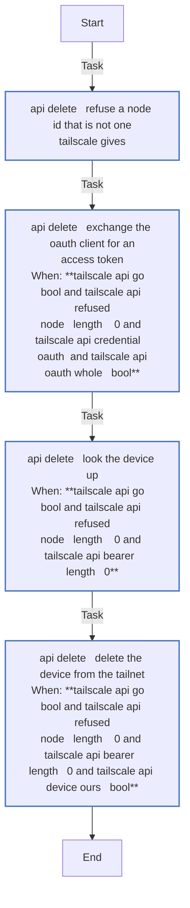

### `connect.yml`

| Task | Module | When |
|---|---|---|
| Record the login a pending sign-in of this role's ended in | `ansible.builtin.copy` | <code>tailscale_login_pending &#124; bool and tailscale_signed_in &#124; bool</code> |
| Read what this role has made, now that it has recorded the login | `ansible.builtin.include_tasks` | <code>tailscale_adopted is not skipped</code> |
| Fail when the key would go to a VM that joined before | `ansible.builtin.assert` | <code>tailscale_ours &#124; bool and tailscale_auth_method == 'key'</code> |
| Remember what tailscaled said before the join | `ansible.builtin.set_fact` | <code>not ansible_check_mode and tailscale_ours &#124; bool and tailscale_key_wanted &#124; bool and tailscale_first_join &#124; bool and not (tailscale_key_refused_locally &#124; bool)</code> |
| Join the tailnet with the key | `ansible.builtin.command` | <code>not ansible_check_mode and tailscale_ours &#124; bool and tailscale_key_wanted &#124; bool and tailscale_first_join &#124; bool and not (tailscale_key_refused_locally &#124; bool)</code> |
| Read the state after the join | `ansible.builtin.include_tasks` | <code>tailscale_join is not skipped</code> |
| Remember that this login is this role's | `ansible.builtin.copy` | <code>tailscale_join is not skipped and tailscale_signed_in &#124; bool</code> |
| Mark a join still under way as this role's | `ansible.builtin.copy` | <code>tailscale_join is not skipped and not (tailscale_signed_in &#124; bool) and tailscale_join_under_way &#124; bool</code> |
| Forget the sign-in a failed join ended | `ansible.builtin.file` | <code>tailscale_join is not skipped and not (tailscale_signed_in &#124; bool) and not (tailscale_join_under_way &#124; bool)</code> |
| Read what this role has made, now that it has joined | `ansible.builtin.include_tasks` | <code>tailscale_join is not skipped and tailscale_signed_in &#124; bool or tailscale_join_under_way &#124; bool</code> |
| Say whether the VM has had a login, for Proxmox to record | `ansible.builtin.set_fact` |  |

```mermaid
flowchart TD
Start
classDef block stroke:#3498db,stroke-width:2px;
classDef task stroke:#4b76bb,stroke-width:2px;
classDef includeTasks stroke:#16a085,stroke-width:2px;
classDef importTasks stroke:#34495e,stroke-width:2px;
classDef includeRole stroke:#2980b9,stroke-width:2px;
classDef importRole stroke:#699ba7,stroke-width:2px;
classDef includeVars stroke:#8e44ad,stroke-width:2px;
classDef rescue stroke:#665352,stroke-width:2px;

  Start-->|Task| connect___Record_the_login_a_pending_sign_in_of_this_role_s_ended_in0[connect   record the login a pending sign in of<br>this role s ended in<br>When: **tailscale login pending   bool and tailscale<br>signed in   bool**]:::task
  connect___Record_the_login_a_pending_sign_in_of_this_role_s_ended_in0-->|Include task| connect___Read_what_this_role_has_made__now_that_it_has_recorded_the_login_ownership_yml_1[connect   read what this role has made  now that<br>it has recorded the login<br>When: **tailscale adopted is not skipped**<br>include_task: ownership yml]:::includeTasks
  connect___Read_what_this_role_has_made__now_that_it_has_recorded_the_login_ownership_yml_1-->|Task| connect___Fail_when_the_key_would_go_to_a_VM_that_joined_before2[connect   fail when the key would go to a vm that<br>joined before<br>When: **tailscale ours   bool and tailscale auth method   <br> key**]:::task
  connect___Fail_when_the_key_would_go_to_a_VM_that_joined_before2-->|Task| connect___Remember_what_tailscaled_said_before_the_join3[connect   remember what tailscaled said before the<br>join<br>When: **not ansible check mode and tailscale ours   bool<br>and tailscale key wanted   bool and tailscale<br>first join   bool and not  tailscale key refused<br>locally   bool**]:::task
  connect___Remember_what_tailscaled_said_before_the_join3-->|Task| connect___Join_the_tailnet_with_the_key4[connect   join the tailnet with the key<br>When: **not ansible check mode and tailscale ours   bool<br>and tailscale key wanted   bool and tailscale<br>first join   bool and not  tailscale key refused<br>locally   bool**]:::task
  connect___Join_the_tailnet_with_the_key4-->|Include task| connect___Read_the_state_after_the_join_state_yml_5[connect   read the state after the join<br>When: **tailscale join is not skipped**<br>include_task: state yml]:::includeTasks
  connect___Read_the_state_after_the_join_state_yml_5-->|Task| connect___Remember_that_this_login_is_this_role_s6[connect   remember that this login is this role s<br>When: **tailscale join is not skipped and tailscale signed<br>in   bool**]:::task
  connect___Remember_that_this_login_is_this_role_s6-->|Task| connect___Mark_a_join_still_under_way_as_this_role_s7[connect   mark a join still under way as this role<br>s<br>When: **tailscale join is not skipped and not  tailscale<br>signed in   bool  and tailscale join under way  <br>bool**]:::task
  connect___Mark_a_join_still_under_way_as_this_role_s7-->|Task| connect___Forget_the_sign_in_a_failed_join_ended8[connect   forget the sign in a failed join ended<br>When: **tailscale join is not skipped and not  tailscale<br>signed in   bool  and not  tailscale join under<br>way   bool**]:::task
  connect___Forget_the_sign_in_a_failed_join_ended8-->|Include task| connect___Read_what_this_role_has_made__now_that_it_has_joined_ownership_yml_9[connect   read what this role has made  now that<br>it has joined<br>When: **tailscale join is not skipped and tailscale signed<br>in   bool or tailscale join under way   bool**<br>include_task: ownership yml]:::includeTasks
  connect___Read_what_this_role_has_made__now_that_it_has_joined_ownership_yml_9-->|Task| connect___Say_whether_the_VM_has_had_a_login__for_Proxmox_to_record10[connect   say whether the vm has had a login  for<br>proxmox to record]:::task
  connect___Say_whether_the_VM_has_had_a_login__for_Proxmox_to_record10-->End
```

### `install.yml`

| Task | Module | When |
|---|---|---|
| Make the directory for this project's markers | `ansible.builtin.file` |  |
| Mark Tailscale on this VM as this project's | `ansible.builtin.copy` |  |
| Make the drop-in directory for tailscaled | `ansible.builtin.file` | <code>not (tailscale_upload_logs &#124; bool)</code> |
| Keep tailscaled from uploading its logs, from its first start | `ansible.builtin.copy` | <code>not (tailscale_upload_logs &#124; bool)</code> |
| Leave tailscaled's log upload as Tailscale ships it | `ansible.builtin.file` | <code>tailscale_upload_logs &#124; bool</code> |
| Remove the source list Tailscale's own instructions write | `ansible.builtin.file` |  |
| Install what managing an apt repository needs | `ansible.builtin.apt` |  |
| Install Tailscale from its repository | block |  |
| &emsp;Add Tailscale's apt repository | `ansible.builtin.deb822_repository` |  |
| &emsp;Install Tailscale | `ansible.builtin.apt` | <code>not (tailscale_check_without_package &#124; bool)</code> |
| &emsp;*rescue:* | | |
| &emsp;&emsp;Ask dpkg whether the install got as far as the package | `ansible.builtin.command` |  |
| &emsp;&emsp;Take the repository back out while there is no package | `ansible.builtin.deb822_repository` | <code>tailscale_dpkg_after.stdout &#124; default('') != 'installed'</code> |
| &emsp;&emsp;Install Tailscale | `ansible.builtin.fail` |  |
| Hand tailscaled its extra flags | `ansible.builtin.lineinfile` | <code>not (tailscale_check_without_package &#124; bool)</code> |
| Reload systemd for the changed drop-in | `ansible.builtin.systemd_service` | <code>tailscale_dropin_on is changed or tailscale_dropin_off is changed</code> |
| Start tailscaled, and keep it enabled | `ansible.builtin.systemd_service` | <code>not (tailscale_check_without_package &#124; bool)</code> |

```mermaid
flowchart TD
Start
classDef block stroke:#3498db,stroke-width:2px;
classDef task stroke:#4b76bb,stroke-width:2px;
classDef includeTasks stroke:#16a085,stroke-width:2px;
classDef importTasks stroke:#34495e,stroke-width:2px;
classDef includeRole stroke:#2980b9,stroke-width:2px;
classDef importRole stroke:#699ba7,stroke-width:2px;
classDef includeVars stroke:#8e44ad,stroke-width:2px;
classDef rescue stroke:#665352,stroke-width:2px;

  Start-->|Task| install___Make_the_directory_for_this_project_s_markers0[install   make the directory for this project s<br>markers]:::task
  install___Make_the_directory_for_this_project_s_markers0-->|Task| install___Mark_Tailscale_on_this_VM_as_this_project_s1[install   mark tailscale on this vm as this<br>project s]:::task
  install___Mark_Tailscale_on_this_VM_as_this_project_s1-->|Task| install___Make_the_drop_in_directory_for_tailscaled2[install   make the drop in directory for<br>tailscaled<br>When: **not  tailscale upload logs   bool**]:::task
  install___Make_the_drop_in_directory_for_tailscaled2-->|Task| install___Keep_tailscaled_from_uploading_its_logs__from_its_first_start3[install   keep tailscaled from uploading its logs <br>from its first start<br>When: **not  tailscale upload logs   bool**]:::task
  install___Keep_tailscaled_from_uploading_its_logs__from_its_first_start3-->|Task| install___Leave_tailscaled_s_log_upload_as_Tailscale_ships_it4[install   leave tailscaled s log upload as<br>tailscale ships it<br>When: **tailscale upload logs   bool**]:::task
  install___Leave_tailscaled_s_log_upload_as_Tailscale_ships_it4-->|Task| install___Remove_the_source_list_Tailscale_s_own_instructions_write5[install   remove the source list tailscale s own<br>instructions write]:::task
  install___Remove_the_source_list_Tailscale_s_own_instructions_write5-->|Task| install___Install_what_managing_an_apt_repository_needs6[install   install what managing an apt repository<br>needs]:::task
  install___Install_what_managing_an_apt_repository_needs6-->|Block Start| install___Install_Tailscale_from_its_repository7_block_start_0[[install   install tailscale from its repository]]:::block
  install___Install_Tailscale_from_its_repository7_block_start_0-->|Task| install___Add_Tailscale_s_apt_repository0[install   add tailscale s apt repository]:::task
  install___Add_Tailscale_s_apt_repository0-->|Task| install___Install_Tailscale1[install   install tailscale<br>When: **not  tailscale check without package   bool**]:::task
  install___Install_Tailscale1-.->|End of Block| install___Install_Tailscale_from_its_repository7_block_start_0
  install___Install_Tailscale1-->|Rescue Start| install___Install_Tailscale_from_its_repository7_rescue_start_0[install   install tailscale from its repository]:::rescue
  install___Install_Tailscale_from_its_repository7_rescue_start_0-->|Task| install___Ask_dpkg_whether_the_install_got_as_far_as_the_package0[install   ask dpkg whether the install got as far<br>as the package]:::task
  install___Ask_dpkg_whether_the_install_got_as_far_as_the_package0-->|Task| install___Take_the_repository_back_out_while_there_is_no_package1[install   take the repository back out while there<br>is no package<br>When: **tailscale dpkg after stdout   default        <br>installed**]:::task
  install___Take_the_repository_back_out_while_there_is_no_package1-->|Task| install___Install_Tailscale2[install   install tailscale]:::task
  install___Install_Tailscale2-.->|End of Rescue Block| install___Install_Tailscale_from_its_repository7_block_start_0
  install___Install_Tailscale2-->|Task| install___Hand_tailscaled_its_extra_flags8[install   hand tailscaled its extra flags<br>When: **not  tailscale check without package   bool**]:::task
  install___Hand_tailscaled_its_extra_flags8-->|Task| install___Reload_systemd_for_the_changed_drop_in9[install   reload systemd for the changed drop in<br>When: **tailscale dropin on is changed or tailscale dropin<br>off is changed**]:::task
  install___Reload_systemd_for_the_changed_drop_in9-->|Task| install___Start_tailscaled__and_keep_it_enabled10[install   start tailscaled  and keep it enabled<br>When: **not  tailscale check without package   bool**]:::task
  install___Start_tailscaled__and_keep_it_enabled10-->End
```

### `login.yml` - entry point `login`

| Task | Module | When |
|---|---|---|
| Move this role's files from their 1.x names | `ansible.builtin.include_tasks` |  |
| Read what is installed, and who installed it | `ansible.builtin.include_tasks` |  |
| Read Tailscale's state | `ansible.builtin.include_tasks` | <code>tailscale_wanted &#124; bool and tailscale_installed &#124; bool</code> |
| Say why there is nothing to sign in | `ansible.builtin.debug` | <code>not (tailscale_wanted &#124; bool) or not (tailscale_installed &#124; bool)</code> |
| Keep what is left to do for the end of the run | `ansible.builtin.set_stats` | <code>not (tailscale_wanted &#124; bool) or not (tailscale_installed &#124; bool)</code> |
| Record whether the web login would sign this VM in | `ansible.builtin.set_fact` |  |
| Ask whether to sign this VM in to Tailscale now | `ansible.builtin.pause` | <code>tailscale_login_ask &#124; bool and tailscale_login_due &#124; bool</code> |
| Sign in by Tailscale's web login | `ansible.builtin.include_tasks` | <code>tailscale_login_go &#124; bool and tailscale_login_due &#124; bool</code> |
| Say whether the VM has had a login, for Proxmox to record | `ansible.builtin.set_fact` |  |
| Report how the VM is on Tailscale | `ansible.builtin.include_tasks` | <code>tailscale_wanted &#124; bool and tailscale_installed &#124; bool</code> |

```mermaid
flowchart TD
Start
classDef block stroke:#3498db,stroke-width:2px;
classDef task stroke:#4b76bb,stroke-width:2px;
classDef includeTasks stroke:#16a085,stroke-width:2px;
classDef importTasks stroke:#34495e,stroke-width:2px;
classDef includeRole stroke:#2980b9,stroke-width:2px;
classDef importRole stroke:#699ba7,stroke-width:2px;
classDef includeVars stroke:#8e44ad,stroke-width:2px;
classDef rescue stroke:#665352,stroke-width:2px;

  Start-->|Include task| login___Move_this_role_s_files_from_their_1_x_names_names_yml_0[login   move this role s files from their 1 x<br>names<br>include_task: names yml]:::includeTasks
  login___Move_this_role_s_files_from_their_1_x_names_names_yml_0-->|Include task| login___Read_what_is_installed__and_who_installed_it_ownership_yml_1[login   read what is installed  and who installed<br>it<br>include_task: ownership yml]:::includeTasks
  login___Read_what_is_installed__and_who_installed_it_ownership_yml_1-->|Include task| login___Read_Tailscale_s_state_state_yml_2[login   read tailscale s state<br>When: **tailscale wanted   bool and tailscale installed  <br>bool**<br>include_task: state yml]:::includeTasks
  login___Read_Tailscale_s_state_state_yml_2-->|Task| login___Say_why_there_is_nothing_to_sign_in3[login   say why there is nothing to sign in<br>When: **not  tailscale wanted   bool  or not  tailscale<br>installed   bool**]:::task
  login___Say_why_there_is_nothing_to_sign_in3-->|Task| login___Keep_what_is_left_to_do_for_the_end_of_the_run4[login   keep what is left to do for the end of the<br>run<br>When: **not  tailscale wanted   bool  or not  tailscale<br>installed   bool**]:::task
  login___Keep_what_is_left_to_do_for_the_end_of_the_run4-->|Task| login___Record_whether_the_web_login_would_sign_this_VM_in5[login   record whether the web login would sign<br>this vm in]:::task
  login___Record_whether_the_web_login_would_sign_this_VM_in5-->|Task| login___Ask_whether_to_sign_this_VM_in_to_Tailscale_now6[login   ask whether to sign this vm in to<br>tailscale now<br>When: **tailscale login ask   bool and tailscale login due<br>  bool**]:::task
  login___Ask_whether_to_sign_this_VM_in_to_Tailscale_now6-->|Include task| login___Sign_in_by_Tailscale_s_web_login_web_login_yml_7[login   sign in by tailscale s web login<br>When: **tailscale login go   bool and tailscale login due <br> bool**<br>include_task: web login yml]:::includeTasks
  login___Sign_in_by_Tailscale_s_web_login_web_login_yml_7-->|Task| login___Say_whether_the_VM_has_had_a_login__for_Proxmox_to_record8[login   say whether the vm has had a login  for<br>proxmox to record]:::task
  login___Say_whether_the_VM_has_had_a_login__for_Proxmox_to_record8-->|Include task| login___Report_how_the_VM_is_on_Tailscale_report_yml_9[login   report how the vm is on tailscale<br>When: **tailscale wanted   bool and tailscale installed  <br>bool**<br>include_task: report yml]:::includeTasks
  login___Report_how_the_VM_is_on_Tailscale_report_yml_9-->End
```

### `names.yml`

| Task | Module | When |
|---|---|---|
| Move the markers' directory to its name from 2.0 | `ansible.builtin.command` | <code>tailscale_marker_dir_1x &#124; length > 0</code> |
| Look for tailscaled's drop-in by its 1.x name | `ansible.builtin.stat` |  |
| Look for tailscaled's drop-in by its name from 2.0 | `ansible.builtin.stat` | <code>tailscale_names_dropin_1x.stat.exists</code> |
| Move tailscaled's drop-in to its name from 2.0 | `ansible.builtin.command` | <code>tailscale_names_dropin_1x.stat.exists and not tailscale_names_dropin.stat.exists and not ansible_check_mode</code> |
| Give the moved drop-in its comment from 2.0 | `ansible.builtin.replace` | <code>tailscale_names_dropin_1x.stat.exists and not tailscale_names_dropin.stat.exists and not ansible_check_mode</code> |
| Reload systemd for the drop-in's new name | `ansible.builtin.systemd_service` | <code>tailscale_names_dropin_1x.stat.exists and not tailscale_names_dropin.stat.exists and not ansible_check_mode</code> |

```mermaid
flowchart TD
Start
classDef block stroke:#3498db,stroke-width:2px;
classDef task stroke:#4b76bb,stroke-width:2px;
classDef includeTasks stroke:#16a085,stroke-width:2px;
classDef importTasks stroke:#34495e,stroke-width:2px;
classDef includeRole stroke:#2980b9,stroke-width:2px;
classDef importRole stroke:#699ba7,stroke-width:2px;
classDef includeVars stroke:#8e44ad,stroke-width:2px;
classDef rescue stroke:#665352,stroke-width:2px;

  Start-->|Task| names___Move_the_markers__directory_to_its_name_from_2_00[names   move the markers  directory to its name<br>from 2 0<br>When: **tailscale marker dir 1x   length   0**]:::task
  names___Move_the_markers__directory_to_its_name_from_2_00-->|Task| names___Look_for_tailscaled_s_drop_in_by_its_1_x_name1[names   look for tailscaled s drop in by its 1 x<br>name]:::task
  names___Look_for_tailscaled_s_drop_in_by_its_1_x_name1-->|Task| names___Look_for_tailscaled_s_drop_in_by_its_name_from_2_02[names   look for tailscaled s drop in by its name<br>from 2 0<br>When: **tailscale names dropin 1x stat exists**]:::task
  names___Look_for_tailscaled_s_drop_in_by_its_name_from_2_02-->|Task| names___Move_tailscaled_s_drop_in_to_its_name_from_2_03[names   move tailscaled s drop in to its name from<br>2 0<br>When: **tailscale names dropin 1x stat exists and not<br>tailscale names dropin stat exists and not ansible<br>check mode**]:::task
  names___Move_tailscaled_s_drop_in_to_its_name_from_2_03-->|Task| names___Give_the_moved_drop_in_its_comment_from_2_04[names   give the moved drop in its comment from 2<br>0<br>When: **tailscale names dropin 1x stat exists and not<br>tailscale names dropin stat exists and not ansible<br>check mode**]:::task
  names___Give_the_moved_drop_in_its_comment_from_2_04-->|Task| names___Reload_systemd_for_the_drop_in_s_new_name5[names   reload systemd for the drop in s new name<br>When: **tailscale names dropin 1x stat exists and not<br>tailscale names dropin stat exists and not ansible<br>check mode**]:::task
  names___Reload_systemd_for_the_drop_in_s_new_name5-->End
```

### `ownership.yml`

| Task | Module | When |
|---|---|---|
| Ask dpkg whether Tailscale is installed | `ansible.builtin.command` |  |
| Look for a Tailscale installed outside dpkg | `ansible.builtin.stat` |  |
| Look for the marker this role leaves when it installs Tailscale | `ansible.builtin.stat` |  |
| Look for that marker by its 1.x directory | `ansible.builtin.stat` | <code>not tailscale_installed_marker.stat.exists and tailscale_marker_dir_1x &#124; length > 0</code> |
| Read the node key of the login this role made | `ansible.builtin.slurp` |  |
| Read the node key of the login this role made, by its 1.x directory | `ansible.builtin.slurp` | <code>tailscale_joined_marker.content is not defined and tailscale_marker_dir_1x &#124; length > 0</code> |

```mermaid
flowchart TD
Start
classDef block stroke:#3498db,stroke-width:2px;
classDef task stroke:#4b76bb,stroke-width:2px;
classDef includeTasks stroke:#16a085,stroke-width:2px;
classDef importTasks stroke:#34495e,stroke-width:2px;
classDef includeRole stroke:#2980b9,stroke-width:2px;
classDef importRole stroke:#699ba7,stroke-width:2px;
classDef includeVars stroke:#8e44ad,stroke-width:2px;
classDef rescue stroke:#665352,stroke-width:2px;

  Start-->|Task| ownership___Ask_dpkg_whether_Tailscale_is_installed0[ownership   ask dpkg whether tailscale is<br>installed]:::task
  ownership___Ask_dpkg_whether_Tailscale_is_installed0-->|Task| ownership___Look_for_a_Tailscale_installed_outside_dpkg1[ownership   look for a tailscale installed outside<br>dpkg]:::task
  ownership___Look_for_a_Tailscale_installed_outside_dpkg1-->|Task| ownership___Look_for_the_marker_this_role_leaves_when_it_installs_Tailscale2[ownership   look for the marker this role leaves<br>when it installs tailscale]:::task
  ownership___Look_for_the_marker_this_role_leaves_when_it_installs_Tailscale2-->|Task| ownership___Look_for_that_marker_by_its_1_x_directory3[ownership   look for that marker by its 1 x<br>directory<br>When: **not tailscale installed marker stat exists and<br>tailscale marker dir 1x   length   0**]:::task
  ownership___Look_for_that_marker_by_its_1_x_directory3-->|Task| ownership___Read_the_node_key_of_the_login_this_role_made4[ownership   read the node key of the login this<br>role made]:::task
  ownership___Read_the_node_key_of_the_login_this_role_made4-->|Task| ownership___Read_the_node_key_of_the_login_this_role_made__by_its_1_x_directory5[ownership   read the node key of the login this<br>role made  by its 1 x directory<br>When: **tailscale joined marker content is not defined and<br>tailscale marker dir 1x   length   0**]:::task
  ownership___Read_the_node_key_of_the_login_this_role_made__by_its_1_x_directory5-->End
```

### `release.yml` - entry point `release`

| Task | Module | When |
|---|---|---|
| Look for tailscaled's unit | `ansible.builtin.stat` |  |
| Start tailscaled, so that its login can be ended | `ansible.builtin.systemd_service` | <code>tailscale_release_unit.stat.exists</code> |
| Read the node's state | `ansible.builtin.command` |  |
| Log the node out | `ansible.builtin.command` | <code>tailscale_release_joined &#124; bool</code> |
| Delete the node's device from the tailnet | `ansible.builtin.include_tasks` |  |
| Record what became of the node | `ansible.builtin.set_fact` |  |

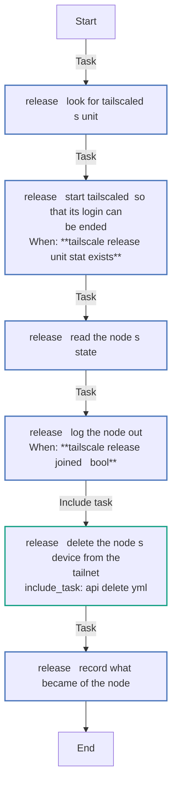

### `report.yml`

| Task | Module | When |
|---|---|---|
| Say how this VM is on Tailscale | `ansible.builtin.debug` |  |
| Keep what is left to do for the end of the run | `ansible.builtin.set_stats` |  |

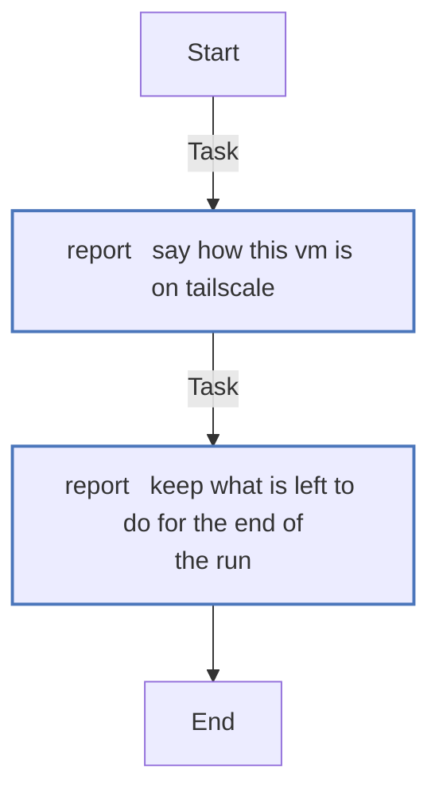

### `settings.yml`

| Task | Module | When |
|---|---|---|
| Change the settings that differ from what is configured | `ansible.builtin.command` | <code>tailscale_backend == 'Running' and tailscale_login_ours &#124; bool and tailscale_set_flags &#124; length > 0</code> |
| Read the state after the change | `ansible.builtin.include_tasks` | <code>tailscale_set is not skipped</code> |

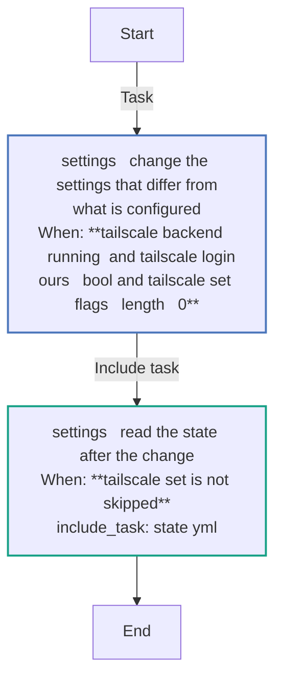

### `state.yml`

| Task | Module | When |
|---|---|---|
| Read Tailscale's state once it has settled | `ansible.builtin.command` | <code>not (tailscale_check_without_package &#124; bool)</code> |
| Fail when the tailscaled this role started does not answer | `ansible.builtin.assert` | <code>tailscale_ours &#124; bool and not ansible_check_mode and not (tailscale_check_without_package &#124; bool)</code> |
| Read the settings of a running node | `ansible.builtin.command` | <code>tailscale_backend == 'Running'</code> |

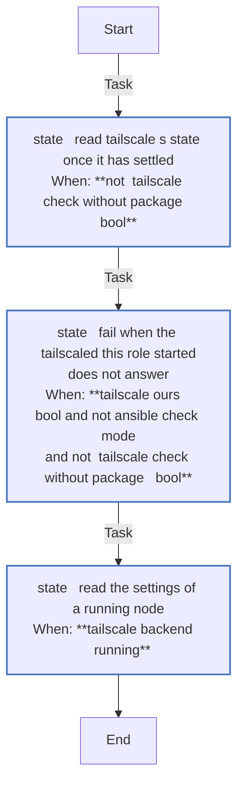

### `unmanaged.yml`

| Task | Module | When |
|---|---|---|
| Say that Tailscale is left as it is | `ansible.builtin.debug` | <code>tailscale_installed_marker_found &#124; bool</code> |

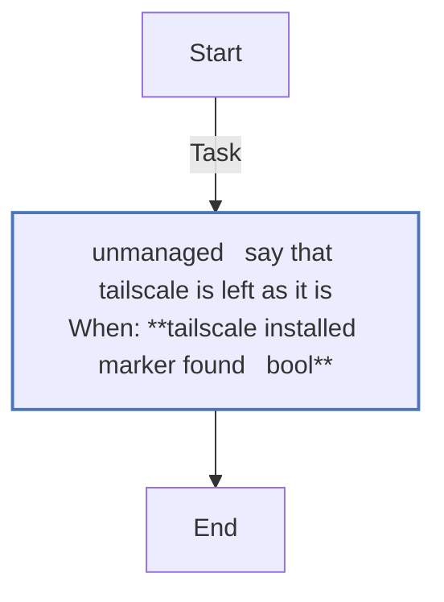

### `web_login.yml`

| Task | Module | When |
|---|---|---|
| Refuse more than one VM at a time | `ansible.builtin.assert` |  |
| Start the login inside tailscaled | `ansible.builtin.command` |  |
| Fail with what tailscale said, when it would not start the login | `ansible.builtin.assert` |  |
| Wait for the page's address | `ansible.builtin.command` |  |
| Fail when tailscale gave no sign-in page | `ansible.builtin.assert` |  |
| Mark the sign-in as this role's | `ansible.builtin.copy` | <code>tailscale_web_page &#124; length > 0</code> |
| Say where to sign in | `ansible.builtin.debug` | <code>tailscale_web_page &#124; length > 0</code> |
| Look for a browser opener on this machine | `ansible.builtin.command` | <code>tailscale_login_desktop &#124; bool and tailscale_web_page_trusted &#124; bool</code> |
| Open the sign-in page in your browser | `ansible.builtin.command` | <code>tailscale_login_desktop &#124; bool and tailscale_web_page_trusted &#124; bool and tailscale_web_opener &#124; length > 0</code> |
| Wait for the page to be approved | `ansible.builtin.command` |  |
| Read the state after the wait | `ansible.builtin.include_tasks` |  |
| Remember that this login is this role's | `ansible.builtin.copy` | <code>tailscale_signed_in &#124; bool</code> |
| Read what this role has made, after the sign-in | `ansible.builtin.include_tasks` |  |

```mermaid
flowchart TD
Start
classDef block stroke:#3498db,stroke-width:2px;
classDef task stroke:#4b76bb,stroke-width:2px;
classDef includeTasks stroke:#16a085,stroke-width:2px;
classDef importTasks stroke:#34495e,stroke-width:2px;
classDef includeRole stroke:#2980b9,stroke-width:2px;
classDef importRole stroke:#699ba7,stroke-width:2px;
classDef includeVars stroke:#8e44ad,stroke-width:2px;
classDef rescue stroke:#665352,stroke-width:2px;

  Start-->|Task| web_login___Refuse_more_than_one_VM_at_a_time0[web login   refuse more than one vm at a time]:::task
  web_login___Refuse_more_than_one_VM_at_a_time0-->|Task| web_login___Start_the_login_inside_tailscaled1[web login   start the login inside tailscaled]:::task
  web_login___Start_the_login_inside_tailscaled1-->|Task| web_login___Fail_with_what_tailscale_said__when_it_would_not_start_the_login2[web login   fail with what tailscale said  when it<br>would not start the login]:::task
  web_login___Fail_with_what_tailscale_said__when_it_would_not_start_the_login2-->|Task| web_login___Wait_for_the_page_s_address3[web login   wait for the page s address]:::task
  web_login___Wait_for_the_page_s_address3-->|Task| web_login___Fail_when_tailscale_gave_no_sign_in_page4[web login   fail when tailscale gave no sign in<br>page]:::task
  web_login___Fail_when_tailscale_gave_no_sign_in_page4-->|Task| web_login___Mark_the_sign_in_as_this_role_s5[web login   mark the sign in as this role s<br>When: **tailscale web page   length   0**]:::task
  web_login___Mark_the_sign_in_as_this_role_s5-->|Task| web_login___Say_where_to_sign_in6[web login   say where to sign in<br>When: **tailscale web page   length   0**]:::task
  web_login___Say_where_to_sign_in6-->|Task| web_login___Look_for_a_browser_opener_on_this_machine7[web login   look for a browser opener on this<br>machine<br>When: **tailscale login desktop   bool and tailscale web<br>page trusted   bool**]:::task
  web_login___Look_for_a_browser_opener_on_this_machine7-->|Task| web_login___Open_the_sign_in_page_in_your_browser8[web login   open the sign in page in your browser<br>When: **tailscale login desktop   bool and tailscale web<br>page trusted   bool and tailscale web opener  <br>length   0**]:::task
  web_login___Open_the_sign_in_page_in_your_browser8-->|Task| web_login___Wait_for_the_page_to_be_approved9[web login   wait for the page to be approved]:::task
  web_login___Wait_for_the_page_to_be_approved9-->|Include task| web_login___Read_the_state_after_the_wait_state_yml_10[web login   read the state after the wait<br>include_task: state yml]:::includeTasks
  web_login___Read_the_state_after_the_wait_state_yml_10-->|Task| web_login___Remember_that_this_login_is_this_role_s11[web login   remember that this login is this role<br>s<br>When: **tailscale signed in   bool**]:::task
  web_login___Remember_that_this_login_is_this_role_s11-->|Include task| web_login___Read_what_this_role_has_made__after_the_sign_in_ownership_yml_12[web login   read what this role has made  after<br>the sign in<br>include_task: ownership yml]:::includeTasks
  web_login___Read_what_this_role_has_made__after_the_sign_in_ownership_yml_12-->End
```

<!-- END_GENERATED: role -->
