```mermaid
flowchart TD
Start
classDef block stroke:#3498db,stroke-width:2px;
classDef task stroke:#4b76bb,stroke-width:2px;
classDef includeTasks stroke:#16a085,stroke-width:2px;
classDef importTasks stroke:#34495e,stroke-width:2px;
classDef includeRole stroke:#2980b9,stroke-width:2px;
classDef importRole stroke:#699ba7,stroke-width:2px;
classDef includeVars stroke:#8e44ad,stroke-width:2px;
classDef rescue stroke:#665352,stroke-width:2px;

  Start-->|Task| Look_for_the_tools_the_server_installer_needs0[look for the tools the server installer needs<br>When: **vscode server enabled   bool**]:::task
  Look_for_the_tools_the_server_installer_needs0-->|Task| Fail_when_the_host_cannot_run_VS_Code_Server1[fail when the host cannot run vs code server<br>When: **vscode server enabled   bool**]:::task
  Fail_when_the_host_cannot_run_VS_Code_Server1-->|Task| Ensure_sshd_privilege_separation_directory_exists2[ensure sshd privilege separation directory exists<br>When: **vscode server enabled   bool**]:::task
  Ensure_sshd_privilege_separation_directory_exists2-->|Task| Allow_the_port_forward_VS_Code_Server_is_reached_through3[allow the port forward vs code server is reached<br>through<br>When: **vscode server enabled   bool**]:::task
  Allow_the_port_forward_VS_Code_Server_is_reached_through3-->|Task| Remove_the_sshd_drop_in4[remove the sshd drop in<br>When: **not vscode server enabled   bool**]:::task
  Remove_the_sshd_drop_in4-->|Task| Find_where_the_editor_s_connection_will_come_from5[find where the editor s connection will come from<br>When: **vscode server enabled   bool**]:::task
  Find_where_the_editor_s_connection_will_come_from5-->|Task| Read_the_configuration_sshd_applies_to_the_editor_s_connection6[read the configuration sshd applies to the editor<br>s connection<br>When: **vscode server enabled   bool**]:::task
  Read_the_configuration_sshd_applies_to_the_editor_s_connection6-->|Task| Find_what_turns_forwarding_off__if_anything_does7[find what turns forwarding off  if anything does<br>When: **vscode server enabled   bool**]:::task
  Find_what_turns_forwarding_off__if_anything_does7-->|Task| Fail_when_sshd_does_not_allow_the_forwarding_VS_Code_needs8[fail when sshd does not allow the forwarding vs<br>code needs<br>When: **vscode server enabled   bool**]:::task
  Fail_when_sshd_does_not_allow_the_forwarding_VS_Code_needs8-->|Task| Raise_the_inotify_watch_limit_for_VS_Code_s_file_watcher9[raise the inotify watch limit for vs code s file<br>watcher<br>When: **vscode server enabled   bool**]:::task
  Raise_the_inotify_watch_limit_for_VS_Code_s_file_watcher9-->|Task| Remove_the_inotify_setting10[remove the inotify setting<br>When: **not vscode server enabled   bool**]:::task
  Remove_the_inotify_setting10-->End
```

# `vscode_server`

What VS Code's Remote - SSH extension needs on the VM: an sshd drop-in that keeps port forwarding on, checked against what sshd will really apply to the editor's connection, keepalives, and a higher inotify limit. `TAGS=vscode_server` runs it alone; `vscode_remote: false` removes it.

Using it: [VS Code](../../guides/vscode.md#what-the-vm-gets). How it works: [§5.7](../../architecture/roles.md#57-vscode_server--what-vs-codes-remote---ssh-needs-on-the-host).

<!-- BEGIN_GENERATED: role -->
<!-- Generated by `make docs` from roles/vscode_server/meta/argument_specs.yml, vars/main.yml and tasks/: edit that, not this section. -->

## Entry point `main`

**Make a VM ready for VS Code's Remote - SSH extension**

Writes an sshd drop-in that keeps the port forwarding VS Code Server is reached through enabled and adds keepalives, asserts the values sshd actually runs with, and raises the inotify watch limit VS Code's file watcher needs. Disabled, it removes both files.

| Variable | Type | Default | Description |
|---|---|---|---|
| `vscode_server_enabled` | bool | `true` | Write the sshd drop-in and the inotify limit, and check what sshd applies. false removes both files. Set through vscode_remote in local.yml. |
| `vscode_server_user` | str | `dev` | The user VS Code connects as, whose connection the sshd check evaluates Match blocks for. Set through vm_user in local.yml. |
| `vscode_server_client_alive_interval` | int | `60` | Seconds of silence after which sshd checks that a connection is alive (ClientAliveInterval); the drop-in sets it for every SSH connection, the editor's included. |
| `vscode_server_client_alive_count_max` | int | `3` | Unanswered checks after which sshd drops the connection (ClientAliveCountMax), so a client that went to sleep is reaped after interval times count seconds. |
| `vscode_server_inotify_watches` | int | `524288` | fs.inotify.max_user_watches, raised for VS Code's file watcher on a large workspace. |
| `vscode_server_container_virt_types` | list of `str` | `["docker", "container", "containerd", "podman", "lxc"]` | Virtualisation types under which /proc/sys is read-only, so the sysctl file is written but not applied. |

## Tasks

Every task in `roles/vscode_server/tasks/`, file by file, in the order the file lists them, with a flowchart of
each file. Generated from the task files, so a task added, renamed or removed shows here on the next `make docs`.

### `main.yml` - entry point `main`

| Task | Module | When |
|---|---|---|
| Look for the tools the server installer needs | `ansible.builtin.command` | <code>vscode_server_enabled &#124; bool</code> |
| Fail when the host cannot run VS Code Server | `ansible.builtin.assert` | <code>vscode_server_enabled &#124; bool</code> |
| Ensure sshd privilege separation directory exists | `ansible.builtin.file` | <code>vscode_server_enabled &#124; bool</code> |
| Allow the port forward VS Code Server is reached through | `ansible.builtin.template` | <code>vscode_server_enabled &#124; bool</code> |
| Remove the sshd drop-in | `ansible.builtin.file` | <code>not vscode_server_enabled &#124; bool</code> |
| Find where the editor's connection will come from | `ansible.builtin.command` | <code>vscode_server_enabled &#124; bool</code> |
| Read the configuration sshd applies to the editor's connection | `ansible.builtin.command` | <code>vscode_server_enabled &#124; bool</code> |
| Find what turns forwarding off, if anything does | `ansible.builtin.find` | <code>vscode_server_enabled &#124; bool</code> |
| Fail when sshd does not allow the forwarding VS Code needs | `ansible.builtin.assert` | <code>vscode_server_enabled &#124; bool</code> |
| Raise the inotify watch limit for VS Code's file watcher | `ansible.posix.sysctl` | <code>vscode_server_enabled &#124; bool</code> |
| Remove the inotify setting | `ansible.builtin.file` | <code>not vscode_server_enabled &#124; bool</code> |

<!-- END_GENERATED: role -->
